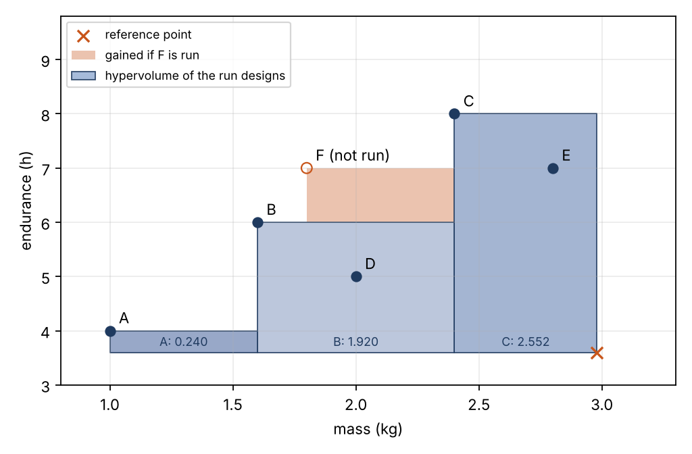
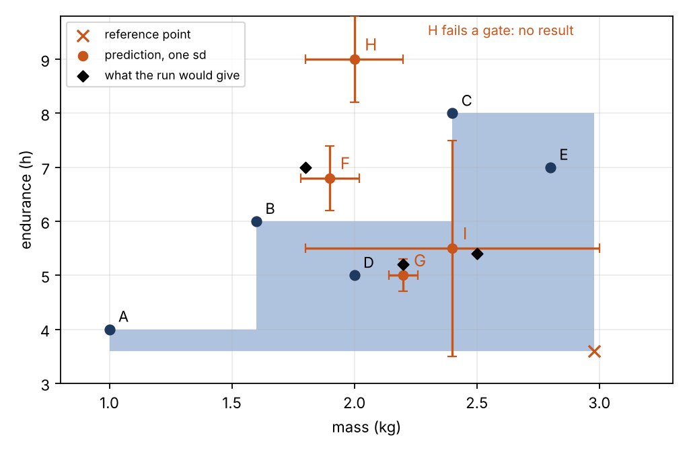
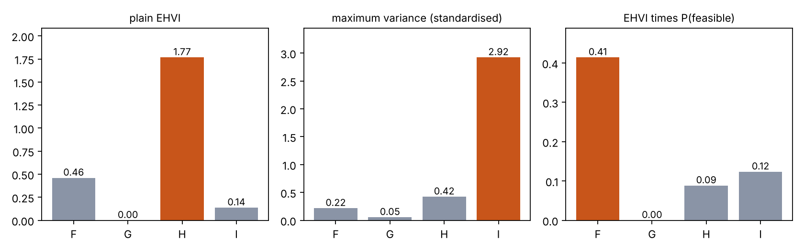

# A worked example of active learning

This document shows the arithmetic behind slides 14 to 16 on a small problem with nine designs. The problem is a teaching example. It is not a study result. The script `analysis/toy_active_learning.py` computes each number with the study's own functions in `surrogate/acquisition.py`. The numbers below come from the script, and a test checks them.

## 1. The setting

Each design has two goals: more endurance and less mass. The code works with both goals in the form "smaller is better". It uses negative endurance and the mass. The study uses the logarithm of the mass. This example uses the mass itself, because it is easier to check by hand.

Five designs have run. Their results are known.

| Design | Endurance (h) | Mass (kg) |
|---|---|---|
| A | 4 | 1 |
| B | 6 | 1.6 |
| C | 8 | 2.4 |
| D | 5 | 2 |
| E | 7 | 2.8 |

Four designs have not run. We call them candidates. The model gives a prediction for each candidate: a mean and a spread (one standard deviation) for each goal. In the study, two Gaussian processes give these predictions. Here we choose them by hand, so that each one teaches a point.

| Candidate | Predicted endurance (h) | Predicted mass (kg) | P(feasible) |
|---|---|---|---|
| F | 6.8 ± 0.6 | 1.9 ± 0.12 | 0.9 |
| G | 5 ± 0.3 | 2.2 ± 0.06 | 0.9 |
| H | 9 ± 0.8 | 2 ± 0.2 | 0.05 |
| I | 5.5 ± 2 | 2.4 ± 0.6 | 0.9 |

We also know what each run would give. The strategies do not know this.

F would give 7 h at 1.8 kg. G would give 5.2 h at 2.2 kg. I would give 5.4 h at 2.5 kg. H fails a gate. A run of H gives no result.

## 2. Step 1: the front

A design is on the front if no other design is better on both goals. Here D is worse than B on both goals. E is worse than C on both goals. So the front of the run designs is A, B, C.

## 3. Step 2: the hypervolume

The hypervolume is the area that the front covers, up to a reference point. The code takes the reference point from the worst value of each goal, plus a tenth of its range. Here it is 3.6 h and 2.98 kg.

Sort the front from the best endurance to the worst. Each front design adds one strip. A strip is a rectangle in Figure 1. It spans the endurance from the reference point up to the design. It spans the mass from the design up to the previous strip. The first strip ends at the reference mass.

| Design | Endurance range (h) | Endurance span (h) | Mass range (kg) | Mass span (kg) | Area |
|---|---|---|---|---|---|
| C | 3.6 to 8 | 4.40 | 2.4 to 2.98 | 0.58 | 2.552 |
| B | 3.6 to 6 | 2.40 | 1.6 to 2.4 | 0.80 | 1.920 |
| A | 3.6 to 4 | 0.40 | 1 to 1.6 | 0.60 | 0.240 |

The hypervolume of the run designs is the sum of the three areas: 4.712. Figure 1 shows the strips in blue. The code adds the strips in the same way.

## 4. Step 3: the regret

The true front uses all clean designs: the five that have run and the three clean candidates. H is not clean, because it fails a gate. The true front is A, B, C, F. Its hypervolume is 5.312.

Regret is the missing share: 1 − 4.712 / 5.312 = 0.113. A regret of 0 means we have the whole front.

## 5. Step 4: the improvement from one result

Suppose we run F and it gives its true value. The front gains the orange area in Figure 1. That area is the hypervolume improvement. Here it is 0.600, the same as the new hypervolume minus the old one. The regret then falls to 0.000.

## 6. Step 5: the expected improvement

Before the run, we do not know the result. We know only the prediction for F. So we draw possible results from the prediction, and we average their improvements. The table shows four draws.

| Draw | Endurance (h) | Mass (kg) | Improvement |
|---|---|---|---|
| 1 | 6.59 | 2.00 | 0.238 |
| 2 | 6.60 | 1.74 | 0.395 |
| 3 | 6.26 | 1.95 | 0.115 |
| 4 | 7.12 | 1.97 | 0.483 |

The mean of the four improvements is 0.308. This is a rough estimate of the expected improvement of F. The study uses 128 draws. With 128 draws, the estimate for F is 0.460. With 20,000 draws it is 0.419. More draws make the estimate steadier.

## 7. Step 6: three strategies choose

Figure 2 shows the predictions. Each orange dot is a predicted mean. Its bars are one standard deviation. Each black diamond is what the run would give. H has no diamond, because it fails a gate.

Figure 3 shows the score of each candidate under three strategies. The orange bar is the choice of each strategy.

The standardised variance is the sum of the two predicted variances. Each one is divided by the variance of that goal over the run designs. The study uses the scale that each Gaussian process sees.

| Candidate | EHVI | Standardised variance | P(feasible) | EHVI × P |
|---|---|---|---|---|
| F | 0.460 | 0.22 | 0.9 | 0.414 |
| G | 0.000 | 0.05 | 0.9 | 0.000 |
| H | 1.767 | 0.42 | 0.05 | 0.088 |
| I | 0.137 | 2.92 | 0.9 | 0.123 |

Plain EHVI chooses H. The model predicts that H has a long endurance at a low mass, so its expected improvement is large. The model does not know that H fails a gate.

Maximum variance chooses I. The model is least sure about I. It does not ask if I is a good design.

EHVI times P(feasible) chooses F. The small value of P(feasible) for H removes H from the race.

Random choice and the Latin hypercube use no model. Random choice picks one of the four candidates with equal chance.

## 8. Step 7: what each choice costs

| If we run | Result | Regret after |
|---|---|---|
| F | 7 h at 1.8 kg | 0.000 |
| G | 5.2 h at 2.2 kg | 0.113 |
| H | fails a gate: no result | 0.113 |
| I | 5.4 h at 2.5 kg | 0.113 |

Plain EHVI wastes its run on H. The regret stays at 0.113. Maximum variance wastes its run on I, a design that the front already beats. Only F closes the gap, to 0.000. Random choice has an expected regret of 0.085.

## 9. How this maps to the slides

- Slide 14 shows the equations for the improvement of one result (Step 4), the expected improvement (Step 5) and the maximum variance score (Step 6).
- Slide 15 uses regret (Step 3) on a pool where no design fails a gate. Here the plain method does well.
- Slide 16 is the open box. Some designs fail a gate. The plain method then picks designs like H, and it loses. The feasibility weight (Step 6) fixes that.
- Backup slide 41 defines the hypervolume and the regret (Steps 2 and 3).

## 10. What the study does differently

- The two goals are endurance and the logarithm of the mass.
- Two Gaussian processes give the predictions. They are fitted on the runs so far, and they change after each run.
- The inputs are six numbers, not the names A to I.
- A logistic regression gives P(feasible) from the gate results so far.
- The study draws 128 samples for each candidate. This is the number that Steps 5 and 6 use for EHVI.

## 11. Check yourself

1. Why does a design that the front already beats add nothing? Answer: it adds no area to the front, so its improvement is 0.
2. Why does maximum variance choose I? Answer: I has the largest spread, and the score counts only spread.
3. Why does P(feasible) help on the open box? Answer: it lowers the score of designs that the model likes but that fail a gate.
4. What does a regret of 0 mean? Answer: the run designs already give the whole true front.
