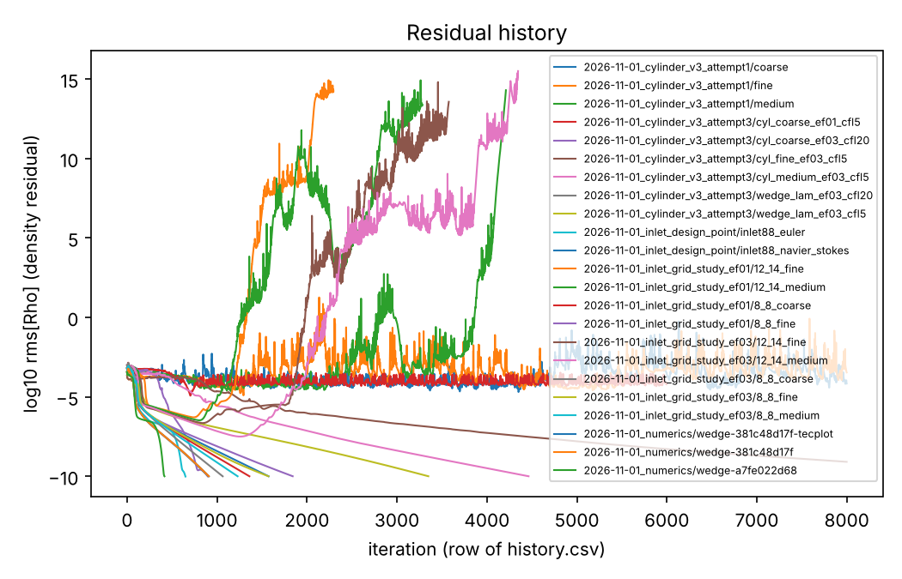
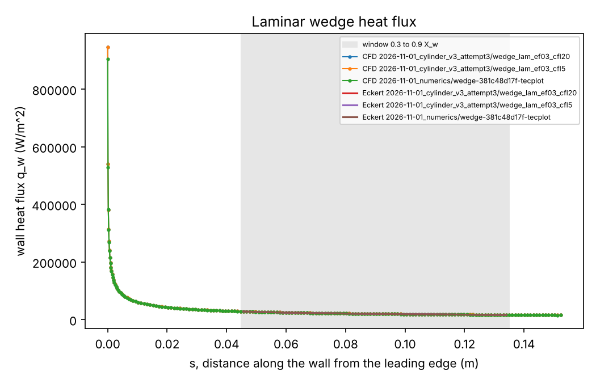
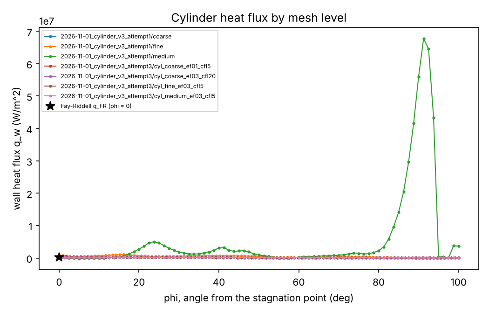
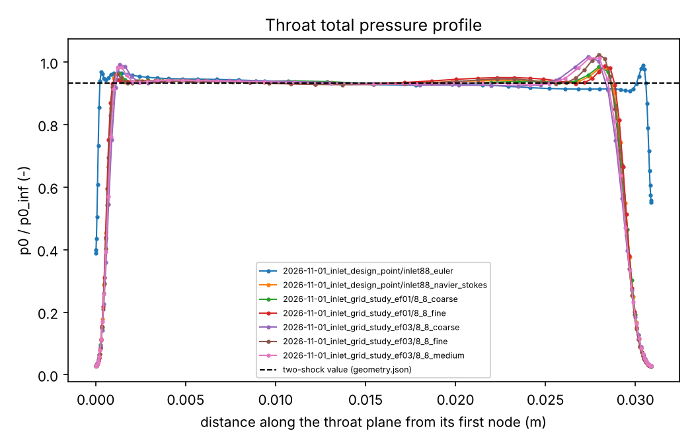
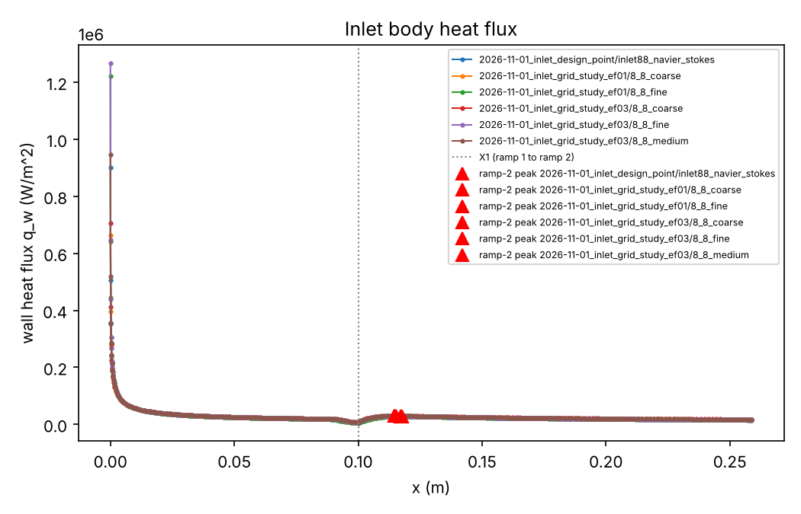
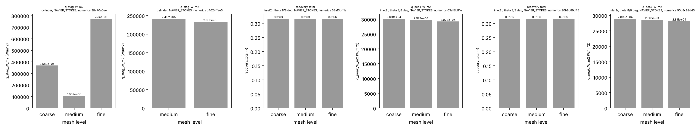

# Validation report, 2026-11-01

Generated by `python -m postprocess.report --out docs/validation --date 2026-11-01 --cases runs/dev/2026-11-01_cylinder_v3_attempt1/coarse runs/dev/2026-11-01_cylinder_v3_attempt1/fine runs/dev/2026-11-01_cylinder_v3_attempt1/medium runs/dev/2026-11-01_cylinder_v3_attempt3/cyl_coarse_ef01_cfl5 runs/dev/2026-11-01_cylinder_v3_attempt3/cyl_coarse_ef03_cfl20 runs/dev/2026-11-01_cylinder_v3_attempt3/cyl_fine_ef03_cfl5 runs/dev/2026-11-01_cylinder_v3_attempt3/cyl_medium_ef03_cfl5 runs/dev/2026-11-01_cylinder_v3_attempt3/wedge_lam_ef03_cfl20 runs/dev/2026-11-01_cylinder_v3_attempt3/wedge_lam_ef03_cfl5 runs/dev/2026-11-01_inlet_design_point/inlet88_euler runs/dev/2026-11-01_inlet_design_point/inlet88_navier_stokes runs/dev/2026-11-01_inlet_grid_study_ef01/12_14_fine runs/dev/2026-11-01_inlet_grid_study_ef01/12_14_medium runs/dev/2026-11-01_inlet_grid_study_ef01/8_8_coarse runs/dev/2026-11-01_inlet_grid_study_ef01/8_8_fine runs/dev/2026-11-01_inlet_grid_study_ef03/12_14_fine runs/dev/2026-11-01_inlet_grid_study_ef03/12_14_medium runs/dev/2026-11-01_inlet_grid_study_ef03/8_8_coarse runs/dev/2026-11-01_inlet_grid_study_ef03/8_8_fine runs/dev/2026-11-01_inlet_grid_study_ef03/8_8_medium runs/dev/2026-11-01_numerics/wedge-381c48d17f-tecplot runs/dev/2026-11-01_numerics/wedge-381c48d17f runs/dev/2026-11-01_numerics/wedge-a7fe022d68 runs/task1/wedge-3c92249afa runs/task1/wedge-c1f497b16b runs/task1/wedge-db7ce9974a runs/task1/wedge-fff1623e77`.

Verdicts: PASS and FAIL are checked against the tolerance; REPORT is reported without a gate; `not run` means the check could not run, and the Measured column gives the reason.

## Cases

| Case id | Family | Level | Solver | Mesh | Status | Iterations | Notes |
|---|---|---|---|---|---|---|---|
| 2026-11-01_cylinder_v3_attempt1/coarse | cylinder | coarse | NAVIER_STOKES | regenerated, fingerprint not recorded | not_converged | 8000 | - |
| 2026-11-01_cylinder_v3_attempt1/fine | cylinder | fine | NAVIER_STOKES | regenerated, fingerprint not recorded | not_converged | 8000 | - |
| 2026-11-01_cylinder_v3_attempt1/medium | cylinder | medium | NAVIER_STOKES | regenerated, fingerprint not recorded | not_converged | 4212 | - |
| 2026-11-01_cylinder_v3_attempt3/cyl_coarse_ef01_cfl5 | cylinder | coarse | NAVIER_STOKES | regenerated, fingerprint not recorded | not_converged | 6000 | - |
| 2026-11-01_cylinder_v3_attempt3/cyl_coarse_ef03_cfl20 | cylinder | coarse | NAVIER_STOKES | regenerated, fingerprint not recorded | converged | 897 | - |
| 2026-11-01_cylinder_v3_attempt3/cyl_fine_ef03_cfl5 | cylinder | fine | NAVIER_STOKES | regenerated, fingerprint not recorded | converged | 8000 | - |
| 2026-11-01_cylinder_v3_attempt3/cyl_medium_ef03_cfl5 | cylinder | medium | NAVIER_STOKES | regenerated, fingerprint not recorded | converged | 4464 | - |
| 2026-11-01_cylinder_v3_attempt3/wedge_lam_ef03_cfl20 | wedge | medium | NAVIER_STOKES | regenerated, fingerprint not recorded | converged | 903 | - |
| 2026-11-01_cylinder_v3_attempt3/wedge_lam_ef03_cfl5 | wedge | medium | NAVIER_STOKES | regenerated, fingerprint not recorded | converged | 3350 | - |
| 2026-11-01_inlet_design_point/inlet88_euler | inlet2r | medium | EULER | regenerated, fingerprint not recorded | converged | 650 | job.json has only mesh_sha256; regenerated mesh bytes equal |
| 2026-11-01_inlet_design_point/inlet88_navier_stokes | inlet2r | medium | NAVIER_STOKES | regenerated, fingerprint not recorded | converged | 1574 | job.json has only mesh_sha256; regenerated mesh bytes equal |
| 2026-11-01_inlet_grid_study_ef01/12_14_fine | inlet2r | fine | NAVIER_STOKES | regenerated, fingerprint not recorded | not_converged | 2295 | throat profile not plotted: ValueError: marker outlet_duct: pressure from the conservative variables differs from SU2's column by more than 0.001 relative at node 49 (1.35728e+09 against 2.57665e+09); check the units; inlet heat flux not plotted: ValueError: marker outlet_duct: pressure from the conservative variables differs from SU2's column by more than 0.001 relative at node 49 (1.35728e+09 against 2.57665e+09); check the units |
| 2026-11-01_inlet_grid_study_ef01/12_14_medium | inlet2r | medium | NAVIER_STOKES | regenerated, fingerprint not recorded | not_converged | 3284 | throat profile not plotted: ValueError: marker outlet_duct: pressure from the conservative variables differs from SU2's column by more than 0.001 relative at node 24 (4.0258e+13 against 4.00825e+13); check the units; inlet heat flux not plotted: ValueError: marker outlet_duct: pressure from the conservative variables differs from SU2's column by more than 0.001 relative at node 24 (4.0258e+13 against 4.00825e+13); check the units |
| 2026-11-01_inlet_grid_study_ef01/8_8_coarse | inlet2r | coarse | NAVIER_STOKES | regenerated, fingerprint not recorded | converged | 1361 | - |
| 2026-11-01_inlet_grid_study_ef01/8_8_fine | inlet2r | fine | NAVIER_STOKES | regenerated, fingerprint not recorded | converged | 1842 | - |
| 2026-11-01_inlet_grid_study_ef03/12_14_fine | inlet2r | fine | NAVIER_STOKES | regenerated, fingerprint not recorded | not_converged | 3577 | throat profile not plotted: ValueError: marker outlet_duct: pressure from the conservative variables differs from SU2's column by more than 0.001 relative at node 34 (1.18911e+13 against 1.19062e+13); check the units; inlet heat flux not plotted: ValueError: marker outlet_duct: pressure from the conservative variables differs from SU2's column by more than 0.001 relative at node 34 (1.18911e+13 against 1.19062e+13); check the units |
| 2026-11-01_inlet_grid_study_ef03/12_14_medium | inlet2r | medium | NAVIER_STOKES | regenerated, fingerprint not recorded | not_converged | 4347 | throat profile not plotted: ValueError: marker outlet_duct: pressure from the conservative variables differs from SU2's column by more than 0.001 relative at node 29 (2.30004e+06 against 2.27773e+06); check the units; inlet heat flux not plotted: ValueError: marker outlet_duct: pressure from the conservative variables differs from SU2's column by more than 0.001 relative at node 29 (2.30004e+06 against 2.27773e+06); check the units |
| 2026-11-01_inlet_grid_study_ef03/8_8_coarse | inlet2r | coarse | NAVIER_STOKES | regenerated, fingerprint not recorded | converged | 1064 | - |
| 2026-11-01_inlet_grid_study_ef03/8_8_fine | inlet2r | fine | NAVIER_STOKES | regenerated, fingerprint not recorded | converged | 1572 | - |
| 2026-11-01_inlet_grid_study_ef03/8_8_medium | inlet2r | medium | NAVIER_STOKES | regenerated, fingerprint not recorded | converged | 1230 | - |
| 2026-11-01_numerics/wedge-381c48d17f-tecplot | wedge | medium | NAVIER_STOKES | regenerated, fingerprint not recorded | converged | 910 | job.json has only mesh_sha256; regenerated mesh bytes equal |
| 2026-11-01_numerics/wedge-381c48d17f | wedge | medium | NAVIER_STOKES | regenerated, fingerprint not recorded | converged | 910 | job.json has only mesh_sha256; regenerated mesh bytes equal |
| 2026-11-01_numerics/wedge-a7fe022d68 | wedge | medium | EULER | regenerated, fingerprint not recorded | converged | 417 | job.json has only mesh_sha256; regenerated mesh bytes equal |
| task1/wedge-3c92249afa | wedge | medium | EULER | regenerated, fingerprint not recorded | no history | - | job.json has only mesh_sha256; regenerated mesh bytes differ |
| task1/wedge-c1f497b16b | wedge | medium | NAVIER_STOKES | regenerated, fingerprint not recorded | no history | - | job.json has only mesh_sha256; regenerated mesh bytes differ |
| task1/wedge-db7ce9974a | wedge | medium | NAVIER_STOKES | regenerated, fingerprint not recorded | no history | - | job.json has only mesh_sha256; regenerated mesh bytes differ |
| task1/wedge-fff1623e77 | wedge | medium | NAVIER_STOKES | regenerated, fingerprint not recorded | no history | - | job.json has only mesh_sha256; regenerated mesh bytes differ |

## Tolerance table (00_decisions.md section 5)

| Id | Quantity | Tolerance | Type | Measured | Verdict |
|---|---|---|---|---|---|
| V1 | beta of the Euler wedge (Colab run) | +-0.5 deg | hard | +0.132 deg (stored in runs/task1/v1_oblique_shock.json) | PASS |
| V1 | p2/p1 vs oblique shock of the Euler wedge (Colab run) | 2% | hard | -0.12% (stored in runs/task1/v1_oblique_shock.json) | PASS |
| V1 | M2 vs oblique shock of the Euler wedge (Colab run) | 2% | hard | -0.19% (stored in runs/task1/v1_oblique_shock.json) | PASS |
| V1 | beta, p2/p1, M2 (2026-11-01_numerics/wedge-a7fe022d68) | beta +-0.5 deg; p2/p1 and M2 2 percent | hard | not run: flow.dat absent | not run |
| V1 | beta, p2/p1, M2 (task1/wedge-3c92249afa) | beta +-0.5 deg; p2/p1 and M2 2 percent | hard | not run: flow.dat absent | not run |
| V2a | plateau p vs inviscid, laminar wedge 10 deg (Colab run) | plateau p vs inviscid +0 to +6 percent | report | +1.69 percent, inside the +0 to +6 percent band (stored in runs/task1/v2a.json; its check block gives p2/p1 +1.57%) | REPORT |
| V2b | q_w vs Eckert flat plate, 0.3 <= x/X_w <= 0.9 (2026-11-01_cylinder_v3_attempt3/wedge_lam_ef03_cfl20) | mean 10 percent, max 15 percent | hard | mean 1.60%, max 1.95% (88 nodes) | PASS |
| V2b | q_w vs Eckert flat plate, 0.3 <= x/X_w <= 0.9 (2026-11-01_cylinder_v3_attempt3/wedge_lam_ef03_cfl5) | mean 10 percent, max 15 percent | hard | mean 1.60%, max 1.95% (88 nodes) | PASS |
| V2b | q_w vs Eckert flat plate, 0.3 <= x/X_w <= 0.9 (2026-11-01_numerics/wedge-381c48d17f-tecplot) | mean 10 percent, max 15 percent | hard | mean 0.75%, max 1.10% (88 nodes) | PASS |
| V2b | q_w vs Eckert flat plate, 0.3 <= x/X_w <= 0.9 (2026-11-01_numerics/wedge-381c48d17f) | mean 10 percent, max 15 percent | hard | not run: surface_flow.dat absent | not run |
| V2b | q_w vs Eckert flat plate, 0.3 <= x/X_w <= 0.9 (task1/wedge-c1f497b16b) | mean 10 percent, max 15 percent | hard | not run: surface_flow.dat absent | not run |
| V2b | q_w vs Eckert flat plate, 0.3 <= x/X_w <= 0.9 (task1/wedge-db7ce9974a) | mean 10 percent, max 15 percent | hard | not run: surface_flow.dat absent | not run |
| V2b | q_w vs Eckert flat plate, 0.3 <= x/X_w <= 0.9 (task1/wedge-fff1623e77) | mean 10 percent, max 15 percent | hard | not run: surface_flow.dat absent | not run |
| V3 | q_stag vs Fay-Riddell (2026-11-01_cylinder_v3_attempt1/coarse) | 15 percent (fine mesh) | hard | q_stag 3.689e+05 W/m^2, Fay-Riddell 2.443e+05 W/m^2, error +50.99%; level coarse, the tolerance applies to the fine mesh | REPORT |
| V3 | q_stag vs Fay-Riddell (2026-11-01_cylinder_v3_attempt1/fine) | 15 percent (fine mesh) | hard | q_stag 7.74e+05 W/m^2, Fay-Riddell 2.443e+05 W/m^2, error +216.84% | FAIL |
| V3 | q_stag vs Fay-Riddell (2026-11-01_cylinder_v3_attempt1/medium) | 15 percent (fine mesh) | hard | q_stag 1.062e+05 W/m^2, Fay-Riddell 2.443e+05 W/m^2, error -56.53%; level medium, the tolerance applies to the fine mesh | REPORT |
| V3 | q_stag vs Fay-Riddell (2026-11-01_cylinder_v3_attempt3/cyl_coarse_ef01_cfl5) | 15 percent (fine mesh) | hard | q_stag 4.941e+05 W/m^2, Fay-Riddell 2.443e+05 W/m^2, error +102.25%; level coarse, the tolerance applies to the fine mesh | REPORT |
| V3 | q_stag vs Fay-Riddell (2026-11-01_cylinder_v3_attempt3/cyl_coarse_ef03_cfl20) | 15 percent (fine mesh) | hard | q_stag 2.436e+05 W/m^2, Fay-Riddell 2.443e+05 W/m^2, error -0.27%; level coarse, the tolerance applies to the fine mesh | REPORT |
| V3 | q_stag vs Fay-Riddell (2026-11-01_cylinder_v3_attempt3/cyl_fine_ef03_cfl5) | 15 percent (fine mesh) | hard | q_stag 2.333e+05 W/m^2, Fay-Riddell 2.443e+05 W/m^2, error -4.49% | PASS |
| V3 | q_stag vs Fay-Riddell (2026-11-01_cylinder_v3_attempt3/cyl_medium_ef03_cfl5) | 15 percent (fine mesh) | hard | q_stag 2.417e+05 W/m^2, Fay-Riddell 2.443e+05 W/m^2, error -1.07%; level medium, the tolerance applies to the fine mesh | REPORT |
| V3 grid | q_stag_W_m2 medium to fine, cylinder, NAVIER_STOKES, numerics 3ffc70a5ee | 5% | hard | +628.92% (levels: coarse 2026-11-01_cylinder_v3_attempt1/coarse; medium 2026-11-01_cylinder_v3_attempt1/medium; fine 2026-11-01_cylinder_v3_attempt1/fine) | FAIL |
| V3 grid | q_stag_W_m2 medium to fine, cylinder, NAVIER_STOKES, numerics d4024ffae5 | 5% | hard | -3.46% (levels: medium 2026-11-01_cylinder_v3_attempt3/cyl_medium_ef03_cfl5; fine 2026-11-01_cylinder_v3_attempt3/cyl_fine_ef03_cfl5) | PASS |
| V3 stand-off | stand-off / R vs Billig (2026-11-01_cylinder_v3_attempt1/coarse) | 15 percent vs Billig | report | not run: standoff_over_R not computed: no flow.dat (run with save_volume) | not run |
| V3 stand-off | stand-off / R vs Billig (2026-11-01_cylinder_v3_attempt1/fine) | 15 percent vs Billig | report | not run: standoff_over_R not computed: no flow.dat (run with save_volume) | not run |
| V3 stand-off | stand-off / R vs Billig (2026-11-01_cylinder_v3_attempt1/medium) | 15 percent vs Billig | report | not run: standoff_over_R not computed: no flow.dat (run with save_volume) | not run |
| V3 stand-off | stand-off / R vs Billig (2026-11-01_cylinder_v3_attempt3/cyl_coarse_ef01_cfl5) | 15 percent vs Billig | report | not run: standoff_over_R not computed: no flow.dat (run with save_volume) | not run |
| V3 stand-off | stand-off / R vs Billig (2026-11-01_cylinder_v3_attempt3/cyl_coarse_ef03_cfl20) | 15 percent vs Billig | report | not run: standoff_over_R not computed: no flow.dat (run with save_volume) | not run |
| V3 stand-off | stand-off / R vs Billig (2026-11-01_cylinder_v3_attempt3/cyl_fine_ef03_cfl5) | 15 percent vs Billig | report | not run: standoff_over_R not computed: no flow.dat (run with save_volume) | not run |
| V3 stand-off | stand-off / R vs Billig (2026-11-01_cylinder_v3_attempt3/cyl_medium_ef03_cfl5) | 15 percent vs Billig | report | not run: standoff_over_R not computed: no flow.dat (run with save_volume) | not run |
| V4e | throat area average p0/p0_inf (2026-11-01_inlet_design_point/inlet88_euler) | 2 percent | hard | -0.34% | PASS |
| V4e | throat area average Mach (2026-11-01_inlet_design_point/inlet88_euler) | 2 percent | hard | -0.14% | PASS |
| V4v | core (mid 50 percent) p0/p0_inf (2026-11-01_inlet_design_point/inlet88_navier_stokes) | 5 percent (mid 50 percent core) | soft | +0.39% | PASS |
| V4v | core (mid 50 percent) p0/p0_inf (2026-11-01_inlet_grid_study_ef01/12_14_fine) (outside the 8/8 design: REPORT only) | 5 percent (mid 50 percent core) | soft | not run: ValueError: marker outlet_duct: pressure from the conservative variables differs from SU2's column by more than 0.001 relative at node 49 (1.35728e+09 against 2.57665e+09); check the units | not run |
| V4v | core (mid 50 percent) p0/p0_inf (2026-11-01_inlet_grid_study_ef01/12_14_medium) (outside the 8/8 design: REPORT only) | 5 percent (mid 50 percent core) | soft | not run: ValueError: marker outlet_duct: pressure from the conservative variables differs from SU2's column by more than 0.001 relative at node 24 (4.0258e+13 against 4.00825e+13); check the units | not run |
| V4v | core (mid 50 percent) p0/p0_inf (2026-11-01_inlet_grid_study_ef01/8_8_coarse) | 5 percent (mid 50 percent core) | soft | +0.28% | PASS |
| V4v | core (mid 50 percent) p0/p0_inf (2026-11-01_inlet_grid_study_ef01/8_8_fine) | 5 percent (mid 50 percent core) | soft | +0.50% | PASS |
| V4v | core (mid 50 percent) p0/p0_inf (2026-11-01_inlet_grid_study_ef03/12_14_fine) (outside the 8/8 design: REPORT only) | 5 percent (mid 50 percent core) | soft | not run: ValueError: marker outlet_duct: pressure from the conservative variables differs from SU2's column by more than 0.001 relative at node 34 (1.18911e+13 against 1.19062e+13); check the units | not run |
| V4v | core (mid 50 percent) p0/p0_inf (2026-11-01_inlet_grid_study_ef03/12_14_medium) (outside the 8/8 design: REPORT only) | 5 percent (mid 50 percent core) | soft | not run: ValueError: marker outlet_duct: pressure from the conservative variables differs from SU2's column by more than 0.001 relative at node 29 (2.30004e+06 against 2.27773e+06); check the units | not run |
| V4v | core (mid 50 percent) p0/p0_inf (2026-11-01_inlet_grid_study_ef03/8_8_coarse) | 5 percent (mid 50 percent core) | soft | -0.04% | PASS |
| V4v | core (mid 50 percent) p0/p0_inf (2026-11-01_inlet_grid_study_ef03/8_8_fine) | 5 percent (mid 50 percent core) | soft | +0.17% | PASS |
| V4v | core (mid 50 percent) p0/p0_inf (2026-11-01_inlet_grid_study_ef03/8_8_medium) | 5 percent (mid 50 percent core) | soft | +0.07% | PASS |
| V4m | medium to fine, inlet2r, theta 12/14 deg, NAVIER_STOKES, numerics 63a13bff1e | recovery_total 2 percent; q_peak 5 percent, medium to fine | hard | not run: ValueError: marker outlet_duct: pressure from the conservative variables differs from SU2's column by more than 0.001 relative at node 29 (2.30004e+06 against 2.27773e+06); check the units | not run |
| V4m | medium to fine, inlet2r, theta 12/14 deg, NAVIER_STOKES, numerics 90b8c89d45 | recovery_total 2 percent; q_peak 5 percent, medium to fine | hard | not run: ValueError: marker outlet_duct: pressure from the conservative variables differs from SU2's column by more than 0.001 relative at node 24 (4.0258e+13 against 4.00825e+13); check the units | not run |
| V4m | recovery_total medium to fine, inlet2r, theta 8/8 deg, NAVIER_STOKES, numerics 63a13bff1e | 2% | hard | +0.09% (levels: coarse 2026-11-01_inlet_grid_study_ef03/8_8_coarse; medium 2026-11-01_inlet_grid_study_ef03/8_8_medium; fine 2026-11-01_inlet_grid_study_ef03/8_8_fine) | PASS |
| V4m | q_peak_W_m2 medium to fine, inlet2r, theta 8/8 deg, NAVIER_STOKES, numerics 63a13bff1e | 5% | hard | -1.68% (levels: coarse 2026-11-01_inlet_grid_study_ef03/8_8_coarse; medium 2026-11-01_inlet_grid_study_ef03/8_8_medium; fine 2026-11-01_inlet_grid_study_ef03/8_8_fine) | PASS |
| V4m | recovery_total medium to fine, inlet2r, theta 8/8 deg, NAVIER_STOKES, numerics 90b8c89d45 | 2% | hard | +0.09% (levels: coarse 2026-11-01_inlet_grid_study_ef01/8_8_coarse; medium 2026-11-01_inlet_design_point/inlet88_navier_stokes; fine 2026-11-01_inlet_grid_study_ef01/8_8_fine) | PASS |
| V4m | q_peak_W_m2 medium to fine, inlet2r, theta 8/8 deg, NAVIER_STOKES, numerics 90b8c89d45 | 5% | hard | -1.75% (levels: coarse 2026-11-01_inlet_grid_study_ef01/8_8_coarse; medium 2026-11-01_inlet_design_point/inlet88_navier_stokes; fine 2026-11-01_inlet_grid_study_ef01/8_8_fine) | PASS |
| X1 | SU2 AVG_TOTALPRESS vs mass average (2026-11-01_inlet_design_point/inlet88_euler) | 0.5 percent | hard | -0.000% | PASS |
| X1 | SU2 AVG_TOTALPRESS vs mass average (2026-11-01_inlet_design_point/inlet88_navier_stokes) | 0.5 percent | hard | +0.000% | PASS |
| X1 | SU2 AVG_TOTALPRESS vs mass average (2026-11-01_inlet_grid_study_ef01/12_14_fine) | 0.5 percent | hard | not run: ValueError: marker outlet_duct: pressure from the conservative variables differs from SU2's column by more than 0.001 relative at node 49 (1.35728e+09 against 2.57665e+09); check the units | not run |
| X1 | SU2 AVG_TOTALPRESS vs mass average (2026-11-01_inlet_grid_study_ef01/12_14_medium) | 0.5 percent | hard | not run: ValueError: marker outlet_duct: pressure from the conservative variables differs from SU2's column by more than 0.001 relative at node 24 (4.0258e+13 against 4.00825e+13); check the units | not run |
| X1 | SU2 AVG_TOTALPRESS vs mass average (2026-11-01_inlet_grid_study_ef01/8_8_coarse) | 0.5 percent | hard | -0.000% | PASS |
| X1 | SU2 AVG_TOTALPRESS vs mass average (2026-11-01_inlet_grid_study_ef01/8_8_fine) | 0.5 percent | hard | -0.000% | PASS |
| X1 | SU2 AVG_TOTALPRESS vs mass average (2026-11-01_inlet_grid_study_ef03/12_14_fine) | 0.5 percent | hard | not run: ValueError: marker outlet_duct: pressure from the conservative variables differs from SU2's column by more than 0.001 relative at node 34 (1.18911e+13 against 1.19062e+13); check the units | not run |
| X1 | SU2 AVG_TOTALPRESS vs mass average (2026-11-01_inlet_grid_study_ef03/12_14_medium) | 0.5 percent | hard | not run: ValueError: marker outlet_duct: pressure from the conservative variables differs from SU2's column by more than 0.001 relative at node 29 (2.30004e+06 against 2.27773e+06); check the units | not run |
| X1 | SU2 AVG_TOTALPRESS vs mass average (2026-11-01_inlet_grid_study_ef03/8_8_coarse) | 0.5 percent | hard | -0.000% | PASS |
| X1 | SU2 AVG_TOTALPRESS vs mass average (2026-11-01_inlet_grid_study_ef03/8_8_fine) | 0.5 percent | hard | -0.000% | PASS |
| X1 | SU2 AVG_TOTALPRESS vs mass average (2026-11-01_inlet_grid_study_ef03/8_8_medium) | 0.5 percent | hard | -0.000% | PASS |

## Grid studies

### cylinder, NAVIER_STOKES, numerics 3ffc70a5ee

Levels: coarse `2026-11-01_cylinder_v3_attempt1/coarse`; medium `2026-11-01_cylinder_v3_attempt1/medium`; fine `2026-11-01_cylinder_v3_attempt1/fine`

| Quantity | Values (coarse, medium, fine) | Medium to fine | Order | Extrapolated | Note |
|---|---|---|---|---|---|
| q_stag_W_m2 | 368862 / 106189 / 774034 | +628.92% | - | - | order undefined (changes not monotone and decreasing) |

### cylinder, NAVIER_STOKES, numerics d4024ffae5

Levels: medium `2026-11-01_cylinder_v3_attempt3/cyl_medium_ef03_cfl5`; fine `2026-11-01_cylinder_v3_attempt3/cyl_fine_ef03_cfl5`

| Quantity | Values (medium, fine) | Medium to fine | Order | Extrapolated | Note |
|---|---|---|---|---|---|
| q_stag_W_m2 | 241675 / 233321 | -3.46% | - | - | Richardson estimate needs three levels |

### inlet2r, theta 12/14 deg, NAVIER_STOKES, numerics 63a13bff1e

Levels: medium `2026-11-01_inlet_grid_study_ef03/12_14_medium`; fine `2026-11-01_inlet_grid_study_ef03/12_14_fine`

not run: ValueError: marker outlet_duct: pressure from the conservative variables differs from SU2's column by more than 0.001 relative at node 29 (2.30004e+06 against 2.27773e+06); check the units

### inlet2r, theta 12/14 deg, NAVIER_STOKES, numerics 90b8c89d45

Levels: medium `2026-11-01_inlet_grid_study_ef01/12_14_medium`; fine `2026-11-01_inlet_grid_study_ef01/12_14_fine`

not run: ValueError: marker outlet_duct: pressure from the conservative variables differs from SU2's column by more than 0.001 relative at node 24 (4.0258e+13 against 4.00825e+13); check the units

### inlet2r, theta 8/8 deg, NAVIER_STOKES, numerics 63a13bff1e

Levels: coarse `2026-11-01_inlet_grid_study_ef03/8_8_coarse`; medium `2026-11-01_inlet_grid_study_ef03/8_8_medium`; fine `2026-11-01_inlet_grid_study_ef03/8_8_fine`

| Quantity | Values (coarse, medium, fine) | Medium to fine | Order | Extrapolated | Note |
|---|---|---|---|---|---|
| recovery_total | 0.316269 / 0.31634 / 0.316626 | +0.09% | - | - | order undefined (changes not monotone and decreasing) |
| q_peak_W_m2 | 30178.1 / 29725.4 / 29225.8 | -1.68% | - | - | order undefined (changes not monotone and decreasing) |

### inlet2r, theta 8/8 deg, NAVIER_STOKES, numerics 90b8c89d45

Levels: coarse `2026-11-01_inlet_grid_study_ef01/8_8_coarse`; medium `2026-11-01_inlet_design_point/inlet88_navier_stokes`; fine `2026-11-01_inlet_grid_study_ef01/8_8_fine`

| Quantity | Values (coarse, medium, fine) | Medium to fine | Order | Extrapolated | Note |
|---|---|---|---|---|---|
| recovery_total | 0.316507 / 0.316618 / 0.3169 | +0.09% | - | - | order undefined (changes not monotone and decreasing) |
| q_peak_W_m2 | 28947.8 / 28612.1 / 28112.1 | -1.75% | - | - | order undefined (changes not monotone and decreasing) |

## Figures

### Residual history

Caption: Residual history. Cases: 2026-11-01_cylinder_v3_attempt1/coarse, 2026-11-01_cylinder_v3_attempt1/fine, 2026-11-01_cylinder_v3_attempt1/medium, 2026-11-01_cylinder_v3_attempt3/cyl_coarse_ef01_cfl5, 2026-11-01_cylinder_v3_attempt3/cyl_coarse_ef03_cfl20, 2026-11-01_cylinder_v3_attempt3/cyl_fine_ef03_cfl5, 2026-11-01_cylinder_v3_attempt3/cyl_medium_ef03_cfl5, 2026-11-01_cylinder_v3_attempt3/wedge_lam_ef03_cfl20, 2026-11-01_cylinder_v3_attempt3/wedge_lam_ef03_cfl5, 2026-11-01_inlet_design_point/inlet88_euler, 2026-11-01_inlet_design_point/inlet88_navier_stokes, 2026-11-01_inlet_grid_study_ef01/12_14_fine, 2026-11-01_inlet_grid_study_ef01/12_14_medium, 2026-11-01_inlet_grid_study_ef01/8_8_coarse, 2026-11-01_inlet_grid_study_ef01/8_8_fine, 2026-11-01_inlet_grid_study_ef03/12_14_fine, 2026-11-01_inlet_grid_study_ef03/12_14_medium, 2026-11-01_inlet_grid_study_ef03/8_8_coarse, 2026-11-01_inlet_grid_study_ef03/8_8_fine, 2026-11-01_inlet_grid_study_ef03/8_8_medium, 2026-11-01_numerics/wedge-381c48d17f-tecplot, 2026-11-01_numerics/wedge-381c48d17f, 2026-11-01_numerics/wedge-a7fe022d68. All cases with a history.csv.

### Laminar wedge heat flux q(x)

Caption: Laminar wedge heat flux q(x). Cases: 2026-11-01_cylinder_v3_attempt3/wedge_lam_ef03_cfl20, 2026-11-01_cylinder_v3_attempt3/wedge_lam_ef03_cfl5, 2026-11-01_numerics/wedge-381c48d17f-tecplot. Eckert curve from eckert_check drawn.

### Cylinder heat flux q(phi) by mesh level

Caption: Cylinder heat flux q(phi) by mesh level. Cases: 2026-11-01_cylinder_v3_attempt1/coarse, 2026-11-01_cylinder_v3_attempt1/fine, 2026-11-01_cylinder_v3_attempt1/medium, 2026-11-01_cylinder_v3_attempt3/cyl_coarse_ef01_cfl5, 2026-11-01_cylinder_v3_attempt3/cyl_coarse_ef03_cfl20, 2026-11-01_cylinder_v3_attempt3/cyl_fine_ef03_cfl5, 2026-11-01_cylinder_v3_attempt3/cyl_medium_ef03_cfl5. Fay-Riddell point drawn.

### Inlet throat total pressure profile

Caption: Inlet throat total pressure profile. Cases: 2026-11-01_inlet_design_point/inlet88_euler, 2026-11-01_inlet_design_point/inlet88_navier_stokes, 2026-11-01_inlet_grid_study_ef01/8_8_coarse, 2026-11-01_inlet_grid_study_ef01/8_8_fine, 2026-11-01_inlet_grid_study_ef03/8_8_coarse, 2026-11-01_inlet_grid_study_ef03/8_8_fine, 2026-11-01_inlet_grid_study_ef03/8_8_medium. Two-shock value from geometry.json.

### Inlet body heat flux q(x)

Caption: Inlet body heat flux q(x). Cases: 2026-11-01_inlet_design_point/inlet88_navier_stokes, 2026-11-01_inlet_grid_study_ef01/8_8_coarse, 2026-11-01_inlet_grid_study_ef01/8_8_fine, 2026-11-01_inlet_grid_study_ef03/8_8_coarse, 2026-11-01_inlet_grid_study_ef03/8_8_fine, 2026-11-01_inlet_grid_study_ef03/8_8_medium. Ramp-2 peak from metrics.compute marked.

### Grid study

Caption: Grid study. Cases: 2026-11-01_cylinder_v3_attempt1/coarse, 2026-11-01_cylinder_v3_attempt1/medium, 2026-11-01_cylinder_v3_attempt1/fine, 2026-11-01_cylinder_v3_attempt3/cyl_medium_ef03_cfl5, 2026-11-01_cylinder_v3_attempt3/cyl_fine_ef03_cfl5, 2026-11-01_inlet_grid_study_ef03/8_8_coarse, 2026-11-01_inlet_grid_study_ef03/8_8_medium, 2026-11-01_inlet_grid_study_ef03/8_8_fine, 2026-11-01_inlet_grid_study_ef01/8_8_coarse, 2026-11-01_inlet_design_point/inlet88_navier_stokes, 2026-11-01_inlet_grid_study_ef01/8_8_fine. Grid study bars for medium and fine, with coarse where present.
