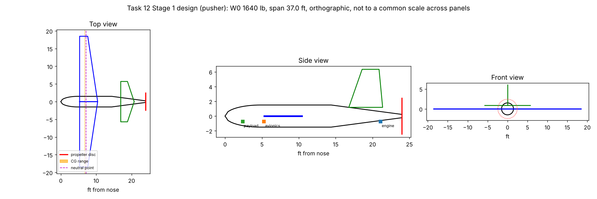
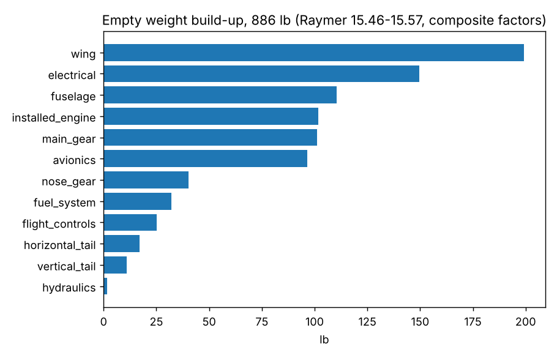
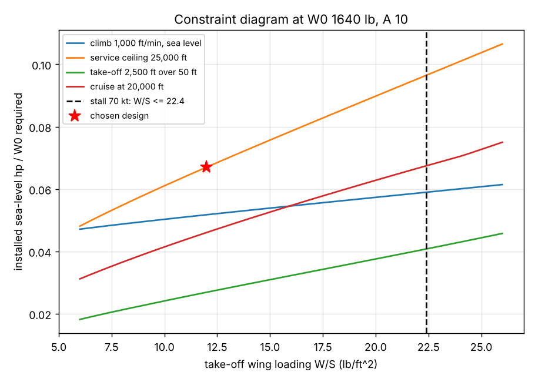
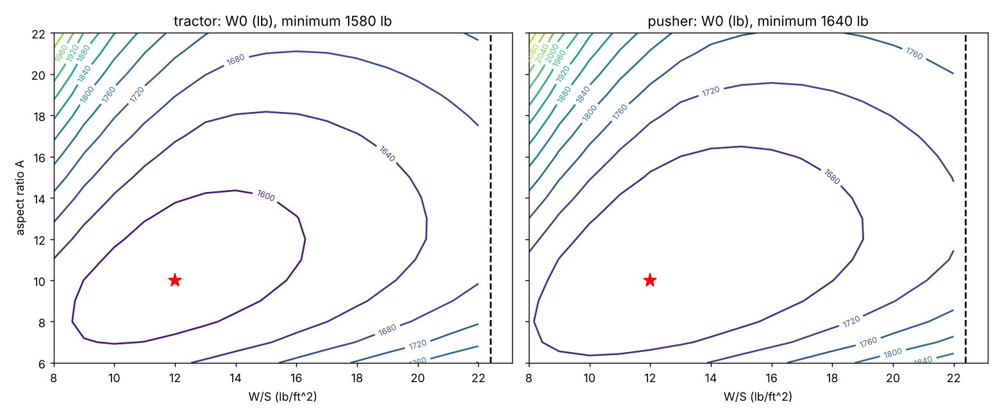
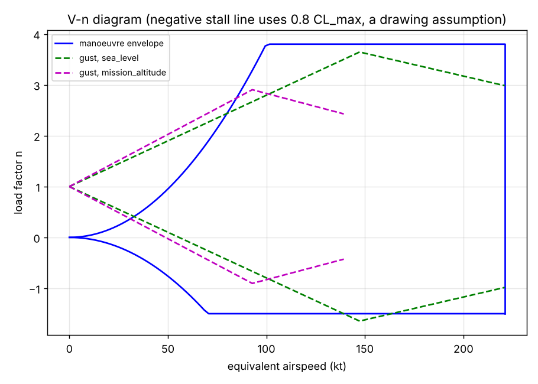

# Task 12 Stage 1: conceptual design package (2026-11-20)

**Status: Stage 1 output, before Gate A.** Generated by `python -m conceptual.report` from the records in `runs/task12/stage1/2026-11-20` (commit `ab69840794`, ledger sha256 `1cdfe8dc2b82`). Every number below is read from those files. Methods: Raymer, *Aircraft Design: A Conceptual Approach*, 2nd ed. (1992), through `conceptual/`; each function cites its equation and page. Spec: `docs/specs/task12_drone_conceptual_design.md`.

## Summary

- **Chosen concept: pusher**, take-off weight **1,640 lb** (744 kg), empty 886 lb, fuel 254 lb, payload 500 lb.
- Wing loading 12 lb/ft^2, aspect ratio 10, area 137 ft^2, span 37.0 ft (11.3 m).
- Rubber engine: **110 shp** at sea level, set by the **ceiling** requirement. This is below the 400 to 5,000 bhp range of Raymer's turboprop statistics (Table 10.4, p. 224), so the engine weight is an extrapolation. The only turboprops with printed data in the library (Mattingly Table C.1, p. 519) are PT6A-42, PT6A-45R, at 7.7 to 10.9 times the power needed.
- Fixed-engine re-size with the PT6A-42: W0 **2,717 lb**, 66 % heavier than the rubber-engine design. Choosing the real engine is the main open decision for Gate A.
- First-pass sizing (Table 3.1 fit with sketch values) gave 2,110 lb; the refined component build-up gives 1,640 lb. Empty fraction: build-up 0.540, Table 3.1 x 0.95 0.592, Table 6.2 x 0.95 0.583. The build-up has no crew items; the fits include them.
- Requirements: 9 checked rows met, 1 not met (table in section 1).
- Raymer method tests: `53 passed in 0.22s` (DR-1 printed values, `tests/task12/`).

## 1. Requirements compliance

| Requirement | Value | Limit | Rule | Met |
|---|---|---|---|---|
| R4 payload (lb) | 500 | 500 | carried by construction | - |
| R5 mission 200 nm + 8 h + 200 nm (fuel lb) | 254 | 254 | sized to it | - |
| R7 take-off over 50 ft (ft) | 649 | 2,500 | <= | yes |
| R7 landing over 50 ft (ft) | 1,329 | 2,500 | <= | yes |
| R7 clean stall at W0, sea level (kt) | 51 | 70 | <= | yes |
| R9 limit load factor (manoeuvre or gust) (-) | 3.800 | 3.800 | >= | yes |
| R9 negative gust within the -1.5 limit (weights use the positive case only) (-) | -1.646 | -1.500 | >= | **no** |
| R12 sea-level rate of climb (ft/min) | 1,403 | 1,000 | >= | yes |
| R12 service ceiling (ft) | 25,250 | 25,000 | >= | yes |
| R13 static margin, full fuel (MAC) | 0.098 | 0.050 | in band | yes |
| R13 static margin, empty fuel (MAC) | 0.102 | 0.050 | in band | yes |
| fuel fits integral wing tanks (ft^3) | 5.1 | 23.3 | <= | yes |
| empty fraction: build-up vs Table 3.1 (x0.95) (-) | 0.540 | 0.592 | report | - |

Landing weight is taken as the take-off weight (conservative; Raymer 17.9 allows the requirement to set it). Distances are the segment sums of Raymer 17.8-17.9, not FAR field lengths; the FAR landing field length would be 2,213 ft.

## 2. Three-view and layout

Fuselage 24.0 ft long (Raymer Table 6.3, general aviation single), 3.00 ft diameter (fineness from the ledger). Tail arm 11.4 ft (aft-engine 47.5 % of length, p. 112-113). Horizontal tail 32.5 ft^2, vertical tail 17.7 ft^2 (volume coefficients 0.70 and 0.04, Table 6.4). Propeller diameter 4.86 ft (smaller of (10.24) and the 950 ft/s tip-speed limit).

## 3. Weight statement

| Item | lb | Station (ft from nose) |
|---|---|---|
| nose_gear | 40.4 | 2.40 |
| payload | 500.0 | 2.40 |
| avionics | 96.5 | 5.28 |
| wing | 199.2 | 6.86 |
| fuel_system | 32.0 | 6.86 |
| electrical | 149.6 | 7.19 |
| fuselage | 110.3 | 10.79 |
| hydraulics | 1.6 | 10.79 |
| flight_controls | 25.2 | 13.19 |
| horizontal_tail | 17.1 | 18.12 |
| vertical_tail | 11.0 | 18.21 |
| installed_engine | 101.8 | 21.10 |
| fuel (in wing tanks) | 253.9 | at the wing group |
| **take-off** | **1640.0** | CG 6.77 full, 6.75 empty |

Composite factors of Raymer Table 15.4 (wing 0.85, tails 0.83, fuselage 0.90, gear 0.95) are applied to the general-aviation equations (15.46)-(15.57). Crew items (seats, furnishings, air conditioning, pressurisation) are left out (R14).

## 4. Drag, propulsion and mission

CD0 0.0195 at 20,000 ft and 0.0183 at sea level (component build-up (12.24) with 5 % leakage and the sensor turret), span efficiency e 0.757 from (12.49), K 0.0421. Clean CL_max 1.35, take-off 1.82, landing 2.13.

| Segment | W start (lb) | W end (lb) | Mean TAS (kt) |
|---|---|---|---|
| takeoff | 1640.0 | 1635.4 | - |
| climb | 1635.4 | 1617.5 | - |
| cruise_out | 1617.5 | 1582.0 | 97.6 |
| loiter | 1582.0 | 1439.1 | 87.6 |
| cruise_back | 1439.1 | 1407.5 | 92.1 |
| landing | 1407.5 | 1400.5 | - |

Cruise and loiter fly at the larger of the best speed (L/D max for range, minimum power for loiter) and 1.3 V_stall clean; at this design the 1.3 V_stall floor sets both speeds. Fuel is 1.06 times the mission burn (3.11).

## 5. Constraint diagram and carpet plot

Required sea-level shp: climb_sl 85, ceiling 110, takeoff 44, cruise_at_altitude 76. Raymer's statistical power loading (Table 5.4, general aviation single, at the computed maximum speed) is 0.072 hp/lb against 0.067 sized here. The ceiling and altitude-cruise rows use Raymer's piston power lapse (13.9), because he gives none for a turboprop (13.7); Stage 3 measures the lapse with Mattingly App. K.

## 6. Concept choice (step 2)

| Criterion | Weight | Tractor | Pusher |
|---|---|---|---|
| take-off weight W0 (lb), lower is better | 0.40 | 5.0 | 4.82 |
| sensor field of view: nose free of propeller and exhaust (grade 1-5) | 0.25 | 2.0 | 5.0 |
| propeller wash and exhaust on the sensor and airframe (grade 1-5) | 0.10 | 2.0 | 4.0 |
| turboprop exhaust impinging on a pusher propeller (Raymer p. 222) (grade 1-5) | 0.10 | 5.0 | 2.0 |
| ground clearance and gear length (grade 1-5; pusher needs longer gear, p. 222) | 0.15 | 5.0 | 3.0 |
| **weighted score** | | **3.95** | **4.23** |

Chosen: **pusher**. The weights and the 1-5 grades are judgements, stated so that Gate A can change them; only the weight row is computed. The tractor is 3.8 % lighter at its own optimum (shorter tail arm and longer gear cost the pusher).

## 7. Loads, stability and trim

Gust load factor at the maximum level speed: 3.65 at sea level (147 kt EAS) and 2.90 at 20,000 ft (93 kt EAS), U_de 30 ft/s, (14.4)-(14.8); the manoeuvre limit governs: limit 3.80, ultimate 5.70.
Neutral point 7.14 ft, static margin 0.098 (full fuel) and 0.102 (empty) of the MAC; the wing is placed to centre the margin in R13. Downwash gradient 0.353 from the far-wake value 2 CL_alpha/(pi A), not Raymer's chart (not readable from the notes; conservative for the margin). Trim tail lift coefficient at loiter: loiter_start_full 0.040, loiter_end_empty_cg 0.019.

## 8. Performance as sized

| Quantity | Value |
|---|---|
| V_stall_clean_kt | 51.2 |
| V_stall_landing_kt | 40.8 |
| takeoff_ft | 648.6 |
| landing_ft | 1,328.6 |
| roc_sl_fpm | 1,403.0 |
| v_best_climb_kt | 61.5 |
| service_ceiling_ft | 25,250.0 |
| vmax_alt_kt | 127.2 |

## 9. Fixed engine and trades

| Engine (Mattingly Table C.1) | shp | Engine lb | W0 (lb) | Fuel (lb) | Power / needed |
|---|---|---|---|---|---|
| PT6A-42 | 850 | 391 | 2,717 | 422 | 7.7 |
| PT6A-45R | 1,197 | 434 | 2,924 | 463 | 10.9 |

| Trade | W0 (lb) | shp | Fuel (lb) |
|---|---|---|---|
| loiter_h=6 | 1,561 | 105 | 209 |
| loiter_h=8 | 1,640 | 110 | 254 |
| loiter_h=10 | 1,723 | 115 | 301 |
| loiter_h=12 | 1,810 | 120 | 350 |
| loiter_h=16 | 1,999 | 132 | 458 |
| payload_lb=300 | 1,230 | 85 | 197 |
| payload_lb=500 | 1,640 | 110 | 254 |
| payload_lb=700 | 2,052 | 135 | 311 |
| payload_lb=1000 | 2,674 | 173 | 396 |
| mission_altitude_ft=15000 | 1,599 | 107 | 230 |
| mission_altitude_ft=20000 | 1,640 | 110 | 254 |
| mission_altitude_ft=25000 | 1,698 | 113 | 287 |

Largest one-at-a-time effects of the banded assumptions on W0 (each at its band end):

| Assumption at band end | W0 (lb) | Change (lb) |
|---|---|---|
| avionics_uninstalled_lb=100 (hi) | 1,826 | +186 |
| gust_ude_fps=50 (hi) | 1,767 | +127 |
| fuselage_fineness=6 (lo) | 1,758 | +119 |
| avionics_uninstalled_lb=40 (lo) | 1,538 | -102 |
| cbhp_loiter=0.75 (hi) | 1,723 | +83 |
| fuselage_fineness=10 (hi) | 1,579 | -61 |
| cbhp_loiter=0.5 (lo) | 1,587 | -53 |
| eta_p=0.75 (lo) | 1,687 | +47 |
| laminar_fraction_wing=0.5 (hi) | 1,599 | -41 |
| cbhp_cruise=0.6 (hi) | 1,680 | +40 |

No effect on W0 at this design (not binding here): airfoil_cm0, flap_span_fraction, fuselage_kf, propeller_rpm, static_ct_over_cp, takeoff_flap_fraction, wing_tank_chord_fraction, wing_tank_span_fraction.

## 10. Risks and open items for Gate A

1. **Engine size.** The aircraft needs about 110 shp; Raymer's turboprop statistics start at 400 bhp and the library's real turboprops start at 850 eshp. Options: accept the PT6A-42 (2,717 lb aircraft, heavily over-powered); find an open datasheet for a small turboprop near the rubber engine's power; or enlarge the mission (payload or endurance) so the power reaches the statistical range. Stage 3 measures the fuel burn and lapse with Mattingly App. K either way.
2. **Power lapse.** Raymer's piston lapse (13.9) sizes the ceiling, the binding requirement; a turbine's lapse differs. Measured in Stage 3 (Mattingly App. K).
3. **Empty weight without crew.** The build-up is 9 % below the Table 3.1 fit; the size of the crew-item deduction is the task's main assumption. Measured in Stage 3 by Anderson's independent sizing (ch. 8).
4. **Section data.** CL_max 1.5 is a judgement; the 1.3 V_stall floor makes it set the loiter and cruise speeds. Measured in Stage 3 (SU2 polar after a NACA-data validation row).
5. **Span efficiency.** (12.49) falls quickly with aspect ratio and sets the optimum A; the vortex lattice measures the inviscid part in Stage 3.
6. **Downwash** from the far-wake value, not Raymer's chart; measured by the lattice in Stage 3.
7. **Concept scoring** grades are judgements for Éder to confirm.
8. **Requirements not met** (section 1): R9 negative gust within the -1.5 limit (weights use the positive case only). The negative gust case is outside Raymer's weight equations, which take the positive ultimate load; Gate A decides whether to raise the negative limit or size for it.

## 11. Records

- `runs/task12/stage1/2026-11-20/carpet.csv`
- `runs/task12/stage1/2026-11-20/compliance.csv`
- `runs/task12/stage1/2026-11-20/concept_scores.json`
- `runs/task12/stage1/2026-11-20/constraint_diagram.csv`
- `runs/task12/stage1/2026-11-20/constraint_limits.json`
- `runs/task12/stage1/2026-11-20/design.json`
- `runs/task12/stage1/2026-11-20/first_pass.json`
- `runs/task12/stage1/2026-11-20/fixed_engine.csv`
- `runs/task12/stage1/2026-11-20/inputs.json`
- `runs/task12/stage1/2026-11-20/ledger.yaml`
- `runs/task12/stage1/2026-11-20/test_report.txt`
- `runs/task12/stage1/2026-11-20/trades.csv`
