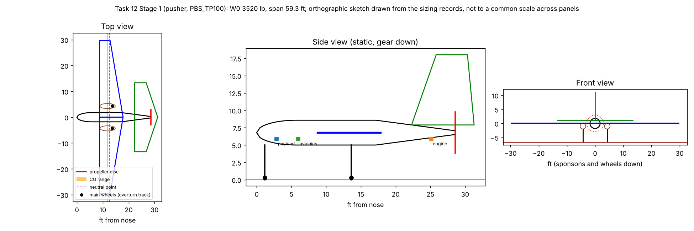
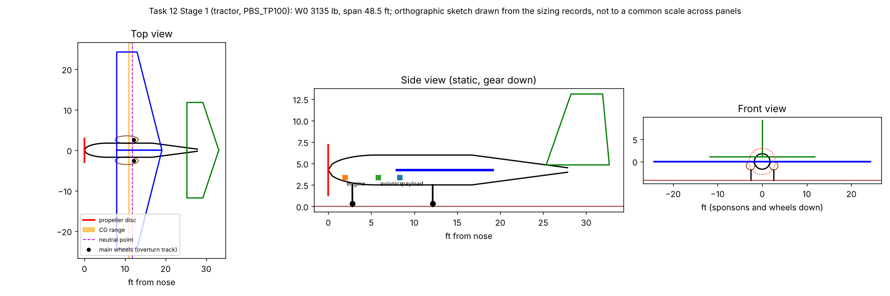
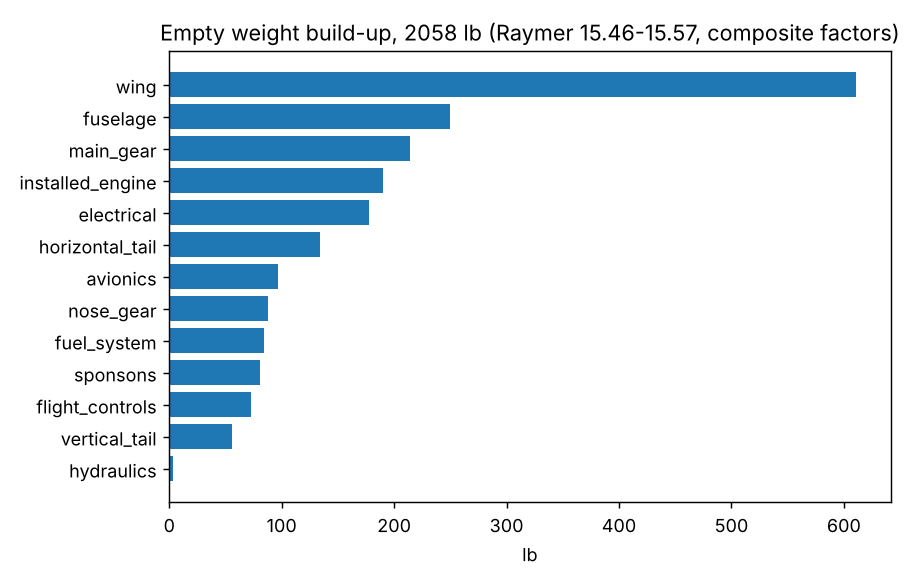
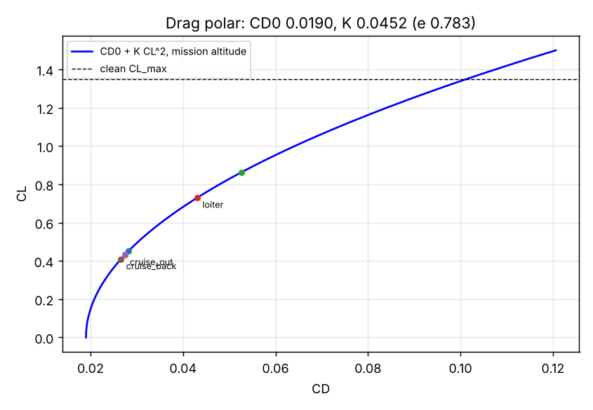
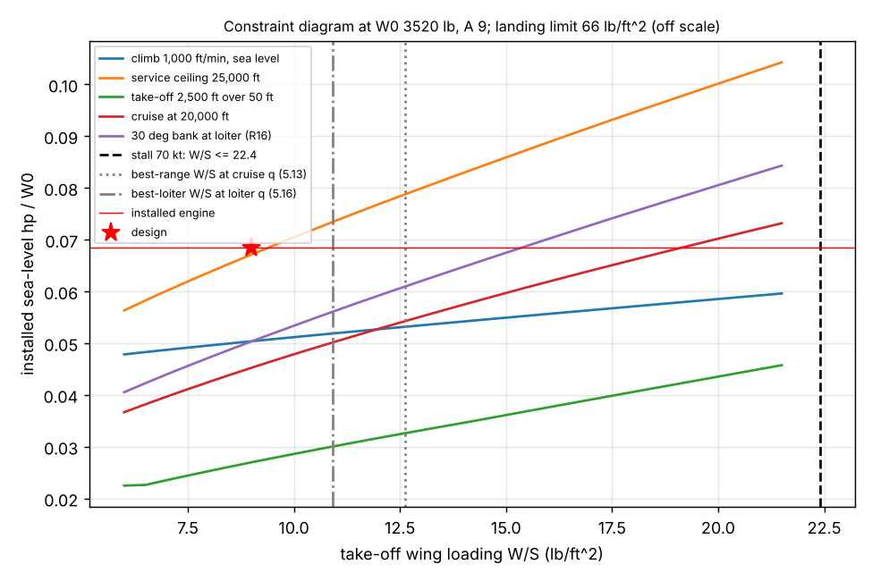
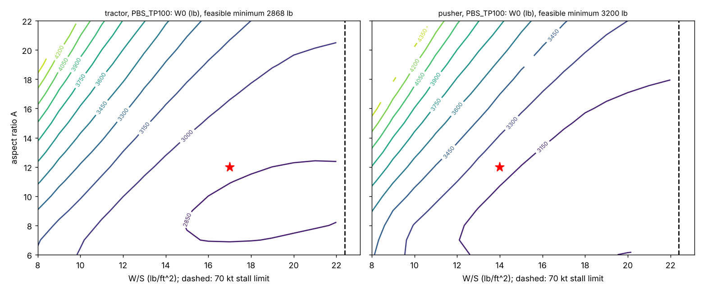
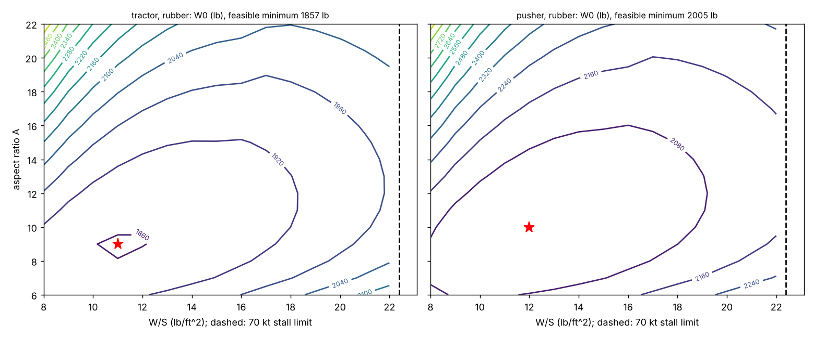
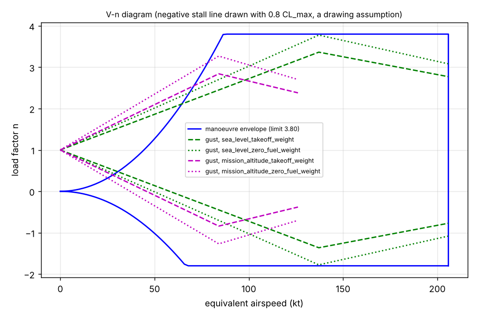

# Task 12 Stage 1, re-sized around the TP100's App. K engine model (2026-11-20f)

**Status: Stage 1 repeated after Stage 3 (Éder, 2026-11-20: "go back to Stage 1 and design around this engine"). The TP100 now enters through its Mattingly App. K cycle table (`data/task12/tp100_table.json`, sha256 `03edd5466005`): power lapse and part-power SFC replace the piston lapse (13.9) and the flat brochure SFC. Gate A must be re-run on this design.** Earlier history follows.

**Gate A record of the previous design: Stage 1 output with the Gate A round 3 rulings and the round 3 review actions applied. Gate A: passed with actions (docs/reviews/2026-11-20_task12_gateA_round3.md).** Generated by `python -m conceptual.report` from `runs/task12/stage1/2026-11-20f` (commit `2da97e909c`, ledger sha256 `4c1a455e5b16`, engines sha256 `8e4739747f1b`). Every number is read from those files. Methods: Raymer, *Aircraft Design: A Conceptual Approach*, 2nd ed. (1992), through `conceptual/`. Review records: `docs/reviews/2026-11-20_task12_gateA_round1.md` and `..._round2.md`.

## Summary

- **Frozen concept: pusher** (Éder, Gate A round 3, on corrected figures). With the round-1 criteria and weights it scores 4.08 against the tractor's 3.95 (only W0 is computed; the rest are judgement grades). Both designs are kept and reported.
- **Pusher with the PBS_TP100**: take-off weight **3,520 lb** (1,597 kg), empty 2,058 lb, fuel 962 lb, payload 500 lb; W/S 9 lb/ft^2, A 9, span 59.3 ft (18.1 m). The tractor with the same engine: 3,135 lb.
- **The engine sets the weight.** With a rubber engine the same aircraft would be 2,076 lb (131 shp). The PBS_TP100 gives 241 shp against 236 needed (ceiling binds). Split of the +1,444 lb: the larger engine itself (its weight and installation drag; with the V_C placard the design q and gusts are the same for both engines) +298 lb, measured with Raymer's Table 3.4 consumption and the piston lapse; its real consumption and lapse (App. K table) +1,147 lb. At this point the Gate A treatment (flat 0.901, piston lapse) would give 2,966 lb with power OK True. Engine data: the maker's brochure (engines.yaml); the cycle is calibrated to its one SFC.
- **Sponsons** (round 3 ruling) weigh 80 lb and add drag; they cost +213 lb of take-off weight against wheels stowed for free (3,307 lb, reference only).
- Requirements: 19 checked rows met, 0 not met.
- Empty weight: build-up 0.585 of W0, Table 3.1 x 0.95 0.516 (decomposition in section 4).
- First pass (Table 3.1 with sketch values) 2,110 lb. Method tests: `135 passed in 8.47s`.

## 0. What changed after Gate A round 1

| Finding or ruling | Change |
|---|---|
| F1 main gear missing from the balance | Main gear placed by the 15 deg tipback rule (p. 232) and included in the CG; nose-wheel load and propeller clearance checked |
| F2 gust at take-off weight only | Gust at take-off and zero-fuel weight, sea level and mission altitude; the largest sets the limit load |
| F3 q inconsistent with the V-n | Weight equations use q at the design cruise speed V_C (sea-level maximum level speed) |
| F4 crew-item explanation | Decomposition reported (section 4) |
| F5 ceiling grid artefact | Ceiling by bisection with CD0 at altitude; the last passing altitude is reported |
| F6 hard-coded speed text | The mission records which legs the 1.3 V_stall floor set; the text is generated from it |
| F7 constraint diagram | Landing limit searched to 200 lb/ft^2; best-range and best-loiter W/S and the R16 turn added |
| F8 test coverage | Tests for methods without printed values (identities, limits, Table 10.4 against Mattingly's PT6A-42); equation-to-test table (section 10) |
| F9 constants in the code | Moved to the ledger with sources and bands (appendix A) |
| F10 calibration list, polar, propeller | Section 9; drag polar and propeller operating points added |
| F11 trim and rotation | Trim on every mission leg at its fuel state; nose rotation at 0.8 V_TO with the forward CG (p. 432-433); tail enlarged where rotation needs it |
| Engine (Éder: find a small turboprop) | PBS TP100 (241 shp, 135.8 lb, 0.901 lb/(hp h)) fixed; Turbotech TP-R90, PT6A-42 and rubber compared |
| R9 negative limit (Éder: raise it) | Ledger -1.8 (GA utility); see section 7 |
| Round 2 N1 rotation sign | Main-wheel reaction and friction both nose-down; flap moment (16.17, Fig. 16.9) and wing moment (16.16) added; ground effect not modelled; sign test added |
| Round 2 N2 nose-load display | Limits shown as 5-20 % with the 8-15 % optimum; the nose wheel moves forward in its band when above the optimum |
| Round 2 N3 overturn and track | Half-track for the 63 deg overturn limit (p. 232) and a stowage check against the wing depth |
| Round 2 N4 pusher rotation angle | Pusher at 10 deg with a tail bumper (favourable end); tractor clearance with the nose strut compressed |
| Round 2 N6 engine attribution | Split into engine size and consumption with a Table 3.4 run of the same engine |
| Round 2 scoring | Round-1 weights restored; layout limits applied as constraints, not scored rows |
| Round 3 rulings | Pusher frozen; V_C placarded at 150 kt EAS (R18); 1.3 V_stall floor kept (R17); R16 accepted; main gear in sponsons with drag (Q 1.5) and weight (Table 15.2) penalties |
| Round 2 F9 tyre drag | Regular wheel and tyre 0.25 (Table 12.5 p. 287) instead of the faired 0.13 |

## 1. Requirements compliance (pusher)

| Requirement | Value | Limit | Rule | Met |
|---|---|---|---|---|
| R1/R2 single turboprop, one engine (-) | PBS_TP100 | n/a | by construction | - |
| R4 payload (lb) | 500 | 500 | by construction | - |
| R5 mission 200 nm + 8 h + 200 nm (fuel lb) | 962 | 962 | sized to it | - |
| R6 mission altitude 20,000 ft within engine limit (ft) | 20,000 | 29,528 | <= | yes |
| R7 take-off over 50 ft (ft) | 549 | 2,500 | <= | yes |
| R7 landing over 50 ft (ft) | 1,251 | 2,500 | <= | yes |
| R7 clean stall at W0, sea level (kt) | 44 | 70 | <= | yes |
| R8 retractable tricycle gear (-) | yes | n/a | by construction | - |
| R9 positive limit load (manoeuvre or gust, both weights) (-) | 3.800 | 3.800 | >= | yes |
| R9 negative gust within the negative limit (-) | -1.777 | -1.800 | >= | yes |
| R10 6 % reserve and trapped fuel (-) | 1.060 | 1.060 | by construction | - |
| R12 sea-level rate of climb (ft/min) | 1,478 | 1,000 | >= | yes |
| R12 service ceiling (last altitude with 100 ft/min) (ft) | 25,334 | 25,000 | ceiling | yes |
| R13 static margin, full fuel (MAC) | 0.106 | 0.05-0.15 | in band | yes |
| R13 static margin, empty fuel (MAC) | 0.094 | 0.05-0.15 | in band | yes |
| R14 no crew items in the weights (-) | yes | n/a | by construction | - |
| R15 flight avionics 60 lb uninstalled (lb) | 60 | 60 | by construction | - |
| R16 sustained 30 deg bank at loiter (power) (hp) | 177 | 241 | <= | yes |
| engine power meets every requirement (hp) | 236 | 241 | <= | yes |
| fuel fits integral wing tanks (ft^3) | 19.2 | 124.2 | <= | yes |
| nose-wheel load, full fuel (p. 232-233; optimum 0.08-0.15) (-) | 0.152 | 0.05-0.20 | nose | yes |
| nose-wheel load, empty fuel (-) | 0.146 | 0.05-0.20 | nose | yes |
| main gear stows: sponsons at the 63 deg overturn track (p. 232; ruling round 3) (ft) | 4 | n/a | stow | yes |
| propeller clearance at rotation (p. 222) (in) | 13.5 | 8.9 | >= | yes |
| trim within tail CL limit, all mission legs (-) | yes | n/a | flag | yes |
| nose rotation at 0.8 V_TO (p. 432-433), tail download (tail CL) | 0.978 | 1.000 | <= | yes |

Take-off and landing distances are Raymer's segment sums (17.8-17.9) with gear and flap drag (12.37); landing weight = take-off weight (conservative). FAR landing field length: 2,083 ft. The nose-load rows pass inside Raymer's 5-20 % limits; the 8-15 % band is his optimum.

## 2. Concept choice (step 2, re-scored)

| Criterion | Weight | Tractor | Pusher | Tractor grade | Pusher grade |
|---|---|---|---|---|---|
| take-off weight W0 (computed) | 0.40 | 3,135 | 3,520 | 5.0 | 4.45 |
| sensor field of view: nose free of propeller and exhaust (judgement) | 0.25 | 2 | 5 | 2.0 | 5.0 |
| propeller wash and exhaust on the sensor and airframe (judgement) | 0.10 | 2 | 4 | 2.0 | 4.0 |
| turboprop exhaust impinging on a pusher propeller, p. 222 (judgement) | 0.10 | 5 | 2 | 5.0 | 2.0 |
| ground clearance and gear length (judgement; pusher needs longer gear, p. 222) | 0.15 | 5 | 3 | 5.0 | 3.0 |
| **weighted score** | | | | **3.95** | **4.08** |

Feasibility constraints (not scored; a layout must meet them or be redesigned):

| Constraint | Tractor | Pusher |
|---|---|---|
| nose_load_within_5_20 | True | True |
| nose_load_within_8_15_optimum | True | False |
| rotation_ok | True | True |
| gear_stows | True | True |

| Quantity | Tractor | Pusher |
|---|---|---|
| W0 (lb) | 3,135 | 3,520 |
| W/S (lb/ft^2) | 8 | 9 |
| A | 6 | 9 |
| main gear length (in) | 30 | 60 |
| horizontal-tail volume scale for rotation | 1.00 | 1.28 |
| limit load factor | 3.80 | 3.80 |
| nose-wheel load, full fuel | 0.121 | 0.152 |
| nose-wheel load, empty | 0.137 | 0.146 |
| nose-wheel station (fraction of length) | 0.10 | 0.04 |
| main-gear half-track for 63 deg overturn (ft) | 2.60 | 4.32 |
| rotation: tail CL needed after resize (negative = download) | -0.72 | -0.98 |

Scoring: the round-1 criteria and weights, unchanged; only W0 is computed. The pusher is evaluated at the favourable end of the rotation band: a tail bumper limits rotation to 10 deg, which still needs a 60 in main gear for 9 in of propeller clearance (p. 222, 232). The tall gear raises the CG, so the tipback rule moves the wheels aft and loads the nose wheel; the nose wheel is then moved forward inside its band. Rotation (corrected for the round-2 sign error) sizes the horizontal tail of both concepts. A raised thrust line is not modelled.

## 3. Layout

Fuselage 28.6 ft (Table 6.3), 3.57 ft diameter; tail arm 13.6 ft; horizontal tail 178.2 ft^2 (volume scale 1.28), vertical tail 68.4 ft^2; propeller 5.91 ft (three-blade (10.24) or the 950 ft/s tip limit); main gear 60 in at 13.61 ft, CG height 6.79 ft; propeller clearance at rotation 13.5 in.

## 4. Weight statement

| Item | lb | Station (ft) |
|---|---|---|
| nose_gear | 87.6 | 1.14 |
| payload | 500.0 | 2.86 |
| avionics | 96.5 | 6.00 |
| wing | 610.9 | 11.50 |
| fuel_system | 84.3 | 11.50 |
| sponsons | 80.3 | 11.50 |
| fuselage | 249.9 | 12.86 |
| hydraulics | 3.5 | 12.86 |
| electrical | 178.1 | 12.86 |
| main_gear | 214.5 | 13.61 |
| flight_controls | 72.6 | 15.72 |
| horizontal_tail | 133.8 | 25.08 |
| vertical_tail | 55.5 | 25.09 |
| installed_engine | 190.1 | 25.16 |
| fuel (wing tanks) | 962.3 | wing group |
| **sum** | **3520.0** | CG 11.71 full, 11.80 empty |

Empty-fraction decomposition (reviewer finding F4):

| Quantity | Fraction of W0 |
|---|---|
| component build-up with composite factors (this design) | 0.585 |
| same build-up without the Table 15.4 composite factors | 0.639 |
| crew items Raymer's GA set would add: furnishings (15.59); air conditioning (15.58) is zero with no crew | 0.040 |
| metal build-up plus crew items | 0.678 |
| Table 3.1 fit, general aviation single | 0.543 |
| Table 3.1 fit x 0.95 (composite) | 0.516 |
| Table 6.2 fit x 0.95 | 0.537 |
| Table 15.2 approximate group weights | 0.716 |

The build-up is 0.069 of W0 above the Table 3.1 fit x 0.95 even without the crew items (0.040); the crewless UAV's components (sponsons, enlarged tail, gear) outweigh the statistical aircraft at this size. Like for like (metal, with crew items) the group equations sit 0.136 above the metal fit. Stage 3's independent sizing (Anderson ch. 8) is the check.

## 5. Drag, propulsion and mission

CD0: 0.0190 at mission altitude, 0.0176 sea level, 0.0618 take-off and 0.1032 landing (gear by the DR-1 p. 572 per-area values, flaps by (12.37)); e 0.783 (12.49); CL_max clean 1.35, take-off 1.82, landing 2.13.

| Segment | W start (lb) | W end (lb) | Mean TAS (kt) | Speed set by | Mean SFC, lb/(hp h) |
|---|---|---|---|---|---|
| takeoff | 3520.0 | 3501.9 | - | - | 0.902 |
| climb | 3501.9 | 3434.8 | - | - | 0.903 |
| cruise_out | 3434.8 | 3275.4 | 103.8 | minimum fuel with the App. K SFC | 0.973 |
| loiter | 3275.4 | 2773.4 | 73.3 | 1.3 V_stall floor | 1.219 |
| cruise_back | 2773.4 | 2625.3 | 95.3 | minimum fuel with the App. K SFC | 1.099 |
| landing | 2625.3 | 2612.2 | - | - | - |

Propeller operating points (efficiency is the ledger's constant, not computed; J and C_P from (13.10)-(13.11)):

| Point | V (kt) | Shaft hp | Throttle | J | C_P |
|---|---|---|---|---|---|
| climb_sea_level | 53.1 | 241.0 | 1.00 | 0.46 | 0.209 |
| cruise_out | 103.8 | 85.4 | 0.80 | 0.89 | 0.139 |
| loiter | 73.3 | 56.2 | 0.54 | 0.63 | 0.091 |
| cruise_back | 95.3 | 64.4 | 0.61 | 0.82 | 0.105 |

Engines compared at the recommended point (W/S, A and tail held):

| Engine | shp | Engine lb | C_bhp cruise / loiter | W0 (lb) | Fuel (lb) | Power needed (hp) | Power OK |
|---|---|---|---|---|---|---|---|
| rubber | 131 | 84 | 0.49999999999999994 / 0.5999999999999999 | 2,076 | 316 | 131 | True |
| PBS_TP100 | 241 | 136 | 0.9726065667821124 / 1.2190616486793258 | 3,520 | 962 | 236 | True |
| Turbotech_TP_R90 | 120 | 141 | 0.49999999999999994 / 0.5999999999999999 | 2,253 | 343 | 141 | False |
| PT6A_42 | 850 | 391 | 0.49999999999999994 / 0.5999999999999999 | 3,551 | 535 | 219 | True |
| PBS_TP100 as at Gate A: flat 0.901, piston lapse | 241 | 136 | 0.9009999999999998 / 0.9009999999999999 | 2,966 | 665 | 183 | True |
| PBS_TP100 at Table 3.4 consumption, piston lapse | 241 | 136 | 0.49999999999999994 / 0.5999999999999999 | 2,373 | 356 | 149 | True |

The rubber engine's weight is Table 10.4 extrapolated below 400 bhp. The TP-R90 and PT6A-42 rows carry Table 3.4 consumption (no published values in hand); the TP-R90 lacks the power for the ceiling.

## 6. Constraint diagram and carpet plots

Required sea-level shp: climb_sl 177, ceiling 236, takeoff 95, turn_at_loiter 177, cruise_at_altitude 159; engine 241. The ceiling and altitude rows use the TP100's App. K lapse (pi_c held at its sea-level rating); rubber-engine rows keep the piston lapse (13.9). Carpets use the Table 6.4 tail; the rotation resize is applied to each candidate, lightest first, until every checked requirement is met (selection_<concept>.json).

At wing loadings from 22.0 to 26.0 lb/ft^2 (at this W0 and A) the PBS_TP100 cannot fly a mission leg at any speed within its power; the curves stop there.

## 7. Loads, stability, trim and rotation

| Gust case | n (positive) | 2 - n (negative) |
|---|---|---|
| sea_level/takeoff_weight | 3.36 | -1.36 |
| sea_level/zero_fuel_weight | 3.78 | -1.78 |
| mission_altitude/takeoff_weight | 2.84 | -0.84 |
| mission_altitude/zero_fuel_weight | 3.27 | -1.27 |

Limit load factor 3.80, ultimate 5.70; design q 63.7 psf at V_C 137 kt EAS. Negative gust -1.78 against the -1.8 set at round 1; Raymer's weight equations carry only the positive case.

Static margin 0.106 (full) and 0.094 (empty); neutral point 12.45 ft; downwash gradient 0.381 (far-wake value in place of Raymer's chart, conservative). Tail lift coefficient in trim at every leg start and end: cruise_out_start 0.023, cruise_out_end 0.019, loiter_start 0.127, loiter_end 0.100, cruise_back_start 0.023, cruise_back_end 0.018. Rotation at 34 kt with the forward CG: tail CL needed -0.98 (available 1.0).

## 8. Performance as sized

| Quantity | Value |
|---|---|
| V_stall_clean_kt | 44.4 |
| V_stall_landing_kt | 35.3 |
| takeoff_ft | 549.4 |
| landing_ft | 1,250.6 |
| roc_sl_fpm | 1,477.7 |
| v_best_climb_kt | 53.2 |
| service_ceiling_ft | 25,333.6 |
| vmax_alt_kt | 118.9 |

## 9. Trades, sensitivities and out-of-calibration uses

| Trade | W0 (lb) | Fuel (lb) | Power OK |
|---|---|---|---|
| loiter_h=6 | 3,203 | 792 | True |
| loiter_h=8 | 3,520 | 962 | True |
| loiter_h=10 | 3,890 | 1,151 | False |
| loiter_h=12 | 4,298 | 1,358 | False |
| payload_lb=300 | 3,060 | 885 | True |
| payload_lb=500 | 3,520 | 962 | True |
| payload_lb=700 | 4,057 | 1,053 | False |
| mission_altitude_ft=15000 | 3,670 | 1,039 | False |
| mission_altitude_ft=20000 | 3,520 | 962 | True |
| mission_altitude_ft=25000 | 3,449 | 925 | True |
| no sponsons (wheels stowed for free; reference only) | 3,307 | 889 | True |
| engine_cbhp=0.8 (datasheet 0.901) | 3,520 | 962 | True |
| engine_cbhp=1 (datasheet 0.901) | 3,520 | 962 | True |
| engine_cbhp=1.2 (datasheet 0.901) | 3,520 | 962 | True |

| Ledger assumption at band end | W0 (lb) | Change (lb) |
|---|---|---|
| gust_ude_fps=50 (hi) | 4,048 | +528 |
| fuselage_fineness=6 (lo) | 3,763 | +243 |
| avionics_uninstalled_lb=100 (hi) | 3,750 | +230 |
| prop_hub_offset_ft=2 (hi) | 3,357 | -163 |
| rotation_angle_deg_pusher=15 (hi) | 3,658 | +138 |
| fuselage_fineness=10 (hi) | 3,404 | -116 |
| avionics_uninstalled_lb=40 (lo) | 3,409 | -111 |
| wing_t_c=0.12 (lo) | 3,621 | +101 |
| eta_p=0.75 (lo) | 3,614 | +94 |
| sponson_depth_per_tyre=1.4 (hi) | 3,610 | +90 |
| fuselage_fill=0.85 (hi) | 3,588 | +68 |
| wing_t_c=0.18 (hi) | 3,454 | -66 |

No effect at this design: airfoil_cm0, braking_mu, flap_deflection_landing_deg, flap_deflection_takeoff_deg, flap_span_fraction, free_roll_s, fuselage_kf, main_gear_length_in, nose_down_deg, nose_gear_length_in, nose_tyre_scale, propeller_rpm, rolling_mu, rotation_angle_deg, static_ct_over_cp, station_avionics, station_engine_pusher, station_engine_tractor, station_flight_controls, station_fuselage, station_nose_gear, station_nose_gear_min, station_payload_pusher, station_payload_tractor, station_systems, strut_width_in, tail_cl_max_rotation, tail_cl_max_trim, takeoff_flap_fraction, wing_tank_chord_fraction, wing_tank_span_fraction.

Used outside its calibration (each carried with a band or flagged for Stage 3):

- Table 3.1 and Table 6.2 empty-weight fits and the GA group weights (15.46)-(15.57): crewed aircraft, used without crew items.
- Table 6.3 fuselage length: crewed aircraft; it sets the tail arm and the fuselage wetted area.
- Table 3.4 consumption (rubber, TP-R90 and PT6A-42 rows): large turboprops. The TP100 uses its App. K table, whose part-throttle trend did not validate against the book's example (11-14 % offset; Stage 3 engine report).
- Table 10.4 turboprop weight and size: 400-5,000 bhp; the rubber engine and the TP100 are below it.
- (13.9) power lapse: piston engines, applied only to the rubber and comparison engines.
- (12.49) span efficiency: a straight-wing fit; it sets the optimum aspect ratio.
- Downwash: the far-wake value in place of Raymer's chart. Stage 3's lattice gave 0.38 against 0.35 for the previous design: not conservative here (docs/validation/2026-11-20_task12_stage3_aero.md).
- Gear and tyre drag per area: DR-1's readings of Raymer's gear-drag table.

## 10. Method tests (equation to test)

Run: `135 passed in 8.47s`. Functions are matched by name in `tests/task12/`; 'none' means no test calls the function directly (it may still run through `uav.py` in the pipeline tests). DR-1's maximum-speed and climb plots (p. 584-585) use a chart thrust curve and are not reproduced.

| Function | Equation(s) | Page(s) | Tests |
|---|---|---|---|
| sizing.climb_fraction_energy | 19.8 | 523 | test_dr1_sizing.py |
| sizing.cruise_fraction_prop | 6.12 | - | test_dr1_sizing.py |
| sizing.empty_fraction_drawn | - | 524-525, 567 | test_dr1_sizing.py |
| sizing.empty_fraction_table31 | - | 13, 14 | test_methods_no_printed_value.py |
| sizing.empty_fraction_table62 | - | 103, 566 | test_dr1_sizing.py |
| sizing.energy_height_change | 19.9 | 523 | test_dr1_sizing.py |
| sizing.equivalent_tsfc | 3.10 | 18 | test_dr1_sizing.py |
| sizing.fuel_fraction | 3.11 | - | test_dr1_sizing.py |
| sizing.lift_to_drag | 6.13 | 105 | test_dr1_sizing.py, test_remaining_methods.py |
| sizing.loiter_fraction_prop | 6.15 | - | test_dr1_sizing.py |
| sizing.range_from_fraction_prop | 6.12 | 568 | test_dr1_sizing.py |
| sizing.solve_mission_fraction_for_weight | 3.4 | 108-109, 568 | test_dr1_sizing.py |
| sizing.solve_takeoff_weight | 3.4, 3.1 | 12, 567 | test_dr1_sizing.py |
| sizing.takeoff_fraction_power | - | 586 | test_dr1_sizing.py |
| constraints.cl_takeoff | - | 89, 565 | test_dr1_analysis.py |
| constraints.drag_to_weight | 5.29 | 98 | test_remaining_methods.py |
| constraints.hp_per_W_climb | 17.37, 13.16, 13.9 | - | test_remaining_methods.py |
| constraints.hp_per_W_statistical | - | 80 | test_dr1_analysis.py |
| constraints.landing_distance | 5.11 | 91, 90-91 | test_remaining_methods.py |
| constraints.thrust_to_weight_prop | 5.1 | 79, 565 | test_dr1_analysis.py |
| constraints.ws_best_loiter_prop | 5.16 | 94 | test_remaining_methods.py |
| constraints.ws_best_range_prop | 5.13 | 93 | test_dr1_analysis.py, test_remaining_methods.py |
| constraints.ws_climb | 5.30 | 98 | test_dr1_analysis.py |
| constraints.ws_landing | 5.11 | - | test_remaining_methods.py |
| constraints.ws_stall | 5.6 | 85 | test_dr1_analysis.py |
| constraints.ws_takeoff_prop | 5.8 | 89 | test_dr1_analysis.py |
| geometry_sizing.fuselage_length | - | 110 | test_dr1_analysis.py |
| geometry_sizing.helical_tip_speed | 10.21, 10.22 | 219 | test_remaining_methods.py |
| geometry_sizing.horizontal_tail_area | 6.29 | 111 | test_dr1_analysis.py |
| geometry_sizing.main_tyre_in | - | 233 | test_remaining_methods.py |
| geometry_sizing.max_diameter_for_tip_speed | - | 569 | test_dr1_analysis.py |
| geometry_sizing.propeller_diameter_statistical_in | 10.23, 10.24 | 219 | test_dr1_analysis.py |
| geometry_sizing.turboprop_scaled | - | 224 | test_remaining_methods.py |
| geometry_sizing.turboprop_statistical | - | 224 | test_methods_no_printed_value.py, test_remaining_methods.py |
| geometry_sizing.vertical_tail_area | 6.28 | 111 | test_dr1_analysis.py |
| geometry_sizing.vertical_tail_span | - | 76 | test_dr1_analysis.py |
| raymer_aero.cd0_buildup | 12.24 | 280, 572 | test_dr1_analysis.py |
| raymer_aero.cd0_equivalent_skin_friction | 12.23 | 280 | test_remaining_methods.py |
| raymer_aero.cf_component | 12.27, 12.25 | 282, 282-283 | test_remaining_methods.py |
| raymer_aero.cf_laminar | 12.25 | 281 | test_remaining_methods.py |
| raymer_aero.cf_turbulent | 12.27 | 282 | test_dr1_analysis.py, test_remaining_methods.py |
| raymer_aero.cooling_drag_area | 13.18 | 330 | test_dr1_analysis.py |
| raymer_aero.cutoff_reynolds_subsonic | 12.28 | 282, 283 | test_dr1_analysis.py |
| raymer_aero.flapped_cl_max | 12.21 | 278, 279 | test_methods_no_printed_value.py |
| raymer_aero.form_factor_fuselage | 12.31 | 283 | test_dr1_analysis.py |
| raymer_aero.form_factor_wing | 12.30 | 283 | test_dr1_analysis.py |
| raymer_aero.fuselage_lift_factor | 12.9 | 266 | test_methods_no_printed_value.py |
| raymer_aero.induced_drag_factor | 12.48 | 298 | test_dr1_analysis.py |
| raymer_aero.lift_slope | 12.6, 12.8 | 266 | test_dr1_analysis.py |
| raymer_aero.misc_engine_drag_area | 13.19 | 330 | test_dr1_analysis.py |
| raymer_aero.oswald_straight_wing | 12.49 | 299 | test_dr1_analysis.py |
| raymer_aero.reynolds | 12.26 | 281 | test_remaining_methods.py |
| raymer_aero.wetted_area_wing | 7.10, 7.11 | 150 | test_remaining_methods.py |
| raymer_aero.wetted_aspect_ratio | - | 21 | test_remaining_methods.py |
| raymer_aero.wing_cl_max | 12.15 | 270 | test_dr1_analysis.py |
| raymer_propulsion.advance_ratio | 13.10 | 327 | test_dr1_analysis.py |
| raymer_propulsion.piston_power_lapse | 13.9 | 325, 331 | test_dr1_analysis.py |
| raymer_propulsion.power_coefficient | 13.11 | 327 | test_remaining_methods.py |
| raymer_propulsion.propwash_factor | 13.17 | 330 | test_dr1_analysis.py |
| raymer_propulsion.static_thrust | 13.16 | 327 | test_dr1_analysis.py |
| raymer_propulsion.thrust_from_power | 13.16 | 327 | test_remaining_methods.py |
| raymer_loads.design_gust_velocity | - | 339 | test_remaining_methods.py |
| raymer_loads.gust_alleviation_subsonic | 14.6 | 339 | test_methods_no_printed_value.py |
| raymer_loads.gust_load_factor | 14.4, 14.5, 14.8 | 339 | test_methods_no_printed_value.py |
| raymer_loads.gust_mass_ratio | 14.8 | 339 | test_remaining_methods.py |
| raymer_loads.ultimate_load_factor | - | 340 | test_remaining_methods.py |
| raymer_weights.avionics | 15.57 | - | test_dr1_analysis.py |
| raymer_weights.electrical | 15.56 | - | test_dr1_analysis.py |
| raymer_weights.flight_controls | 15.54 | - | test_dr1_analysis.py |
| raymer_weights.fuel_system | 15.53 | - | test_dr1_analysis.py |
| raymer_weights.fuselage | 15.49 | - | test_dr1_analysis.py |
| raymer_weights.horizontal_tail | 15.47 | - | test_dr1_analysis.py |
| raymer_weights.hydraulics | 15.55 | - | test_remaining_methods.py |
| raymer_weights.installed_engine | 15.52 | - | test_dr1_analysis.py |
| raymer_weights.main_gear | 15.50 | - | test_dr1_analysis.py |
| raymer_weights.nose_gear | 15.51 | - | test_remaining_methods.py |
| raymer_weights.vertical_tail | 15.48 | - | test_dr1_analysis.py |
| raymer_weights.wing | 15.46 | - | test_dr1_analysis.py |
| raymer_stability.cm_alpha | 16.10 | 417 | test_dr1_analysis.py |
| raymer_stability.downwash_gradient_lifting_line | - | 425 | test_dr1_analysis.py |
| raymer_stability.fuselage_cm_alpha_per_deg | 16.22 | 427 | test_dr1_analysis.py |
| raymer_stability.neutral_point | 16.9 | 417 | test_dr1_analysis.py |
| raymer_stability.static_margin | - | 580 | test_dr1_analysis.py |
| raymer_performance.best_rate_of_climb | 17.37 | 585 | test_methods_no_printed_value.py |
| raymer_performance.drag | - | - | test_dr1_analysis.py, test_methods_no_printed_value.py |
| raymer_performance.ground_roll | 17.99, 17.100, 17.101 | 487 | test_dr1_analysis.py |
| raymer_performance.landing_distance | 17.99 | 489-491, 491 | test_methods_no_printed_value.py |
| raymer_performance.max_level_speed | - | 585 | test_methods_no_printed_value.py |
| raymer_performance.power_required_hp | - | 458 | test_dr1_analysis.py |
| raymer_performance.rate_of_climb | 17.37 | 464 | test_methods_no_printed_value.py, test_remaining_methods.py |
| raymer_performance.speed_max_ld | - | 457-458 | test_remaining_methods.py |
| raymer_performance.speed_min_power | - | 458-459 | test_dr1_analysis.py |
| raymer_performance.stall_speed | 5.6 | 584 | test_dr1_analysis.py |
| raymer_performance.sustained_turn_rate | 17.52, 17.50 | 469 | test_dr1_analysis.py |
| raymer_performance.takeoff_distance | 17.99, 17.101, 17.102, 17.108, 17.109 | 486-488 | test_methods_no_printed_value.py |

## 11. Risks, each with its Stage 3 measurement

| Risk | Effect if wrong | Stage 3 measurement |
|---|---|---|
| TP100 cycle unknown (a calibrated family; nominal member used) | power at altitude and SFC; Stage 3 found the family spread under 0.2 % in power and 2 % in SFC | maker's cycle data or a test-cell curve |
| Part-power SFC from App. K (part-throttle trend unvalidated) | loiter SFC 1.219; fuel and W0 move directly | maker's part-power curve |
| Empty weight of a crewless aircraft from crewed statistics | W0 through the sizing growth factor | Anderson ch. 8 independent weight estimate |
| Section CL_max 1.5 (judgement) | sets the loiter and cruise speeds through the 1.3 V_stall floor and the stall limit | SU2 polar of the chosen section after a NACA-data validation row |
| Span efficiency (12.49) and downwash (far-wake value) | optimum aspect ratio; static margin and tail size | vortex lattice: span loading, e, downwash at the tail |
| Sponson size, drag (form factor at low fineness, Q 1.5) and weight (banded) | about 12 % of W0 at the current size | layout in preliminary design; sponson drag by the vortex-lattice/CFD ladder |
| Rotation without ground effect; assumed tail CL limits | tail size | lattice with a ground image; elevator sizing |
| Control law (pi_c held at the sea-level rating) and installation losses not modelled | a flat-rated engine gives about 50 % more power at altitude; installation losses lower it | maker's data; installation estimate in preliminary design |

## 12. Actions carried past Gate A

1. **Engine data**: the brochure gives no part-power SFC, control law or cycle; ask the maker for a part-power curve of the PBS_TP100.
2. **Gate A re-run** on this design, then Stage 3 again (engine rows now part of the sizing).
3. **Sponson** size, drag and weight are banded assumptions; preliminary design draws them.
4. The rotation and trim checks rest on two assumed tail lift limits (ledger).

## Appendix A. Ledger

| Name | Value | Units | Confidence | Band | Source |
|---|---|---|---|---|---|
| payload_lb | 500.0 | lb | requirement |  | R4, Eder 2026-11-20 (Q4) |
| radius_nm | 200.0 | nm | requirement |  | R5, Eder 2026-11-20 (Q5): 200 nm out and 200 nm back |
| loiter_h | 8.0 | h | requirement |  | R5, Eder 2026-11-20 (Q5): 8 h on station |
| mission_altitude_ft | 20000.0 | ft | requirement |  | R6, Eder 2026-11-20 (Q6), ISA |
| field_length_ft | 2500.0 | ft | requirement |  | R7, Eder 2026-11-20 (Q7): take-off and landing over 50 ft, sea level ISA |
| stall_speed_kt | 70.0 | kt | requirement |  | R7: clean stall at take-off weight, sea level |
| limit_load_factor | 3.8 | - | requirement |  | R9, Eder (Q8): Raymer Table 14.2 p. 336 general aviation normal, top of band |
| negative_load_factor | -1.8 | - | requirement |  | R9 as changed at Gate A (Eder 2026-11-20, raise the negative limit): the Stage 1 sea-level down-gust gave -1.65 against -1.5; -1.8 is Raymer Table 14.2 p. 336, general aviation utility |
| climb_rate_sl_fpm | 1000.0 | ft/min | default |  | R12, spec default: sea-level rate of climb at take-off weight |
| ceiling_ft | 25000.0 | ft | default |  | R12, spec default: service ceiling (100 ft/min) at take-off weight |
| ceiling_rate_fpm | 100.0 | ft/min | default |  | R12: service-ceiling definition |
| static_margin_min | 0.05 | MAC | default |  | R13, spec default |
| static_margin_max | 0.15 | MAC | default |  | R13, spec default |
| speed_over_stall | 1.3 | - | requirement |  | R17, Gate A round 3 ruling (Eder 2026-11-20, keep): cruise and loiter fly at least 1.3 V_stall clean at the current weight, for gust and turn margin on a long orbit; first used in Task 10. Not from the library. |
| cbhp_cruise | 0.5 | lb/(hp h) | published | [0.45, 0.6] | Raymer Table 3.4 p. 19, turboprop cruise; band set by judgement (Mattingly App. K measures it in Stage 3) |
| cbhp_loiter | 0.6 | lb/(hp h) | published | [0.5, 0.75] | Raymer Table 3.4 p. 19, turboprop loiter; band by judgement |
| eta_p | 0.8 | - | published | [0.75, 0.85] | Raymer Table 3.4 p. 19, turboprop cruise and loiter propeller efficiency |
| takeoff_minutes | 5.0 | min | published |  | Raymer DR-1 refined sizing p. 586: warm-up and take-off at full power |
| propeller_rpm | 2000.0 | rpm | assumed | [1700.0, 2200.0] | Turboprop propeller speed, a judgement (PT6A-class propellers run near 2,000 rpm); not from the library |
| tip_speed_limit_fps | 950.0 | ft/s | published |  | Raymer p. 221: metal propeller helical tip speed at most 950 ft/s |
| static_ct_over_cp | 2.5 | - | published | [2.0, 2.8] | Raymer DR-1 p. 574, Fig. 13.8 reading for a variable-pitch propeller |
| installed_engine_factor | 1.4 | - | published |  | Raymer Table 15.2 p. 398, general aviation installed engine = 1.4 x engine weight (DR-1 p. 576 prefers Table 15.2 over (15.52)) |
| fuel_density_lb_gal | 6.7 | lb/gal | published |  | Raymer Table 10.5 p. 227, JP-8 mil-spec density |
| airfoil_cl_max | 1.5 | - | assumed | [1.3, 1.7] | Section maximum lift of a 15 % cambered section at Re of a few million; a judgement, not from the library. Stage 3 measures it (SU2 polar and an open NACA data report) |
| airfoil_cm0 | -0.08 | - | assumed | [-0.1, -0.04] | Section zero-lift pitching moment of a cambered section; a judgement for the trim check |
| airfoil_efficiency | 0.95 | - | published |  | Raymer (12.8) p. 266 and DR-1 p. 571: airfoil efficiency about 0.95 |
| wing_t_c | 0.15 | - | published | [0.12, 0.18] | Raymer Fig. 4.14 p. 47: historical t/c about 0.15 at low Mach |
| wing_x_c_max_t | 0.3 | - | published |  | Raymer p. 283: chordwise maximum-thickness position about 0.3 for low-speed airfoils |
| wing_taper | 0.45 | - | published |  | Raymer 4.3 p. 55-57: taper about 0.45 gives a near-elliptic loading on an unswept wing |
| flap_delta_cl_max | 1.3 | - | published |  | Raymer Table 12.2 p. 279: slotted flap |
| flap_span_fraction | 0.6 | - | assumed | [0.5, 0.7] | Flapped area over reference area (Raymer Fig. 12.19 definition); a layout judgement |
| takeoff_flap_fraction | 0.6 | - | assumed | [0.4, 0.8] | Take-off flap increment as a fraction of the landing increment; a judgement (Raymer p. 288 gives take-off deflections of 20-40 deg against 60-70 deg for landing) |
| laminar_fraction_wing | 0.15 | - | published | [0.1, 0.5] | Raymer p. 282: 10-20 % typical on wings and tails, about 50 % for a carefully designed composite aircraft |
| laminar_fraction_fuselage | 0.0 | - | published | [0.0, 0.2] | Raymer p. 282: essentially none on the fuselage of typical aircraft, 20-35 % for the GP180 |
| roughness_k_ft | 1.7e-06 | ft | published |  | Raymer Table 12.4 p. 283: smooth molded composite |
| leakage_fraction | 0.05 | - | published |  | Raymer DR-1 p. 572: 5 % for leaks and protuberances |
| tail_interference_q | 1.05 | - | published |  | Raymer p. 284-285: conventional tail Q 1.04-1.05 |
| sensor_drag_area_ft2 | 0.4 | ft^2 | assumed | [0.2, 0.8] | Drag area D/q of an external sensor turret; a judgement, not from the library |
| fuselage_fineness | 8.0 | - | assumed | [6.0, 10.0] | Fuselage length over diameter; Raymer 6.4 p. 110 says packaging decides it; a judgement for a crewless body |
| fuselage_fill | 0.8 | - | assumed | [0.75, 0.85] | Projected top and side areas over length x diameter, for Raymer (7.12) p. 152; a judgement |
| fuselage_kf | 0.008 | - | published | [0.005, 0.015] | Raymer (16.22) p. 427 empirical factor from Fig. 16.14, as read in DR-1 p. 579; the chart itself is not readable from the notes |
| tail_eta_h | 0.9 | - | published |  | Raymer (16.6) and DR-1 p. 579: q_h/q about 0.9 |
| ht_aspect_ratio | 4.0 | - | published |  | Raymer Table 4.3 p. 76 range for horizontal tails; DR-1 p. 563 |
| ht_taper | 0.5 | - | published |  | Raymer Table 4.3 p. 76 range |
| vt_aspect_ratio | 1.5 | - | published |  | Raymer Table 4.3 p. 76 range; DR-1 p. 563 |
| vt_taper | 0.5 | - | published |  | Raymer Table 4.3 p. 76 range |
| tail_t_c | 0.12 | - | published |  | Raymer DR-1 p. 563, NACA 0012 tails |
| c_ht | 0.7 | - | published |  | Raymer Table 6.4 p. 112, general aviation single engine |
| c_vt | 0.04 | - | published |  | Raymer Table 6.4 p. 112, general aviation single engine |
| composite_factor | 0.95 | - | published | [0.9, 1.0] | Raymer p. 14: advanced composites, statistical empty fraction x 0.95 (judgement factor); band per Eder Q8 |
| avionics_uninstalled_lb | 60.0 | lb | assumed | [40.0, 100.0] | Uninstalled flight avionics of a UAV (autopilot, datalink, navigation, transponder); a judgement, not from the library (R15) |
| gear_load_factor_ultimate | 3.0 | - | published |  | Raymer DR-1 p. 576: N_l W_l = 3 x W0 in (15.50) |
| main_gear_length_in | 30.0 | in | assumed | [24.0, 40.0] | Main gear length; a layout judgement (pusher adds 10 in for propeller clearance, Raymer p. 222: at least 9 in) |
| nose_gear_length_in | 30.0 | in | assumed | [24.0, 40.0] | Nose gear length; a layout judgement |
| gust_ude_fps | 30.0 | ft/s | published | [30.0, 50.0] | Raymer p. 339: U_de = 30 ft/s up to cruise for civil normal category; band top is the transport value at cruise up to 20,000 ft, Fig. 14.6 p. 340 |
| wing_tank_chord_fraction | 0.45 | - | assumed | [0.4, 0.5] | Integral wing tank between the spars as a fraction of chord; a judgement |
| wing_tank_span_fraction | 0.8 | - | assumed | [0.7, 0.85] | Spanwise extent of the wing tanks as a fraction of the semispan; a judgement |
| wing_tank_usable | 0.85 | - | published |  | Raymer p. 228: integral wing tanks 85 % usable |
| rolling_mu | 0.03 | - | published | [0.03, 0.05] | Raymer Table 17.1 p. 486, dry concrete or asphalt, brakes off |
| braking_mu | 0.5 | - | published | [0.3, 0.5] | Raymer p. 491: braking mu about 0.5 civil, 0.3 military, on hard runways |
| cl_ground | 0.1 | - | published |  | Raymer p. 486: ground-attitude CL usually below 0.1 without large flaps |
| free_roll_s | 2.0 | s | published | [1.0, 3.0] | Raymer p. 490: free roll 1-3 s before braking |
| climb_speed_over_stall | 1.2 | - | published |  | Raymer p. 489: climb at 1.2 V_stall in (17.110); used here as the lowest climb speed |
| flap_deflection_takeoff_deg | 30.0 | deg | published | [20.0, 40.0] | Raymer p. 288: take-off flap deflection typically 20-40 deg |
| flap_deflection_landing_deg | 60.0 | deg | published | [60.0, 70.0] | Raymer p. 288: landing flap deflection typically 60-70 deg; flap drag by (12.37) p. 288 |
| tyre_drag_per_area | 0.25 | - | published |  | Raymer Table 12.5 p. 287: regular wheel and tyre D/q per ft^2 of frontal area (0.13 is the faired value DR-1 used; Gate A round 2 finding) |
| strut_drag_per_area | 0.05 | - | published |  | D/q per ft^2 of strut frontal area, Raymer gear-drag table as read in DR-1 p. 572 |
| strut_width_in | 3.0 | in | assumed | [2.0, 4.0] | Gear strut frontal width; a judgement |
| gear_interference | 1.284 | - | published |  | Raymer p. 286-288: gear drag sum x 1.2 for mutual interference, plus about 7 % for a retractable gear with open wells (1.2 x 1.07) |
| tipback_angle_deg | 15.0 | deg | published |  | Raymer p. 232: angle from vertical at the main wheel to the CG at least the tipback angle or 15 deg |
| rotation_angle_deg | 15.0 | deg | published | [10.0, 15.0] | Raymer p. 232: landing attitude for tail clearance typically 10-15 deg; used for propeller clearance |
| prop_clearance_in | 9.0 | in | published |  | Raymer p. 222: at least 9 in propeller ground clearance in all attitudes |
| nose_load_min | 0.08 | - | published |  | Raymer p. 232-233: nose-wheel load optimum 8-15 % of weight (5-20 % limits) |
| nose_load_max | 0.15 | - | published |  | Raymer p. 232-233 |
| main_gear_station_guess | 0.4 | - | assumed | [0.3, 0.5] | Main-wheel station as a fraction of fuselage length used only to size the gear length for propeller clearance before the layout places the wheels; the layout then checks the clearance at the placed station |
| tail_cl_max_trim | 0.5 | - | assumed | [0.4, 0.7] | Largest horizontal-tail lift coefficient allowed in steady trim, leaving elevator authority; a judgement, not from the library |
| tail_cl_max_rotation | 1.0 | - | assumed | [0.8, 1.2] | Horizontal-tail lift coefficient available with full elevator at rotation; a judgement, not from the library |
| turn_bank_deg | 30.0 | deg | requirement |  | R16 (accepted at Gate A round 3): sustained 30 deg banked turn (n = 1.155) at loiter speed and mission altitude, the turn the spec's step 4 names |
| station_engine_pusher | 0.88 | - | assumed | [0.82, 0.92] | Aft-mounted engine ahead of the pusher propeller; layout judgement |
| station_engine_tractor | 0.07 | - | assumed | [0.05, 0.1] | Nose-mounted engine behind the tractor propeller; layout judgement |
| station_payload_pusher | 0.1 | - | assumed | [0.06, 0.15] | Sensor turret in the nose; layout judgement |
| station_payload_tractor | 0.3 | - | assumed | [0.25, 0.35] | Sensor under the fuselage behind the engine; layout judgement |
| station_avionics | 0.21 | - | assumed | [0.15, 0.3] | Avionics bay; layout judgement |
| station_fuselage | 0.45 | - | published | [0.4, 0.5] | Raymer Table 15.2 p. 398: fuselage at 40-50 % of length |
| station_systems | 0.45 | - | published | [0.4, 0.5] | Raymer Table 15.2 p. 398: all-else at 40-50 % of length (hydraulics, electrical) |
| station_flight_controls | 0.55 | - | assumed | [0.45, 0.65] | Servos and runs spread between wing and tail; layout judgement |
| station_nose_gear | 0.1 | - | assumed | [0.06, 0.15] | Nose-gear station; layout judgement, checked by the nose-load rule |
| rotation_angle_deg_pusher | 10.0 | deg | assumed | [10.0, 15.0] | Pusher rotation limited to 10 deg by a tail bumper (Gate A round 2: evaluate the pusher at the favourable end of Raymer's 10-15 deg band, p. 232); a layout assumption |
| nose_down_deg | 2.0 | deg | assumed | [1.0, 3.0] | Nose-down pitch with the nose strut compressed, for tractor propeller clearance in all attitudes (Raymer p. 222); a judgement |
| overturn_max_deg | 63.0 | deg | published |  | Raymer p. 232: overturn angle at most 63 deg |
| station_nose_gear_min | 0.04 | - | assumed | [0.03, 0.06] | Most-forward nose-gear station the nose can hold; a layout judgement (the nose wheel is moved forward to this when the nose load exceeds the 8-15 % optimum) |
| flap_cp_fraction | 0.44 | - | published |  | Raymer Fig. 16.9 p. 423: centre of pressure of the slotted-flap lift increment at about 0.44-0.45 of the flapped chord |
| vc_placard_kt_eas | 150.0 | kt | requirement |  | R18, Gate A round 3 ruling (Eder 2026-11-20): design cruise speed V_C placarded at 150 kt EAS (dive 225 kt, Raymer p. 338); the structure and gust loads are sized at it, the autopilot enforces it |
| sponson_length_per_tyre | 3.6 | - | assumed | [3.0, 4.8] | Sponson length as a multiple of the main-tyre diameter: 3 times the 1.2-tyre depth, the fineness ratio of least subsonic drag for a fixed volume (Raymer 6.4 p. 110); band fineness 2.5-4 |
| sponson_depth_per_tyre | 1.2 | - | assumed | [1.1, 1.4] | Sponson depth as a multiple of the main-tyre diameter; a layout judgement |
| sponson_interference_q | 1.5 | - | published | [1.3, 1.5] | Raymer p. 284-285: nacelle or store mounted directly on the wing or fuselage Q about 1.5, within one diameter about 1.3 |
| sponson_weight_per_wetted | 1.4 | lb/ft^2 | published | [1.0, 1.8] | Raymer Table 15.2 p. 398: general-aviation fuselage 1.4 lb per ft^2 of wetted area, applied to the sponson skins (composite factor 0.90 of Table 15.4 applied in code) |
| main_wheel_load_fraction | 0.45 | - | published |  | Raymer p. 233: main wheels carry about 90 % of the weight (Table 11.1 assumes it), so 45 % per main wheel |
| nose_tyre_scale | 0.8 | - | published | [0.6, 1.0] | Raymer p. 233: nose tyres about 60-100 % of the main tyre size |
| prop_hub_offset_ft | 0.0 | ft | assumed | [0.0, 2.0] | Pusher propeller hub raised above the fuselage centreline (Gate A close: Eder required the nose-wheel load in Raymer's 8-15 % optimum; a raised thrust line shortens the gear the propeller clearance needs). Its nose-down thrust moment, -T z_t of (16.7) p. 416, is in the trim and rotation checks; Raymer p. 223 notes the pitch-down with power of a high thrust line |

## Appendix B. Records

- `runs/task12/stage1/2026-11-20f/carpet.csv`
- `runs/task12/stage1/2026-11-20f/compliance_pusher.csv`
- `runs/task12/stage1/2026-11-20f/compliance_tractor.csv`
- `runs/task12/stage1/2026-11-20f/concept_scores.json`
- `runs/task12/stage1/2026-11-20f/constraint_diagram.csv`
- `runs/task12/stage1/2026-11-20f/constraint_limits.json`
- `runs/task12/stage1/2026-11-20f/design_pusher.json`
- `runs/task12/stage1/2026-11-20f/design_tractor.json`
- `runs/task12/stage1/2026-11-20f/engines.yaml`
- `runs/task12/stage1/2026-11-20f/engines_compared.csv`
- `runs/task12/stage1/2026-11-20f/first_pass.json`
- `runs/task12/stage1/2026-11-20f/inputs.json`
- `runs/task12/stage1/2026-11-20f/ledger.yaml`
- `runs/task12/stage1/2026-11-20f/selection_pusher.json`
- `runs/task12/stage1/2026-11-20f/selection_tractor.json`
- `runs/task12/stage1/2026-11-20f/test_report.txt`
- `runs/task12/stage1/2026-11-20f/trades.csv`
