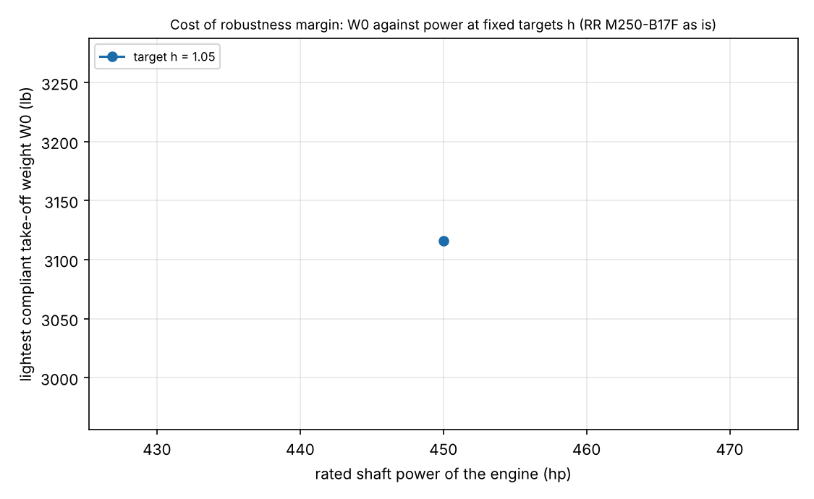

# Task 12: robust sizing with the real engine (RR M250-B17F)

Generated by `measurement/robust_sizing.py --curve-targets --engine-as-is` from `runs/task12/stage3/2026-11-23/m250_robust_105_refined/curve.json`; every number is from that run. It sizes the pusher around the real engine (owner ruling R-a, 2026-11-23) to the target h_T chosen as the input (ruling of 2026-11-23: 1.05); the result is the lightest take-off weight W0 that meets it. The photo-scaled TP100 curve (`2026-11-23_task12_robustness_curve_targets_v2.md`, kept) is a different, hypothetical engine. The first curve (`2026-11-23_task12_robustness_curve.md`, kept) sized every power to h = 1 and then measured h, so its endurance h was 1.00 by construction and it could not show the price of margin (review RC2-1).

**The engine is the Rolls-Royce M250-B17F as it is**: 450 shp, 212 lb (FAA TCDS E10CE: basic engine, fuel pump and filter, ignition and fuel control; Stage 1 applies Raymer's installed-engine factor to it as it does to every engine), its App. K table (`data/task12/m250_table.json`, calibrated to the brochure's take-off SFC and MGT, validated at 70 to 100 % power at sea level only), the ledger's SFC allowance (ruling R-b) and propeller rpm 2,030. Not a photo-scaled engine. The info-gap power band is a **cap** on the available power (ruling R-c, review M-2): SFC at a given shaft power does not change with it. The model has no altitude or low-power fuel-flow data behind it (review M-1).

## Method

- Failure modes of the R5 guarantee (3.5 h for every member of the uncertainty set U(h)): **endurance** (every member that flies the mission gives at least 3.5 h) and **transit cliff** (every member can fly the mission: the shaft power needed over the power available on the worst sub-step, the transit power ratio, is at most 1).
- Targets h_T = 1.05. Corner sets: the two seed corners (`runs/task12/stage3/2026-11-23/curve/seed_corners.json`, the harmful directions found at h = 1 on the 400 hp study of the photo-scaled TP100, not of the M250: the directions of the ledger quantities carry over, the engine power multiplier is here a cap, and the mode searches below add the M250's own worst points) moved to their harmful ends of U(h_T). After each design the two mode searches (corrected worst-case search, no early stop) run at h_T; a worst point that violates and is new joins the set and the power is sized again (at most 3 iterations).
- Candidates per power: W/S in [15.0, 16.0, 17.0, 18.0], A in [6.0, 7.0, 8.0]. Each is sized to the smallest L_sized in [8, 16] h (bisection on a 1/32 h lattice) at which the built aircraft (wing area fixed, empty weight banded) flies at least 3.5 h at every endurance corner and can fly the mission at every cliff corner. Only candidates with no failed Stage 1 compliance row count; the lightest W0 is the design of that cell.
- **V_C placard per design (owner ruling):** V_C (EAS, the same at every altitude) is 10 % above the fastest cruise sub-step of the design, rounded up to a multiple of 5 kt, never below 110 kt; V_D = 1.5 V_C; gusts and the design dynamic pressure at that V_C. R18 then holds by construction. The ledger file says `vc_placard_rule: per_design`. V_C is kept out of the weight iteration: each design is sized with V_C held fixed (110 kt first), the rule is read off the converged design, and if the held V_C is below it the design is sized again 5 kt higher, until the held V_C is at or above the rule (`uav.size_with_vc_rule`; the steps tried are in each record's `vc_placard`). **For the info-gap rebuilds the aircraft is the built one:** the record's ledger copy carries the design's chosen V_C as a fixed `vc_placard_kt_eas` and no rule, so an info-gap member that flies faster does not get a stronger structure.
- **Unresolved candidates:** a weight iteration that did not converge is neither 'too heavy' nor 'too light': the bisection stops for that candidate and the candidate is reported as unresolved with the reason. Unresolved or errored candidates in the last iteration of the cells of this report: 0.
- Only h_T = 1.05 (the ruling's target) gets the full `info_gap.study`, the mode h scans and the step-doubling check. For the other targets only the mode searches' worst values at h_T are recorded; there is no full study for them.
- Step error (RC2-2): the W0 and fuel of each h_T = 1.05 design re-sized at the same L_sized with the mission sub-steps doubled (cruise 10 to 20, loiter 16 to 32), as bias against the as-run numbers. Sizing itself uses the as-run steps.

## Summary (from the cells below)

- h = 1.05: 450 hp (W0 3116 lb; lightest 3116 lb at 450 hp).
- A power with no design at a target means no candidate of the grid meets that target; the reasons are in the last section. 'No design' is a statement about this grid and this model, not a proof for every aircraft.

## W0 against power

| P (hp) | W0 at h = 1.05 (lb) |
|---|---|
| 450 | 3116 (W/S 18, A 7) |

Crosses on the plot mark the powers with no design at a target (their height has no meaning). Each cell is the lightest design of the grid only; a lighter design off the grid (W/S or A between the levels) is not excluded.

## Target h = 1.05 (full study)

| P (hp) | W0 (lb) | W/S | A | span (ft) | fuel (lb) | L_sized (h) | V_C (kt EAS) | power margin | endurance h | cliff h | R5 guarantee h (full study) | R7 h | worst endurance at h_T (h) | worst cliff ratio at h_T |
|---|---|---|---|---|---|---|---|---|---|---|---|---|---|---|
| 450 | 3116 | 18 | 7 | 34.8 | 977 | 8.84 | 120 | 33.4% | 1.05 | 1.08 | 1.05 | 1.51 | 3.51 | 0.97 |

Endurance h is about the target by construction (the fuel is sized until the worst case at the target gives 3.5 h; review RC2-1); the columns that carry information are the cliff h (how far the transit cliff lies beyond the target) and R7. R5 guarantee h is the full study's value, at least the target in every row (to three decimals 1.050 or more).

Convergence of the corner sets: 450 hp 2 iteration(s), 2 + 1 corners. At every final design the mode searches at h_T found no violation.

## Fuel burned outside the choked-turbine assumption (review M-1)

- h = 1.05, 450 hp: 66.4% of the mission fuel (take-off to the end of the last cruise) is burned in table cells outside App. K's choked-turbine assumption and outside the part-power validation (70 to 100 % power, sea level). That fuel rests on the model alone; the 10 % SFC band stands in for the missing data.

## Unresolved and errored candidates

None: in the last iteration of every cell every candidate was classified (design, too heavy, too light, pruned or failing a Stage 1 row) and none ended in an error.

## W0 over the grid (h = 1.05, 450 hp, last iteration)

| A \ W/S | 15 | 16 | 17 | 18 |
|---|---|---|---|---|
| 6 | 3120 | 3131 | 3122 | - |
| 7 | 3134 | 3117 | 3124 | 3116 |
| 8 | 3135 | 3140 | 3127 | 3137 |

'>= x' is a pruned candidate: its W0 at 8 h already is x, not below the lightest design found before it, and W0 only grows with the sized loiter time. 'F' fails a Stage 1 row.

- W/S 18, A 6 (-): no L on the lattice satisfies both corners: too few hours at an endurance corner below some L, too heavy above it

## Powers with no design, and why

Every power has a design at every target.

## W0 and fuel bias of the sub-step count (h = 1.05 designs, RC2-2)

| P (hp) | W0 as run (lb) | W0 steps x2 (lb) | W0 bias (lb) | fuel bias (lb) | V_C as run / x2 (kt) |
|---|---|---|---|---|---|
| 450 | 3116.0 | 3116.9 | +0.9 | +0.6 | 120 / 120 |

## What the result does not cover

- The exclusions of the info-gap study apply to every h above: Headwind strength (R19, 25 kt fixed) and Oswald efficiency e are outside the horizon (Eder, 2026-11-22); ISA temperature deviation is not varied (sea level and 20,000 ft are ISA); The engine control law is not varied (the table's throttle schedule is taken as is); The shape of the part-power SFC curve is not varied (only a uniform multiplier on every table entry); Trim drag (downwash and tail height) is not modelled.
- R12 (ceiling) and R16 (turn at loiter) are not inside Gate B's horizon.
- The M250 table is validated at sea level, 70 to 100 % power only; the mission cells are outside that and part of them outside the choked-turbine assumption (review M-1; the unchoked fuel share of each design is in its record). The SFC band (10 %) and the power cap band (10 %) stand in for that, not data.
- Each mode's worst case is a search, not a proof (see `measurement/info_gap.py`); the grid is coarse in W/S and A.
- The per-design V_C changes the gust loads and structure with the engine; those loads were not re-checked against a V-n diagram beyond the Stage 1 rows listed in each record.

## Inputs

- commit ee68128bc77c32c69a3d388a153f2a679f668ad4; the working tree was dirty: 1 untracked path(s) (runs/task12/stage3/2026-11-23/m250_robust_105_refined/): new run outputs, tests or reports, none of which the sizing code reads.
- seed 20261122; ledger sha256 `0ac19b5b63c4646d8c7352f5c24999c4620849ce101a82e0cbe9e993b417f3c7`; engine table sha256 `114b0e0f1cbdbcfca8ba4d1e881e7f5699a5bb6751191c4367292630f1df0790`; seed corners sha256 `f21041cd62dc03dcbb26c26d661ba0e5eeb4c6f9edcfafd6361616bdd499cd38`.
- python 3.13.18, numpy 2.5.3, pyyaml 6.0.3; runtime 3632 s.
- command: `python -m measurement.robust_sizing --curve-targets --engine-as-is --targets 1.05 --ws 15,16,17,18 --A 6,7,8 --out runs/task12/stage3/2026-11-23/m250_robust_105_refined --report docs/validation/2026-11-23_task12_m250_robust_refined.md`

Records: `runs/task12/stage3/2026-11-23/m250_robust_105_refined/P<power>/h<target>/` (design record, ledger copy with the design's fixed V_C, engine table, `target_result.json`, per-iteration folders; `info_gap.json` for h = 1.05).
