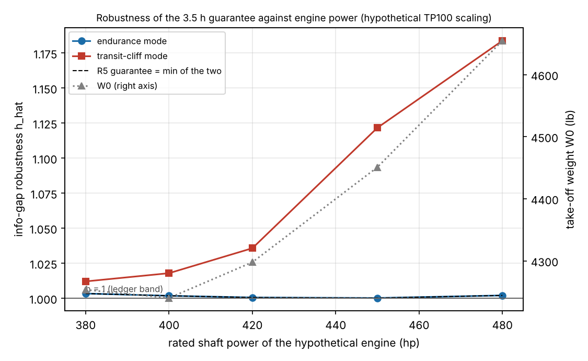

# Task 12: robustness of the R5 guarantee against engine power

Generated by `measurement/robust_sizing.py --curve` from `runs/task12/stage3/2026-11-23/curve/curve.json`; every number is from that run. There is no pass/fail headline: by the owner's ruling (2026-11-23) Gate B's R5 line is judged as a curve of info-gap robustness h_hat against engine power, per failure mode, and the engine is chosen from it later.

**The engine is hypothetical.** It is the TP100 App. K table scaled in power by P/241 (same lapse, same part-power SFC curve, 5 % SFC allowance) and in weight by Raymer Table 10.3, W = 135.8 (P/241)^0.803. No turboprop with these powers and that table is known to exist; the curve says which power class to look for. The review (RS-7) names the photo-scaled TP100 curve as the main unverified assumption behind any power figure.

## Method

- Failure modes of the 3.5 h guarantee (`r5_robust_hours`, nominal mission 8 h): **endurance mode**, the largest h such that every member of U(h) that flies the mission gives at least 3.5 h; **transit-cliff mode**, the largest h such that every member of U(h) can fly the mission (transit power ratio, shaft power needed over available on the worst mission sub-step, at most 1; a ratio above 1 is the model's "no speed on the leg within the engine's power"). The R5-guarantee h_hat is the minimum of the two. Each mode's worst case uses the corrected search (coordinate sweeps, pair flips of the most influential variables and the two engine multipliers, interior scan).
- Candidates per power: W/S in [11.0, 12.0, 13.0, 14.0, 15.0], A in [8.0, 9.0, 10.0, 12.0]; only candidates with no failed Stage 1 compliance row count; the lightest W0 is taken. Sized loiter L_sized in [8, 16] h (bisection, 0.05 h): the smallest L at which the built aircraft (wing area fixed, empty weight banded) flies at least 3.5 h at every endurance corner of a set and can fly the mission at every cliff corner of the set (review RS-4). "Cannot fly" means too heavy and moves the upper bound down.
- The sets start from the endurance and cliff corners of the 400 hp study (`runs/task12/stage3/2026-11-23/curve/seed_corners.json`). After each design its two modes are searched at h = 1; a worst point that violates and is new is added to the set and the power is sized again (at most 3 iterations per power). Iterations use the mode searches; the full `info_gap.study` runs once on the final design of each power.
- First guess of the weight iteration scales with the engine and fuel (3,000 + 6 (P - 241) lb at 8 h, plus 400 lb per extra sized hour); if non-closure is raised it is retried once from 1.3 x the guess before the candidate is declared not to close (RS-5); the reason is recorded per candidate row in each `iteration*/robust_candidate.json` and `power_result.json`.
- Step refinement (RS-1): for each final design the worst-case endurance and the cliff ratio at h = 1 are recomputed with the mission sub-steps doubled (cruise 10 to 20, loiter 16 to 32; `conceptual/uav.py` constants patched for the check only), at the recorded worst points and with the worst-case search repeated from them.

## Curve

| P (hp) | W0 (lb) | fuel (lb) | L_sized (h) | W/S | A | span (ft) | engine (lb) | power margin | endurance h | cliff h | R5 guarantee h (min) | R5 guarantee h (full study) | R7 h | binding |
|---|---|---|---|---|---|---|---|---|---|---|---|---|---|---|
| 300 | no design | | | | | | | | | | | | | |
| 340 | no design | | | | | | | | | | | | | |
| 360 | no design | | | | | | | | | | | | | |
| 380 | 4253 | 1516 | 8.69 | 12 | 8 | 53.3 | 196 | 20.3% | 1.003 | 1.012 | 1.003 | 1.003 | 1.422 | endurance |
| 400 | 4240 | 1542 | 8.53 | 13 | 8 | 51.1 | 204 | 21.4% | 1.002 | 1.018 | 1.002 | 1.002 | 1.440 | endurance |
| 420 | 4298 | 1568 | 8.50 | 14 | 9 | 52.6 | 212 | 24.8% | 1.001 | 1.036 | 1.001 | 1.000 | 1.448 | endurance |
| 450 | 4451 | 1636 | 8.34 | 13 | 8 | 52.3 | 224 | 26.9% | 1.000 | 1.122 | 1.000 | 1.000 | 1.514 | endurance |
| 480 | 4655 | 1695 | 8.38 | 13 | 9 | 56.8 | 236 | 31.7% | 1.002 | 1.184 | 1.002 | 1.002 | 1.538 | endurance |

## Step-refined values at h = 1 (RS-1)

| P (hp) | worst endurance at h = 1, as run (h) | refined, recorded point (h) | refined, search repeated (h) | cliff ratio at h = 1, as run | refined, search repeated | verdict at h = 1 depends on refinement |
|---|---|---|---|---|---|---|
| 380 | 3.5160 | 3.5076 | 3.5076 | 0.9914 | 0.9914 | no |
| 400 | 3.5085 | 3.4998 | 3.4998 | 0.9871 | 0.9871 | endurance |
| 420 | 3.5029 | 3.4937 | 3.4937 | 0.9736 | 0.9736 | endurance |
| 450 | 3.5013 | 3.4911 | 3.4911 | 0.9146 | 0.9146 | endurance |
| 480 | 3.5094 | 3.5001 | 3.5001 | 0.8691 | 0.8691 | no |

The refinement changes the worst-case endurance by the amounts above; 3.5 h at h = 1 is met when the worst-case endurance is at least 3.5 h.

## Where each mode crosses h = 1

- endurance mode: at or above 1 at every power studied.
- transit-cliff mode: at or above 1 at every power studied.
- R5 guarantee (min): at or above 1 at every power studied.

Margin of step error at the crossing: compare the worst-case endurance at h = 1 as run and refined in the step table (the review's four-fold refinement moved the 400 hp worst endurance from 3.508 to 3.495 h; the cliff ratio is set by the first mission sub-step and does not move with the number of sub-steps). A power at which the 'depends on refinement' column is not 'no' has a verdict at h = 1 that the model's own discretisation can flip.

## Convergence of the corner sets

| P (hp) | iterations | converged | corners (endurance + cliff) in the final set |
|---|---|---|---|
| 300 | 1 | no design | 1 + 1 |
| 340 | 1 | no design | 1 + 1 |
| 360 | 1 | no design | 1 + 1 |
| 380 | 1 | True | 1 + 1 |
| 400 | 1 | True | 1 + 1 |
| 420 | 1 | True | 1 + 1 |
| 450 | 1 | True | 1 + 1 |
| 480 | 1 | True | 1 + 1 |

### Powers with no design

- 300 hp: no compliant candidate satisfies both corner sets. Reasons by candidate: too heavy already at # h (last heavy point: cliff corner not flyable: no speed on the leg within the engine's power) (20)
- 340 hp: no compliant candidate satisfies both corner sets. Reasons by candidate: too heavy already at # h (last heavy point: cliff corner not flyable: no speed on the leg within the engine's power) (16); no L satisfies both: too few hours at an endurance corner below # h, too heavy (not flyable or not closing) from # h (3); no L satisfies both: too few hours at an endurance corner below # h, too heavy (not flyable or not closing) from # h (last heavy point: clif (1)
- 360 hp: no compliant candidate satisfies both corner sets. Reasons by candidate: too heavy already at # h (last heavy point: cliff corner not flyable: no speed on the leg within the engine's power) (12); no L satisfies both: too few hours at an endurance corner below # h, too heavy (not flyable or not closing) from # h (last heavy point: clif (3); no L satisfies both: too few hours at an endurance corner below # h, too heavy (not flyable or not closing) from # h (2); Stage # compliance failed: R# negative gust within the negative limit, with the round# margin (3)

## What the curve does not cover

- The exclusions of the info-gap study apply to every h_hat above: Headwind strength (R19, 25 kt fixed) and Oswald efficiency e are outside the horizon (Eder, 2026-11-22); ISA temperature deviation is not varied (sea level and 20,000 ft are ISA); The engine control law is not varied (the table's throttle schedule is taken as is); The shape of the part-power SFC curve is not varied (only a uniform multiplier on every table entry); Trim drag (downwash and tail height) is not modelled. The review found that Oswald e lower by 0.03 or a 30 kt headwind removes the margin at the 400 hp corner.
- R12 (ceiling) and R16 (turn at loiter) are not inside Gate B's horizon; the review found they do not hold inside U(1) at the 400 hp worst corner (ceiling power 430 hp against 400 hp rated).
- The engine is the photo-scaled TP100 with weight from Raymer Table 10.3; a real engine of this class would have its own SFC curve and weight (RS-7).
- Each mode's worst case is a search, not a proof (see `measurement/info_gap.py`).

## Inputs

- commit 291945de416d73248665f8475dfb3faa00470b2f (dirty tree: True); seed 20261122; ledger sha256 `915840c7010bfac5af3406027a39e6e8e26d5f86765be0033f9b914083c070c0`; engine table sha256 `3f422ba67bccb42ebe632f94342424340d8dd733804f165f31ae925d30504229`; seed corners sha256 `f21041cd62dc03dcbb26c26d661ba0e5eeb4c6f9edcfafd6361616bdd499cd38`.
- python 3.13.18, numpy 2.5.3, pyyaml 6.0.3; runtime 5602 s.
- command: `python -m measurement.robust_sizing --curve --out runs/task12/stage3/2026-11-23/curve --report docs/validation/2026-11-23_task12_robustness_curve.md --budget-min 200`

Records: `runs/task12/stage3/2026-11-23/curve/P<power>/` (design record, ledger copy, engine table, `info_gap.json` with an `inputs` block, `modes.json`, `power_result.json`, per-iteration folders).
