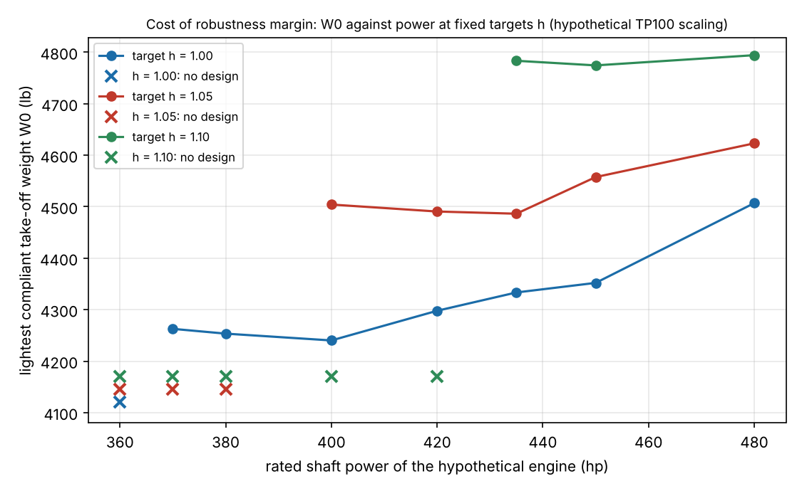

# Task 12: the cost of robustness margin against engine power

Generated by `measurement/robust_sizing.py --curve-targets` from `runs/task12/stage3/2026-11-23/curve_targets/curve.json`; every number is from that run. It answers the owner's ruling of 2026-11-23: the target h is the input (1.00, 1.05, 1.10), each power is sized to it, and the result is the lightest take-off weight W0 that meets it. The first curve (`2026-11-23_task12_robustness_curve.md`, kept) sized every power to h = 1 and then measured h, so its endurance h was 1.00 by construction and it could not show the price of margin (review RC2-1).

**The engine is hypothetical.** It is the TP100 App. K table scaled in power by P/241 (same lapse, same part-power SFC curve, 5 % SFC allowance) and in weight by Raymer Table 10.3, W = 135.8 (P/241)^0.803. No turboprop with these powers and that table is known to exist; the result says which power class to look for, not that one exists. Whether a real engine of this class has this consumption is not shown here.

## Method

- Failure modes of the R5 guarantee (3.5 h for every member of the uncertainty set U(h)): **endurance** (every member that flies the mission gives at least 3.5 h) and **transit cliff** (every member can fly the mission: the shaft power needed over the power available on the worst sub-step, the transit power ratio, is at most 1).
- Targets h_T = 1.00, 1.05, 1.10. Corner sets: the two seed corners (`runs/task12/stage3/2026-11-23/curve/seed_corners.json`, the harmful directions found at h = 1 on the 400 hp study) moved to their harmful ends of U(h_T). After each design the two mode searches (corrected worst-case search, no early stop) run at h_T; a worst point that violates and is new joins the set and the power is sized again (at most 3 iterations).
- Candidates per power: W/S in [11.0, 11.5, 12.0, 13.0, 14.0, 15.0], A in [8.0, 9.0, 10.0]. Each is sized to the smallest L_sized in [8, 16] h (bisection on a 1/32 h lattice) at which the built aircraft (wing area fixed, empty weight banded) flies at least 3.5 h at every endurance corner and can fly the mission at every cliff corner. Only candidates with no failed Stage 1 compliance row count; the lightest W0 is the design of that cell.
- **V_C placard per design (owner ruling):** V_C (EAS, the same at every altitude) is 10 % above the fastest cruise sub-step of the design, rounded up to a multiple of 5 kt, never below 110 kt; V_D = 1.5 V_C; gusts and the design dynamic pressure at that V_C. R18 then holds by construction. The ledger file says `vc_placard_rule: per_design`. V_C is kept out of the weight iteration: each design is sized with V_C held fixed (110 kt first), the rule is read off the converged design, and if the held V_C is below it the design is sized again 5 kt higher, until the held V_C is at or above the rule (`uav.size_with_vc_rule`; the steps tried are in each record's `vc_placard`). **For the info-gap rebuilds the aircraft is the built one:** the record's ledger copy carries the design's chosen V_C as a fixed `vc_placard_kt_eas` and no rule, so an info-gap member that flies faster does not get a stronger structure.
- **Unresolved candidates:** a weight iteration that did not converge is neither 'too heavy' nor 'too light': the bisection stops for that candidate and the candidate is reported as unresolved with the reason. Unresolved candidates in the last iteration of the cells of this report: 3.
- Only h_T = 1.05 (the ruling's target) gets the full `info_gap.study`, the mode h scans and the step-doubling check. For the other targets only the mode searches' worst values at h_T are recorded; there is no full study for them.
- Step error (RC2-2): the W0 and fuel of each h_T = 1.05 design re-sized at the same L_sized with the mission sub-steps doubled (cruise 10 to 20, loiter 16 to 32), as bias against the as-run numbers. Sizing itself uses the as-run steps.

## Summary (from the cells below)

- h = 1.00: designs from 370 hp up (W0 4240 to 4507 lb over the powers that have one; lightest 4240 lb at 400 hp); no design at 360 hp.
- h = 1.05: designs from 400 hp up (W0 4486 to 4623 lb over the powers that have one; lightest 4486 lb at 435 hp); no design at 360, 370, 380 hp.
- h = 1.10: designs from 435 hp up (W0 4774 to 4794 lb over the powers that have one; lightest 4774 lb at 450 hp); no design at 360, 370, 380, 400, 420 hp.
- A power with no design at a target means no candidate of the grid meets that target; the reasons are in the last section. 'No design' is a statement about this grid and this model, not a proof for every aircraft.

## W0 against power

| P (hp) | W0 at h = 1.00 (lb) | W0 at h = 1.05 (lb) | W0 at h = 1.10 (lb) |
|---|---|---|---|
| 360 | no design | no design | no design |
| 370 | 4263 (W/S 11.5, A 8) | no design | no design |
| 380 | 4253 (W/S 12, A 8) | no design | no design |
| 400 | 4240 (W/S 13, A 8) | 4504 (W/S 11.5, A 8) | no design |
| 420 | 4298 (W/S 14, A 9) | 4491 (W/S 13, A 9) | no design |
| 435 | 4333 (W/S 15, A 9) | 4486 (W/S 13, A 8) | 4783 (W/S 11.5, A 8) |
| 450 | 4352 (W/S 15, A 8) | 4558 (W/S 13, A 8) | 4774 (W/S 12, A 8) |
| 480 | 4507 (W/S 15, A 8) | 4623 (W/S 15, A 9) | 4794 (W/S 13, A 8) |

Crosses on the plot mark the powers with no design at a target (their height has no meaning). Each cell is the lightest design of the grid only; a lighter design off the grid (W/S or A between the levels) is not excluded.

For reference, the first curve (h = 1 sizing, fixed 110 kt placard, grid W/S 11 to 15, A 8 to 12) at the powers both runs share: 380 hp 4253 lb; 400 hp 4240 lb; 420 hp 4298 lb; 450 hp 4451 lb; 480 hp 4655 lb. The difference to the h = 1.00 column is the per-design V_C (review RC2-3) and the finer grid.

## Target h = 1.00 (mode searches at h_T only)

| P (hp) | W0 (lb) | W/S | A | span (ft) | fuel (lb) | L_sized (h) | V_C (kt EAS) | power margin | worst endurance at h_T (h) | worst cliff ratio at h_T |
|---|---|---|---|---|---|---|---|---|---|---|
| 360 | no design (see the reasons below) | | | | | | | | | | |
| 370 | 4263 | 11.5 | 8 | 54.5 | 1502 | 8.75 | 110 | 19.6% | 3.50 | 0.99 |
| 380 | 4253 | 12 | 8 | 53.3 | 1516 | 8.69 | 110 | 20.3% | 3.52 | 0.99 |
| 400 | 4240 | 13 | 8 | 51.1 | 1542 | 8.53 | 110 | 21.4% | 3.51 | 0.99 |
| 420 | 4298 | 14 | 9 | 52.6 | 1568 | 8.50 | 110 | 24.8% | 3.50 | 0.97 |
| 435 | 4333 | 15 | 9 | 51.0 | 1610 | 8.50 | 115 | 24.3% | 3.51 | 1.00 |
| 450 | 4352 | 15 | 8 | 48.2 | 1648 | 8.38 | 115 | 23.1% | 3.52 | 0.99 |
| 480 | 4507 | 15 | 8 | 49.0 | 1718 | 8.34 | 120 | 25.5% | 3.51 | 0.96 |

Convergence of the corner sets: 370 hp 1 iteration(s), 1 + 1 corners; 380 hp 1 iteration(s), 1 + 1 corners; 400 hp 1 iteration(s), 1 + 1 corners; 420 hp 1 iteration(s), 1 + 1 corners; 435 hp 1 iteration(s), 1 + 1 corners; 450 hp 2 iteration(s), 2 + 1 corners; 480 hp 1 iteration(s), 1 + 1 corners. At every final design the mode searches at h_T found no violation.

## Target h = 1.05 (full study)

| P (hp) | W0 (lb) | W/S | A | span (ft) | fuel (lb) | L_sized (h) | V_C (kt EAS) | power margin | endurance h | cliff h | R5 guarantee h (full study) | R7 h | worst endurance at h_T (h) | worst cliff ratio at h_T |
|---|---|---|---|---|---|---|---|---|---|---|---|---|---|---|
| 360 | no design (see the reasons below) | | | | | | | | | | | | | | |
| 370 | no design (see the reasons below) | | | | | | | | | | | | | | |
| 380 | no design (see the reasons below) | | | | | | | | | | | | | | |
| 400 | 4504 | 11.5 | 8 | 56.0 | 1620 | 9.03 | 110 | 21.7% | 1.05 | 1.05 | 1.05 | 1.44 | 3.51 | 1.00 |
| 420 | 4491 | 13 | 9 | 55.8 | 1637 | 8.97 | 110 | 24.6% | 1.05 | 1.05 | 1.05 | 1.44 | 3.51 | 1.00 |
| 435 | 4486 | 13 | 8 | 52.5 | 1666 | 8.78 | 110 | 23.8% | 1.05 | 1.07 | 1.05 | 1.47 | 3.50 | 0.99 |
| 450 | 4558 | 13 | 8 | 53.0 | 1699 | 8.75 | 110 | 25.2% | 1.05 | 1.10 | 1.05 | 1.49 | 3.52 | 0.97 |
| 480 | 4623 | 15 | 9 | 52.7 | 1758 | 8.75 | 115 | 27.1% | 1.05 | 1.07 | 1.05 | 1.47 | 3.51 | 0.99 |

Endurance h is about the target by construction (the fuel is sized until the worst case at the target gives 3.5 h; review RC2-1); the columns that carry information are the cliff h (how far the transit cliff lies beyond the target) and R7. R5 guarantee h is the full study's value, at least the target in every row (to three decimals 1.050 or more).

Convergence of the corner sets: 400 hp 1 iteration(s), 1 + 1 corners; 420 hp 1 iteration(s), 1 + 1 corners; 435 hp 1 iteration(s), 1 + 1 corners; 450 hp 1 iteration(s), 1 + 1 corners; 480 hp 1 iteration(s), 1 + 1 corners. At every final design the mode searches at h_T found no violation.

## Target h = 1.10 (mode searches at h_T only)

| P (hp) | W0 (lb) | W/S | A | span (ft) | fuel (lb) | L_sized (h) | V_C (kt EAS) | power margin | worst endurance at h_T (h) | worst cliff ratio at h_T |
|---|---|---|---|---|---|---|---|---|---|---|
| 360 | no design (see the reasons below) | | | | | | | | | | |
| 370 | no design (see the reasons below) | | | | | | | | | | |
| 380 | no design (see the reasons below) | | | | | | | | | | |
| 400 | no design (see the reasons below) | | | | | | | | | | |
| 420 | no design (see the reasons below) | | | | | | | | | | |
| 435 | 4783 | 11.5 | 8 | 57.7 | 1757 | 9.31 | 110 | 23.7% | 3.52 | 1.00 |
| 450 | 4774 | 12 | 8 | 56.4 | 1773 | 9.19 | 110 | 24.9% | 3.50 | 0.99 |
| 480 | 4794 | 13 | 8 | 54.3 | 1820 | 9.03 | 110 | 26.5% | 3.51 | 0.98 |

Convergence of the corner sets: 435 hp 1 iteration(s), 1 + 1 corners; 450 hp 1 iteration(s), 1 + 1 corners; 480 hp 1 iteration(s), 1 + 1 corners. At every final design the mode searches at h_T found no violation.

## Powers with no design, and why

- **360 hp, h = 1.00**: none of the 18 candidates is a design (1 unresolved).
  - too heavy already at 8 h: cliff corner not flyable (no speed on the leg within the engine's power) (9): W/S 15 (A 8, 9, 10); W/S 14 (A 8, 9, 10); W/S 13 (A 8, 9, 10)
  - no L on the lattice satisfies both corners: too few hours at an endurance corner below some L, cliff corner not flyable (no speed on the leg within the engine's power) above it (4): W/S 12 (A 8, 10); W/S 11.5 (A 9, 10)
  - no L on the lattice satisfies both corners: too few hours at an endurance corner below some L, too heavy above it (1): W/S 12 (A 9)
  - unresolved: weight iteration did not converge (not classified as too heavy or too small) (1): W/S 11.5 (A 8)
  - meets both corners but fails Stage 1 row: R9 negative gust within the negative limit (3): W/S 11 (A 8, 9, 10)
- **360 hp, h = 1.05**: none of the 18 candidates is a design.
  - too heavy already at 8 h: cliff corner not flyable (no speed on the leg within the engine's power) (14): W/S 15 (A 8, 9, 10); W/S 14 (A 8, 9, 10); W/S 13 (A 8, 9, 10); W/S 12 (A 8, 9, 10); W/S 11.5 (A 8, 9)
  - no L on the lattice satisfies both corners: too few hours at an endurance corner below some L, cliff corner not flyable (no speed on the leg within the engine's power) above it (3): W/S 11 (A 8, 9, 10)
  - no L on the lattice satisfies both corners: too few hours at an endurance corner below some L, too heavy above it (1): W/S 11.5 (A 10)
- **370 hp, h = 1.05**: none of the 18 candidates is a design.
  - too heavy already at 8 h: cliff corner not flyable (no speed on the leg within the engine's power) (11): W/S 15 (A 8, 9, 10); W/S 14 (A 8, 9, 10); W/S 13 (A 8, 9, 10); W/S 12 (A 8, 9)
  - no L on the lattice satisfies both corners: too few hours at an endurance corner below some L, too heavy above it (3): W/S 11.5 (A 8, 10); W/S 12 (A 10)
  - no L on the lattice satisfies both corners: too few hours at an endurance corner below some L, cliff corner not flyable (no speed on the leg within the engine's power) above it (4): W/S 11.5 (A 9); W/S 11 (A 8, 9, 10)
- **380 hp, h = 1.05**: none of the 18 candidates is a design.
  - too heavy already at 8 h: cliff corner not flyable (no speed on the leg within the engine's power) (9): W/S 15 (A 8, 9, 10); W/S 14 (A 8, 9, 10); W/S 13 (A 8, 9, 10)
  - no L on the lattice satisfies both corners: too few hours at an endurance corner below some L, too heavy above it (5): W/S 12 (A 8, 9, 10); W/S 11.5 (A 8, 10)
  - no L on the lattice satisfies both corners: too few hours at an endurance corner below some L, cliff corner not flyable (no speed on the leg within the engine's power) above it (4): W/S 11.5 (A 9); W/S 11 (A 8, 9, 10)
- **360 hp, h = 1.10**: none of the 18 candidates is a design.
  - too heavy already at 8 h: cliff corner not flyable (no speed on the leg within the engine's power) (18): W/S 15 (A 8, 9, 10); W/S 14 (A 8, 9, 10); W/S 13 (A 8, 9, 10); W/S 12 (A 8, 9, 10); W/S 11.5 (A 8, 9, 10); W/S 11 (A 8, 9, 10)
- **370 hp, h = 1.10**: none of the 18 candidates is a design.
  - too heavy already at 8 h: cliff corner not flyable (no speed on the leg within the engine's power) (18): W/S 15 (A 8, 9, 10); W/S 14 (A 8, 9, 10); W/S 13 (A 8, 9, 10); W/S 12 (A 8, 9, 10); W/S 11.5 (A 8, 9, 10); W/S 11 (A 8, 9, 10)
- **380 hp, h = 1.10**: none of the 18 candidates is a design.
  - too heavy already at 8 h: cliff corner not flyable (no speed on the leg within the engine's power) (16): W/S 15 (A 8, 9, 10); W/S 14 (A 8, 9, 10); W/S 13 (A 8, 9, 10); W/S 12 (A 8, 9, 10); W/S 11.5 (A 8, 9, 10); W/S 11 (A 8)
  - no L on the lattice satisfies both corners: too few hours at an endurance corner below some L, cliff corner not flyable (no speed on the leg within the engine's power) above it (1): W/S 11 (A 9)
  - no L on the lattice satisfies both corners: too few hours at an endurance corner below some L, too heavy above it (1): W/S 11 (A 10)
- **400 hp, h = 1.10**: none of the 18 candidates is a design.
  - too heavy already at 8 h: cliff corner not flyable (no speed on the leg within the engine's power) (10): W/S 15 (A 8, 9, 10); W/S 14 (A 8, 9, 10); W/S 13 (A 8, 9, 10); W/S 12 (A 8)
  - no L on the lattice satisfies both corners: too few hours at an endurance corner below some L, too heavy above it (4): W/S 12 (A 9); W/S 11 (A 8, 10); W/S 11.5 (A 10)
  - no L on the lattice satisfies both corners: too few hours at an endurance corner below some L, cliff corner not flyable (no speed on the leg within the engine's power) above it (4): W/S 11.5 (A 8, 9); W/S 12 (A 10); W/S 11 (A 9)
- **420 hp, h = 1.10**: none of the 18 candidates is a design.
  - too heavy already at 8 h: cliff corner not flyable (no speed on the leg within the engine's power) (7): W/S 15 (A 8, 9, 10); W/S 14 (A 8, 9, 10); W/S 13 (A 8)
  - no L on the lattice satisfies both corners: too few hours at an endurance corner below some L, too heavy above it (6): W/S 13 (A 9); W/S 12 (A 8); W/S 11.5 (A 9, 10); W/S 11 (A 8, 10)
  - no L on the lattice satisfies both corners: too few hours at an endurance corner below some L, cliff corner not flyable (no speed on the leg within the engine's power) above it (5): W/S 13 (A 10); W/S 12 (A 9, 10); W/S 11.5 (A 8); W/S 11 (A 9)

## W0 and fuel bias of the sub-step count (h = 1.05 designs, RC2-2)

| P (hp) | W0 as run (lb) | W0 steps x2 (lb) | W0 bias (lb) | fuel bias (lb) | V_C as run / x2 (kt) |
|---|---|---|---|---|---|
| 400 | 4504.2 | 4508.0 | +3.9 | +2.2 | 110 / 110 |
| 420 | 4490.7 | 4494.5 | +3.9 | +2.2 | 110 / 110 |
| 435 | 4486.4 | 4490.3 | +3.9 | +2.3 | 110 / 110 |
| 450 | 4557.6 | 4561.7 | +4.1 | +2.4 | 110 / 110 |
| 480 | 4623.1 | 4627.3 | +4.2 | +2.6 | 115 / 115 |

## What the result does not cover

- The exclusions of the info-gap study apply to every h above: Headwind strength (R19, 25 kt fixed) and Oswald efficiency e are outside the horizon (Eder, 2026-11-22); ISA temperature deviation is not varied (sea level and 20,000 ft are ISA); The engine control law is not varied (the table's throttle schedule is taken as is); The shape of the part-power SFC curve is not varied (only a uniform multiplier on every table entry); Trim drag (downwash and tail height) is not modelled.
- R12 (ceiling) and R16 (turn at loiter) are not inside Gate B's horizon.
- The engine is the photo-scaled TP100 with weight from Raymer Table 10.3; a real engine of this class would have its own SFC curve and weight.
- Each mode's worst case is a search, not a proof (see `measurement/info_gap.py`); the grid is coarse in W/S and A.
- The per-design V_C changes the gust loads and structure with the engine; those loads were not re-checked against a V-n diagram beyond the Stage 1 rows listed in each record.

## Inputs

- commit 4a31ef8ca044d3ec7ee73d354ad02da643fd32ad; the working tree was dirty: 1 untracked path(s) (runs/task12/stage3/2026-11-23/curve_targets_v2/): new run outputs, tests or reports, none of which the sizing code reads.
- seed 20261122; ledger sha256 `49429f4d24cfdb6a40eabaa25b48aafdcba27910bf4202eb72d361dec95c16cd`; engine table sha256 `3f422ba67bccb42ebe632f94342424340d8dd733804f165f31ae925d30504229`; seed corners sha256 `f21041cd62dc03dcbb26c26d661ba0e5eeb4c6f9edcfafd6361616bdd499cd38`.
- python 3.13.18, numpy 2.5.3, pyyaml 6.0.3; runtime 8512 s.
- command: `python -m measurement.robust_sizing --curve-targets --out runs/task12/stage3/2026-11-23/curve_targets_v2 --report docs/validation/2026-11-23_task12_robustness_curve_targets_v2.md`

Records: `runs/task12/stage3/2026-11-23/curve_targets/P<power>/h<target>/` (design record, ledger copy with the design's fixed V_C, engine table, `target_result.json`, per-iteration folders; `info_gap.json` for h = 1.05).
