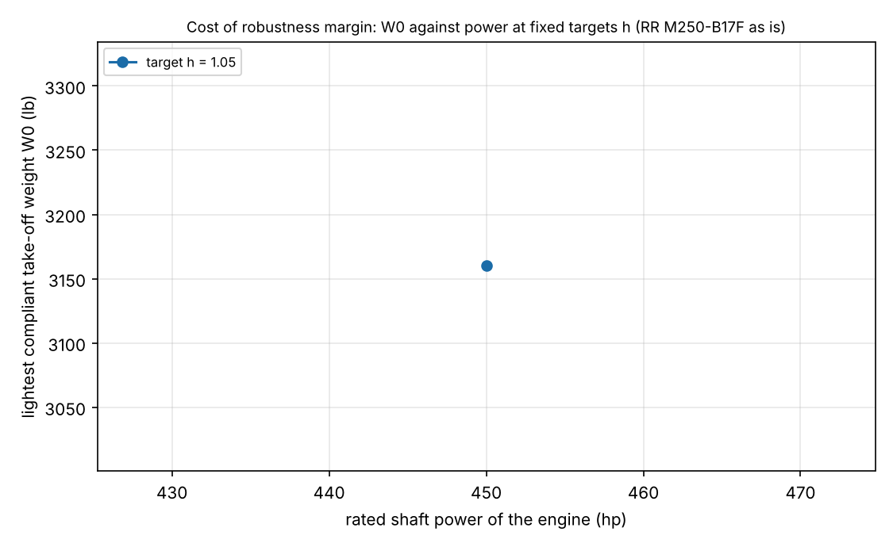

# Task 12: robust sizing with the real engine (RR M250-B17F)

Generated by `measurement/robust_sizing.py --curve-targets --engine-as-is` from `runs/task12/stage3/2026-11-25/m250_baseline_appl/curve.json`; every number is from that run. It sizes the pusher around the real engine (owner ruling R-a, 2026-11-23) to the target h_T chosen as the input (ruling of 2026-11-23: 1.05); the result is the lightest take-off weight W0 that meets it. The photo-scaled TP100 curve (`2026-11-23_task12_robustness_curve_targets_v2.md`, kept) is a different, hypothetical engine. The first curve (`2026-11-23_task12_robustness_curve.md`, kept) sized every power to h = 1 and then measured h, so its endurance h was 1.00 by construction and it could not show the price of margin (review RC2-1).

**The engine is the Rolls-Royce M250-B17F as it is**: 450 shp, 212 lb (FAA TCDS E10CE: basic engine, fuel pump and filter, ignition and fuel control; Stage 1 applies Raymer's installed-engine factor to it as it does to every engine), its App. K table (`data/task12/m250_table.json`, calibrated to the brochure's take-off SFC and MGT, validated at 70 to 100 % power at sea level only), the ledger's SFC allowance (ruling R-b) and propeller rpm 2,030. Not a photo-scaled engine. The info-gap power band is a **cap** on the available power (ruling R-c, review M-2): SFC at a given shaft power does not change with it. The cap is clipped at the rated power (ruling R-e): a multiplier above 1 cannot take the available power above 450 shp. The model has no altitude or low-power fuel-flow data behind it (review M-1).

## Method

- Failure modes of the R5 guarantee (3.5 h for every member of the uncertainty set U(h)): **endurance** (every member that flies the mission gives at least 3.5 h) and **transit cliff** (every member can fly the mission: the shaft power needed over the power available on the worst sub-step, the transit power ratio, is at most 1).
- Targets h_T = 1.05. Corner sets: the two seed corners (`runs/task12/stage3/2026-11-23/curve/seed_corners.json`, the harmful directions found at h = 1 on the 400 hp study of the photo-scaled TP100, not of the M250: the directions of the ledger quantities carry over, the engine power multiplier is here a cap, and the mode searches below add the M250's own worst points) moved to their harmful ends of U(h_T). After each design the two mode searches (corrected worst-case search, no early stop) run at h_T; a worst point that violates and is new joins the set and the power is sized again (at most 3 iterations).
- Candidates per power: W/S in [16.0], A in [7.0]. Each is sized to the smallest L_sized in [8, 16] h (bisection on a 1/32 h lattice) at which the built aircraft (wing area fixed, empty weight banded) flies at least 3.5 h at every endurance corner and can fly the mission at every cliff corner. Only candidates with no failed Stage 1 compliance row count; the lightest W0 is the design of that cell.
- **V_C placard per design (owner ruling):** V_C (EAS, the same at every altitude) is 10 % above the fastest cruise sub-step of the design, rounded up to a multiple of 5 kt, never below 110 kt; V_D = 1.5 V_C; gusts and the design dynamic pressure at that V_C. R18 then holds by construction. The ledger file says `vc_placard_rule: per_design`. V_C is kept out of the weight iteration: each design is sized with V_C held fixed (110 kt first), the rule is read off the converged design, and if the held V_C is below it the design is sized again 5 kt higher, until the held V_C is at or above the rule (`uav.size_with_vc_rule`; the steps tried are in each record's `vc_placard`). **For the info-gap rebuilds the aircraft is the built one:** the record's ledger copy carries the design's chosen V_C as a fixed `vc_placard_kt_eas` and no rule, so an info-gap member that flies faster does not get a stronger structure.
- **Unresolved candidates:** a weight iteration that did not converge is neither 'too heavy' nor 'too light': the bisection stops for that candidate and the candidate is reported as unresolved with the reason. Unresolved or errored candidates in the last iteration of the cells of this report: 0.
- Only h_T = 1.05 (the ruling's target) gets the full `info_gap.study`, the mode h scans and the step-doubling check. For the other targets only the mode searches' worst values at h_T are recorded; there is no full study for them.
- Step error (RC2-2): the W0 and fuel of each h_T = 1.05 design re-sized at the same L_sized with the mission sub-steps doubled (cruise 10 to 20, loiter 16 to 32), as bias against the as-run numbers. Sizing itself uses the as-run steps.

## Summary (from the cells below)

- h = 1.05: 450 hp (W0 3160 lb; lightest 3160 lb at 450 hp).
- A power with no design at a target means no candidate of the grid meets that target; the reasons are in the last section. 'No design' is a statement about this grid and this model, not a proof for every aircraft.

## W0 against power

| P (hp) | W0 at h = 1.05 (lb) |
|---|---|
| 450 | 3160 (W/S 16, A 7) |

Crosses on the plot mark the powers with no design at a target (their height has no meaning). Each cell is the lightest design of the grid only; a lighter design off the grid (W/S or A between the levels) is not excluded.

## Target h = 1.05 (full study)

| P (hp) | W0 (lb) | W/S | A | span (ft) | fuel (lb) | L_sized (h) | V_C (kt EAS) | power margin | endurance h | cliff h | R5 guarantee h (full study) | R7 h | worst endurance at h_T (h) | worst cliff ratio at h_T |
|---|---|---|---|---|---|---|---|---|---|---|---|---|---|---|
| 450 | 3160 | 16 | 7 | 37.2 | 977 | 9.03 | 115 | 34.7% | 1.05 | 1.18 | 1.05 | 1.51 | 3.51 | 0.90 |

Endurance h is about the target by construction (the fuel is sized until the worst case at the target gives 3.5 h; review RC2-1); the columns that carry information are the cliff h (how far the transit cliff lies beyond the target) and R7. R5 guarantee h is the full study's value, at least the target in every row (to three decimals 1.050 or more).

Convergence of the corner sets: 450 hp 2 iteration(s), 2 + 1 corners. At every final design the mode searches at h_T found no violation.

## Fuel burned outside the choked-turbine assumption (review M-1)

- h = 1.05, 450 hp: 71.8% of the mission fuel (take-off to the end of the last cruise) is burned in table cells outside App. K's choked-turbine assumption and outside the part-power validation (70 to 100 % power, sea level). That fuel rests on the model alone; the 10 % SFC band stands in for the missing data.

## Unresolved and errored candidates

None: in the last iteration of every cell every candidate was classified (design, too heavy, too light, pruned or failing a Stage 1 row) and none ended in an error.

## W0 over the grid (h = 1.05, 450 hp, last iteration)

| A \ W/S | 16 |
|---|---|
| 7 | 3160 |

'>= x' is a pruned candidate: its W0 at 8 h already is x, not below the lightest design found before it, and W0 only grows with the sized loiter time. 'F' fails a Stage 1 row.

## Powers with no design, and why

Every power has a design at every target.

## W0 and fuel bias of the sub-step count (h = 1.05 designs, RC2-2)

| P (hp) | W0 as run (lb) | W0 steps x2 (lb) | W0 bias (lb) | fuel bias (lb) | V_C as run / x2 (kt) |
|---|---|---|---|---|---|
| 450 | 3160.3 | 3161.3 | +1.0 | +0.6 | 115 / 115 |

## What the result does not cover

- The exclusions of the info-gap study apply to every h above: Headwind strength (R19, 25 kt fixed) and Oswald efficiency e are outside the horizon (Eder, 2026-11-22); ISA temperature deviation is not varied (sea level and 20,000 ft are ISA); The engine control law is not varied (the table's throttle schedule is taken as is); The shape of the part-power SFC curve is not varied (only a uniform multiplier on every table entry); Trim drag (downwash and tail height) is not modelled.
- R12 (ceiling) and R16 (turn at loiter) are not inside Gate B's horizon.
- The M250 table is validated at sea level, 70 to 100 % power only; the mission cells are outside that and part of them outside the choked-turbine assumption (review M-1; the unchoked fuel share of each design is in its record). The SFC band (10 %) and the power cap band (10 %) stand in for that, not data.
- Each mode's worst case is a search, not a proof (see `measurement/info_gap.py`); the grid is coarse in W/S and A.
- The per-design V_C changes the gust loads and structure with the engine; those loads were not re-checked against a V-n diagram beyond the Stage 1 rows listed in each record.

## Why this baseline is 43 lb heavier than the flat-propeller baseline (added after the run, review S3A-1)

Added to this generated report by hand on 2026-11-26; regenerating the report with `measurement/robust_sizing.py` would drop it. Every number below is read from one record, `runs/task12/stage3/2026-11-26/appl_decomposition/decomposition.json`, made by `measurement/appl_decomposition.py` from the two designs' `design_pusher.json` and `target_result.json` (old: `runs/task12/stage3/2026-11-24/m250_baseline_ws16_a7/P450/h1.05`, flat propeller; new: this run). Record commit `bc6c07cfe185b4207fd723d2f97e75b4eb5c2ed8`, working tree dirty: false; command: `python -m measurement.appl_decomposition --old runs/task12/stage3/2026-11-24/m250_baseline_ws16_a7/P450/h1.05 --new runs/task12/stage3/2026-11-25/m250_baseline_appl/P450/h1.05 --out runs/task12/stage3/2026-11-26/appl_decomposition/decomposition.json`.

**Split of the weight (the two records, read).**

| Quantity | Flat (old) | App. L (new) | Change |
|---|---|---|---|
| W0 (lb) | 3,116.9 | 3,160.3 | +43.4 |
| Fuel (lb) | 950.0 | 977.3 | +27.3 |
| Empty weight (lb) | 1,667.0 | 1,683.0 | +16.1 |
| Sized loiter (h) | 8.78125 | 9.03125 | +0.25000 |
| W0 sized at an 8 h loiter (lb) | 3,017.0 | 3,024.2 | +7.2 |
| W0 - fuel - empty weight (lb) | 500.0 | 500.0 | - |

The W0 change of +43.4 lb is +27.3 lb of fuel and +16.1 lb of empty weight (the remainder, payload and fixed items, is the same in both). The sized loiter is +0.25 h longer (8 steps of the 1/32 h lattice). Sized to an 8 h loiter the two designs differ by +7.2 lb only; the other 36.2 lb of the 43.4 lb arises between the 8 h loiter and the sized one, that is, from what the worst case at h = 1.05 needs.

**Where the worst case spends the fuel.** At each design's worst endurance point (the moved values of `worst_at_target.endurance`, loiter time the record's hours on station at that point: 3.507 h new, 3.512 h old), segment fuel in lb (weight lost; the reserve factor 1.06 applies to the total), with the record's propeller and with the other propeller swapped in. The flat swap uses the old record's low end eta_p 0.7475; the disk swap uses the new record's low end f = 0.7975.

| Segment | New design, disk (record) | New design, flat 0.7475 swapped in | Old design, flat (record) | Old design, disk swapped in |
|---|---|---|---|---|
| takeoff | 26.8 | 26.8 | 26.8 | 26.8 |
| climb | 83.1 | 64.6 | 63.1 | 80.9 |
| cruise_out | 232.9 | 233.0 | 231.3 | 231.0 |
| loiter | 350.5 | 349.5 | 347.4 | 348.2 |
| cruise_back | 215.5 | 216.1 | 214.5 | 213.9 |
| mission fuel with reserve | 977.3 | 957.5 | 950.0 | 968.6 |
| W0 at that point (lb) | 3,559.7 | 3,559.7 | 3,512.6 | 3,512.6 |
| hours on station at the record's fuel | 3.507 | 3.713 | 3.512 | 3.318 |

On the new design the disk costs +19.7 lb of fuel against the flat low end, of which the climb segment is +18.5 lb; the cruise and loiter segments differ by at most 0.9 lb each. Hours on station at the record's fuel: 3.507 h with the disk, 3.713 h with the flat low end. On the old design the disk swapped in gives 3.318 h against the record's 3.512 h.

**Mean propeller efficiency per leg and climb inputs** (mean over the sub-steps the mission code used; the climb efficiency is at the mid-altitude of the climb).

| Case | Cruise out | Loiter | Cruise back | Climb eta | D/T | Climb speed (kt) | Climb fraction |
|---|---|---|---|---|---|---|---|
| Old, worst point, flat 0.7475 (record) | 0.7475 | 0.7475 | 0.7475 | 0.7475 | 0.474 | 81.0 | 0.9819 |
| New, worst point, disk f 0.7975 (record) | 0.7455 | 0.7384 | 0.7472 | 0.6673 | 0.550 | 87.7 | 0.9765 |
| New, worst point, flat 0.7475 swapped in | 0.7475 | 0.7475 | 0.7475 | 0.7475 | 0.480 | 80.9 | 0.9817 |
| New, nominal, disk f 0.85, sized loiter | 0.8144 | 0.7917 | 0.8156 | 0.7271 | 0.360 | 99.2 | 0.9868 |
| New, nominal, flat 0.80 swapped in, sized loiter | 0.8000 | 0.8000 | 0.8000 | 0.8000 | 0.312 | 70.7 | 0.9886 |

At nominal the same exchange (disk f 0.85 against the ledger's flat 0.80) changes the mission fuel by +4.8 lb at the sized loiter, against +19.7 lb at the worst point. The low ends are about equally far below nominal in relative terms: flat 0.7475/0.8 = 0.9344, disk factor 0.7975/0.85 = 0.9382. The disk's efficiency at the worst point's climb (0.667) lies below the flat low end (0.7475); that aircraft is heavier (3560 lb against 3160 lb nominal), which loads the disk more (not isolated by a run here).

What this supports and what it does not: the extra weight of this baseline comes mainly from the climb leg at the worst endurance point, where the disk's efficiency is lower than the flat low end, and from the longer sized loiter that follows. It rests on the disk at its most heavily loaded point, where the factor f = 0.85 at low speed is a judgement beyond App. L (review APL-5), and on the two-point climb model of Stage 1 (mean drag over thrust of sea level and the mission altitude at one speed). No run here isolates the take-off use of f, and none varies f over its band for the climb.

## Seed corners and the binding R7 mode (added after the run, review S3A-9)

- The seed corners (`runs/task12/stage3/2026-11-23/curve/seed_corners.json`) were found for the flat propeller and carry `eta_p` (the first endurance corner here moves `eta_p` to 0.7475). Under `propeller_model: app_l` `eta_p` is inert (it is in this run's `inert_variables`: yes), so the first endurance corner has a nominal propeller: iteration 1 sized to W0 3,060.2 lb with L_sized 8.1875 h and a worst corner at 3.501 h. The mode search then added the corner with `prop_real_to_ideal` 0.7975 and the second iteration closed with no violation, so the result stands; but the sentence under Method that the directions of the ledger quantities carry over does not hold for the propeller (the seeds were not mapped from `eta_p` to `prop_real_to_ideal`).
- The binding R7 mode changed. On the flat baseline landing bound it (h 1.605, take-off 1.725); on this baseline take-off binds (h 1.506, landing 1.606). The take-off horizon fell from 1.725 to 1.506, while the landing horizon is nearly the same. The take-off thrust under `app_l` rests on f at low speed (review APL-5), so R7's binding value now depends on that judgement.

## Inputs

- commit 85019809ca73ae305c23e6c5fa9821ad8063c54d; the working tree was dirty: 1 untracked path(s) (runs/task12/stage3/2026-11-25/): new run outputs, tests or reports, none of which the sizing code reads.
- seed 20261122; ledger sha256 `a869023c44313081b7d321925b1e705ff67132b437697d9e97ec6065d9334716`; engine table sha256 `114b0e0f1cbdbcfca8ba4d1e881e7f5699a5bb6751191c4367292630f1df0790`; seed corners sha256 `f21041cd62dc03dcbb26c26d661ba0e5eeb4c6f9edcfafd6361616bdd499cd38`.
- python 3.13.18, numpy 2.5.3, pyyaml 6.0.3; runtime 2615 s.
- command: `python -m measurement.robust_sizing --curve-targets --engine-as-is --targets 1.05 --ws 16 --A 7 --out runs/task12/stage3/2026-11-25/m250_baseline_appl --report docs/validation/2026-11-25_task12_m250_baseline_appl.md`

Records: `runs/task12/stage3/2026-11-25/m250_baseline_appl/P<power>/h<target>/` (design record, ledger copy with the design's fixed V_C, engine table, `target_result.json`, per-iteration folders; `info_gap.json` for h = 1.05).
