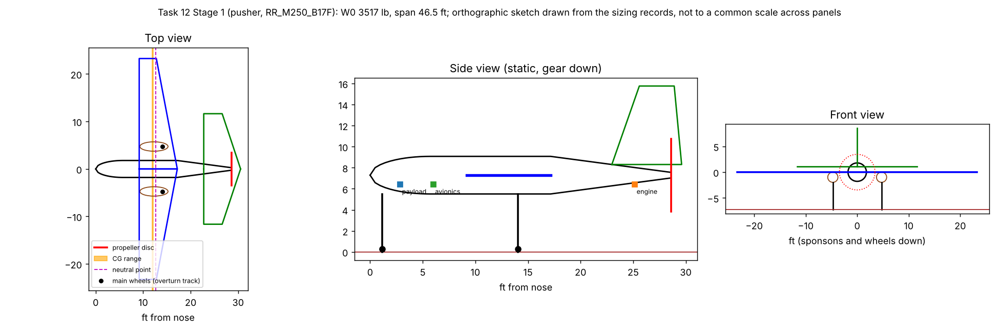
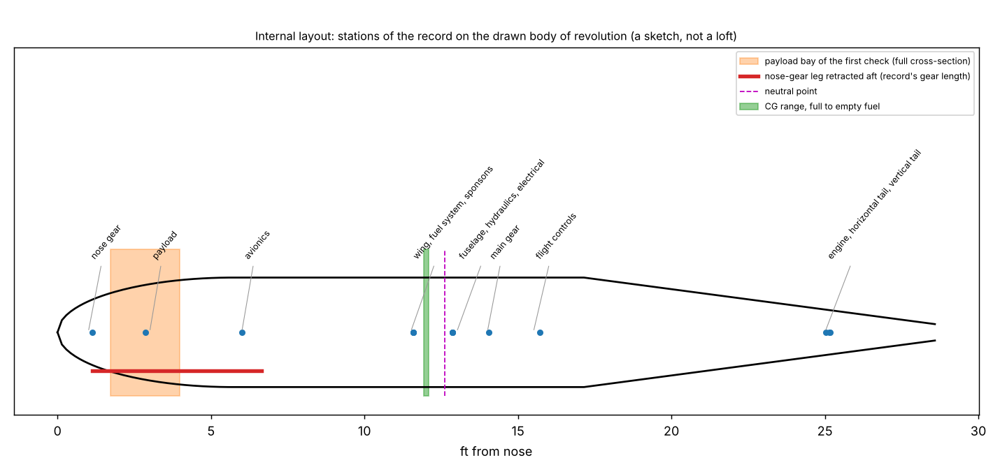
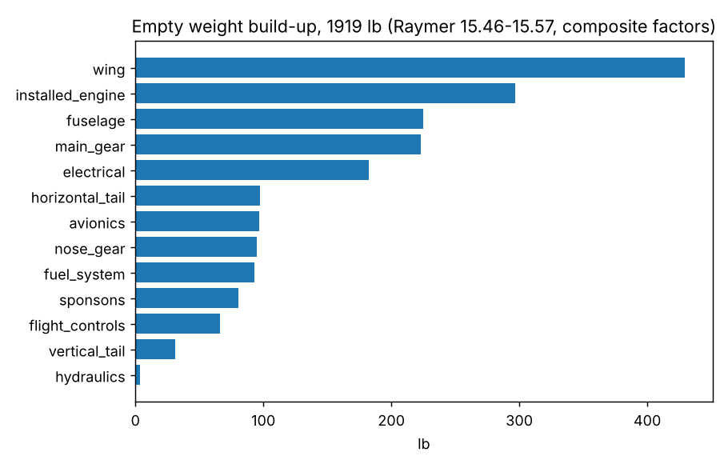
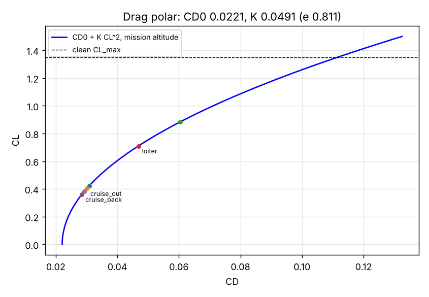
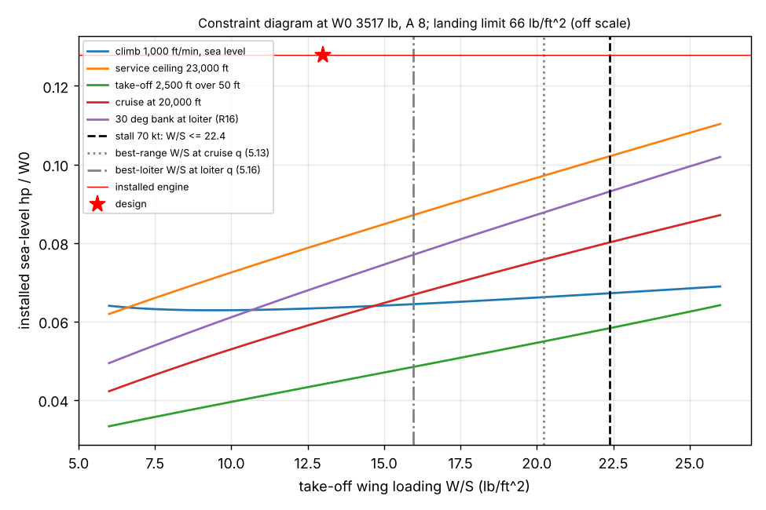
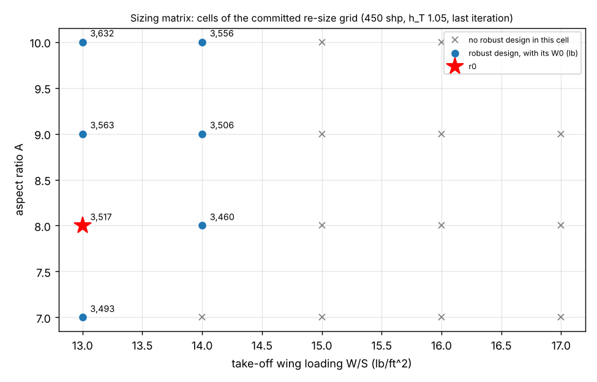
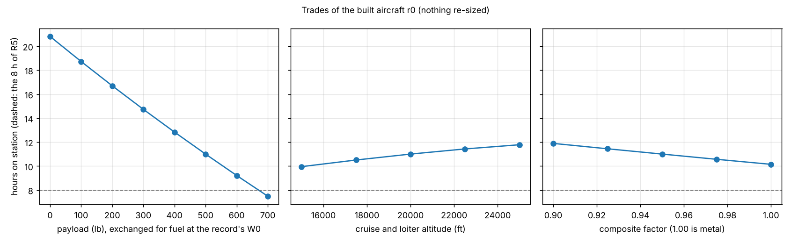
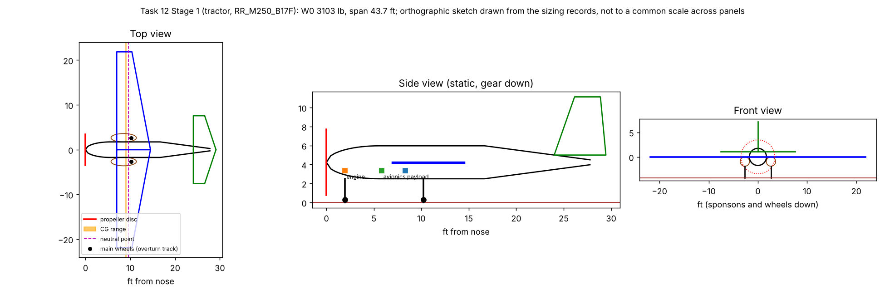
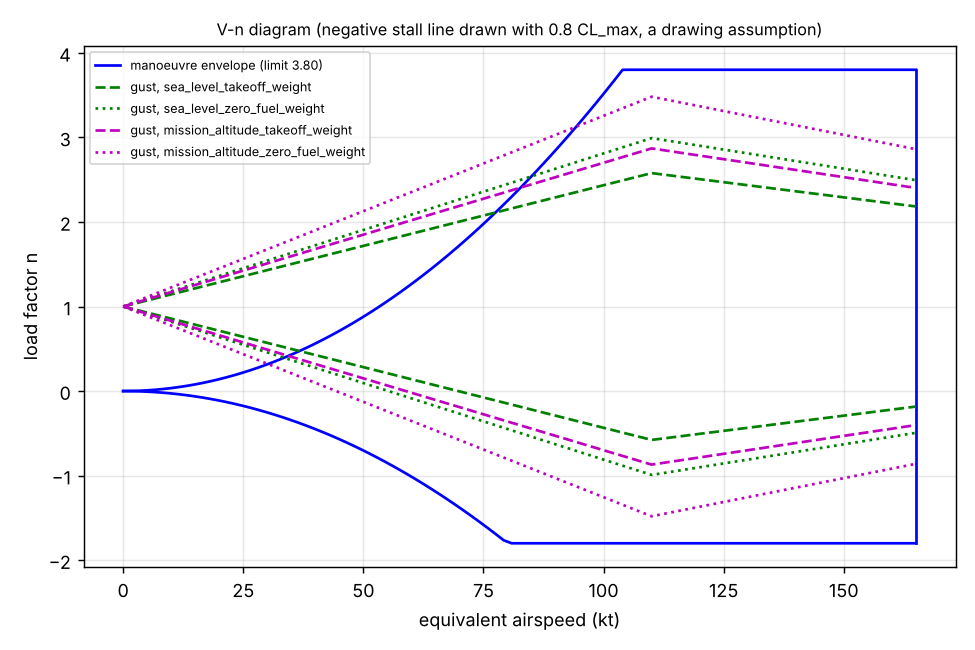

# Task 12 preliminary design P1: Stage 1 package for the baseline r0

Generated by `python -m prelim.p1_package --report-only` from `runs/task12/pd/2026-11-27/p1/p1.json` and the baseline record `runs/task12/pd/2026-11-27/p0/r0`. Every number below is read from those files. Spec: `docs/specs/task12_preliminary_design.md`, package P1 (ruling B-9a). Tolerances were fixed before the run; nothing was tuned. r0 was not re-sized and no ledger band was changed.

Evidence class: **a package, not a measurement**. It collects what Stage 1 says about r0 and closes the entry item of B-9a; it verifies no quantity of the aircraft.

## 1. Run

- Command: `python -m prelim.p1_package --out runs/task12/pd/2026-11-27/p1`
- Commit `531b3546110d6b9c9cf9f66a59ee474bed0b3b71`; working tree at the start: clean (the run's own folder `runs/task12/pd/2026-11-27/p1` is not counted); unchanged during the run: yes.
- Seed: none. No random numbers are drawn in P1; r0's info-gap study used seed 20261122. python 3.13.18, numpy 2.5.3, pyyaml 6.0.3, matplotlib 3.11.2.
- Inputs (sha256, first 12): `runs/task12/pd/2026-11-27/p0/r0/design_pusher.json` 2af85aca9acd; `runs/task12/pd/2026-11-27/p0/r0/ledger.yaml` a3b88c45e6cb; `runs/task12/pd/2026-11-27/p0/r0/info_gap.json` 67ac334d1a3a; `runs/task12/pd/2026-11-27/p0/r0/cell_result.json` 83c078c1433f; `runs/task12/pd/2026-11-27/p0/r0/m250_table.json` 48e24462bb64; `runs/task12/pd/2026-11-27/p0/p0.json` e101940806c5; `runs/task12/stage3/2026-11-26/m250_bands_resize/curve.json` 364b4e6536c3; `runs/task12/stage3/2026-11-27/m250_ws13a8_measure/perf.json` 6efd4a8af087; `data/task12/pd_p1_judgements.yaml` 61a8010f7c74; `data/task12/ledger.yaml` f8f56b791fd8.
- Log: `runs/task12/pd/2026-11-27/p1/run.log`. Run time 649 s.

## 2. Acceptance rows

Rows 1 to 6 are the spec's. Rows 7 to 12 are one per added Gate B item; their criteria were written in `tests/task12_pd/test_p1_package.py` and `prelim/p1_package.py` before the run.

| # | Row | Result | Tolerance | Verdict |
|---|---|---|---|---|
| 1 | every number is read from r0: the design sized again by the script equals r0, field by field | 325 fields compared, 0 differ, largest relative difference 0 | 1e-09 | **pass** |
| 2 | the compliance matrix has no blank row | 35 rows, 0 blank cells, 0 failed rows; R1 to R19 each have a row | - | **pass** |
| 3 | the weight statement sums to the record's empty weight | sum of components minus the record's empty weight: +0 lb | 0.1 lb | **pass** |
| 4 | the V-n diagram's points equal r0's vn entries | 17 points, largest difference 0 | 1e-06 | **pass** |
| 5 | out-of-calibration list: not empty, and every correlation flagged on 2026-11-25 is in it or has a reason | 15 entries; the 8 flagged on 2026-11-25 are all there; 0 problems | - | **pass** |
| 6 | risk list: not empty, and every risk names the package that measures it or the ruling that carries it | 17 risks; 1 have no package and name their ruling; 0 problems | - | **pass** |
| 7 | trades (NR-3): the nominal case of each trade is r0 (re-sized weight; hours of the built aircraft) | re-sized nominal W0 differs from r0 by 0 (relative); built aircraft 11.0000 h against the sized 11.000 h | 1e-09; 0.002 h | **pass** |
| 8 | App. L decomposition on r0 (NR-1) and the climb speed at the worst endurance corner (item 18): Stage 1's climb speed at or above 1.2 V_stall at the mission altitude; integrated climb within 1 % of the mission fuel | climb speed over the stall speed at the top of the climb: nominal, sized loiter 1.298, worst endurance point at h = 1 0.983, worst endurance point at the target h_T 0.971; integrated climb as a share of the mission fuel: 0.11 %, 0.77 %, 1.41 % | 1.2 V_stall; 1 % of the mission fuel | **finding for r1** |
| 9 | concept record at these sizes (NR-4, A9): the scoring does not reverse | pusher 4.064, tractor 3.950; weight ratio 1.133 against a break-even of 1.212 | - | **pass (not reversed)** |
| 10 | empty weight (items 8, 27): the Table 15.2 groups sum to the record's value and the steps close | Table 15.2 groups against the record's value: 0 (relative); 15 lb of the like-for-like gap unexplained | 1e-09 | **pass** |
| 11 | band audit (item 28): every ledger entry without a band is classed | 58 entries: 21 requirement, 23 definition, 14 needs a band | - | **pass** |
| 12 | payload bay, first check (item 30, PD-12): the payload volume is inside the free volume of the Stage 1 body | 16.67 ft^3 against 186.2 ft^3 free (9.0 %) | - | **pass** |

## 3. Findings

1. **Climb at the worst endurance point at h = 1 (item 18).** Stage 1's climb leg flies 85.4 kt true airspeed from sea level to 20,000 ft. At the top that is 0.983 of the stall speed (86.9 kt at the end-of-climb weight, clean C_L,max 1.170): below the stall speed. Integrated in 1,000 ft steps the climb burns 120.6 lb against 112.6 lb (+8.0 lb, 0.77 % of the mission fuel, inside the 1 % threshold), and the rate of climb at the top is 118 ft/min. Estimate of the hours on station with the integrated climb: 3.75 h against 3.83 h (need 3.5 h). The estimate divides the fuel difference by the loiter fuel flow; the mission was not flown again.
2. **Climb at the worst endurance point at the target h_T (item 18).** Stage 1's climb leg flies 85.1 kt true airspeed from sea level to 20,000 ft. At the top that is 0.971 of the stall speed (87.6 kt at the end-of-climb weight, clean C_L,max 1.161): below the stall speed. Integrated in 1,000 ft steps the climb burns 134.5 lb against 119.8 lb (+14.6 lb, 1.41 % of the mission fuel, above the 1 % threshold), and the rate of climb at the top is 86 ft/min, below the 100 ft/min of the service-ceiling definition. Estimate of the hours on station with the integrated climb: 3.36 h against 3.50 h (need 3.5 h). The estimate divides the fuel difference by the loiter fuel flow; the mission was not flown again. **Finding for r1 (P9).**
3. **Concept scoring (NR-4).** Pusher 4.06, tractor 3.95: not reversed. The pusher is 1.133 times the tractor's weight; the scores are equal at 1.212. In the 2026-11-25 record the pusher scored 4.11.
4. **Nose packaging (item 30).** The payload volume of PD-12 (16.67 ft^3) is 9.0 % of the free body volume, so the whole-body check passes. Locally it does not fit yet: a bay at the payload station takes 1.73 to 3.99 ft at full cross-section, and the nose-gear leg (5.51 ft, station 1.14 ft) retracted aft reaches 6.65 ft, through that bay and past the avionics station (6.00 ft). Stage 1 has no stow check for the nose gear. **For P3 (and P4 if the bay or the gear moves).**
5. **Unbanded estimates that would break the R5 guarantee at h = 1 if they moved (item 28).** `leakage_fraction` at 0.155: 3.34 h at the record's worst endurance point (need 3.5 h; 3.83 h there today). None of these values is a band: they are the common +-10 % step, a proposed band end, or the +10 % on CD0. **For Gate C: whether these entries get a band, and P9 if they do.**
6. **Empty weight (items 8, 27).** Like for like (metal, crew items in) the group equations are 293 lb above the Table 3.1 fit. Four features of this aircraft account for 278 lb of it by what-if scaling; 15 lb is left unexplained. The risk stays named (B-9g).

## 4. Requirements compliance matrix (Stage 1 output 1)

`conceptual/stage1.compliance` on the design sized again here (equal to r0, row 1), with a margin for every numeric rule, and the rows that function does not write: R3, R11 and the robust half of R5 and R7. Margin is the distance to the limit, positive inside it. Class S1: Stage 1's own value (the independent rows are in the Gate B report, section 2). Class RB: robustness study of the same model (r0/info_gap.json). Class PK: a package, not a measurement.

| # | Req. | Requirement | Units | Value | Limit | Margin | Verdict | Class | Produced by |
|---|---|---|---|---|---|---|---|---|---|
| 1 | R1/R2 | R1/R2 single turboprop, one engine | - | RR_M250_B17F | none: met by construction | none: by construction | not tested: by construction | S1 | step 8: fixed-engine re-size |
| 2 | R4 | R4 payload | lb | 500 | 500 | none: by construction | not tested: by construction | S1 | step 1: mission and payload |
| 3 | R5 | R5 mission 200 nm + 11 h + 200 nm | fuel lb | 1099 | 1099 | none: sized to it | not tested: sized to it | S1 | step 8: fuel sized to the mission |
| 4 | R6 | R6 note: no starting (relight) envelope in our sources for this engine; an in-flight relight is not assessed (the TP100's envelope is not reused) | ft | no source (assumption R-f) | 20,000 | none: note | not tested: note | S1 | none: no source for the engine's relight envelope |
| 5 | R6 | R6 mission altitude 20,000 ft: no maximum operating altitude in our sources for this engine (not checked, none invented) | ft | 20,000 | none: no source (assumption R-f) | none: note | not tested: note | S1 | none: no source for the engine's operating altitude |
| 6 | R7 | R7 take-off over 50 ft | ft | 711 | 2500 | 1789 | pass | S1 | step 7: performance |
| 7 | R7 | R7 landing over 50 ft | ft | 1349 | 2500 | 1151 | pass | S1 | step 7: performance |
| 8 | R7 | R7 clean stall at W0, sea level | kt | 53.33 | 70 | 16.67 | pass | S1 | step 7: maximum lift |
| 9 | R8 | R8 retractable tricycle gear | - | yes | none: met by construction | none: by construction | not tested: by construction | S1 | step 6: layout |
| 10 | R9 | R9 positive limit load (manoeuvre or gust, both weights) | - | 3.8 | 3.8 | 0 | pass | S1 | step 7: V-n with gusts |
| 11 | R9 | R9 negative gust within the negative limit, with the round-4 margin | - | -1.504 | -1.7 | 0.1965 | pass | S1 | step 7: V-n with gusts |
| 12 | R10 | R10 6 % reserve and trapped fuel | - | 1.06 | 1.06 | none: by construction | not tested: by construction | S1 | step 1: mission fuel allowance |
| 13 | R12 | R12 sea-level rate of climb | ft/min | 2326 | 1000 | 1326 | pass | S1 | step 7: performance |
| 14 | R12 | R12 service ceiling (last altitude with 100 ft/min), with the round-4 margin | ft | 30,439 | 23,500 | 6939 | pass | S1 | step 7: performance on the engine table |
| 15 | R13 | R13 static margin, full fuel | MAC | 0.1126 | 0.05-0.15 | 0.03744 | pass | S1 | step 7: stability, by layout construction |
| 16 | R13 | R13 static margin, empty fuel | MAC | 0.08744 | 0.05-0.15 | 0.03744 | pass | S1 | step 7: stability, by layout construction |
| 17 | R14 | R14 no crew items in the weights | - | yes | none: met by construction | none: by construction | not tested: by construction | S1 | step 7: component weights |
| 18 | R15 | R15 flight avionics 60 lb uninstalled | lb | 60 | 60 | none: by construction | not tested: by construction | S1 | step 7: component weights |
| 19 | R18 | R18 V_C placard covers the fastest cruise sub-step with 10 % margin (study margin) | kt EAS | 104.5 | 110 | 5.541 | pass | S1 | step 7: loads at the V_C placard |
| 20 | R17 | R17 every mission sub-step at or above 1.3 V_stall (enforced in the speed choice) | - | yes | none: met by construction | none: by construction | not tested: by construction | S1 | step 1: speed choice of every mission sub-step |
| 21 | R19 | R19 both transit legs flown against a 25 kt headwind (air distance V/(V - V_w)) | kt | 25 | 25 | none: by construction | not tested: by construction | S1 | step 1: mission with the headwind |
| 22 | R16 | R16 sustained 30 deg bank at loiter (power) | hp | 243.5 | 450 | 206.5 | pass | S1 | step 4: power required in the turn |
| 23 | R12/R16 | engine power meets every requirement (achieved margin 37.5%) | hp | 281.1 | 450 | 168.9 | pass | S1 | step 4: largest power required |
| 24 | layout | fuel fits integral wing tanks | ft^3 | 21.92 | 73.17 | 51.25 | pass | S1 | step 6: wing tank volume |
| 25 | layout | nose-wheel load, full fuel (p. 232-233; optimum 0.08-0.15) | - | 0.1633 | 0.05-0.20 | 0.03667 | pass | S1 | step 6: layout |
| 26 | layout | nose-wheel load, empty fuel | - | 0.1515 | 0.05-0.20 | 0.04854 | pass | S1 | step 6: layout |
| 27 | layout | main gear stows: sponsons at the 63 deg overturn track (p. 232; ruling round 3) | ft | 4.731 | the sponsons at this track hold the wheels | none: stow | pass | S1 | step 6: layout |
| 28 | layout | propeller clearance at rotation (p. 222) | in | 14.44 | 8.95 | 5.493 | pass | S1 | step 6: layout |
| 29 | layout | trim within tail CL limit, all mission legs | - | yes | yes | none: flag | pass | S1 | step 7: trim |
| 30 | layout | nose rotation at 0.8 V_TO (p. 432-433), tail download | tail CL | 0.9676 | 1 | 0.03235 | pass | S1 | step 7: rotation |
| 31 | R3 | R3 rubber-engine sizing first, then a production turboprop and a fixed-engine re-size | hp | rubber engine at these sizes 182 hp; installed 450 shp (RR_M250_B17F) | none: a procedure | none: a procedure | not tested: a procedure; the engine was fixed by ruling R-a | PK | steps 5 and 8; the rubber-engine design of this package |
| 32 | R5 | R5 hours on station at nominal values | h | 11 | 8 | 3 | pass | RB | robust sizing (ruling R-d): the sized loiter |
| 33 | R5 | R5 at least 3.5 h for every combination inside the bands: guarantee horizon | - | 1.05 | 1 | 0.05011 | pass | RB | info-gap study of r0 (P0) |
| 34 | R7 | R7 field length for every combination inside the bands: horizon | - | 1.284 | 1 | 0.2845 | pass | RB | info-gap study of r0 (P0) |
| 35 | R11 | R11 cruise legs at the best-range speed, no minimum speed | - | best-range speed unless the R17 floor is higher; the floor sets the speed on 0% of the cruise-out and 0% of the cruise-back sub-steps | none: no minimum speed | none: by construction | not tested: by construction | S1 | step 1: speed choice |

The service ceiling row now reads the engine table to 35,000 ft (P0); at Gate B it read above the table top. No row fails. The R6 rows have no source (assumption R-f) and are not verdicts.

## 5. Three-view and internal layout (output 2)

Both are sketches drawn by code from the sizing record: geometry only, no flow solution, and a body of revolution that Stage 1 knows only through its length, diameter and fill factor. P3 redraws the three-view from the loft.

| Quantity | Value |
|---|---|
| wing area, span, aspect ratio, taper | 270.6 ft^2, 46.52 ft, 8.0, 0.45 |
| wing root chord, tip chord, mean chord and its span station | 8.02 ft, 3.61 ft, 6.094 ft at 10.16 ft |
| horizontal tail area, span (volume scale over Table 6.4) | 135.5 ft^2, 23.28 ft (1.594) |
| vertical tail area, height | 37.1 ft^2, 7.46 ft |
| fuselage length, diameter, wetted area | 28.58 ft, 3.57 ft, 277.8 ft^2 |
| tail arm | 13.58 ft |
| propeller diameter; clearance at rotation | 6.91 ft; 14.4 in |
| gear length; main-wheel half track; wheels retract into | 66.1 in; 4.73 ft; sponsons |
| wing leading edge at the root; main wheels; CG height | 9.16 ft; 14.05 ft; 7.29 ft |
| fuel volume needed; wing tank volume claimed | 21.92 ft^3; 73.17 ft^3 |

## 6. Weight statement (output 3; Gate B items 8 and 27)

### 6.1 Components, stations and centre of gravity

| Item | Weight (lb) | Station (ft from nose) | Moment (lb ft) |
|---|---|---|---|
| wing | 429.40 | 11.60 | 4,982 |
| horizontal tail | 97.21 | 25.17 | 2,447 |
| vertical tail | 30.83 | 25.04 | 772 |
| fuselage | 224.58 | 12.86 | 2,889 |
| main gear | 223.04 | 14.05 | 3,133 |
| nose gear | 95.04 | 1.14 | 109 |
| installed engine | 296.80 | 25.15 | 7,465 |
| sponsons | 80.21 | 11.60 | 931 |
| fuel system | 92.84 | 11.60 | 1,077 |
| flight controls | 66.26 | 15.72 | 1,042 |
| hydraulics | 3.52 | 12.86 | 45 |
| avionics | 96.55 | 6.00 | 580 |
| electrical | 182.30 | 12.86 | 2,345 |
| **empty weight (sum)** | **1,918.56** |  |  |
| payload | 500.00 | 2.86 | 1,429 |
| fuel (wing tanks, at the wing station) | 1,098.69 | 11.60 | 12,746 |
| **take-off weight** | **3,517.25** |  |  |

- Sum of the components against the record's empty weight (1,918.561 lb): +0 lb (tolerance 0.1 lb).
- Centre of gravity, full fuel: 11.938 ft in the record, 11.938 ft from the stations above. Empty of fuel, payload on: 12.091 ft and 12.091 ft. Zero-fuel weight 2,418.6 lb.
- Neutral point 12.624 ft; static margin 0.1126 MAC full and 0.0874 MAC empty (by layout construction, ruling B-6).

### 6.2 Build-up against Raymer's approximate group weights (Table 15.2), group by group

| Group | Build-up, as built (lb) | Build-up, metal (lb) | Table 15.2 (lb) | Rule of the table | As built minus table (lb) |
|---|---|---|---|---|---|
| wing | 429.4 | 505.2 | 604.7 | 2.5 lb/ft^2 of exposed wing | -175.3 |
| tails | 128.0 | 154.3 | 345.1 | 2.0 lb/ft^2 of tail area | -217.1 |
| fuselage | 224.6 | 249.5 | 388.9 | 1.4 lb/ft^2 of wetted area | -164.3 |
| landing gear and sponsons | 398.3 | 415.0 | 200.5 | 0.057 W0 (no sponsons in the table) | +197.8 |
| installed engine | 296.8 | 296.8 | 296.8 | 1.4 x engine weight | +0.0 |
| all else | 441.5 | 441.5 | 351.7 | 0.10 W0 | +89.7 |
| **sum** | **1,918.6** | **2,062.3** | **2,187.8** |  | **-269.2** |

- As fractions of W0: build-up 0.5455, Table 15.2 0.6220. Exposed wing area 241.9 ft^2 (from the design sized again; the record does not store it).
- The table is heavier than the build-up in: wing, tails, fuselage; lighter in: landing gear and sponsons, all else. Groups where the metal build-up is still below the table, so that the composite factors are not the whole difference: wing, tails, fuselage. The table's tail rule is applied here to a tail enlarged for rotation.
- Weight per area of the build-up, as metal, against the table's rule: wing 2.09 against 2.5 lb/ft^2; tails 0.89 against 2.0 lb/ft^2; fuselage 0.90 against 1.4 lb/ft^2.
- 'Metal' divides each group by its Table 15.4 factor, as the record's `build_up_metal` does (the sponsons are left as they are).
- Anderson's build-up of the Gate B report uses the same table and iterates the weight with it: W0 4,036 lb, empty 2,269 lb (`runs/task12/stage3/2026-11-27/m250_ws13a8_measure/perf.json`). It is the same comparison at a heavier aircraft, not a second source.

### 6.3 Build-up against the Table 3.1 fit

| Step | Empty fraction | Empty weight at r0's W0 (lb) | Change (lb) |
|---|---|---|---|
| Table 3.1 fit times the composite factor | 0.5156 | 1,813.5 |  |
| the fit without the composite factor | 0.5427 | 1,909.0 | +95.4 |
| group equations against the fit, like for like (metal, crew items in) | 0.6260 | 2,202.0 | +293.0 |
| crew items left out (furnishings, (15.59)) | 0.5863 | 2,062.3 | -139.7 |
| Table 15.4 composite factors on the groups | 0.5455 | 1,918.6 | -143.7 |

The fit is a total, so it has no components. The step that needs explaining is the like-for-like one, +293 lb. Each line below takes one feature of this aircraft back to a reference value through the exponent of its own group equation, with everything else held. They are what-ifs on the equations, not a re-size, and they are not strictly additive.

| Feature a general-aviation single of the fit does not have | Metal weight it adds (lb) | How |
|---|---|---|
| sponsons for the main gear (no counterpart in the fit's aircraft) | 80.2 | the whole item |
| main gear 66.1 in long for propeller clearance, against the ledger's 30 in | 64.8 | (15.50), weight ~ length^0.409 |
| horizontal tail 1.594 times the Table 6.4 size, for rotation | 40.0 | (15.47), weight ~ area^0.896 |
| wing loading 13 lb/ft^2 against the class's typical 17 (Table 5.5): a larger wing | 93.0 | (15.46), weight ~ area^0.758 |
| **left unexplained** | **15.0** | the gap less the four lines |

- The crew items the fit's aircraft carry and this one does not (139.7 lb) and the larger composite saving of the group factors against the fit's single factor then bring the build-up back to 0.5455, 105.0 lb above the fit (0.5156).
- Table 6.2's fit gives 0.4952, below both.
- This explains the difference between the three numbers. It does not show which is right: all three are crewed general-aviation statistics (out-of-calibration entry OC-1). The typical wing loading is read from the chapter notes of the library (Raymer Table 5.5, p. 84).

## 7. Drag, propulsion and mission (output 4; NR-1; item 18)

### 7.1 Drag polar and propeller points of r0

- CD0 0.02208 at mission altitude, 0.02063 at sea level, 0.06607 in the take-off and 0.10747 in the landing configuration. K 0.04909, e 0.8106. Largest L/D of that polar at mission altitude: 15.19 (computed here as 1/(2 sqrt(CD0 K))).
- C_L,max 1.350 clean, 1.818 take-off, 2.130 landing.

| Propeller point | Speed (kt) | Shaft power (hp) | Efficiency | J | C_P | Throttle |
|---|---|---|---|---|---|---|
| climb sea level | 93.3 | 450.0 | 0.7041 | 0.674 | 0.1708 | 1.000 |
| cruise out | 129.3 | 123.7 | 0.8073 | 0.933 | 0.0881 | 0.610 |
| loiter | 87.3 | 77.8 | 0.7733 | 0.630 | 0.0554 | 0.398 |
| cruise back | 119.1 | 91.3 | 0.8094 | 0.860 | 0.0650 | 0.455 |

Propeller diameter 6.91 ft at 2,030 rpm; App. L disk times f = 0.85.

### 7.2 Fuel by mission segment

| Segment | Weight at start (lb) | Fuel burned (lb) | Mean speed (kt) | Mean C_bhp | Time (h) | Sub-steps on the R17 floor | Sub-steps in unchoked cells |
|---|---|---|---|---|---|---|---|
| takeoff | 3,517.3 | 23.47 | 0.0 | 0.6260 | 0.000 | 0% | 0% |
| climb | 3,493.8 | 46.12 | 0.0 | 0.6109 | 0.000 | 0% | 0% |
| cruise out | 3,447.7 | 161.49 | 129.3 | 0.6868 | 1.918 | 0% | 0% |
| loiter | 3,286.2 | 645.66 | 87.3 | 0.8564 | 11.000 | 100% | 100% |
| cruise back | 2,640.5 | 147.29 | 119.1 | 0.7625 | 2.126 | 0% | 100% |
| landing | 2,493.2 | 12.47 | 0.0 | 0.0000 | 0.000 | 0% | 0% |
| **burned in the mission** |  | **1,036.50** |  |  |  |  |  |
| **fuel on board (with the 6 % of R10)** |  | **1,098.69** |  |  |  |  |  |

Share of the mission fuel burned in unchoked table cells: 77.4 % (Gate B item 11, unchanged).

### 7.3 App. L decomposition on r0 (NR-1)

`measurement/appl_decomposition.case` on r0: the mission with the disk as recorded, and with a flat propeller efficiency swapped in. The flat value is the ledger's `eta_p` at nominal and its band low end scaled by h at the two worst endurance points of the record. This is what the robust weight owes to the disk, segment by segment. The earlier decomposition (2026-11-26) compared two baselines of the superseded cell; r0 has no flat-propeller twin, so the swap is made on r0 itself.

**Nominal, sized loiter** (take-off weight 3,517.2 lb, loiter 11.000 h, f 0.8500, flat efficiency 0.8000):

| Segment fuel (lb) | Disk | Flat | Disk minus flat |
|---|---|---|---|
| takeoff | 23.47 | 23.47 | +0.00 |
| climb | 46.12 | 38.26 | +7.85 |
| cruise out | 161.49 | 162.68 | -1.19 |
| loiter | 645.66 | 637.81 | +7.85 |
| cruise back | 147.29 | 148.65 | -1.36 |
| mission fuel with reserve | 1,098.69 | 1,084.81 | +13.87 |
| hours on station on the record's fuel | 11.000 | 11.255 | -0.255 |

Mean disk efficiency: cruise out 0.8076, loiter 0.7801, cruise back 0.8095. Climb leg: efficiency at mid-altitude 0.7134 (flat 0.8000), drag over thrust 0.346 (0.284), climb speed 93.9 kt (63.8 kt).

**Worst endurance point at h = 1** (take-off weight 4,454.2 lb, loiter 3.827 h, f 0.8000, flat efficiency 0.7500):

| Segment fuel (lb) | Disk | Flat | Disk minus flat |
|---|---|---|---|
| takeoff | 26.59 | 26.59 | +0.00 |
| climb | 112.61 | 83.98 | +28.63 |
| cruise out | 251.37 | 249.49 | +1.89 |
| loiter | 395.51 | 391.86 | +3.65 |
| cruise back | 233.24 | 232.73 | +0.51 |
| mission fuel with reserve | 1,098.69 | 1,062.11 | +36.58 |
| hours on station on the record's fuel | 3.827 | 4.194 | -0.367 |

Mean disk efficiency: cruise out 0.7394, loiter 0.7316, cruise back 0.7437. Climb leg: efficiency at mid-altitude 0.6622 (flat 0.7500), drag over thrust 0.584 (0.503), climb speed 85.4 kt (77.1 kt).

**Worst endurance point at the target h_T** (take-off weight 4,501.6 lb, loiter 3.501 h, f 0.7975, flat efficiency 0.7475):

| Segment fuel (lb) | Disk | Flat | Disk minus flat |
|---|---|---|---|
| takeoff | 26.75 | 26.75 | +0.00 |
| climb | 119.84 | 88.49 | +31.36 |
| cruise out | 259.07 | 256.33 | +2.74 |
| loiter | 373.81 | 370.51 | +3.30 |
| cruise back | 239.61 | 238.87 | +0.74 |
| mission fuel with reserve | 1,098.69 | 1,058.47 | +40.22 |
| hours on station on the record's fuel | 3.501 | 3.890 | -0.390 |

Mean disk efficiency: cruise out 0.7341, loiter 0.7288, cruise back 0.7399. Climb leg: efficiency at mid-altitude 0.6599 (flat 0.7475), drag over thrust 0.601 (0.519), climb speed 85.1 kt (77.8 kt).

At the worst point of the target the disk costs +40.2 lb of mission fuel against the flat low end, and the climb leg is +31.4 lb of it. P6 checks the disk; the next section checks the climb model.

### 7.4 The climb at the worst endurance corner (item 18)

Stage 1's climb leg uses one true airspeed, the best-climb speed at sea level, all the way up, and averages drag over thrust between sea level and the mission altitude at that speed (`conceptual/uav.py`, the climb rows of the mission). The table compares that speed with the stall speed at the mission altitude, and then integrates the same climb in steps with `prelim.p0_baseline.integrate_climb` (the P0 function), where each altitude flies its own best-climb speed, never below 1.2 V_stall.

|  | nominal, sized loiter | worst endurance point at h = 1 | worst endurance point at the target h_T |
|---|---|---|---|
| take-off weight (lb) | 3,517.2 | 4,454.2 | 4,501.6 |
| clean C_L,max | 1.350 | 1.170 | 1.161 |
| Stage 1 climb speed (kt true) | 93.9 | 85.4 | 85.1 |
| stall speed at the mission altitude, end-of-climb weight (kt) | 72.3 | 86.9 | 87.6 |
| climb speed over that stall speed | 1.298 | 0.983 | 0.971 |
| the same at the start-of-climb weight | 1.289 | 0.970 | 0.958 |
| at or above the stall speed / at or above 1.2 V_stall | yes / yes | no / no | no / no |
| climb fuel, Stage 1 two-point (lb) | 46.12 | 112.61 | 119.84 |
| climb fuel, integrated (lb) | 45.00 | 120.59 | 134.48 |
| difference (lb; relative) | -1.12; -2.4 % | +7.98; +7.1 % | +14.64; +12.2 % |
| as a share of the mission fuel (threshold 1 %) | 0.11 % | 0.77 % | 1.41 % |
| time to climb, integrated (min) | 15.5 | 43.9 | 49.7 |
| rate of climb at sea level; at the top (ft/min) | 2,338; 709 | 1,287; 118 | 1,243; 86 |
| integrated climb speed at sea level; one step below the top (kt) | 93.4; 94.3 | 82.5; 102.6 | 82.0; 103.5 |
| hours on station in the record | 11.000 | 3.827 | 3.501 |
| estimate with the integrated climb (h) | 11.019 (+0.019) | 3.750 (-0.077) | 3.364 (-0.137) |
| finding for r1 | no | no | yes |

- Nominal, sized loiter: the Stage 1 speed is at or above 1.2 V_stall at the top of the climb.
- Worst endurance point at h = 1: the Stage 1 speed is **below the stall speed at the mission altitude**. The two-point estimate there evaluates drag at a lift coefficient above C_L,max, which the aircraft cannot fly.
- Worst endurance point at the target h_T: the Stage 1 speed is **below the stall speed at the mission altitude**. The two-point estimate there evaluates drag at a lift coefficient above C_L,max, which the aircraft cannot fly.
- This is the first test of item 18 on this design; at Gate B it was not testable.
- The estimate of hours is the fuel difference divided by the loiter fuel flow of the same state (106.8 lb/h at the target point). The mission was not flown again with the integrated climb, and the worst-case search was not repeated with it, so the worst point itself may move. What can be said: at h = 1 the estimate (3.75 h) is still at or above the 3.5 h of R5; at the target h_T it (3.36 h) is below it.
- The rate of climb at the top of the climb is 118 ft/min at the h = 1 point and 86 ft/min at the target point, against 100 ft/min for a service ceiling: at the target point the mission altitude is above that aircraft's service ceiling at that weight. R12's ceiling is a requirement at nominal values, and it is met there. The info-gap study checks the endurance and the level-flight power of the transit legs; it has no row for the climb to the mission altitude.
- Class: coding check with finer steps. It shares the polar, the engine table and the propeller model with Stage 1.

## 8. Constraint diagram, carpet plot and trades (output 5; NR-3)

### 8.1 Constraint diagram

`conceptual/stage1.constraint_diagram` at r0's weight and aspect ratio, run here. Stall limit W/S 22.40 lb/ft^2; landing limit 66.4 lb/ft^2; best-range wing loading at the cruise dynamic pressure 20.23; best-loiter wing loading at the loiter dynamic pressure 15.97. r0 is at 13.
Power required at r0 (hp): climb sl 223.0, ceiling 281.1, takeoff 154.7, turn at loiter 243.5, cruise at altitude 211.4; installed 450. The largest is 62.5 % of the installed power. These are requirements at nominal values; the cell and the sized loiter of r0 were set by the robust sizing (rulings R-d, B-2c), which this diagram does not show.

### 8.2 Carpet plot from the committed re-size grid

No new sizing: the cells are the last iteration of `runs/task12/stage3/2026-11-26/m250_bands_resize/curve.json` (450 shp, both bands acting, target h_T 1.05).

| W/S | A | Robust design | W0 (lb) | Sized loiter (h) | If none, why |
|---|---|---|---|---|---|
| 13 | 7 | yes | 3,493.1 | 10.906 |  |
| 13 | 8 | yes | 3,517.3 | 11.000 |  |
| 13 | 9 | yes | 3,562.9 | 11.156 |  |
| 13 | 10 | yes | 3,631.9 | 11.344 |  |
| 14 | 7 | no | - | - | no L satisfies both on the lattice |
| 14 | 8 | yes | 3,459.9 | 10.906 |  |
| 14 | 9 | yes | 3,506.3 | 11.062 |  |
| 14 | 10 | yes | 3,556.5 | 11.188 |  |
| 15 | 7 | no | - | - | no L satisfies both on the lattice |
| 15 | 8 | no | - | - | no L satisfies both on the lattice |
| 15 | 9 | no | - | - | no L satisfies both on the lattice |
| 15 | 10 | no | - | - | no L satisfies both on the lattice |
| 16 | 7 | no | - | - | too heavy already at 8 h |
| 16 | 8 | no | - | - | no L satisfies both on the lattice |
| 16 | 9 | no | - | - | no L satisfies both on the lattice |
| 16 | 10 | no | - | - | no L satisfies both on the lattice |
| 17 | 7 | no | - | - | too heavy already at 8 h |
| 17 | 8 | no | - | - | too heavy already at 8 h |
| 17 | 9 | no | - | - | too heavy already at 8 h |
| 17 | 10 | no | - | - | weight iteration did not converge at 8.000 h |

### 8.3 Trades of the built aircraft (nothing re-sized)

The aircraft of r0 as built, rebuilt by the info-gap study's own function with one value changed.

Loiter time against payload, with payload exchanged for fuel at the record's take-off weight:

| Payload (lb) | Fuel (lb) | Hours on station | Fuel volume (ft^3) | Fits the wing tanks |
|---|---|---|---|---|
| 0 | 1,598.7 | 20.82 | 31.90 | yes |
| 100 | 1,498.7 | 18.73 | 29.90 | yes |
| 200 | 1,398.7 | 16.70 | 27.91 | yes |
| 300 | 1,298.7 | 14.73 | 25.91 | yes |
| 400 | 1,198.7 | 12.84 | 23.92 | yes |
| 500 | 1,098.7 | 11.00 | 21.92 | yes |
| 600 | 998.7 | 9.21 | 19.93 | yes |
| 700 | 898.7 | 7.48 | 17.93 | yes |

The same payloads with the record's fuel on board (the take-off weight changes):

| Payload (lb) | Take-off weight (lb) | Hours on station | Take-off over 50 ft (ft) | Landing over 50 ft (ft) |
|---|---|---|---|---|
| 300 | 3,261.7 | 12.23 | 651 | 1,326 |
| 400 | 3,389.7 | 11.59 | 680 | 1,337 |
| 500 | 3,517.2 | 11.00 | 711 | 1,349 |
| 600 | 3,644.4 | 10.44 | 743 | 1,360 |
| 700 | 3,771.2 | 9.93 | 778 | 1,371 |

Altitude of the cruise and loiter:

| Mission altitude (ft) | Hours on station |
|---|---|
| 15,000 | 9.95 |
| 17,500 | 10.50 |
| 20,000 | 11.00 |
| 22,500 | 11.43 |
| 25,000 | 11.78 |

Composite factor across its band (the empty weight moves, the fuel does not):

| Composite factor | Take-off weight (lb) | Hours on station | Take-off over 50 ft (ft) | Landing over 50 ft (ft) |
|---|---|---|---|---|
| 0.900 | 3,327.8 | 11.89 | 666 | 1,332 |
| 0.925 | 3,421.3 | 11.44 | 688 | 1,340 |
| 0.950 | 3,517.2 | 11.00 | 711 | 1,349 |
| 0.975 | 3,615.7 | 10.56 | 736 | 1,357 |
| 1.000 | 3,716.6 | 10.14 | 763 | 1,366 |

Above 20,000 ft the engine's operating altitude is an assumption (R-f), as it is at 20,000 ft.

### 8.4 Stage 1's one-at-a-time trades, re-sized at W/S 13, A 8

`conceptual/stage1.analyse` with one ledger value changed, the tail resized for rotation, then the compliance rows. Each row is another aircraft, for comparison only: r0 is not changed. The sized loiter is 11 h unless it is the value traded.

| Trade | Value | W0 (lb) | Fuel (lb) | Empty (lb) | W0 minus r0 (lb) | Failed compliance rows |
|---|---|---|---|---|---|---|
| sized loiter (h) | 8 | 3,114.2 | 860.1 | 1,754.1 | -403.0 | none |
| sized loiter (h) | 9 | 3,244.2 | 937.0 | 1,807.2 | -273.1 | none |
| sized loiter (h) | 10 | 3,378.3 | 1,016.4 | 1,861.9 | -138.9 | none |
| sized loiter (h) | 11 | 3,517.3 | 1,098.7 | 1,918.6 | +0.0 | none |
| sized loiter (h) | 12 | 3,661.1 | 1,183.9 | 1,977.2 | +143.9 | none |
| sized loiter (h) | 13 | 3,810.1 | 1,272.2 | 2,037.9 | +292.8 | none |
| payload (lb) | 300 | 3,054.8 | 1,006.1 | 1,748.7 | -462.5 | none |
| payload (lb) | 400 | 3,286.3 | 1,052.7 | 1,833.6 | -231.0 | none |
| payload (lb) | 500 | 3,517.3 | 1,098.7 | 1,918.6 | +0.0 | none |
| payload (lb) | 600 | 3,749.8 | 1,145.3 | 2,004.5 | +232.6 | none |
| payload (lb) | 700 | 3,982.4 | 1,191.6 | 2,090.8 | +465.2 | none |
| mission altitude (ft) | 15000 | 3,670.8 | 1,189.7 | 1,981.0 | +153.5 | none |
| mission altitude (ft) | 20000 | 3,517.3 | 1,098.7 | 1,918.6 | +0.0 | none |
| mission altitude (ft) | 25000 | 3,409.9 | 1,035.0 | 1,874.9 | -107.4 | none |
| composite factor | 0.9 | 3,198.0 | 1,034.9 | 1,663.1 | -319.3 | none |
| composite factor | 0.95 | 3,517.3 | 1,098.7 | 1,918.6 | +0.0 | none |
| composite factor | 1 | 3,917.1 | 1,178.7 | 2,238.3 | +399.8 | none |

The nominal case of this function is r0 to 1e-09 (row 7).

## 9. Concept record at these sizes (NR-4; Gate A item A9)

The tractor with the same engine and the rubber-engine pusher, sized by Stage 1 at W/S 13, A 8 with the ledger r0 was sized with, the 11 h sized loiter included. The choice of the pusher is not re-opened (PD-3).

| Quantity | r0 (pusher, M250) | tractor, M250 | pusher, rubber engine |
|---|---|---|---|
| take-off weight (lb) | 3,517.3 | 3,103.0 | 2,383.4 |
| empty weight (lb) | 1,918.6 | 1,617.6 | 1,304.1 |
| fuel (lb) | 1,098.7 | 985.5 | 579.2 |
| engine power (hp); engine weight (lb) | 450; 212 | 450; 212 | 182; 109 |
| engine inside Table 10.4's range | yes | yes | no |
| horizontal-tail volume scale | 1.594 | 1.000 | 1.604 |
| gear length (in); propeller clearance at rotation (in) | 66.1; 14.4 | 30.0; 5.1 | 56.3; 9.8 |
| nose-wheel load, full; empty | 0.163; 0.151 | 0.137; 0.146 | 0.184; 0.173 |
| take-off; landing over 50 ft (ft) | 711; 1,349 | 674; 1,349 | 1,005; 1,348 |
| service ceiling (ft) | 30,439 | 32,887 | 23,000 |
| failed compliance rows | none | propeller clearance at rotation (p. 222) | R12 service ceiling (last altitude with 100 ft/min), with the round-4 margin |
| record | `runs/task12/pd/2026-11-27/p0/r0/design_pusher.json` | `runs/task12/pd/2026-11-27/p1/design_tractor.json` | `runs/task12/pd/2026-11-27/p1/design_pusher_rubber.json` |

Scoring table: the round-1 criteria and weights, unchanged (`conceptual/stage1.concept_scores`). Only the weight row is computed; the others are the judgements of Gate A round 1.

| Criterion | Weight | Tractor | Pusher | Tractor grade | Pusher grade |
|---|---|---|---|---|---|
| take-off weight W0 (computed) | 0.40 | 3,103 | 3,517 | 5.00 | 4.41 |
| sensor field of view: nose free of propeller and exhaust (judgement) | 0.25 | 2 | 5 | 2.00 | 5.00 |
| propeller wash and exhaust on the sensor and airframe (judgement) | 0.10 | 2 | 4 | 2.00 | 4.00 |
| turboprop exhaust impinging on a pusher propeller, p. 222 (judgement) | 0.10 | 5 | 2 | 5.00 | 2.00 |
| ground clearance and gear length (judgement; pusher needs longer gear, p. 222) | 0.15 | 5 | 3 | 5.00 | 3.00 |
| **weighted score** |  |  |  | **3.95** | **4.06** |

| Feasibility (not scored) | Tractor | Pusher |
|---|---|---|
| nose load within 5 20 | yes | yes |
| nose load within 8 15 optimum | yes | no |
| rotation ok | yes | yes |
| gear stows | yes | yes |

- **The scoring does not reverse**: highest score pusher, frozen concept pusher. The margin is 0.114; on 2026-11-25 it was 0.157 (`runs/task12/stage1/2026-11-25/concept_scores.json`, other sizes).
- The pusher weighs 1.133 times the tractor. With the judgement grades as they are, the scores are equal at 1.212.
- The tractor is not a compliant design as analysed. Failed: propeller clearance at rotation (p. 222). Its propeller clearance is 5.1 in on a 30 in gear, against the 9 in rule. Whatever cures a failed row adds weight, so the tractor's weight here is on the light side and the comparison favours it.
- The rubber-engine pusher needs 182 hp. It is a reference only: its consumption is Table 3.4's, its lapse the piston (13.9), and its engine is below Table 10.4's range (OC-3, OC-4, OC-5). Failed rows: R12 service ceiling (last altitude with 100 ft/min), with the round-4 margin; its service ceiling is 23,000 ft against the 23,500 ft the row asks (R12 with its margin). Neither design was sized for the robust target; both carry r0's sized loiter.

## 10. V-n diagram (output 6)

The points are r0's `vn` entries (row 4). Limit load factor 3.80; negative limit -1.80; V_C 110 kt EAS; largest gust load factor 3.5035; most negative -1.5035. The negative stall line of the figure is a drawing assumption; P5 computes the negative manoeuvre.

| Case | Point | Speed (kt EAS) | Load factor |
|---|---|---|---|
| manoeuvre | corner | 103.96 | 3.8000 |
| sea level takeoff weight | V_C up | 110.00 | 2.5777 |
| sea level takeoff weight | V_C down | 110.00 | -0.5777 |
| sea level takeoff weight | V_D up | 165.00 | 2.1833 |
| sea level takeoff weight | V_D down | 165.00 | -0.1833 |
| sea level zero fuel weight | V_C up | 110.00 | 2.9918 |
| sea level zero fuel weight | V_C down | 110.00 | -0.9918 |
| sea level zero fuel weight | V_D up | 165.00 | 2.4938 |
| sea level zero fuel weight | V_D down | 165.00 | -0.4938 |
| mission altitude takeoff weight | V_C up | 110.00 | 2.8697 |
| mission altitude takeoff weight | V_C down | 110.00 | -0.8697 |
| mission altitude takeoff weight | V_D up | 165.00 | 2.4023 |
| mission altitude takeoff weight | V_D down | 165.00 | -0.4023 |
| mission altitude zero fuel weight | V_C up | 110.00 | 3.4809 |
| mission altitude zero fuel weight | V_C down | 110.00 | -1.4809 |
| mission altitude zero fuel weight | V_D up | 165.00 | 2.8607 |
| mission altitude zero fuel weight | V_D down | 165.00 | -0.8607 |

The recorded V-n check at V_D and at the level top speed is `docs/validation/2026-11-27_task12_vn_check_ws13a8.md`; it was not run again.

## 11. Stability and trim summary (output 7)

| Quantity | Value |
|---|---|
| neutral point; CG full; CG empty (ft from nose) | 12.624; 11.938; 12.091 |
| static margin full; empty (MAC); R13 band | 0.1126; 0.0874; 0.05 to 0.15 |
| tail lift slope (per rad); 1 - d(epsilon)/d(alpha) at the tail | 3.773; 0.5491 |
| fuselage moment slope (per rad, Raymer (16.22)) | 0.1014 |
| wing section moment about the aerodynamic centre | -0.064 |
| trim within the tail's lift limit on every leg | yes |
| rotation speed (kt); tail lift coefficient needed; limit | 40.4; -0.9676; 1.00 |
| nose-wheel load full; empty (optimum 0.08 to 0.15, limits 0.05 to 0.20) | 0.1633; 0.1515 |

| Trim point | Wing C_L | Tail C_L |
|---|---|---|
| cruise out start | 0.4224 | 0.0255 |
| cruise out end | 0.4026 | 0.0222 |
| loiter start | 0.8838 | 0.1329 |
| loiter end | 0.7101 | 0.1050 |
| cruise back start | 0.3814 | 0.0236 |
| cruise back end | 0.3601 | 0.0201 |

R13 is met by layout construction (B-6): the wing is placed so that the margin range is centred. The fuselage-inclusive neutral point by an independent route is P4.

## 12. Payload bay, first check (item 30, NR-21, PD-12)

| Quantity | Value |
|---|---|
| payload volume at 30 lb/ft^3 (PD-12) | 16.67 ft^3 |
| Stage 1 body volume, Raymer (7.13), projected areas = 0.80 x length x diameter | 198.5 ft^3 |
| less: engine envelope as a box (the record's length and diameter) | 9.11 ft^3 |
| less: installed flight avionics at 30 lb/ft^3 | 3.22 ft^3 |
| free volume | 186.2 ft^3 |
| payload volume over free volume | 9.0 % |
| **fits in the free volume** | **yes** |

- Not deducted, because the record gives no size for them: nose-gear bay; sensor turret and its mount; electrical, flight-control and other systems; skin, frames and the wing carry-through; engine inlet and exhaust ducts. The free volume is therefore an upper bound and this check cannot fail by a small amount; it shows only that the body as a whole is not short of volume.
- Local reading on the body the three-view draws (its fill is 0.787 against the ledger's 0.80; volume 197.6 ft^3). The payload station is 2.86 ft from the nose, where the body radius is 1.55 ft. A bay centred there that fills the whole cross-section needs 2.26 ft of length, from 1.73 to 3.99 ft: 41 % of all the volume ahead of the avionics station (6.00 ft, 41.1 ft^3). A real bay does not fill the cross-section, so it is longer.
- The nose gear is at 1.14 ft and its leg is 5.51 ft long (Stage 1 gives it the main gear's length). It cannot retract forward (1.14 ft of nose ahead of it). Retracted aft it reaches 6.65 ft: through the bay and past the avionics station. Stage 1 checks that the main gear stows in the sponsons and has no stow check for the nose gear. The sensor turret is outside the bay (PD-12) but its mount is in the same nose.
- This local reading is on a drawing convention, not on Stage 1's analysis, and has no verdict. P3 repeats the check with boxes on the loft (gate 4).

## 13. Ledger: band audit and out-of-calibration list (output 8; item 28)

The ledger of r0 has 111 entries: 53 with a band and 58 without. The info-gap study adds two engine multipliers to the banded ones. The full ledger with sources is `runs/task12/pd/2026-11-27/p0/r0/ledger.yaml`; Appendix A lists every entry.

### 13.1 Band audit of the entries without a band

Classes (judgement of the package lead, `data/task12/pd_p1_judgements.yaml`): **requirement** is what the owner asked for or ruled; **definition** is a design choice, a design rule, a datum of the chosen engine or a model switch; **needs a band** is an estimate of a physical quantity the built aircraft will have whatever is assumed. 21 requirement, 23 definition, 14 needs a band.

| Entry | Value | Class | Reason |
|---|---|---|---|
| `payload_lb` | 500 lb | requirement | R4 |
| `radius_nm` | 200 nm | requirement | R5 |
| `loiter_h` | 11 h | requirement | R5. The value is the sized loiter of the robust sizing (ruling R-d), an output of that sizing, not an uncertain input |
| `r5_robust_hours` | 3.5 h | requirement | R5 as restated at Gate B |
| `headwind_kt` | 25 kt | requirement | R19. The info-gap study leaves it outside the horizon by owner decision (r0/info_gap.json, exclusions) |
| `mission_altitude_ft` | 20,000 ft | requirement | R6 |
| `field_length_ft` | 2500 ft | requirement | R7 |
| `stall_speed_kt` | 70 kt | requirement | R7 |
| `limit_load_factor` | 3.8 | requirement | R9 |
| `negative_load_factor` | -1.8 | requirement | R9, ruling B-3 |
| `margin_power_fraction` | 0 | requirement | Gate A round 4 ruling 4, relaxed at the round 4 close |
| `margin_ceiling_ft` | 500 ft | requirement | Gate A round 4 ruling 4 |
| `margin_gust_g` | 0.1 | requirement | Gate A round 4 ruling 4 |
| `climb_rate_sl_fpm` | 1000 ft/min | requirement | R12 |
| `ceiling_ft` | 23,000 ft | requirement | R12 |
| `ceiling_rate_fpm` | 100 ft/min | definition | the definition of the service ceiling in R12 |
| `static_margin_min` | 0.05 MAC | requirement | R13 |
| `static_margin_max` | 0.15 MAC | requirement | R13 |
| `speed_over_stall` | 1.3 | requirement | R17 |
| `propeller_model` | app_l | definition | model switch (ruling G-4) |
| `takeoff_minutes` | 5 min | definition | mission-profile allowance (warm-up and take-off at full power); part of the mission the fuel is sized for, like the segments of R5 |
| `propeller_rpm` | 2030 rpm | definition | datum of the chosen engine's gearbox (ruling R-b) |
| `tip_speed_limit_fps` | 950 ft/s | definition | design rule that sets the propeller diameter |
| `wing_x_c_max_t` | 0.3 | definition | geometry of the wing section, fixed when P2 fixes the section (PD-5) |
| `wing_taper` | 0.45 | definition | design choice, frozen (PD-3) |
| `engine_sfc_allowance` | 1.02 | requirement | ruling R-b. The uncertainty of the SFC is the banded engine_sfc_mult of the info-gap study, on top of this allowance |
| `ht_aspect_ratio` | 4 | definition | design choice, frozen (PD-3) |
| `ht_taper` | 0.5 | definition | design choice, frozen (PD-3) |
| `vt_aspect_ratio` | 1.5 | definition | design choice, frozen (PD-3) |
| `vt_taper` | 0.5 | definition | design choice, frozen (PD-3) |
| `tail_t_c` | 0.12 | definition | design choice: NACA 0012 tails (PD-5) |
| `c_ht` | 0.7 | definition | sizing rule for the first tail size; the tail is then enlarged for rotation and P4 checks the result |
| `c_vt` | 0.04 | definition | sizing rule for the vertical tail. No requirement checks its result (PD-11: no lateral-directional analysis) |
| `composite_model` | saving | definition | model switch (ruling B-2a) |
| `gear_load_factor_ultimate` | 3 | definition | design rule in the gear weight equation |
| `climb_speed_over_stall` | 1.2 | definition | speed rule: the lowest climb speed |
| `tipback_angle_deg` | 15 deg | definition | layout rule |
| `prop_clearance_in` | 9 in | definition | layout rule |
| `nose_load_min` | 0.08 | definition | layout rule (the optimum band) |
| `nose_load_max` | 0.15 | definition | layout rule (the optimum band) |
| `turn_bank_deg` | 30 deg | requirement | R16 |
| `overturn_max_deg` | 63 deg | definition | layout rule |
| `vc_placard_kt_eas` | 110 kt | requirement | R18, ruling B-4 |
| `main_wheel_load_fraction` | 0.45 | definition | rule for sizing the tyres; P4 computes the wheel loads of the layout |

**The 14 entries that need a band.** A proposed band is listed for Gate C and is not applied: the ledger is unchanged and no run sized with it. 5 proposals come from the entry's own source text; the others have none and say why.

| Entry | Value | Why it needs a band | Proposed band | Basis, or why none | Measured by |
|---|---|---|---|---|---|
| `installed_engine_factor` | 1.4 | the installed weight of this engine in this airframe is not known; the factor is a general-aviation average | none | the ledger's source gives one value. The +-5 % empty-weight band (ruling B-2a) covers it in aggregate; a band of its own would count the same uncertainty twice unless that band is narrowed | no package (B-9g (empty weight is a named risk)) |
| `fuel_density_lb_gal` | 6.7 | a fuel property that varies with temperature and batch; it sets the tank volume needed, not the fuel weight | none | no range in the ledger's source; the tank-volume margin is what matters and P3 checks it on the loft | P3 |
| `airfoil_efficiency` | 0.95 | section lift-curve slope over 2 pi; it sets the wing lift slope and with it the gust load factor | none | P2 reads the lift-curve slope of the chosen section from measured data; the band should come from that reading | P2 |
| `flap_delta_cl_max` | 1.3 | the flap's lift increment sets the take-off and landing C_L,max; one table value | none | the ledger's source gives one value. P2 uses the same table for the flapped increment, so no package measures it | no package (item 1 covers the clean value only; the flapped increment stays an assumption) |
| `roughness_k_ft` | 1.7e-06 | surface finish in service; enters every skin-friction coefficient | none | no range in the ledger's source | no package (G-3, B-5 (item 14: CD0 has no second route)) |
| `leakage_fraction` | 0.05 | it multiplies the whole parasite drag; the drag build-up has no band of its own, and Gate B found that its method resolves CD0 to about +-20 % (G-3) | none | the width is the owner's choice: this entry is the natural carrier of a CD0 band, because the info-gap study has none. The package records what +10 % on CD0 costs (leakage_fraction 0.155) | no package (G-3, B-5 (item 14)) |
| `tail_interference_q` | 1.05 | interference factor on tail drag | 1.04 to 1.05 | the range printed in the entry's own source text | no package (not carried by a ruling) |
| `tail_eta_h` | 0.9 | dynamic-pressure ratio at the tail; it scales the tail's contribution to the neutral point and to trim, behind a pusher propeller | none | the ledger's source gives 'about 0.9' and no range; the slipstream at the tail is out of scope (NR-16) | no package (NR-16 (out of scope); P4 uses the value) |
| `wing_tank_usable` | 0.85 | usable share of the tank box volume | none | the ledger's source gives one value; P3 measures the tank volume on the loft | P3 |
| `cl_ground` | 0.1 | lift coefficient in the ground attitude; it enters the ground roll and the rotation moment. The source's value is for an aircraft without large flaps, and the take-off is flown with the flap at 30 deg | 0 to 0.1 | the entry's own source text ('usually below 0.1'); the upper end is not covered by it for a deflected flap, which is why a band is needed | no package (not carried by a ruling) |
| `tyre_drag_per_area` | 0.25 | gear drag with the gear down (take-off and landing) | 0.13 to 0.25 | the two values in the entry's own source text (faired and regular wheel) | no package (not carried by a ruling) |
| `strut_drag_per_area` | 0.05 | gear drag with the gear down | none | the ledger's source gives one value | no package (not carried by a ruling) |
| `gear_interference` | 1.284 | gear drag with the gear down | 1.2 to 1.284 | the entry's own source text: 1.2 for mutual interference, 1.284 with the 7 % for open wells | no package (not carried by a ruling) |
| `flap_cp_fraction` | 0.44 | centre of pressure of the flap's lift; it enters the rotation moment, whose margin is thin (item 25) | 0.44 to 0.45 | the range printed in the entry's own source text | P4 |

What each of them moves. Columns 3 to 5: the built aircraft with that one value changed (nominal 11.00 h, 711 ft, 1,349 ft). Column 6: the same change added to the record's worst endurance point at h = 1 (3.827 h there; R5 needs 3.5 h). Columns 7 and 8: Stage 1's re-sized trade. The 0.9 and 1.1 times the value are a common step for comparison, **not a band**.

| Entry | At | Hours on station, change | Take-off, change (ft) | Landing, change (ft) | Hours at the worst point of h = 1 | Re-sized W0, change (lb) | Re-sized: failed rows |
|---|---|---|---|---|---|---|---|
| `installed_engine_factor` | 1.26 | +0.172 | -9.3 | -3.4 | 3.924 | -68.9 | none |
| `installed_engine_factor` | 1.54 | -0.170 | +9.4 | +3.3 | 3.728 | +69.1 | none |
| `fuel_density_lb_gal` | 6.03 | -0.063 | +3.5 | +1.2 | 3.791 | +25.6 | none |
| `fuel_density_lb_gal` | 7.37 | +0.054 | -2.9 | -1.0 | 3.854 | -21.5 | none |
| `airfoil_efficiency` | 0.855 | +0.000 | +0.0 | +0.0 | 3.911 | -1.1 | none |
| `airfoil_efficiency` | 1.045 | +0.000 | +0.0 | +0.0 | 3.751 | +1.1 | none |
| `flap_delta_cl_max` | 1.17 | +0.000 | +14.3 | +11.4 | 3.827 | -4.5 | none |
| `flap_delta_cl_max` | 1.43 | +0.000 | -13.5 | -10.6 | 3.827 | +4.5 | none |
| `roughness_k_ft` | 1.53e-06 | +0.000 | +0.0 | +0.0 | 3.827 | +0.0 | none |
| `roughness_k_ft` | 1.87e-06 | +0.000 | +0.0 | +0.0 | 3.827 | +0.0 | none |
| `leakage_fraction` | 0.045 | +0.029 | -0.0 | +0.0 | 3.849 | -4.1 | none |
| `leakage_fraction` | 0.055 | -0.028 | +0.0 | -0.0 | 3.801 | +4.1 | none |
| `leakage_fraction` | 0.155 | -0.582 | +0.6 | -0.2 | 3.344 **below** | +85.7 | none |
| `tail_interference_q` | 0.945 | +0.145 | -0.1 | +0.1 | 3.910 | -20.3 | none |
| `tail_interference_q` | 1.155 | -0.141 | +0.1 | -0.1 | 3.743 | +20.4 | none |
| `tail_interference_q` | 1.04 | +0.014 | -0.0 | +0.0 | 3.834 | -2.0 | none |
| `tail_eta_h` | 0.81 | +0.000 | +0.0 | +0.0 | 3.827 | +50.2 | none |
| `tail_eta_h` | 0.99 | +0.000 | +0.0 | +0.0 | 3.827 | -40.1 | none |
| `wing_tank_usable` | 0.765 | +0.000 | +0.0 | +0.0 | 3.827 | +0.0 | none |
| `wing_tank_usable` | 0.935 | +0.000 | +0.0 | +0.0 | 3.827 | +0.0 | none |
| `cl_ground` | 0.09 | +0.000 | +0.0 | +0.0 | 3.827 | +2.2 | none |
| `cl_ground` | 0.11 | +0.000 | -0.0 | +0.0 | 3.827 | -2.2 | none |
| `cl_ground` | 0 | +0.000 | +0.6 | +0.0 | 3.827 | +31.7 | none |
| `tyre_drag_per_area` | 0.225 | +0.000 | -0.1 | +0.0 | 3.827 | +0.0 | none |
| `tyre_drag_per_area` | 0.275 | +0.000 | +0.1 | -0.0 | 3.827 | +0.0 | none |
| `tyre_drag_per_area` | 0.13 | +0.000 | -0.4 | +0.2 | 3.827 | +0.0 | none |
| `strut_drag_per_area` | 0.045 | +0.000 | -0.0 | +0.0 | 3.827 | +0.0 | none |
| `strut_drag_per_area` | 0.055 | +0.000 | +0.0 | -0.0 | 3.827 | +0.0 | none |
| `gear_interference` | 1.156 | +0.000 | -0.1 | +0.0 | 3.827 | +0.0 | none |
| `gear_interference` | 1.412 | +0.000 | +0.1 | -0.0 | 3.827 | +0.0 | none |
| `gear_interference` | 1.2 | +0.000 | -0.1 | +0.0 | 3.827 | +0.0 | none |
| `flap_cp_fraction` | 0.396 | +0.000 | +0.0 | +0.0 | 3.827 | -9.4 | none |
| `flap_cp_fraction` | 0.484 | +0.000 | +0.0 | +0.0 | 3.827 | +9.5 | none |
| `flap_cp_fraction` | 0.45 | +0.000 | +0.0 | +0.0 | 3.827 | +2.1 | none |

- `leakage_fraction` 0.155 is the parasite drag raised by 10 % (1.155 over 1.05). The drag build-up has no band of its own in the info-gap study, and Gate B found its method resolves CD0 to about +-20 % (G-3).
- Entries that move neither the hours nor the field lengths of the built aircraft in these columns: `airfoil_efficiency`, `roughness_k_ft`, `tail_eta_h`, `wing_tank_usable`, `strut_drag_per_area`, `flap_cp_fraction`. They act on quantities the columns do not show (tail size and stability in the re-sized column, tank volume, loads), or not at all at this design.

### 13.2 Correlations used outside their calibration

| ID | Correlation | Calibrated for | Used here | Status | Carried or measured by | From the records |
|---|---|---|---|---|---|---|
| OC-1 * | Raymer Table 3.1 and Table 6.2 empty-weight fits and the general-aviation group weights (15.46)-(15.57) | crewed general-aviation aircraft | a crewless composite aircraft, with the crew items left out | applies | empty_weight_factor band 0.95 to 1.05 (B-2a); named risk (B-9g); P7 sizes the wing spar from the bottom up |  |
| OC-2 * | Raymer Table 6.3 fuselage length | crewed aircraft | it sets the fuselage length, the tail arm and the fuselage wetted area | applies | fuselage_fineness and fuselage_fill bands; P3 replaces the body with a loft and checks the areas |  |
| OC-3 * | Raymer Table 3.4 turboprop consumption | large turboprops | the rubber-engine design of the concept record only. r0 reads its App. K engine table (see OC-9) | applies to the concept record only | the rubber-engine design is a reference, not a design of record |  |
| OC-4 * | Raymer Table 10.4 turboprop weight and size | 400 to 5,000 bhp | the rubber engine of the concept record lies below the range (its record says so). For r0 the engine weight is the type certificate's and only the envelope dimensions come from the table, at a power inside its range (the record's flag) | applies to the concept record only | P3 places the engine envelope of the record's source in the loft | r0 engine inside the table's range: yes; rubber engine inside the table's range: no |
| OC-5 * | Raymer (13.9) power lapse with altitude | piston engines | the rubber-engine design of the concept record only; r0 reads the App. K table | applies to the concept record only | the rubber-engine design is a reference; its ceiling row is not a verdict on the concept |  |
| OC-6 * | Raymer (12.49) span efficiency | a fit for straight wings | it sets the induced drag of a wing of aspect ratio 8 | applies | no band: the info-gap study leaves e outside the horizon by owner decision; item 21 (not comparable as specified) | e: 0.8106 |
| OC-7 * | downwash at the tail from the vortex lattice (planar wake, wing alone, no fuselage or slipstream) | an isolated wing | the tail behind a fuselage and ahead of a pusher propeller | applies | tail_height_over_df band; P4 (fuselage-inclusive neutral point); slipstream out of scope (NR-16) |  |
| OC-8 * | gear and tyre drag per frontal area | readings of Raymer's gear-drag table as used in DR-1 | take-off and landing drag with the gear down | applies | no band today; the band audit proposes bands for tyre_drag_per_area and gear_interference |  |
| OC-9 | the M250 engine table (Mattingly App. K cycle, calibrated to the brochure) | sea level, 70 to 100 % power (brochure rows); the cycle's choked-turbine assumption | the mission legs at part power and 20,000 ft; most of the mission fuel burns in unchoked cells | applies | SFC band +-10 % (R-c, B-5); G-6; item 11. No package: no maker's data (O-3) | share of mission fuel burned in unchoked cells: 0.7743 |
| OC-10 | the M250 engine table above 30,000 ft | the book's altitude lapse figure ends at 30,000 ft | the service ceiling is read between the 30,000 ft row and the first new row | applies | P0 (stated as an extrapolation); R12's margin; G-6 | service ceiling (ft): 30,439 |
| OC-11 | Mattingly App. L actuator disk times one real-to-ideal factor f | efficiency in flight; the book gives no static value | static thrust, the take-off roll and the sea-level climb, where the disk is most heavily loaded | applies | prop_real_to_ideal band 0.80 to 0.90; G-9 sweep; P6 (blade element) | efficiency at the sea-level climb point: 0.7041 |
| OC-12 | Raymer Table 15.4 composite factors, moved by the 'saving' mapping | one printed factor per group, no range | a band 0.90 to 1.00 on the factor, mapped onto every group's saving (a judgement, ruling B-2a) | applies | composite_factor band; the composite trade of this package |  |
| OC-13 | Stage 1's two-point climb leg (one true airspeed from the sea-level best climb, drag over thrust averaged between sea level and 20,000 ft) | a climb whose sea-level best-climb speed can be flown at 20,000 ft | the worst endurance corner of the info-gap study, where that speed is below the 20,000 ft stall speed (this package, section 7) | applies | item 18; P9 (integrated climb in the robustness study) |  |
| OC-14 | Raymer (7.12) and (7.13) with K = 3.4, and the ledger's fill factor | a quick estimate from projected areas | fuselage wetted area in the drag build-up and in the fuselage weight; fuselage volume in the payload-bay first check | applies | fuselage_fill band; P3 gates 3 and 4 (areas and volumes integrated on the loft) |  |
| OC-15 | Raymer Table 6.4 tail volume coefficient, general aviation single engine | tractor aircraft that rotate about a main gear close behind the centre of gravity | the pusher's horizontal tail is enlarged above the table's size until it can rotate the aircraft | applies | tail_cl_max_rotation and rotation_angle_deg_pusher bands; P4 (rotation at the CG ends, item 25) | horizontal-tail volume scale over Table 6.4: 1.594 |

\* flagged in the 2026-11-25 package (`docs/validation/2026-11-25_task12_conceptual_m250_appl.md`, section 9). All 8 of its entries are kept; 3 of the entries now apply to the rubber-engine design of the concept record only. The entries without the mark are new for r0.

## 14. Risk list (output 9; Gate A item A11)

Every risk names the package of `docs/specs/task12_preliminary_design.md` that measures it. A risk that no package measures says under which ruling it is carried.

| ID | Risk | Effect if wrong | Gate B items | Measured by | How | Carried under | From the records |
|---|---|---|---|---|---|---|---|
| K-1 | Empty weight comes from crewed general-aviation statistics | take-off weight through the growth of the sizing; hours on station of the built aircraft | 8, 27 | P7, P4, P9 | P7 sizes the wing spar from the bottom up against the statistical wing weight; P4 moves the centre of gravity at the ends of the empty-weight band; P9 keeps the +-5 % band acting | B-9g | build-up empty fraction: 0.5455; approximate group weights (Raymer p. 398): 0.622; Anderson build-up W0 against Stage 1 (relative): 0.1474 |
| K-2 | Clean C_L,max rests on a judged section value | the R17 speed floor sets the loiter and cruise speeds; the stall clause of R7 | 1 | P2 | measured section data at the design Reynolds number, then the wing value | - | clean C_L,max: 1.35; clean stall at W0 (kt): 53.33 |
| K-3 | Propeller: an actuator disk times a judged factor f, with no independent check in flight, in climb or at take-off | R7 take-off is the binding robustness horizon; the climb fuel at the worst corner | 3, 13, 15, 16, 17 | P6 | blade-element propeller at the record's operating points and at the take-off speeds | - | R7 horizon: 1.284; efficiency at sea-level climb: 0.7041 |
| K-4 | Engine fuel consumption at part power and altitude rests on a cycle model with no maker's data | mission fuel and hours on station move directly with SFC | 10, 11 | **no package** | no package: no maker's part-power curve exists in the sources (O-3). The +-10 % SFC band stands in for data | G-6, B-5 | share of mission fuel in unchoked cells: 0.7743 |
| K-5 | Engine operating altitude and in-flight relight are assumptions | R6 and R12 are flown above every certified installation found | 9 | P8 | P8 states it as a declared limit (row EP-8); it is not verified by any package | R-f |  |
| K-6 | Static margin is met by layout construction; the neutral point has only Raymer's single-factor fuselage term | R13; the aft limit of the centre of gravity | 4 | P4 | fuselage-inclusive neutral point by a route independent of (16.22), with the pusher propeller term | - | static margin, full fuel (MAC): 0.1126; static margin, empty fuel (MAC): 0.08744 |
| K-7 | Rotation margin is thin, with a tail half the wing area | a larger tail or a moved main gear; R7 take-off | 25 | P4 | trim and rotation re-checked at the CG ends with the measured section moment | - | tail lift coefficient needed at rotation: -0.9676; horizontal-tail area (ft^2): 135.5 |
| K-8 | Gust loads come from one source; no negative manoeuvre is computed; the worst gust point is past ultimate if the gust is held at 30 ft/s above V_C | limit load factor and structure weight (R9) | 2, 26 | P5, P7 | second gust source and a time integration of the gust response (P5); the ultimate cases on the spar (P7) | - | largest gust load factor: 3.504; negative gust load factor: -1.504 |
| K-9 | The V_C placard is held only by the autopilot | structural over-speed: level top speed at sea level is above V_D | 7 | P8 | envelope-protection requirement with numbers (EP-1 to EP-7) | - | level top speed, sea level (kt EAS): 185.2; V_C (kt EAS): 110 |
| K-10 | Parasite drag has no second route and no band of its own; the wetted areas come from factors | hours on station (the band audit records what +10 % on CD0 costs) | 14 | P3 | P3 checks the wetted areas on the loft. A second route for CD0 is out of scope | G-3, B-5 | CD0 at mission altitude: 0.02208 |
| K-11 | Stage 1's two-point climb is not valid at the worst endurance corner | climb fuel at the corner, and with it the hours on station that the R5 guarantee rests on | 18, 23 | P1, P9 | measured first here (section 7); P9 decides whether the integrated climb goes into r1 and its robustness study | - | integrated minus two-point climb fuel at the corner of h_T (lb): 14.64 |
| K-12 | Payload-bay volume has never been checked, and the bay sits in the tapering nose with the nose gear and the turret | a longer nose or a moved bay, and with it the centre of gravity | 30 | P3, P4 | first check here (section 12); P3 boxes on the loft (gate 4); P4 if the bay moves | - |  |
| K-13 | Nose-wheel load is above the 8 to 15 % optimum | steering and nose-gear loads; the main gear position | 31 | P4 | nose-wheel load at every loading of the CG envelope | - | nose-wheel load, full fuel: 0.1633; nose-wheel load, empty fuel: 0.1515 |
| K-14 | Sponson size, drag and weight are banded assumptions; the main gear is long | drag, empty weight and whether the gear stows | - | P3 | sponsons and the retracted gear drawn on the loft; wetted-area gate 3 | - | sponson weight (lb): 80.21; main gear length (in): 66.08 |
| K-15 | Wing tank volume is a box estimate | whether the fuel fits | - | P3 | tank volume from the loft between the spar fractions (gate 4) | - | fuel volume needed (ft^3): 21.92; tank volume claimed (ft^3): 73.17 |
| K-16 | The service ceiling is read on engine-table rows that no printed value covers | R12's margin | 6 | P0 | P0 extended the table and judged the row; the rows above 30,000 ft stay an extrapolation | G-6, R-f | service ceiling (ft): 30,439 |
| K-17 | The robustness study leaves out span efficiency, the headwind, temperature and trim drag | the R5 and R7 horizons are horizons of the quantities that are varied | 34 | P9 | restated on r1; nothing is added to the study unless the owner accepts a band | - | R5 guarantee horizon: 1.05 |

## 15. Test report (output 10)

Recorded run at the commit of the record: `python -m pytest -q -p no:cacheprovider tests/task12 tests/task12_pd/test_p0_baseline.py tests/task12_pd/test_p0_record.py tests/task12_pd/test_p0_report.py tests/task12_pd/test_p1_package.py`. Result: `473 passed, 1 xfailed in 416.62s (0:06:56)`, exit code 0. Full log: `runs/task12/pd/2026-11-27/p1/pytest.log`. The tests of this record and of this report are not in that run, because they need the record; they run with the rest of `tests/task12_pd`.

Method functions of `conceptual/` and the tests in `tests/task12` that call them by name: 101 functions, 0 with no test that calls them directly.

| Function | Equations | Pages | Tests |
|---|---|---|---|
| `sizing.climb_fraction_energy` | 19.8 | 523 | test_dr1_sizing.py |
| `sizing.cruise_fraction_prop` | 6.12 | - | test_dr1_sizing.py, test_round4_recheck.py |
| `sizing.empty_fraction_drawn` | - | 524-525, 567 | test_dr1_sizing.py |
| `sizing.empty_fraction_table31` | - | 13, 14 | test_methods_no_printed_value.py |
| `sizing.empty_fraction_table62` | - | 103, 566 | test_dr1_sizing.py |
| `sizing.energy_height_change` | 19.9 | 523 | test_dr1_sizing.py |
| `sizing.equivalent_tsfc` | 3.10 | 18 | test_dr1_sizing.py |
| `sizing.fuel_fraction` | 3.11 | - | test_dr1_sizing.py |
| `sizing.lift_to_drag` | 6.13 | 105 | test_dr1_sizing.py, test_remaining_methods.py |
| `sizing.loiter_fraction_prop` | 6.15 | - | test_dr1_sizing.py |
| `sizing.range_from_fraction_prop` | 6.12 | 568 | test_dr1_sizing.py |
| `sizing.solve_mission_fraction_for_weight` | 3.4 | 108-109, 568 | test_dr1_sizing.py |
| `sizing.solve_takeoff_weight` | 3.4, 3.1 | 12, 567 | test_dr1_sizing.py |
| `sizing.takeoff_fraction_power` | - | 586 | test_dr1_sizing.py |
| `constraints.cl_takeoff` | - | 89, 565 | test_dr1_analysis.py |
| `constraints.drag_to_weight` | 5.29 | 98 | test_remaining_methods.py |
| `constraints.hp_per_W_climb` | 17.37, 13.16, 13.9 | - | test_remaining_methods.py |
| `constraints.hp_per_W_statistical` | - | 80 | test_dr1_analysis.py |
| `constraints.landing_distance` | 5.11 | 91, 90-91 | test_remaining_methods.py |
| `constraints.thrust_to_weight_prop` | 5.1 | 79, 565 | test_dr1_analysis.py |
| `constraints.ws_best_loiter_prop` | 5.16 | 94 | test_remaining_methods.py |
| `constraints.ws_best_range_prop` | 5.13 | 93 | test_dr1_analysis.py, test_remaining_methods.py |
| `constraints.ws_climb` | 5.30 | 98 | test_dr1_analysis.py |
| `constraints.ws_landing` | 5.11 | - | test_remaining_methods.py |
| `constraints.ws_stall` | 5.6 | 85 | test_dr1_analysis.py |
| `constraints.ws_takeoff_prop` | 5.8 | 89 | test_dr1_analysis.py |
| `geometry_sizing.fuselage_length` | - | 110 | test_dr1_analysis.py |
| `geometry_sizing.helical_tip_speed` | 10.21, 10.22 | 219 | test_remaining_methods.py |
| `geometry_sizing.horizontal_tail_area` | 6.29 | 111 | test_dr1_analysis.py |
| `geometry_sizing.main_tyre_in` | - | 233 | test_remaining_methods.py |
| `geometry_sizing.max_diameter_for_tip_speed` | - | 569 | test_dr1_analysis.py |
| `geometry_sizing.propeller_diameter_statistical_in` | 10.23, 10.24 | 219 | test_dr1_analysis.py |
| `geometry_sizing.turboprop_scaled` | - | 224 | test_remaining_methods.py |
| `geometry_sizing.turboprop_statistical` | - | 224 | test_methods_no_printed_value.py, test_remaining_methods.py |
| `geometry_sizing.vertical_tail_area` | 6.28 | 111 | test_dr1_analysis.py |
| `geometry_sizing.vertical_tail_span` | - | 76 | test_dr1_analysis.py |
| `raymer_aero.cd0_buildup` | 12.24 | 280, 572 | test_dr1_analysis.py |
| `raymer_aero.cd0_equivalent_skin_friction` | 12.23 | 280 | test_remaining_methods.py |
| `raymer_aero.cf_component` | 12.27, 12.25 | 282, 282-283 | test_remaining_methods.py |
| `raymer_aero.cf_laminar` | 12.25 | 281 | test_remaining_methods.py |
| `raymer_aero.cf_turbulent` | 12.27 | 282 | test_dr1_analysis.py, test_remaining_methods.py |
| `raymer_aero.cooling_drag_area` | 13.18 | 330 | test_dr1_analysis.py |
| `raymer_aero.cutoff_reynolds_subsonic` | 12.28 | 282, 283 | test_dr1_analysis.py |
| `raymer_aero.flapped_cl_max` | 12.21 | 278, 279 | test_methods_no_printed_value.py |
| `raymer_aero.form_factor_fuselage` | 12.31 | 283 | test_dr1_analysis.py |
| `raymer_aero.form_factor_wing` | 12.30 | 283 | test_dr1_analysis.py |
| `raymer_aero.fuselage_lift_factor` | 12.9 | 266 | test_methods_no_printed_value.py |
| `raymer_aero.induced_drag_factor` | 12.48 | 298 | test_dr1_analysis.py |
| `raymer_aero.lift_slope` | 12.6, 12.8 | 266 | test_dr1_analysis.py |
| `raymer_aero.misc_engine_drag_area` | 13.19 | 330 | test_dr1_analysis.py |
| `raymer_aero.oswald_straight_wing` | 12.49 | 299 | test_dr1_analysis.py |
| `raymer_aero.reynolds` | 12.26 | 281 | test_remaining_methods.py |
| `raymer_aero.wetted_area_wing` | 7.10, 7.11 | 150 | test_remaining_methods.py |
| `raymer_aero.wetted_aspect_ratio` | - | 21 | test_remaining_methods.py |
| `raymer_aero.wing_cl_max` | 12.15 | 270 | test_dr1_analysis.py |
| `raymer_propulsion.advance_ratio` | 13.10 | 327 | test_dr1_analysis.py |
| `raymer_propulsion.efficiency_at_power` | - | - | test_propeller_app_l.py |
| `raymer_propulsion.efficiency_for_thrust` | - | - | test_propeller_app_l.py, test_stage3_propeller.py |
| `raymer_propulsion.piston_power_lapse` | 13.9 | 325, 331 | test_dr1_analysis.py |
| `raymer_propulsion.power_coefficient` | 13.11 | 327 | test_remaining_methods.py |
| `raymer_propulsion.propeller` | - | - | test_propeller_app_l.py |
| `raymer_propulsion.propwash_factor` | 13.17 | 330 | test_dr1_analysis.py |
| `raymer_propulsion.shaft_hp` | - | - | test_propeller_app_l.py |
| `raymer_propulsion.static_thrust` | 13.16 | 327 | test_dr1_analysis.py |
| `raymer_propulsion.static_thrust_limit` | - | - | test_propeller_app_l.py |
| `raymer_propulsion.thrust_from_power` | 13.16 | 327 | test_propeller_app_l.py, test_remaining_methods.py |
| `raymer_loads.design_gust_velocity` | - | 339 | test_remaining_methods.py |
| `raymer_loads.gust_alleviation_subsonic` | 14.6 | 339 | test_methods_no_printed_value.py |
| `raymer_loads.gust_load_factor` | 14.4, 14.5, 14.8 | 339 | test_methods_no_printed_value.py |
| `raymer_loads.gust_mass_ratio` | 14.8 | 339 | test_remaining_methods.py |
| `raymer_loads.ultimate_load_factor` | - | 340 | test_remaining_methods.py |
| `raymer_weights.avionics` | 15.57 | - | test_dr1_analysis.py |
| `raymer_weights.composite_fudge` | - | - | test_composite_band.py |
| `raymer_weights.electrical` | 15.56 | - | test_dr1_analysis.py |
| `raymer_weights.flight_controls` | 15.54 | - | test_dr1_analysis.py |
| `raymer_weights.fuel_system` | 15.53 | - | test_dr1_analysis.py |
| `raymer_weights.fuselage` | 15.49 | - | test_dr1_analysis.py |
| `raymer_weights.horizontal_tail` | 15.47 | - | test_dr1_analysis.py |
| `raymer_weights.hydraulics` | 15.55 | - | test_remaining_methods.py |
| `raymer_weights.installed_engine` | 15.52 | - | test_dr1_analysis.py |
| `raymer_weights.main_gear` | 15.50 | - | test_dr1_analysis.py |
| `raymer_weights.nose_gear` | 15.51 | - | test_remaining_methods.py |
| `raymer_weights.vertical_tail` | 15.48 | - | test_dr1_analysis.py |
| `raymer_weights.wing` | 15.46 | - | test_dr1_analysis.py |
| `raymer_stability.cm_alpha` | 16.10 | 417 | test_dr1_analysis.py |
| `raymer_stability.downwash_gradient_lifting_line` | - | 425 | test_dr1_analysis.py |
| `raymer_stability.fuselage_cm_alpha_per_deg` | 16.22 | 427 | test_dr1_analysis.py |
| `raymer_stability.neutral_point` | 16.9 | 417 | test_anderson_static_margin.py, test_dr1_analysis.py |
| `raymer_stability.static_margin` | - | 580 | test_dr1_analysis.py |
| `raymer_performance.best_rate_of_climb` | 17.37 | 585 | test_methods_no_printed_value.py |
| `raymer_performance.drag` | - | - | test_dr1_analysis.py, test_engine_in_loop.py, test_gate_a4_closing.py, test_methods_no_printed_value.py, test_propeller_app_l.py |
| `raymer_performance.ground_roll` | 17.99, 17.100, 17.101 | 487 | test_dr1_analysis.py |
| `raymer_performance.landing_distance` | 17.99 | 489-491, 491 | test_methods_no_printed_value.py |
| `raymer_performance.max_level_speed` | - | 585 | test_methods_no_printed_value.py |
| `raymer_performance.power_required_hp` | - | 458 | test_dr1_analysis.py |
| `raymer_performance.rate_of_climb` | 17.37 | 464 | test_methods_no_printed_value.py, test_propeller_app_l.py, test_remaining_methods.py |
| `raymer_performance.speed_max_ld` | - | 457-458 | test_remaining_methods.py, test_stage3_perf.py |
| `raymer_performance.speed_min_power` | - | 458-459 | test_dr1_analysis.py |
| `raymer_performance.stall_speed` | 5.6 | 584 | test_dr1_analysis.py, test_engine_in_loop.py, test_propeller_app_l.py |
| `raymer_performance.sustained_turn_rate` | 17.52, 17.50 | 469 | test_dr1_analysis.py |
| `raymer_performance.takeoff_distance` | 17.99, 17.101, 17.102, 17.108, 17.109 | 486-488 | test_methods_no_printed_value.py |

## 16. Assumptions made where the spec left a choice

Each stands until the owner changes it. None is a design choice, so none is a new PD entry.

1. **Trades are given twice.** Of the built aircraft, with nothing re-sized (8.3), and as Stage 1's own one-at-a-time re-sized trades at W/S 13, A 8 (8.4). Reason: the spec names the trades of the Stage 1 package, which are re-sized, and also says the baseline is not re-sized; a re-sized trade row is another aircraft for comparison and changes nothing in r0.
2. **The carpet plot shows the cells of the last iteration of the committed re-size**, compliant or not. Reason: the spec forbids new sizing for it, and the reason a cell has no design is part of the picture.
3. **The decomposition swaps the propeller on r0 itself.** Reason: `measurement/appl_decomposition.py` compares two records, and r0 has no flat-propeller twin. Its `case` function is used unchanged. The flat value at a worst point is the ledger's `eta_p` band low end scaled by h, as in the 2026-11-26 decomposition.
4. **Item 18 is judged at the end-of-climb weight**, where the aircraft is at the mission altitude, against 1.2 V_stall (the ledger's lowest climb speed). The integrated climb reuses P0's function and P0's threshold of 1 % of the mission fuel, applied at each state.
5. **'These sizes' of the concept record means W/S 13, A 8 with the ledger r0 was sized with**, the 11 h sized loiter and the per-design V_C rule included. Neither comparison design was sized for the robust target.
6. **The empty-weight what-ifs use the exponents of the group equations**, with everything else held. The typical wing loading of the class (Table 5.5) and the avionics density range of PD-12 were read from the library's chapter notes; the scan of the book is not in this container, so the pages themselves were not opened. Neither is a test target.
7. **The band audit's three classes are the spec's.** 'Definition' includes design choices and design rules. A band is proposed only where the entry's own source text states two values. The +-10 % step of the sensitivity table is not a band.
8. **Free fuselage volume** is the (7.13) volume less the two items the record gives a size for. The local reading uses the body the three-view draws, and assumes the nose gear retracts aft.
9. **The compliance matrix adds five rows** to `stage1.compliance` so that R1 to R19 each have one. The requirement and producing step of each row are a table in `prelim/p1_package.py`.
10. **The recorded test run leaves out the tests of this record and report**, which cannot exist before the record does.
11. **No seed**: the package draws no random numbers.

## 17. What this does not show

- It is a package of Stage 1's own numbers. The independent rows are in the Gate B report; the packages named in section 14 measure the rest.
- The hours with the integrated climb are an estimate. No mission and no worst-case search was run with it. That is P9's to run.
- The sensitivity of an unbanded entry is one value at a time on top of one stored worst point. It is not an info-gap study with that entry added.
- The payload-bay check is on a body of revolution with a fill factor. Nothing is lofted (P3).
- The Stage 3 rows, VSPAERO, the V-n check and the info-gap study were not run again; r0's are quoted.
- The three-view is not from the loft (P3 redraws it) and no OpenVSP model was made here.

## 18. Files

- `runs/task12/pd/2026-11-27/p1/p1.json` (every result above), `run.log`, `pytest.log`, `design_tractor.json`, `design_pusher_rubber.json`.
- Figures: `docs/validation/figures/2026-11-27_task12_pd_p1/` with `figures.json`.
- Code: `prelim/p1_package.py`, `prelim/p1_report.py`; judgements `data/task12/pd_p1_judgements.yaml`; tests `tests/task12_pd/test_p1_package.py`, `test_p1_record.py`, `test_p1_report.py`.

## Appendix A. Ledger of r0

| Entry | Value | Units | Band | Confidence | Audit class (entries without a band) |
|---|---|---|---|---|---|
| `payload_lb` | 500 | lb | none | requirement | requirement |
| `radius_nm` | 200 | nm | none | requirement | requirement |
| `loiter_h` | 11 | h | none | requirement | requirement |
| `r5_robust_hours` | 3.5 | h | none | requirement | requirement |
| `headwind_kt` | 25 | kt | none | requirement | requirement |
| `mission_altitude_ft` | 20,000 | ft | none | requirement | requirement |
| `field_length_ft` | 2500 | ft | none | requirement | requirement |
| `stall_speed_kt` | 70 | kt | none | requirement | requirement |
| `limit_load_factor` | 3.8 | - | none | requirement | requirement |
| `negative_load_factor` | -1.8 | - | none | requirement | requirement |
| `margin_power_fraction` | 0 | - | none | requirement | requirement |
| `margin_ceiling_ft` | 500 | ft | none | requirement | requirement |
| `margin_gust_g` | 0.1 | - | none | requirement | requirement |
| `climb_rate_sl_fpm` | 1000 | ft/min | none | default | requirement |
| `ceiling_ft` | 23,000 | ft | none | requirement | requirement |
| `ceiling_rate_fpm` | 100 | ft/min | none | default | definition |
| `static_margin_min` | 0.05 | MAC | none | default | requirement |
| `static_margin_max` | 0.15 | MAC | none | default | requirement |
| `speed_over_stall` | 1.3 | - | none | requirement | requirement |
| `cbhp_cruise` | 0.5 | lb/(hp h) | 0.45 to 0.6 | published | - |
| `cbhp_loiter` | 0.6 | lb/(hp h) | 0.5 to 0.75 | published | - |
| `propeller_model` | app_l | - | none | requirement | definition |
| `eta_p` | 0.8 | - | 0.75 to 0.85 | published | - |
| `prop_real_to_ideal` | 0.85 | - | 0.8 to 0.9 | assumed | - |
| `takeoff_minutes` | 5 | min | none | published | definition |
| `propeller_rpm` | 2030 | rpm | none | datasheet | definition |
| `tip_speed_limit_fps` | 950 | ft/s | none | published | definition |
| `static_ct_over_cp` | 2.5 | - | 2 to 2.8 | published | - |
| `installed_engine_factor` | 1.4 | - | none | published | needs a band |
| `fuel_density_lb_gal` | 6.7 | lb/gal | none | published | needs a band |
| `airfoil_cl_max` | 1.5 | - | 1.3 to 1.7 | assumed | - |
| `airfoil_cm0` | -0.08 | - | -0.1 to -0.04 | assumed | - |
| `airfoil_efficiency` | 0.95 | - | none | published | needs a band |
| `wing_t_c` | 0.15 | - | 0.12 to 0.18 | published | - |
| `wing_x_c_max_t` | 0.3 | - | none | published | definition |
| `wing_taper` | 0.45 | - | none | published | definition |
| `flap_delta_cl_max` | 1.3 | - | none | published | needs a band |
| `flap_span_fraction` | 0.6 | - | 0.5 to 0.7 | assumed | - |
| `takeoff_flap_fraction` | 0.6 | - | 0.4 to 0.8 | assumed | - |
| `laminar_fraction_wing` | 0.15 | - | 0.1 to 0.5 | published | - |
| `laminar_fraction_fuselage` | 0 | - | 0 to 0.2 | published | - |
| `roughness_k_ft` | 1.7e-06 | ft | none | published | needs a band |
| `leakage_fraction` | 0.05 | - | none | published | needs a band |
| `tail_interference_q` | 1.05 | - | none | published | needs a band |
| `sensor_drag_area_ft2` | 0.4 | ft^2 | 0.2 to 0.8 | assumed | - |
| `fuselage_fineness` | 8 | - | 6 to 10 | assumed | - |
| `fuselage_fill` | 0.8 | - | 0.75 to 0.85 | assumed | - |
| `fuselage_kf` | 0.008 | - | 0.005 to 0.015 | published | - |
| `tail_eta_h` | 0.9 | - | none | published | needs a band |
| `tail_height_over_df` | 0.4 | - | 0.1 to 0.9 | assumed | - |
| `engine_sfc_allowance` | 1.02 | - | none | requirement | requirement |
| `ht_aspect_ratio` | 4 | - | none | published | definition |
| `ht_taper` | 0.5 | - | none | published | definition |
| `vt_aspect_ratio` | 1.5 | - | none | published | definition |
| `vt_taper` | 0.5 | - | none | published | definition |
| `tail_t_c` | 0.12 | - | none | published | definition |
| `c_ht` | 0.7 | - | none | published | definition |
| `c_vt` | 0.04 | - | none | published | definition |
| `composite_factor` | 0.95 | - | 0.9 to 1 | published | - |
| `composite_model` | saving | - | none | default | definition |
| `empty_weight_factor` | 1 | - | 0.95 to 1.05 | assumed | - |
| `avionics_uninstalled_lb` | 60 | lb | 40 to 100 | assumed | - |
| `gear_load_factor_ultimate` | 3 | - | none | published | definition |
| `main_gear_length_in` | 30 | in | 24 to 40 | assumed | - |
| `nose_gear_length_in` | 30 | in | 24 to 40 | assumed | - |
| `gust_ude_fps` | 30 | ft/s | 30 to 50 | published | - |
| `wing_tank_chord_fraction` | 0.45 | - | 0.4 to 0.5 | assumed | - |
| `wing_tank_span_fraction` | 0.8 | - | 0.7 to 0.85 | assumed | - |
| `wing_tank_usable` | 0.85 | - | none | published | needs a band |
| `rolling_mu` | 0.03 | - | 0.03 to 0.05 | published | - |
| `braking_mu` | 0.5 | - | 0.3 to 0.5 | published | - |
| `cl_ground` | 0.1 | - | none | published | needs a band |
| `free_roll_s` | 2 | s | 1 to 3 | published | - |
| `climb_speed_over_stall` | 1.2 | - | none | published | definition |
| `flap_deflection_takeoff_deg` | 30 | deg | 20 to 40 | published | - |
| `flap_deflection_landing_deg` | 60 | deg | 60 to 70 | published | - |
| `tyre_drag_per_area` | 0.25 | - | none | published | needs a band |
| `strut_drag_per_area` | 0.05 | - | none | published | needs a band |
| `strut_width_in` | 3 | in | 2 to 4 | assumed | - |
| `gear_interference` | 1.284 | - | none | published | needs a band |
| `tipback_angle_deg` | 15 | deg | none | published | definition |
| `rotation_angle_deg` | 15 | deg | 10 to 15 | published | - |
| `prop_clearance_in` | 9 | in | none | published | definition |
| `nose_load_min` | 0.08 | - | none | published | definition |
| `nose_load_max` | 0.15 | - | none | published | definition |
| `main_gear_station_guess` | 0.4 | - | 0.3 to 0.5 | assumed | - |
| `tail_cl_max_trim` | 0.5 | - | 0.4 to 0.7 | assumed | - |
| `tail_cl_max_rotation` | 1 | - | 0.8 to 1.2 | assumed | - |
| `turn_bank_deg` | 30 | deg | none | requirement | requirement |
| `station_engine_pusher` | 0.88 | - | 0.82 to 0.92 | assumed | - |
| `station_engine_tractor` | 0.07 | - | 0.05 to 0.1 | assumed | - |
| `station_payload_pusher` | 0.1 | - | 0.06 to 0.15 | assumed | - |
| `station_payload_tractor` | 0.3 | - | 0.25 to 0.35 | assumed | - |
| `station_avionics` | 0.21 | - | 0.15 to 0.3 | assumed | - |
| `station_fuselage` | 0.45 | - | 0.4 to 0.5 | published | - |
| `station_systems` | 0.45 | - | 0.4 to 0.5 | published | - |
| `station_flight_controls` | 0.55 | - | 0.45 to 0.65 | assumed | - |
| `station_nose_gear` | 0.1 | - | 0.06 to 0.15 | assumed | - |
| `rotation_angle_deg_pusher` | 10 | deg | 10 to 15 | assumed | - |
| `nose_down_deg` | 2 | deg | 1 to 3 | assumed | - |
| `overturn_max_deg` | 63 | deg | none | published | definition |
| `station_nose_gear_min` | 0.04 | - | 0.03 to 0.06 | assumed | - |
| `flap_cp_fraction` | 0.44 | - | none | published | needs a band |
| `vc_placard_kt_eas` | 110 | kt | none | requirement | requirement |
| `sponson_length_per_tyre` | 3.6 | - | 3 to 4.8 | assumed | - |
| `sponson_depth_per_tyre` | 1.2 | - | 1.1 to 1.4 | assumed | - |
| `sponson_interference_q` | 1.5 | - | 1.3 to 1.5 | published | - |
| `sponson_weight_per_wetted` | 1.4 | lb/ft^2 | 1 to 1.8 | published | - |
| `main_wheel_load_fraction` | 0.45 | - | none | published | definition |
| `nose_tyre_scale` | 0.8 | - | 0.6 to 1 | published | - |
| `prop_hub_offset_ft` | 0 | ft | 0 to 2 | assumed | - |
