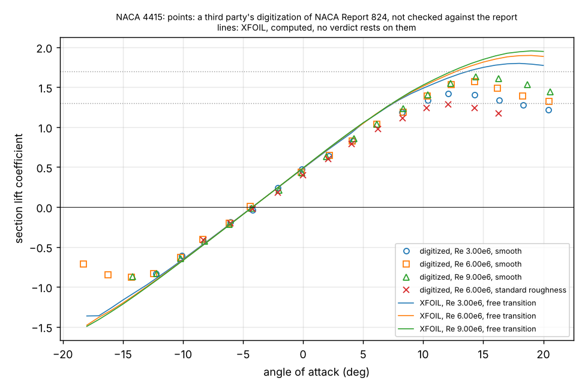
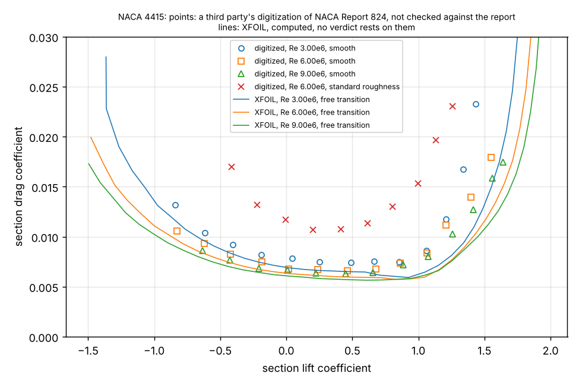
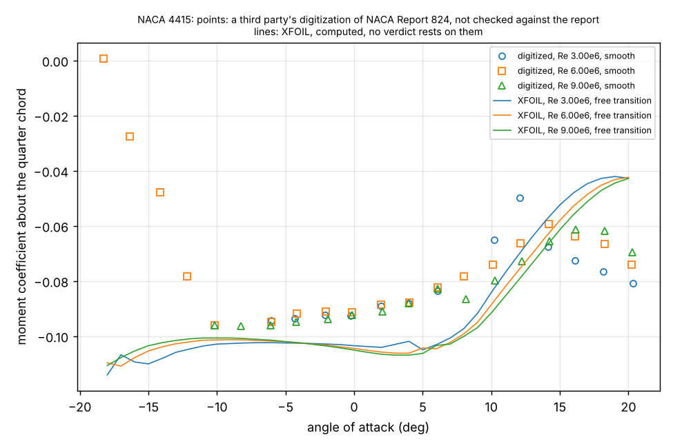

# Task 12 preliminary design P2: wing section and section data

Generated by `python -m prelim.p2_section --report-only` from `runs/task12/pd/2026-11-27/p2/p2.json`. Every number below is read from that file. Spec: `docs/specs/task12_preliminary_design.md`, package P2 (decisions PD-5, PD-6). Bands and tolerances were fixed before the run; nothing was tuned. r0 (`runs/task12/pd/2026-11-27/p0/r0`) was read and not changed.

Evidence class: **independent of Stage 1 and of the library (measured data), but read through a third party's digitization that was not checked against the report**.

## 1. Run

- Command: `python -m prelim.p2_section --out runs/task12/pd/2026-11-27/p2`
- Commit `0eee58d88d2158c11e95165de321835ab98f228d`; working tree at the start: clean (the run's own folder `runs/task12/pd/2026-11-27/p2` is not counted); unchanged during the run: yes.
- Seed: none (no random numbers are drawn in P2). python 3.13.18, numpy 2.5.3, pyyaml 6.0.3, matplotlib 3.11.2. XFOIL 6.99.dfsg+1-3 (Debian package).
- Inputs (sha256, first 12): `runs/task12/pd/2026-11-27/p0/r0/design_pusher.json` 2af85aca9acd; `runs/task12/pd/2026-11-27/p0/r0/ledger.yaml` a3b88c45e6cb; `runs/task12/pd/2026-11-27/p0/r0/cell_result.json` 83c078c1433f; `runs/task12/pd/2026-11-27/p0/r0/m250_table.json` 48e24462bb64; `data/task12/pd_p2_section_source.yaml` becb7cd4e350; `data/task12/tr824_digitized/142.ALL` c6f95d8eb794; `data/task12/tr824_digitized/NACA.LST` 2d140795c8bf.
- Log: `runs/task12/pd/2026-11-27/p2/run.log`. Run time 9 s.

## 2. Acceptance rows

Rows 1 to 5 are the spec's. Rows 6 and 7 were added in `tests/task12_pd/test_p2_section.py` and `prelim/p2_section.py` before the run.

| # | Row | Result | Band or tolerance | Verdict |
|---|---|---|---|---|
| 1 | section maximum lift, smooth, at the tabulated Reynolds number nearest the stall: inside the ledger band | 1.418 at Re 3.00 million | 1.3 to 1.7 | **pass** |
| 2 | wing clean maximum lift by (12.15) from the measured section value against the record's | 1.276 against 1.35; built aircraft 10.90 h on station against 11.00 h, loiter 89.75 kt against 87.26 kt | lower is a finding | **finding for r1** |
| 3 | section moment about the quarter chord against the ledger band of airfoil_cm0 | -0.0911 (ledger -0.08) | -0.10 to -0.04 | **pass** |
| 4 | standard roughness: a sensitivity | at Re 6.00 million: maximum lift 1.287 rough against 1.570 smooth; lowest drag 0.0107 against 0.0066 | - | **reported, no verdict** |
| 5 | SU2 validation row | owner default O-1: the Colab notebook is not started; P2 closes on measured data (PD-6) | slope 5 %, lift at zero angle 0.05, maximum lift 0.10 | **not run** |
| 6 | added: the digitized lift curve against thin-airfoil theory (gross-error check of the source file) | zero-lift angle -0.07 deg from theory; slope 0.929 of 2 pi per radian | 1.0 deg; 0.85 to 1.15 | **pass** |
| 7 | added: XFOIL polars as a third source (PD-6) | section 10 | - | **reported, no verdict** |

## 3. Findings

1. **Clean wing maximum lift is lower than r0's. Finding for r1 (P9).** The digitized NACA 4415 points give a section maximum of 1.418 at Re 3.00 million, smooth (highest plotted point, at 12.1 deg). By (12.15) the clean wing has 1.276 against r0's 1.350; take-off 1.744 against 1.818, landing 2.056 against 2.130. r0 assumed a section value of 1.50. r0 is not changed here.
2. **R17 re-flown on the built aircraft with that value.** Every loiter sub-step sits on the 1.3 V_stall floor (floor fraction 1.00), so the loiter speed rises from 87.26 to 89.75 kt true airspeed (mean of the leg) and the hours on station on r0's fuel fall from 11.00 to 10.90 h (-0.10 h). R5 needs 8.0 h at nominal values: still met. Clean stall at W0, sea level: 54.86 kt against 53.33 kt (R7 allows 70 kt; the clause holds down to a clean wing value of 0.78). Take-off over 50 ft 734 ft against 711 ft, landing 1,359 ft against 1,349 ft (limit 2,500 ft).
3. **Reading scatter.** The digitized lift points of that set lie 0.034 (root mean square, 5 points) from a straight line between -6 and 6 deg. With the section value lowered by twice that (1.350) the clean wing has 1.215 and the built aircraft 10.80 h on station at 91.97 kt. That is still at or above the ledger band's low end of 1.3. The points were not read from the report here, so this scatter is the only measure of the reading error that this package has.
4. **The loiter is flown at a lower Reynolds number than the data covers.** R17's floor is 1.3 times the stall speed at the mission altitude. There the stall Reynolds number at the mean chord is 2.77 million, below the lowest set (3.00 million), and the tip is lower still (section 5). In the sets the maximum lift falls as the Reynolds number falls, so the value used here is, if anything, high for the loiter. Nothing was extrapolated. Data at 2 million or below, or the SU2 polars after their validation row, would close this.
5. **The robustness study already covers this value.** The info-gap study of r0 moves the section maximum lift over 1.3 to 1.7, and its worst endurance point at h = 1 has it at 1.30: 3.83 h there (the cell record says 3.83 h; need 3.5 h). With the measured value in place of the band's low end, the same point gives 3.95 h. So the measured value moves the nominal aircraft, not the guarantee, as long as the band stays. Whether the band is re-centred on the measurement is for P9 and Gate C (C7).
6. **Interaction with P1's findings 1 and 2 (climb at the worst endurance point).** A lower clean maximum lift raises the stall speed at the top of the climb at nominal values too. P1's climb check was not run again here; P9 runs it on r1.
7. **Section moment.** Mean moment coefficient about the quarter chord between -6 and 6 deg: -0.0911 (5 points, -0.0935 to -0.0882). The ledger has -0.08 with the band -0.10 to -0.04: inside the band, so no finding by the spec's rule; the measured value is more nose-down than the ledger's and goes to P4's trim check and to r1 as an input.
8. **The source is a digitization, not the report.** NACA Report 824 could not be opened from the container (its hosts were refused by the session's network proxy). The points are a public third-party digitization of the report's figure. They were not read twice and not compared with the figure. Section 4 says what has to be done to close this.
9. **No measured data for the tail section.** NACA.LST of the archive lists the NACA 0006 and 0009 and no 0012, and the report could not be opened to look for it. No measured 0012 data is used in P2. The NACA 0012 rows of section 10 are XFOIL only.

## 4. Source of the section data

- Report: NACA Report 824 (TR-824). Opened in this session: **no**. The report is a scan and its hosts were not reachable from the container on 2026-11-27. The points used here were therefore not read from the report's figure by this project. They are a third party's digitization of that figure (below).
- What was tried and refused: `ntrs.nasa.gov` (curl: curl: (56) CONNECT tunnel failed, response 403 (egress proxy: connect_rejected)); `ntrs.nasa.gov` (WebFetch: getaddrinfo ENOTFOUND ntrs.nasa.gov (outside the session's allowed network domains)); `archive.org` (curl: no connection through the proxy (HTTP code 000)); `web.archive.org` (curl: no connection through the proxy (HTTP code 000)); `digital.library.unt.edu` (curl: no connection through the proxy (HTTP code 000)); `naca.central.cranfield.ac.uk` (curl: no connection through the proxy (HTTP code 000)); `m-selig.ae.illinois.edu` (curl: no connection through the proxy (HTTP code 000)); `airfoiltools.com` (curl: no connection through the proxy (HTTP code 000)).
- What was used: Text files of the plotted points of NACA TR 824, one file per page of the report, made in 1994 by Gregory P. D. Siemens at the University of Saskatchewan and declared public domain in the archive's Readme.txt. Each file holds angle of attack against lift coefficient, angle of attack against moment coefficient about the quarter chord, lift coefficient against drag coefficient, and lift coefficient against moment coefficient about the aerodynamic centre.
- Repository https://github.com/enritoomey/Perfiles2D at commit `64511f3a404398b6637fae047e2747b99ab0bf53`, folder `TR824-Digitized` (MIT (file License of the repository)); fetched 2026-11-27, git clone --depth 1 through the session proxy.
- `142.ALL`: https://github.com/enritoomey/Perfiles2D/blob/64511f3a404398b6637fae047e2747b99ab0bf53/TR824-Digitized/142.ALL ; sha256 `c6f95d8eb794a027`; committed as `data/task12/tr824_digitized/142.ALL`; byte for byte the same as TR824-Digitized/4415.txt of the same commit (cmp, 2026-11-27).
- `NACA.LST`: https://github.com/enritoomey/Perfiles2D/blob/64511f3a404398b6637fae047e2747b99ab0bf53/TR824-Digitized/NACA.LST ; sha256 `2d140795c8bf9c78`; committed as `data/task12/tr824_digitized/NACA.LST`.
- `Readme.txt`: https://github.com/enritoomey/Perfiles2D/blob/64511f3a404398b6637fae047e2747b99ab0bf53/TR824-Digitized/Readme.txt ; sha256 `49e5118b9279d4aa`; not committed (it carries a private e-mail address).
- NACA 4415: file `142.ALL`. The archive's index says the file name is the report's page number: page **142**. Checked against the report: no. Figure number: not known (the archive gives none).
- Sets used and their Reynolds numbers (the archive's Readme gives them as approximate): set 1: 3.00 million, smooth; set 2: 6.00 million, smooth; set 3: 9.00 million, smooth; set 4: 6.00 million, standard roughness.
- Read twice: **no**. Not transcribed by hand at all. The committed file is the archive's file, byte for byte (sha256 above), and the loader parses it. So there is no transcription step of this project that could be wrong, and there is no second reading of the report's figure either: the digitizer's reading error is unknown.
- Reading uncertainty: The scatter of the digitized lift points about a straight line fitted between -6 and +6 degrees is computed in the run and reported as the reading scatter. It contains the tunnel's own scatter and any curvature, so it over-states the digitizing error alone. The highest plotted point is taken as the maximum lift; the test points are about 2 degrees apart, so a faired peak between two points could be higher by an amount the points do not show.
- To close: When ntrs.nasa.gov (or another host of the scan) is allowed: open page 142 of NACA Report 824, record the figure number, and read the maximum lift, the minimum lift and five points of each lift curve twice against this file.

## 5. Reynolds and Mach numbers (step 1)

From r0's planform and speeds, ISA, viscosity by Sutherland's law (`conceptual.units.isa`).

| Condition | Station | True airspeed (kt) | Altitude (ft) | Chord (ft) | Reynolds (million) | Mach |
|---|---|---|---|---|---|---|
| stall, sea level, W0 | root | 53.33 | 0 | 8.021 | 4.59 | 0.081 |
| stall, sea level, W0 | mean | 53.33 | 0 | 6.094 | 3.49 | 0.081 |
| stall, sea level, W0 | tip | 53.33 | 0 | 3.610 | 2.07 | 0.081 |
| stall, mission altitude, start of loiter | root | 70.60 | 20,000 | 8.021 | 3.64 | 0.115 |
| stall, mission altitude, start of loiter | mean | 70.60 | 20,000 | 6.094 | 2.77 | 0.115 |
| stall, mission altitude, start of loiter | tip | 70.60 | 20,000 | 3.610 | 1.64 | 0.115 |
| loiter, mission altitude | root | 87.26 | 20,000 | 8.021 | 4.50 | 0.142 |
| loiter, mission altitude | mean | 87.26 | 20,000 | 6.094 | 3.42 | 0.142 |
| loiter, mission altitude | tip | 87.26 | 20,000 | 3.610 | 2.03 | 0.142 |
| cruise out, mission altitude | root | 129.27 | 20,000 | 8.021 | 6.67 | 0.210 |
| cruise out, mission altitude | mean | 129.27 | 20,000 | 6.094 | 5.07 | 0.210 |
| cruise out, mission altitude | tip | 129.27 | 20,000 | 3.610 | 3.00 | 0.210 |

The stall at sea level at the mean chord is at Re 3.49 million; the nearest tabulated set is 3.00 million. 4 of the 12 rows are below the lowest tabulated Reynolds number (3.00 million): stall, sea level, W0 at the tip, stall, mission altitude, start of loiter at the mean, stall, mission altitude, start of loiter at the tip, loiter, mission altitude at the tip. Nothing is extrapolated below it; maximum lift falls with Reynolds number in the sets above, so the tip is the least covered part of the wing.

## 6. Section data of the NACA 4415 (step 2)

Highest and lowest lift are the highest and lowest digitized points as they are, without fairing. Slope, lift at zero angle and zero-lift angle are a straight-line fit between -6 and 6 deg. The moment is the mean of the quarter-chord points in the same range.

| Set | Re (million) | Surface | Points | Max lift (at deg) | Lowest lift (at deg) | Negative stall shown | Slope (1/deg) | Lift at 0 deg | Zero-lift angle (deg) | Scatter | Moment c/4 | Lowest drag (at lift) |
|---|---|---|---|---|---|---|---|---|---|---|---|---|
| 1 | 3.00 | smooth | 15 | 1.418 (12.1) | -0.837 (-12.3) | no | 0.1019 | 0.431 | -4.23 | 0.034 | -0.0911 | 0.0074 (0.49) |
| 2 | 6.00 | smooth | 19 | 1.570 (14.3) | -0.880 (-14.3) | yes | 0.0970 | 0.437 | -4.51 | 0.007 | -0.0901 | 0.0066 (0.46) |
| 3 | 9.00 | smooth | 18 | 1.628 (14.4) | -0.870 (-14.2) | no | 0.1029 | 0.427 | -4.15 | 0.008 | -0.0920 | 0.0063 (0.45) |
| 4 | 6.00 | standard roughness | 13 | 1.287 (12.1) | -0.410 (-8.3) | no | 0.0979 | 0.393 | -4.01 | 0.005 | n/a | 0.0107 (0.20) |

Where "negative stall shown" is no, the lowest point is the last one of the set and the true minimum may be lower (more negative). P5 needs the negative maximum lift: it takes the sets where it is shown.

Gross-error check (row 6): thin-airfoil theory for the 4415's mean line gives a zero-lift angle of -4.15 deg; the fit of the set used is -0.07 deg from it, and its slope is 0.929 of 2 pi per radian. This can catch a wrong file or a shifted axis. It says nothing about the maximum lift.

## 7. Wing maximum lift (step 3)

Raymer (12.15), p. 270: 0.9 times the section value, quarter chord unswept. (12.16), p. 272, with Fig. 12.8: the ratio is 0.9 at zero leading-edge sweep for every curve, and the Mach correction of Fig. 12.9 is zero at Mach 0.2 and the stall is at Mach 0.081, so (12.16) at zero sweep equals (12.15). r0's leading edge is swept 2.71 deg and the section's sharpness parameter is 3.9 % chord (Table 12.1), which is the bluntest curve of Fig. 12.8. The figure is not in the library's notes and was not read; the last column is a straight line between the two values the notes give for that curve (0.9 at 0 deg, about 0.55 at 60 deg). It is a sensitivity and is not used. Flaps by (12.21), p. 278, and Table 12.2 as Stage 1.

| Section value | Section | Clean (12.15) | Clean (12.16), zero sweep | Take-off | Landing | Clean, rough line at the sweep (not used) |
|---|---|---|---|---|---|---|
| r0: the ledger's section value | 1.500 | 1.350 | 1.350 | 1.818 | 2.130 | 1.326 |
| measured value at the Reynolds number nearest the stall | 1.418 | 1.276 | 1.276 | 1.744 | 2.056 | 1.254 |
| measured value minus twice the reading scatter | 1.350 | 1.215 | 1.215 | 1.683 | 1.995 | 1.194 |
| measured, interpolated in ln(Re) to the stall Reynolds number | 1.451 | 1.306 | 1.306 | 1.774 | 2.086 | 1.283 |

Maximum lift interpolated to the stall Reynolds number of each station (straight line in ln(Re) between the sets; n/a where the station is outside the tabulated range):

| Condition | Station | Re (million) | Section maximum lift |
|---|---|---|---|
| stall, sea level, W0 | root | 4.59 | 1.511 |
| stall, sea level, W0 | mean | 3.49 | 1.451 |
| stall, sea level, W0 | tip | 2.07 | n/a |
| stall, mission altitude, start of loiter | root | 3.64 | 1.460 |
| stall, mission altitude, start of loiter | mean | 2.77 | n/a |
| stall, mission altitude, start of loiter | tip | 1.64 | n/a |

## 8. R17 re-flown: the built aircraft of r0 with another maximum lift

The aircraft is r0 as built (wing area, tanks, fuel); only the section maximum lift changes. Hours on station are the loiter time at which the mission burns r0's fuel (`measurement.info_gap.Built`, as the info-gap study). The mission holds every cruise and loiter sub-step at or above 1.3 V_stall clean at the current weight (R17).

| Case | Section | Wing clean | Hours on station | Loiter speed, mean (kt) | Loiter speed, start (kt) | Loiter sub-steps on the floor | Stall, sea level, W0 (kt) | Take-off (ft) | Landing (ft) |
|---|---|---|---|---|---|---|---|---|---|
| r0: the ledger's section value | 1.500 | 1.350 | 11.00 | 87.26 | 91.78 | 1.00 | 53.33 | 711 | 1,349 |
| measured value at the Reynolds number nearest the stall | 1.418 | 1.276 | 10.90 | 89.75 | 94.40 | 1.00 | 54.86 | 734 | 1,359 |
| measured value minus twice the reading scatter | 1.350 | 1.215 | 10.80 | 91.97 | 96.74 | 1.00 | 56.21 | 754 | 1,369 |
| measured, interpolated in ln(Re) to the stall Reynolds number | 1.451 | 1.306 | 10.95 | 88.72 | 93.32 | 1.00 | 54.23 | 724 | 1,355 |
| low end of the ledger band | 1.300 | 1.170 | 10.71 | 93.73 | 98.59 | 1.00 | 57.29 | 771 | 1,376 |

Cruise legs: the floor sets the speed on 0.00 of the cruise-out and 0.00 of the cruise-back sub-steps with the measured value (0.00 and 0.00 in r0).
Worst endurance point of r0's info-gap study at h = 1 (all its moved values): 3.83 h with its section value of 1.30; 3.95 h with the measured value there instead. Need 3.5 h.

## 9. Standard roughness (row 4, a sensitivity)

At Re 6.00 million the rough set has a maximum lift of 1.287 against 1.570 smooth (-0.282), and a lowest drag of 0.0107 against 0.0066. The rough maximum is below the ledger band (1.3 to 1.7); by (12.15) it would give a clean wing value of 1.159. There is no rough set at the stall Reynolds number in the archive. No verdict: the archive calls it standard roughness and the report was not opened to see what that is.

## 10. XFOIL, third source (row 7, PD-6)

XFOIL (Debian package xfoil) 6.99.dfsg+1-3; free transition, Ncrit 9 (default), 160 panels (default), viscous, 200 iterations; Mach 0.081. **Computed, third source (PD-6): no verdict rests on it.** The last three columns are what the tolerances of the SU2 row (row 5) would say of XFOIL; they are shown to size the gap between a computed and the measured maximum lift, not as a verdict.

| Section | Re (million) | Angles converged | Max lift (at deg) | Peak inside the sweep | Lowest lift (at deg) | Slope (1/deg) | Lift at 0 deg | Moment c/4 | Lowest drag | Slope against measured | Lift at 0 deg against measured | Max lift against measured |
|---|---|---|---|---|---|---|---|---|---|---|---|---|
| NACA 4415 | 3.00 | 38 of 39 | 1.798 (18) | yes | -1.364 (-18) | 0.1132 | 0.479 | -0.1031 | 0.0059 | 11.1 % | 0.048 | 0.381 |
| NACA 4415 | 6.00 | 39 of 39 | 1.898 (19) | yes | -1.479 (-18) | 0.1143 | 0.483 | -0.1041 | 0.0057 | 17.9 % | 0.045 | 0.328 |
| NACA 4415 | 9.00 | 39 of 39 | 1.955 (19) | yes | -1.495 (-18) | 0.1147 | 0.484 | -0.1045 | 0.0056 | 11.5 % | 0.057 | 0.327 |
| NACA 0012 | 3.00 | 39 of 39 | 1.643 (18) | yes | -1.640 (-18) | 0.1104 | 0.000 | 0.0000 | 0.0051 | n/a | n/a | n/a |
| NACA 0012 | 6.00 | 37 of 39 | 1.781 (19) | yes | -1.755 (-18) | 0.1125 | -0.000 | -0.0000 | 0.0051 | n/a | n/a | n/a |

XFOIL's maximum lift is not a substitute for the measured one (PD-6), and its NACA 0012 rows have no measured set beside them in this package.

## 11. SU2 polars (row 5)

**Not run.** Owner default O-1: the Colab notebook is not started; P2 closes on measured data (PD-6). Case files: none written. Proposed queue when the notebook is started: 20 cases, NACA 4415 at Re 3.00 and 6.00 million, Mach 0.081, angles -12, -8, -4, 0, 4, 8, 10, 12, 14, 16 deg. The validation row compares them with the sets of section 6 before any SU2 polar is used.

## 12. Tail section (NACA 0012)

Status: **not obtained**. NACA.LST of the archive lists the NACA 0006 and 0009 and no 0012, and the report could not be opened to look for it. No measured 0012 data is used in P2. PD-5 keeps the NACA 0012 for the tails; its shape is analytic, so P3 can loft it. Its measured lift curve and maximum lift stay open for P4.

## 13. Assumptions made where the spec left a choice

1. The section value for rows 1 and 2 is the smooth set at the tabulated Reynolds number nearest (by ratio) to the stall Reynolds number at the mean chord, sea level, W0. The interpolated value is reported beside it and not used.
2. Maximum lift is the highest digitized point; no curve is faired through the points.
3. The section moment is the mean of the quarter-chord moment points between -6 and 6 deg, taken as the ledger's zero-lift moment `airfoil_cm0`.
4. A public third-party digitization of the report's figure was used because the report could not be opened. The caller's rule was to stop if no open source could be reached; one could, so the data steps were done and the difference is stated in sections 3, 4 and 14.
5. The digitizer's file is committed unchanged and parsed, instead of being typed into a table.
6. The Reynolds numbers of the sets are the archive's approximate values. The order of the sets agrees with them: maximum lift rises and lowest drag falls from set 1 to set 3.
7. The split-flap set of the archive is not used: the aircraft has slotted flaps, taken from Table 12.2 as in Stage 1.
8. XFOIL is run with its defaults (free transition, Ncrit 9). The Debian build stops with a floating-point exception when plotting is off, so it is run with plotting on under a virtual display (`xvfb-run`).
9. No SU2 case files were written: they need a mesh and a turbulence-model choice that belong to the SU2 case spec.
10. No design choice was made here, so there is no new PD entry in `docs/specs/00_decisions.md`.

## 14. What this does not show

- It does not show that the digitized points are the report's points. Nobody here saw the figure.
- It does not give the figure number, and the page number is the archive's statement.
- It does not give the maximum lift at the tip's Reynolds number, which is below the lowest set.
- It does not give measured data for the NACA 0012.
- It does not validate SU2, and XFOIL's numbers validate nothing.
- It does not change r0. The wing value for r1 is P9's decision; Gate C item C7 asks that it is not above what the measured data supports.
- (12.15) is itself an estimate: Raymer, p. 270, calls maximum lift the least reliable estimate of conceptual design. A measured section value does not make the wing value measured.
