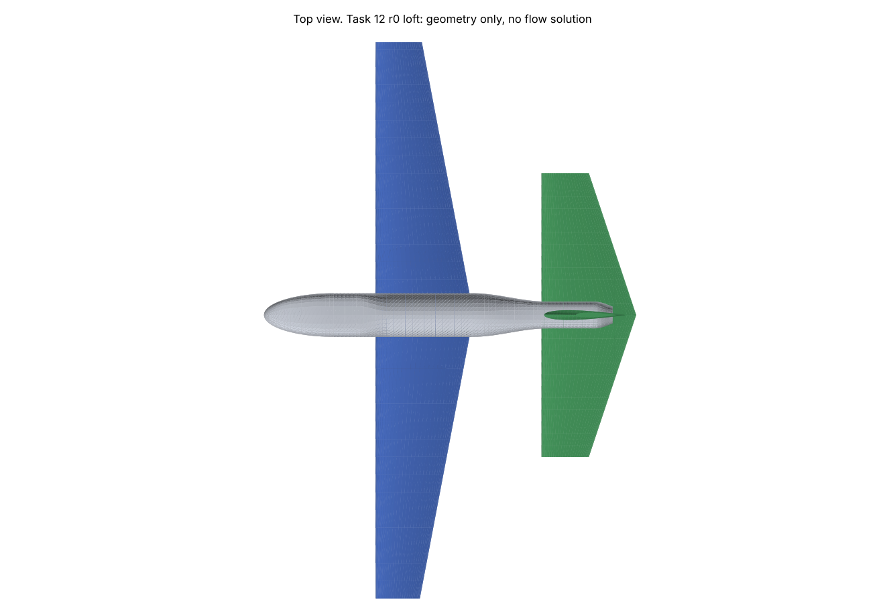
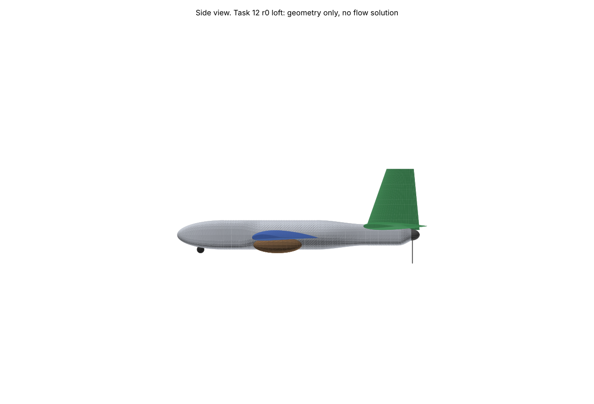
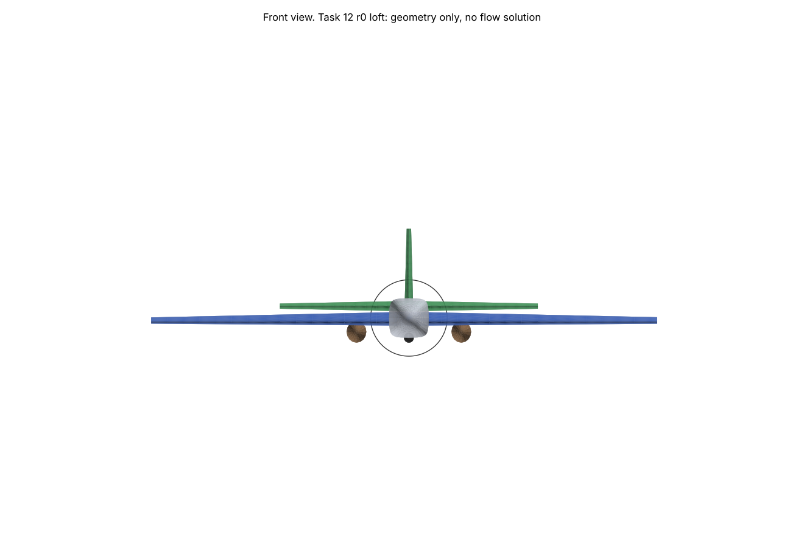
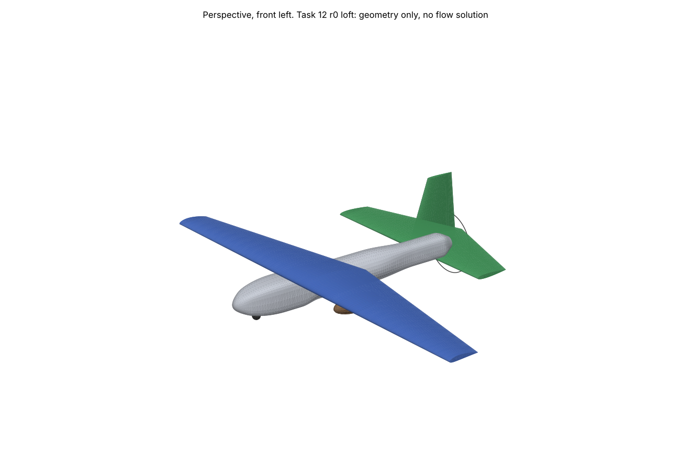
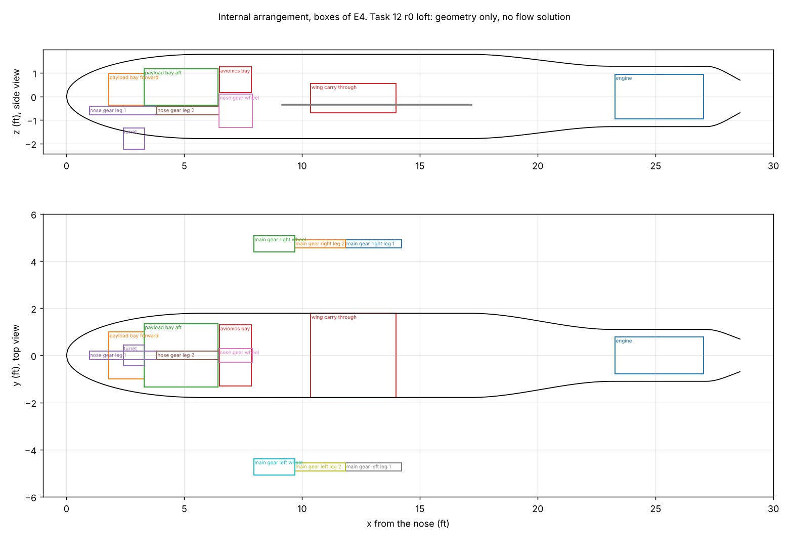

# Task 12 preliminary design P3: lofted geometry and geometry gates

Generated by `python -m prelim.p3_loft --report-only` from `runs/task12/pd/2026-11-27/p3/p3.json` and `runs/task12/pd/2026-11-27/p3/loft.stl`. Every number below is read from that record. Spec: `docs/specs/task12_preliminary_design.md`, package P3 (E1, E2, E4, E5; gates 1 to 8; decisions PD-2, PD-12, PD-14). Tolerances are the spec's or were fixed in `tests/task12_pd/test_p3_geometry.py` before the run; nothing was tuned. r0 (`runs/task12/pd/2026-11-27/p0/r0`) was read and not changed: what the loft finds is listed in section 10 for the closing re-record r1 (PD-7).

Evidence class: **layout construction for the geometry; the area and volume rows integrate a surface instead of using a factor, so they are independent of Stage 1's formulas (spec P3). The tail section data are measured values of NACA Report 586, independent of Stage 1 and of the library**.

**In short:** the loft is watertight and smooth, its export reads back exactly, the fuselage, wing and horizontal tail areas agree with Stage 1 inside 5 %. 4 rows fail and are reported, not tuned: row 3; row 4; row 8; row 9.

## 1. Run

- Command: `python -m prelim.p3_loft --out runs/task12/pd/2026-11-27/p3 --openvsp-python /tmp/claude-0/-home-user/d15a4c10-d7a3-5006-96e8-4d0a5f6097f0/scratchpad/vspenv/bin/python`
- Commit `cfae30868196484f18cf31d9cc7997887527ec37`; working tree at the start: clean (the run's own folder `runs/task12/pd/2026-11-27/p3` is not counted); unchanged during the run: yes.
- Seed: none (no random numbers are drawn in P3). python 3.13.18, numpy 2.5.3, scipy 1.18.1, pyyaml 6.0.3, matplotlib 3.11.2. OpenVSP 3.57.1 for gate 8 (interpreter `/tmp/claude-0/-home-user/d15a4c10-d7a3-5006-96e8-4d0a5f6097f0/scratchpad/vspenv/bin/python`, a session scratchpad, PD-14).
- Inputs (sha256, first 12): `runs/task12/pd/2026-11-27/p0/r0/design_pusher.json` 2af85aca9acd; `runs/task12/pd/2026-11-27/p0/r0/ledger.yaml` a3b88c45e6cb; `data/task12/pd_p3_arrangement.yaml` 2e57c5a76290; `data/task12/pd_p3_tail_section_source.yaml` 622001997e10.
- Export: `runs/task12/pd/2026-11-27/p3/loft.stl`, 5,170,815 bytes, sha256 8aa350f08ad9, 17,214 triangles. Log: `runs/task12/pd/2026-11-27/p3/run.log`. Run time 81 s.

## 2. Gates

Rows 1 to 8 are the spec's. Rows 9 and 10 were added in the tests before the run (a package may add tests).

| Row | Gate | Key number | Verdict |
|---|---|---|---|
| 1 | every component watertight, normals outward | 8 parts, 17,214 triangles, 0 bad edges | **pass** |
| 2 | printed targets: conic cases of Raymer (7.4); mean chord and its station against r0 | circle radius error 2.2e-16 (rho = sqrt(2) - 1) and 9.6e-06 (rho = 0.4142 as printed); parabola error 2.2e-16; mean chord +2.2e-16, its station +2.2e-16 relative to r0 | **pass** |
| 3 | wetted area per component against the area Stage 1's build-up uses, within 5 % | wing -0.2 %; fuselage -4.2 %; horizontal tail -3.9 %; vertical tail -11.4 %; sponsons -26.1 % | **fail** |
| 4 | volumes: tanks, boxes inside the skin with clearance, no two boxes overlapping, payload bay | tanks 68.24 ft^3 usable against 21.92 needed; payload bay 17.11 ft^3 against 16.67; 0 overlaps; 2 of 13 boxes outside their skin | **fail** |
| 5 | smoothness of section perimeter and area along the fuselage; aft-body angle reported | largest change of slope: perimeter 0.0041, area 0.0049 (bound 0.01); aft-body angle 29.4 deg (reported) | **pass** |
| 6 | ground angles on the loft: propeller clearance at rotation, tipback, overturn | propeller clearance at 10 deg 14.76 in (needs 9); CG angle 15.00 deg (needs 15); overturn 63.00 deg (at most 63) | **pass** |
| 7 | export round trip: area and volume of the re-read STL | largest relative difference 0.0e+00 | **pass** |
| 8 | OpenVSP CompGeom wetted areas, within 2 % | wing -3.1 %; fuselage +0.6 %; horizontal tail +0.7 %; vertical tail -3.9 %; sponsons -8.0 % | **fail** |
| 9 | added: no part of the airframe behind the propeller plane inside the disc | fuselage -0.15 ft; horizontal tail +1.78 ft; vertical tail +0.87 ft | **fail** |
| 10 | added: wetted areas with the surface mesh doubled and doubled again (reported) | largest change of a wetted area, base mesh to four times finer: +0.77 % | **reported** |

## 3. The loft

- Axes: x aft from the nose, y to the right, z up from the fuselage reference line; feet. Layout convention of `conceptual/render3d.py` and `conceptual/openvsp_model.py` (wing 0.1 D below the reference line, tailplane 0.3 D above, unswept leading edges, fin leading edge slope 0.35, ellipsoid sponsons, turret under the nose). Only the fuselage is new.
- **Wing and tails (E1).** NACA 4415 (P2) and NACA 0012 (PD-5) at every span station, scaled to the local chord, so the surface is straight between root and tip at constant per cent chord (Raymer 7.8, p. 139-146). Section equations: NACA Report 460, p. 4-5 (thickness polynomial, mean line, the rule for combining them; Report 824, p. 4, gives the same rule as its (1) to (4) but does not print the polynomial). The report's trailing edge is not closed; the loft keeps it and closes each section with a flat base. Tips are closed flat.
- **Fuselage (E2).** Control stations, each four conics with horizontal and vertical end tangents and the shape parameter rho of Raymer (7.2), p. 132; between the stations the half breadth, top, bottom and rho follow monotone cubics, and the nose is closed by an ellipse over the first 20 % of the length as in the Stage 1 body. Maximum breadth and depth stay Stage 1's diameter.

| x (ft) | half breadth (ft) | top (ft) | bottom (ft) | rho | why |
|---|---|---|---|---|---|
| 0.000 | 1.786 | 1.786 | 1.786 | 0.4142 | nose point (the ellipse closes it) |
| 1.715 | 1.786 | 1.786 | 1.786 | 0.7000 | payload bay starts: squarer sections |
| 7.717 | 1.786 | 1.786 | 1.786 | 0.7000 | payload bay and nose-wheel well end |
| 10.290 | 1.786 | 1.786 | 1.786 | 0.4142 | circular again ahead of the wing spars |
| 17.150 | 1.786 | 1.786 | 1.786 | 0.4142 | end of the constant section (Stage 1: 60 %) |
| 23.152 | 1.100 | 1.281 | 1.281 | 0.6500 | engine bay starts, round the engine envelope |
| 27.154 | 1.100 | 1.281 | 1.281 | 0.6500 | engine bay ends |
| 28.583 | 0.691 | 0.691 | 0.691 | 0.4142 | circle at the spinner |

- Sponsons, turret and spinner are ellipsoids. The spinner base radius is 0.691 ft (a judgement, `data/task12/pd_p3_arrangement.yaml`). No wing-body fairing, inlet or exhaust.
- **Export (E5).** ASCII STL by `geometry3d/mesh.py`, one solid per part, 17 significant digits.

## 4. Gate 3: wetted areas against the drag build-up

Loft wetted area: the triangles of a part whose middle is not inside another part. Stage 1: the areas `conceptual/uav.py` puts into (12.24), computed again from the record. Raymer form on the loft: (7.11) on the loft's exposed planform, (7.12) on the loft's top and side areas, as a second reading (no verdict).

| Component | Loft wetted (ft^2) | Loft whole surface (ft^2) | Stage 1 (ft^2) | Loft against Stage 1 | Raymer form on the loft (ft^2) | Loft against it | Verdict (5 %) |
|---|---|---|---|---|---|---|---|
| wing | 496.22 | 562.25 | 497.10 | -0.2 % | 499.67 | -0.7 % | **pass** |
| fuselage | 266.12 | 294.40 | 277.78 | -4.2 % | 296.24 | -10.2 % | **pass** |
| horizontal tail | 265.56 | 279.16 | 276.30 | -3.9 % | 258.06 | +2.9 % | **pass** |
| vertical tail | 66.99 | 80.35 | 75.63 | -11.4 % | 68.78 | -2.6 % | **fail** |
| sponsons | 47.03 | 56.29 | 63.66 | -26.1 % | - | - | **fail** |
| sum | 1,141.92 |  | 1,190.47 | -4.1 % |  |  |  |

- Fuselage: top-view area 85.71 ft^2 and side-view area 88.55 ft^2, fill 0.839 and 0.867 of length x diameter against the ledger's 0.80. The whole surface is larger than Stage 1's area; the wetted part is smaller because the wing, the tail roots and the spinner cover some of it, which Stage 1 does not deduct.
- Vertical tail: Stage 1 counts the whole fin; on the loft its root is inside the aft fuselage (the convention puts the root at 0.6 of the Stage 1 body radius, and the engine bay is fuller than that body).
- Sponsons: Stage 1 uses (7.12) with the fuselage's fill factor on length x depth; the ellipsoid of the drawing has less surface, and the wing covers its top.
- Not in Stage 1's build-up, for the record: turret 1.94 ft^2 and spinner 3.87 ft^2 wetted (the turret is a drag area in the ledger).
- Row 10, mesh: wetted areas with 1, 2 and 4 times the stations and points: wing 496.22 / 496.60 / 495.93; fuselage 266.12 / 266.13 / 266.38; horizontal tail 265.56 / 264.54 / 263.96; vertical tail 66.99 / 66.49 / 66.47; sponsons 47.03 / 47.27 / 47.13 ft^2. Gate 3 verdicts on the finest mesh: wing pass, fuselage pass, horizontal tail pass, vertical tail fail, sponsons fail.

**Gate 3 fails, so the build-up was re-run with the loft's areas (spec).** Stage 1's drag build-up and mission on the built aircraft (the record's weight, wing area, engine table and fuel), once as recorded and once with the five areas replaced. Form factors, interference factors and weights are unchanged.

| | As recorded | With the loft's areas | Change |
|---|---|---|---|
| CD0 at the mission altitude | 0.02208 | 0.02061 | -0.00147 (-6.66 %) |
| CD0 at sea level | 0.02063 | 0.01923 | -0.00141 |
| hours on station, r0's weight and fuel | 11.000 | 11.429 | +0.429 h |

- The run as recorded reproduces r0's CD0 (0.022082) and its sized loiter. The change is favourable. It is **not credited here**: it goes to r1 with the other findings, and two of them work against it (a sponson that holds the gear is larger, section 5; a fin clear of the propeller may be placed differently, section 7). The fuselage and sponson weights of Stage 1 also depend on wetted area and were not re-run.

## 5. Gate 4: volumes and the internal arrangement (E4)

- **Wing tanks.** Between the spars at 0.15 and 0.60 of the chord, from the fuselage side (1.79 ft) to 18.61 ft, integrated on the NACA 4415: 80.28 ft^3, 68.24 ft^3 usable (85 %). Needed 21.92 ft^3: **pass**, margin 46.32 ft^3. Stage 1 claims 73.17 ft^3 (a box of the full thickness): the loft gives -6.7 %.
- **Fuselage volume.** Section area integrated over the length (Raymer 7.11): 236.28 ft^3; enclosed by the surface: 234.93 ft^3 (+0.58 %); Raymer (7.13) on the loft's projected areas: 225.70 ft^3.
- **Payload bay (PD-12).** 17.11 ft^3 in two boxes against 16.67 ft^3: **pass**. Volume centre at 4.313 ft. This is the first payload-bay row on a loft (item 30, NR-21). Avionics: 3.83 ft^3 against 3.22 ft^3: **pass**.
- **Boxes.** Clearance required to the skin: 1.0 in (set in the arrangement file; the ledger has no such entry). The clearance found is the largest at which every edge point of the box is inside the skin; -12.00 means outside by a foot or more.

| Box | x from to (ft) | y from to (ft) | z from to (ft) | Volume (ft^3) | Inside | Clearance (in) | Verdict |
|---|---|---|---|---|---|---|---|
| engine | 23.28 to 27.02 | -0.78 to 0.78 | -0.94 to 0.94 | 11.03 | fuselage | 1.44 | **pass** |
| payload bay forward | 1.80 to 3.30 | -1.00 to 1.00 | -0.38 to 0.97 | 4.05 | fuselage | 1.15 | **pass** |
| payload bay aft | 3.30 to 6.42 | -1.35 to 1.35 | -0.38 to 1.17 | 13.06 | fuselage | 1.10 | **pass** |
| avionics bay | 6.50 to 7.85 | -1.30 to 1.30 | 0.16 to 1.25 | 3.83 | fuselage | 2.74 | **pass** |
| nose gear leg 1 | 0.97 to 3.83 | -0.17 to 0.17 | -0.77 to -0.42 | 0.35 | fuselage | 1.63 | **pass** |
| nose gear leg 2 | 3.83 to 6.47 | -0.17 to 0.17 | -0.77 to -0.42 | 0.32 | fuselage | 9.06 | **pass** |
| nose gear wheel | 6.47 to 7.89 | -0.29 to 0.29 | -1.31 to 0.11 | 1.15 | fuselage | 5.36 | **pass** |
| main gear left leg 1 | 11.84 to 14.22 | -4.91 to -4.56 | -1.42 to -1.07 | 0.29 | sponson left | 6.21 | **pass** |
| main gear left leg 2 | 9.69 to 11.84 | -4.91 to -4.56 | -1.42 to -1.07 | 0.26 | sponson left | 2.62 | **pass** |
| main gear left wheel | 7.95 to 9.69 | -5.08 to -4.38 | -2.12 to -0.37 | 2.11 | sponson left | -12.00 | **fail** |
| main gear right leg 1 | 11.84 to 14.22 | 4.56 to 4.91 | -1.42 to -1.07 | 0.29 | sponson right | 6.21 | **pass** |
| main gear right leg 2 | 9.69 to 11.84 | 4.56 to 4.91 | -1.42 to -1.07 | 0.26 | sponson right | 2.62 | **pass** |
| main gear right wheel | 7.95 to 9.69 | 4.38 to 5.08 | -2.12 to -0.37 | 2.11 | sponson right | -12.00 | **fail** |
| wing carry through | 10.37 to 13.98 | -1.79 to 1.79 | -0.69 to 0.55 | 16.10 | not tested | - | - |
| turret | 2.41 to 3.31 | -0.45 to 0.45 | -2.24 to -1.34 | 0.73 | not tested | - | - |

- Overlaps between boxes, and between a box and a wing tank: none.
- **Main gear in the sponsons: fail.** On the loft the leg from pivot to axle is 5.22 ft (the pivot on the sponson's centre line, the wheel on the ground). Folded forward, the wheel ends ahead of the sponson's nose. The three boxes need 6.44 ft by 1.91 ft deep with clearance; the sponson is 5.93 ft by 1.98 ft and is an ellipsoid. In tyre diameters: 3.91 long and 1.16 deep at least, against the ledger's 3.6 (band 3.0 to 4.8) and 1.2 (band 1.1 to 1.4). Stage 1's check compares the gear length with the sponson length and the tyre with its depth; it does not see the shape or where the sponson sits. A finding for r1; no sponson was resized here.
- Gate 4 verdict: **fail**: box main_gear_left_wheel: clearance -12.00 in; box main_gear_right_wheel: clearance -12.00 in.

## 6. Nose packaging (the nose-packaging finding of P1; decision PD-19)

P1 found that the nose-gear leg, retracted aft, passes through the payload bay and the avionics station. On the loft the leg is 6.03 ft from its pivot to the axle (pivot at 1.14 ft; it cannot fold forward) and its stowed axle is at 7.18 ft. The choice (PD-19 in `docs/specs/00_decisions.md` section 9), the simplest that passes the box gate:

1. The nose wheel stays at r0's station and retracts aft into a bay on the centreline: two boxes round the leg and a wheel well.
2. The payload bay is two boxes above the stowed leg, ahead of the wheel well, in sections made squarer (rho 0.70; Raymer p. 133 squares a fuselage the same way to make room). The turret stays where r0 draws it; the leg passes above it.
3. The avionics box sits above the wheel well, behind the payload bay.
4. Not chosen: forward retraction (the wheel is 1.14 ft from the nose); a shorter leg (the leg length comes from the propeller's ground clearance, and a shorter nose leg alone tilts the aircraft nose-down on the ground); a longer or fuller nose (changes the outer lines).

Why the bay had to move: at r0's payload station the body is too slender for the volume of PD-12 as boxes, with or without the leg.

| Moved mass | Weight (lb) | r0 station (ft) | P3 station (ft) | Shift (ft) | Moment change (lb ft) |
|---|---|---|---|---|---|
| payload | 500.00 | 2.858 | 4.313 | +1.455 | +727 |
| avionics | 96.55 | 6.002 | 7.175 | +1.173 | +113 |
| sum |  |  |  |  | +841 |

- For scale (P4 recomputes): the centre of gravity moves +0.239 ft (+0.0392 MAC) at take-off weight and +0.348 ft (+0.0570 MAC) at zero-fuel weight. With Stage 1's neutral point the static margin would go from 0.1126 to 0.0733 full and from 0.0874 to 0.0304 empty of fuel; R13 asks 0.05 to 0.15. **r0 is not changed here**; the wing position that restores R13 is P4's to compute.
- The whole 500 lb is placed at the bay's volume centre. The turret's share of it is not in any record, so it is not split off.
- Gear up and down, for P4's balance (Stage 1 keeps the gear weight at the wheel station):

| Gear | Weight (lb) | Station, gear down (ft) | Leg mid-point, gear up (ft) | Stowed axle (ft) | Retracts |
|---|---|---|---|---|---|
| nose gear | 95.04 | 1.143 | 4.161 | 7.178 | aft |
| main gear | 223.04 | 14.045 | 11.433 | 8.821 | forward |

- Not moved: every other station of r0 (engine, nose gear down, main gear down, systems, wing, tails, fuel).

## 7. Gates 5, 6, 7 and row 9

- **Gate 5, smoothness.** The slope of the section perimeter and of the section area along the fuselage, over steps of 1/4000 of the length from 5 % on, changes between neighbouring steps by at most 0.0041 (perimeter, at 27.16 ft) and 0.0049 (area) of the largest value per foot; bound 0.01. The test shows that the Stage 1 body, with its break at 60 % of the length, fails this bound.
- Aft-body angle (reported): top and bottom 29.4 deg, side 21.4 deg. Raymer 8.2, p. 155-156: 10 to 12 deg without a propeller behind, about 30 deg ahead of a pusher propeller. The loft is just inside the pusher guide: the engine envelope ends 1.6 ft ahead of the fuselage end, so the body closes steeply.
- **Gate 6, ground angles.** Turned 10 deg nose-up about the main wheels, the lowest point of the propeller disc is 14.76 in above the ground (9 in needed). Stage 1's own expression on the loft gives 14.44 in; the record has 14.44 in. The lowest point of the loft itself is 43.54 in up (fuselage). First to touch if the nose keeps rising: the propeller, at 14.65 deg; the ledger assumes a tail bumper at 10 deg. CG angle at the main wheel 15.00 deg (15 needed; equal by Stage 1's construction). Overturn angle 63.00 deg full and 62.67 deg empty (at most 63; equal by construction). Raymer 11.2, Fig. 11.4, p. 232. These use r0's centre of gravity; P4 repeats them if it moves.
- **Gate 7, export.** The STL read back gives every part's area and volume within 0.0e+00 relative (1e-9 allowed).
- **Row 9, propeller disc: fail.** Propeller plane at 28.73 ft, disc radius 3.45 ft. The horizontal tail reaches 1.78 ft behind the plane inside the disc. The vertical tail reaches 0.87 ft behind the plane inside the disc. r0 places each tail by its mean chord at the tail arm; with unswept leading edges the root chords run past the end of the fuselage. The conceptual render and the OpenVSP model draw the same overlap. A finding for r1 (tail arm, planform or sweep; PD-3 allows tail area and arm to change).

## 8. Gate 8: OpenVSP cross-check

OpenVSP 3.57.1 was available in the session scratchpad. `geometry3d/openvsp_check.py` gives OpenVSP the loft's fuselage sections and the parameters of the other parts; OpenVSP builds its own surfaces and trims them in CompGeom. Judged on OpenVSP's default surface mesh; its finer mesh is shown because OpenVSP's own numbers move with it.

| Component | Loft wetted | OpenVSP wetted, default mesh | Difference | OpenVSP wetted, fine mesh | Difference | Whole surface: loft against OpenVSP fine | Verdict (2 %) |
|---|---|---|---|---|---|---|---|
| wing | 496.22 | 512.27 | -3.1 % | 516.67 | -4.0 % | +0.12 % | **fail** |
| fuselage | 266.12 | 264.57 | +0.6 % | 266.69 | -0.2 % | +0.23 % | **pass** |
| horizontal tail | 265.56 | 263.64 | +0.7 % | 263.53 | +0.8 % | +0.11 % | **pass** |
| vertical tail | 66.99 | 69.73 | -3.9 % | 69.91 | -4.2 % | +0.13 % | **fail** |
| sponsons | 47.03 | 51.14 | -8.0 % | 52.09 | -9.7 % | -1.33 % | **fail** |

- The whole surfaces agree to a fraction of a per cent, so the two tools draw the same shapes. The differences are in how much of a part is counted as covered where parts cross (wing in fuselage and sponsons, fin root in the aft fuselage, sponson top in the wing). The loft counts a triangle as covered when its middle is inside another part, and its numbers move by +0.77 % at most when the mesh is refined four times (row 10). Which of the two is nearer the true covered area was **not established**; the row is reported as it came out. One more reading, from section 4: Raymer's (7.11) on the loft's exposed planform gives 499.67 ft^2 for the wing and 68.78 ft^2 for the fin (it does not know the sponsons).
- No verdict of gate 3 changes if OpenVSP's areas are used instead: wing +3.1 %; fuselage -4.8 %; horizontal tail -4.6 %; vertical tail -7.8 %; sponsons -19.7 % against Stage 1.

## 9. Tail section data: NACA 0012 (for P4 and P5)

NACA Report 824 has no characteristics page for the 0012, so P2 transcribed none. Source here: NACA Report 586 (NACA-TR-586), "Airfoil Section Characteristics as Affected by Variations of the Reynolds Number", Eastman N. Jacobs, Albert Sherman, 1937; NTRS 19930091662, https://ntrs.nasa.gov/api/citations/19930091662/downloads/19930091662.pdf, sha256 a48dbddbad04, 46 pages. Opened in this session; the PDF is not committed. Report 586, Table I, 'Important airfoil section characteristics', printed p. 39 (PDF page 44); rows of the N.A.C.A. 0012. Cross-check: Report 586, Table II, printed p. 41 (PDF page 46), row 0012 at R_e 8.37 million: c_l max 1.66, a_0 0.099, c_d0 min 0.0069, c_m a.c. 0, a.c. 0.6 ahead and 3 above; equal to the first row below. Read twice: the whole page at 130 dpi, then the rows alone at 400 dpi. The two readings agree in every digit. Reading uncertainty: a printed table: half of the last printed digit (0.0005 in a_0, 0.005 in c_l max, 0.00005 in c_d0 min).

| R_e (millions) | lift-curve slope a_0 (per deg) | c_l max | peak | c_d0 min | c_m a.c. | a.c. ahead of c/4 (% c) |
|---|---|---|---|---|---|---|
| 8.450 | 0.100 | 1.65 | A | 0.0069 | 0 | 0.6 |
| 8.370 | 0.099 | 1.66 | A | 0.0069 | 0 | 0.6 |
| 6.280 | 0.097 | 1.62 | A | 0.0073 | 0 | 0.8 |
| 3.540 | 0.097 | 1.49 | A | 0.0077 | 0 | 1.0 |
| 1.740 | 0.096 | 1.18 | A | 0.0075 | 0 | 1.1 |
| 0.871 | 0.094 | 0.91 | D | 0.0065 | - | - |
| 0.449 | 0.098 | 0.89 | D | 0.0105 | - | - |

- R_e is the effective Reynolds number R_e of the report: the test Reynolds number times the tunnel's turbulence factor 2.64 (Table II, footnote 4). The report's method is to use R_e as the flight Reynolds number.
- Negative maximum lift: Not measured: the report's tests are at positive angles. The section is symmetrical, so the negative maximum lift is taken as minus the positive one. This is a property of the shape, not a reading.
- Old tunnel: the variable-density tunnel's stream was turbulent. Its minimum drag is higher than a low-turbulence tunnel gives, and Report 824 exists because of that. Use c_d0 min as an upper reading.
- Smooth model. No roughness data for the 0012 in this report.
- The table gives no curve points; angles of stall and the shape after the peak are in Fig. 3 only and were not digitized.
- At the tail's Reynolds numbers on r0 (mean chords of the record), interpolated between the table rows in log R (an interpolation, not a reading):

| Condition | Tail | Reynolds number | a_0 (per deg) | c_l max | negative c_l max | c_d0 min |
|---|---|---|---|---|---|---|
| stall, clean, sea level | horizontal tail | 3,455,366 | 0.0970 | 1.479 | -1.479 | 0.00769 |
| stall, clean, sea level | vertical tail | 2,952,113 | 0.0967 | 1.411 | -1.411 | 0.00765 |
| rotation, sea level | horizontal tail | 2,620,327 | 0.0966 | 1.359 | -1.359 | 0.00762 |
| rotation, sea level | vertical tail | 2,238,692 | 0.0964 | 1.290 | -1.290 | 0.00757 |
| loiter, mission altitude | horizontal tail | 3,388,398 | 0.0969 | 1.471 | -1.471 | 0.00769 |
| loiter, mission altitude | vertical tail | 2,894,898 | 0.0967 | 1.402 | -1.402 | 0.00764 |
| cruise out, mission altitude | horizontal tail | 5,019,974 | 0.0970 | 1.569 | -1.569 | 0.00746 |
| cruise out, mission altitude | vertical tail | 4,288,845 | 0.0970 | 1.534 | -1.534 | 0.00757 |
| V_C, sea level | horizontal tail | 7,126,967 | 0.0979 | 1.638 | -1.638 | 0.00712 |
| V_C, sea level | vertical tail | 6,088,967 | 0.0970 | 1.613 | -1.613 | 0.00732 |

- Loft geometry of the 0012 and 4415: NACA Report 460 (NACA-TR-460), "The characteristics of 78 related airfoil sections from tests in the variable-density wind tunnel", Eastman N. Jacobs, Kenneth E. Ward, Robert M. Pinkerton, 1933; NTRS 19930091108, sha256 ed7f7a0c24f9; opened in this session, not committed. Report 460, printed p. 4 (PDF page 6), and Fig. 1 on the same page; Report 460, printed p. 5 (PDF page 7); Report 460, printed p. 5, Fig. 2; the same in Report 824, printed p. 4 (PDF page 9), equations (1) to (4). The tests check the polynomial against the printed ordinates of Report 460, Fig. 1, and of the 0012 in Report 586, Fig. 3.

## 10. Findings for r1

1. Wetted area, vertical tail: loft 66.99 ft^2 against Stage 1's 75.63 ft^2 (-11.4 %), outside 5 %.
2. Wetted area, sponsons: loft 47.03 ft^2 against Stage 1's 63.66 ft^2 (-26.1 %), outside 5 %.
3. Build-up with the loft's five areas: CD0 at the mission altitude 0.02208 to 0.02061 (-6.66 %); hours on station 11.00 to 11.43 h (+0.43 h) at r0's weight and fuel. The loft's areas go into r1.
4. Nose packaging (PD-19): payload 500.00 lb from 2.858 ft to 4.313 ft (+1.455 ft, +727 lb ft).
5. Nose packaging (PD-19): avionics 96.55 lb from 6.002 ft to 7.175 ft (+1.173 ft, +113 lb ft).
6. Together +841 lb ft: centre of gravity +0.239 ft (+0.0392 MAC) at take-off weight and +0.348 ft (+0.0570 MAC) at zero-fuel weight; with Stage 1's neutral point the static margin would be 0.0733 full and 0.0304 empty (R13: 0.05 to 0.15). P4 recomputes and moves the wing if needed.
7. The retracted main gear does not fit the sponson (box main_gear_left_wheel: clearance -12.00 in; box main_gear_right_wheel: clearance -12.00 in): the leg from pivot to axle is 5.22 ft and its boxes need 6.44 ft by 1.91 ft deep against the sponson's 5.93 ft by 1.98 ft (3.91 and 1.16 tyre diameters; ledger 3.6 and 1.2).
8. The horizontal tail reaches 1.78 ft behind the propeller plane inside the disc (plane at 28.73 ft, disc radius 3.45 ft): the tail and the pusher propeller of r0's layout occupy the same space.
9. The vertical tail reaches 0.87 ft behind the propeller plane inside the disc (plane at 28.73 ft, disc radius 3.45 ft): the tail and the pusher propeller of r0's layout occupy the same space.
10. Aft-body angle of the loft: 29.4 deg (top and bottom), 21.4 deg (side), against Raymer's 10 to 12 deg and about 30 deg ahead of a pusher propeller; the engine envelope at r0's engine station sets it.
11. Wing tanks on the loft: 68.24 ft^3 usable against Stage 1's claim of 73.17 ft^3 (-6.7 %) and 21.92 ft^3 needed.
12. OpenVSP cross-check outside 2 % for: wing, vertical_tail, sponsons (no size changes; see the report).

## 11. Renders

Made by code from the exported STL, matplotlib only (PD-2). Each has a sidecar record beside it and is labelled "geometry only, no flow solution". The three orthographic views are the three-view of P1 redrawn from the loft (item 5).

## 12. Assumptions made where the spec left a choice

1. Layout convention (heights of wing and tail, unswept leading edges, fin sweep, sponson and turret shapes and places) is that of the conceptual render and OpenVSP model, so the three drawings agree. r0 gives planform sizes and stations but no sweep or heights.
2. The fuselage keeps Stage 1's length, maximum diameter and nose ellipse. The payload-bay sections are squarer (rho 0.70) and the engine bay is drawn round the TCDS engine envelope at r0's engine station; both are P3 choices in `data/task12/pd_p3_arrangement.yaml`.
3. The fuselage ends in a circle of 20 % of the propeller diameter (the spinner base) instead of Stage 1's 15 % of the fuselage diameter; a judgement.
4. Box clearance to the skin 1.0 in. The spec names 'the ledger's clearance'; the ledger has none, so it is set in the arrangement file with a band.
5. Avionics volume at 30 lb/ft^3 on the installed avionics weight of r0, as the P1 first check did.
6. Front spar at 15 % of the chord; rear spar at 15 % plus the ledger's tank chord fraction.
7. A gear leg is measured on the loft from a pivot inside the body to the axle with the wheel on the ground, and folds through a right angle. Stage 1's 'gear length' is the height of the fuselage bottom above the ground, which is shorter than either leg.
8. The nose-gear pivot is 0.60 ft below the reference line, the highest place that keeps the stowed leg inside the nose skin.
9. The wetted area of a part is the area of its triangles whose middle is outside every other part. Gate 3 is judged on this, not on the whole surface.
10. Gate 5's bound and the form of the test were fixed before the run, with the Stage 1 body as the case that must fail.
11. Gate 6 uses r0's centre of gravity on the reference line, as Stage 1 does.
12. Gate 8 is judged on OpenVSP's default surface mesh, the one the committed OpenVSP models used.
13. Row 9 (propeller disc) and row 10 (mesh) are additions of this package.
14. The build-up re-run changes the five wetted areas only.
15. NACA 0012 data are from Report 586's printed table; its Reynolds number is the report's effective one. The negative maximum lift is taken by symmetry.
16. The four-digit equations are cited from Report 460, because Report 824 does not print the thickness polynomial.

## 13. What this does not show

- No flow solution. The renders are geometry only.
- No wing-body fairing, inlet, exhaust, doors or structure. Boxes are bounding boxes; the payload is 500 lb at a density, not a real payload.
- No sponson was resized, no tail was moved and no wing was moved: those are findings. Until r1 the loft has a gear that does not stow and a tail that crosses the propeller disc.
- The centre-of-gravity shift of section 6 is arithmetic on r0's weights and Stage 1's neutral point. P4 owns the balance and R13.
- The CD0 and hours of section 4 are Stage 1's method with other areas. They are not a second route for CD0 (item 14 stays carried).
- Gate 8's disagreement was not resolved.
- The 0012 data are smooth-model data from the variable-density tunnel of 1935; no roughness, no negative-angle test.
