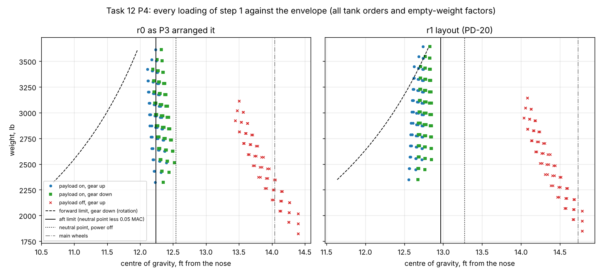
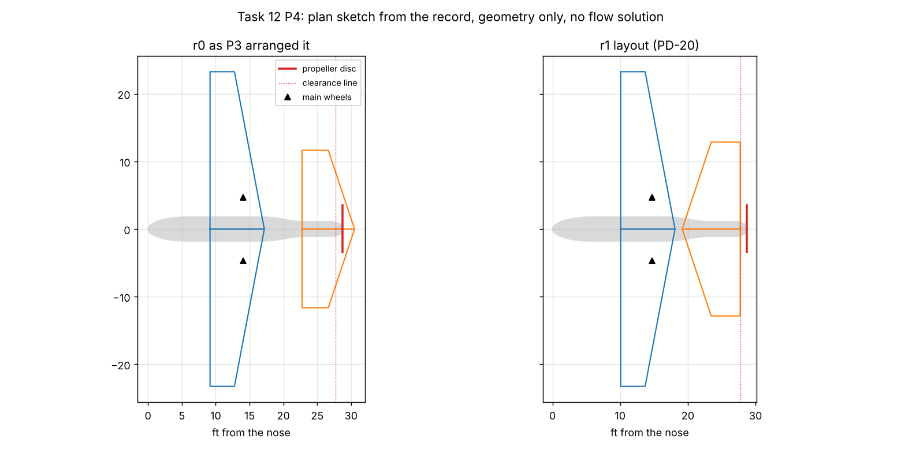
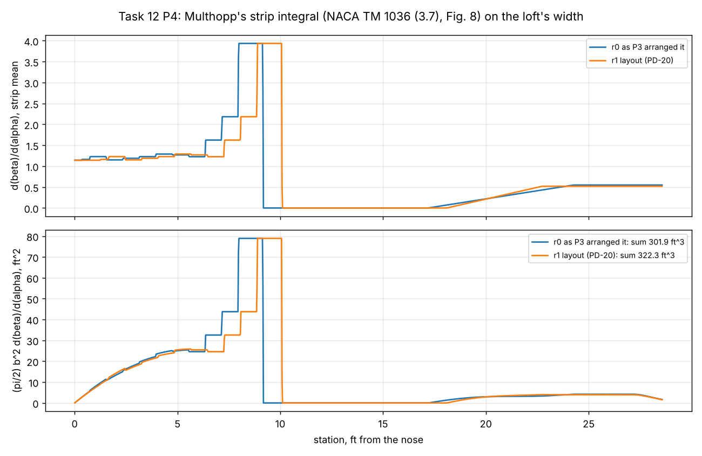

# Task 12 preliminary design P4: balance and longitudinal stability

Generated by `python -m prelim.p4_balance --report-only` from `runs/task12/pd/2026-11-27/p4/p4.json`. Every number below is read from that record. Spec: `docs/specs/task12_preliminary_design.md`, package P4 (method steps 1 to 4, acceptance rows 1 to 5), and decision PD-20 (`docs/specs/00_decisions.md` section 9). Tolerances are the spec's or were fixed in `tests/task12_pd/test_p4_methods.py` before the run; nothing was tuned. r0 (`runs/task12/pd/2026-11-27/p0/r0`) was read and not changed: what P4 finds is listed in section 9 for the closing re-record r1 (PD-7).

Evidence class: **step 2 is independent of Stage 1 in the fuselage term (Multhopp's strip integral on the loft's width in place of Raymer's single factor) and partly independent overall: the wing and tail lift slopes and the lattice downwash are Stage 1's (spec 7.1c item 3). Step 1 is layout construction on the P3 arrangement. Step 3 (VSPAERO) is support, as under G-8. Step 4 is Stage 1's own equations with P2's measured section moment (a coding check plus one measured input). The power-on rows use a representative blade whose validation failed in P6 and carry no verdict**.

**In short:** on r0 as P3 arranged it the static margin is 0.0607 with full fuel and 0.0374 with none, against R13's 0.05 to 0.15; rows 1, 3, 4 fail and are reported, not tuned. The independent neutral point is -0.0131 MAC from Stage 1's (row 2 pass). Moving the wing +0.616 ft restores R13 with r0's tail, but that tail is still inside the propeller disc. With the tail clear of the disc (PD-20) the wing moves +0.915 ft, the tail arm goes from 13.577 to 11.132 ft and the tailplane from 135.5 to 165.2 ft^2; the static margin is then 0.0966 and 0.1034, and 0 of 132 loadings with the payload on are outside the envelope. With the payload off 132 of 132 are.

## 1. Run

- Command: `python -m prelim.p4_balance --out runs/task12/pd/2026-11-27/p4 --openvsp-python /tmp/claude-0/-home-user/d15a4c10-d7a3-5006-96e8-4d0a5f6097f0/scratchpad/vspenv/bin/python`
- Commit `e48e585be574e75a1f93480a4c29ee1dc1e00296`; working tree at the start: clean (the run's own folder `runs/task12/pd/2026-11-27/p4` is not counted); unchanged during the run: yes.
- Seed: none (no random numbers are drawn in P4). python 3.13.18, numpy 2.5.3, scipy 1.18.1, pyyaml 6.0.3, matplotlib 3.11.2. OpenVSP 3.57.1, VSPAERO v.7.2.2 for step 3 (interpreter `/tmp/claude-0/-home-user/d15a4c10-d7a3-5006-96e8-4d0a5f6097f0/scratchpad/vspenv/bin/python`, a session scratchpad, PD-14).
- Inputs (sha256, first 12): `runs/task12/pd/2026-11-27/p0/r0/design_pusher.json` 2af85aca9acd; `runs/task12/pd/2026-11-27/p0/r0/ledger.yaml` a3b88c45e6cb; `data/task12/pd_p3_arrangement.yaml` 2e57c5a76290; `runs/task12/pd/2026-11-27/p3/p3.json` e251dde69d92; `runs/task12/pd/2026-11-27/p2b/p2.json` ee57a987e59e; `runs/task12/pd/2026-11-27/p6/p6.json` 53d20ada7270; `data/task12/pd_p4_sources.yaml` 36d08d93a14e; `data/task12/pd_p4_choices.yaml` 55e926b27b9f.
- Log: `runs/task12/pd/2026-11-27/p4/run.log`. Run time 587 s.
- Sources opened on ntrs.nasa.gov in this session (PDFs not committed): NACA Technical Memorandum 1036 (NACA-TM-1036), "Aerodynamics of the Fuselage", H. Multhopp, NTRS 20000004246, https://ntrs.nasa.gov/api/citations/20000004246/downloads/20000004246.pdf, sha256 b0c558a61cb5, 47 pages; NACA Wartime Report L-25 (NACA-WR-L-25), first issued as Advance Restricted Report L4I12a, October 1944, "Notes on the Propeller and Slipstream in Relation to Stability", Herbert S. Ribner, NTRS 19930092551, https://ntrs.nasa.gov/api/citations/19930092551/downloads/19930092551.pdf, sha256 201ff067ee7f, 27 pages. Pages, equations as read and both readings of each figure: `data/task12/pd_p4_sources.yaml`.

## 2. Acceptance rows

Rows 1 to 4 are judged on r0 with the P3 arrangement. Row 5 is the answer to their failures and is judged by repeating rows 1, 3 and 4 on the layout it gives.

| Row | What | Key number | Verdict |
|---|---|---|---|
| 1 | static margin at the full-fuel and empty-fuel centre of gravity, independent neutral point, power off: inside R13's 0.05 to 0.15 MAC | 0.0607 full, 0.0374 empty (gear up, nominal empty weight); power on at loiter 0.0661 and 0.0428 | **fail** |
| 2 | independent neutral point against Stage 1's: within 0.03 MAC | independent 12.544 ft, Stage 1 12.624 ft: -0.0131 MAC | **pass** |
| 3 | every loading of step 1 between the forward limit (trim and rotation) and the aft limit (neutral point less 0.05 MAC) | payload on: 87 of 132 outside; payload off: 132 of 132 outside | **fail** |
| 4 | nose-wheel load at every loading inside 5 to 20 % | payload on 11.8 to 14.3 % (0 outside); payload off -4.0 to 3.9 % (66 outside) | **fail** |
| 5 | if 1, 3 or 4 fails: the wing position that restores them, for r1 (with the tail of PD-20) | wing leading edge 9.163 to 10.079 ft (+0.915 ft); on that layout row 1 pass, row 3 pass with the payload on and fail with it off, row 4 pass with the payload on and fail with it off | **computed** |

- Rows 3 and 4 fail on both layouts with the payload off: 500 lb leave the nose and the centre of gravity goes behind the main wheels (section 6). PD-13 already treats payload-off flight as an operating limit; this package gives the limit a number (ballast, section 6).
- Row 2's evidence class: independent of Stage 1 in the fuselage term only; the wing and tail lift slopes and the downwash are shared.

## 3. Weight and balance (step 1)

Stations of the empty items, ft from the nose. The r1 column is the layout of section 8.

| Item | Weight r0 (lb) | Station, gear down | Station, gear up | Weight r1 layout (lb) | Station r1, gear down | gear up |
|---|---|---|---|---|---|---|
| fuselage | 224.58 | 12.862 | 12.862 | 226.86 | 12.862 | 12.862 |
| installed engine | 296.80 | 25.153 | 25.153 | 296.80 | 25.153 | 25.153 |
| flight controls | 66.26 | 15.721 | 15.721 | 66.26 | 15.721 | 15.721 |
| hydraulics | 3.52 | 12.862 | 12.862 | 3.52 | 12.862 | 12.862 |
| electrical | 182.30 | 12.862 | 12.862 | 182.30 | 12.862 | 12.862 |
| avionics | 96.55 | 7.175 | 7.175 | 96.55 | 7.175 | 7.175 |
| wing | 429.40 | 11.601 | 11.601 | 429.40 | 12.516 | 12.516 |
| fuel system | 92.84 | 11.601 | 11.601 | 92.84 | 12.516 | 12.516 |
| sponsons | 80.21 | 11.601 | 11.601 | 80.21 | 12.516 | 12.516 |
| horizontal tail | 97.21 | 25.169 | 25.169 | 116.02 | 23.734 | 23.734 |
| vertical tail | 30.83 | 25.037 | 25.037 | 36.66 | 23.588 | 23.588 |
| nose gear | 95.04 | 1.143 | 4.161 | 95.04 | 1.143 | 4.161 |
| main gear | 223.04 | 14.045 | 11.433 | 223.04 | 14.734 | 12.122 |
| payload | 500.00 | 4.313 | 4.313 | 500.00 | 4.313 | 4.313 |
| empty weight | 1,918.56 | | | 1,945.49 | | |

- **Fuel on the loft.** Between the spars at 0.15 and 0.60 of the chord; the section area between them has its centre at 0.3680 of the chord (NACA 4415). The fuel needs 12.89 ft^3 a side of the 40.13 ft^3 the bay has. Tanks, inboard first: span 1.79 to 3.60 ft, 6.45 ft^3, centre 2.765 ft behind the root leading edge; span 3.60 to 5.61 ft, 6.45 ft^3, centre 2.632 ft behind the root leading edge. Stage 1 puts all fuel at 0.40 of the mean chord, 2.438 ft behind the leading edge.
- 264 loadings: fuel in 10 steps x 2 tank orders x payload on and off x gear up and down x empty weight at 0.95, 1, 1.05 of r0's. All are in the record (`as_arranged.loadings`).

Centre of gravity at the fuel ends, payload on (tank order does not change the ends):

| Gear | Empty weight | Weight full / empty (lb) | CG full (ft) | CG empty (ft) | Static margin full | empty | Inside R13 |
|---|---|---|---|---|---|---|---|
| up | x0.95 | 3,421.3 / 2,322.6 | 12.112 | 12.230 | 0.0709 | 0.0515 | yes |
| up | x1 | 3,517.2 / 2,418.6 | 12.174 | 12.316 | 0.0607 | 0.0374 | **no** |
| up | x1.05 | 3,613.2 / 2,514.5 | 12.234 | 12.396 | 0.0510 | 0.0243 | **no** |
| down | x0.95 | 3,421.3 / 2,322.6 | 12.194 | 12.351 | 0.0574 | 0.0316 | **no** |
| down | x1 | 3,517.2 / 2,418.6 | 12.259 | 12.439 | 0.0469 | 0.0173 | **no** |
| down | x1.05 | 3,613.2 / 2,514.5 | 12.320 | 12.520 | 0.0368 | 0.0040 | **no** |

- Gear up moves the centre of gravity forward (the main legs fold forward and weigh more than the nose leg, which folds aft). P3's rough figure (0.073 full, 0.030 empty) used Stage 1's neutral point, Stage 1's fuel station and the gear down; with Stage 1's neutral-point method this package gives 0.0738 and 0.0505 gear up.

## 4. Neutral point (step 2)

| Route | Neutral point (ft from the nose) | Fraction of the mean chord behind its leading edge | Against Stage 1 (MAC) |
|---|---|---|---|
| Stage 1 (r0 record, Raymer (16.9) with (16.22)) | 12.624 | 0.5679 | +0.0000 |
| Stage 1's method recomputed here | 12.624 | 0.5679 | +0.0000 |
| independent: Multhopp's strip integral on the loft, power off | 12.544 | 0.5547 | -0.0131 |
| independent, power on, loiter (no verdict) | 12.577 | 0.5602 | -0.0077 |
| independent, power on, cruise out (no verdict) | 12.584 | 0.5612 | -0.0066 |
| independent, power on, climb sea level (no verdict) | 12.597 | 0.5634 | -0.0045 |
| VSPAERO L1 (1592 panels) | 12.513 | 0.5497 | -0.0182 |
| VSPAERO L2 (5601 panels) | 12.279 | 0.5112 | -0.0566 |
| VSPAERO L3 (12092 panels) | 12.430 | 0.5361 | -0.0318 |

- **Fuselage term.** (1/q) dM/d(alpha) = (pi/2) integral of b^2 d(beta)/d(alpha) dx (NACA TM 1036 (3.7), p. 11) over 2000 strips of the loft's width: 266.0 ft^3 ahead of the wing, 0 over the root chord, 35.9 ft^3 behind it, 301.9 ft^3 in all. Over S c that is C_m_alpha = 0.1831 per rad against 0.1014 from Raymer's (16.22) with the ledger's K_f: the fuselage moves the neutral point -0.0294 MAC by Multhopp and -0.0163 MAC by (16.22). The nose is long ahead of the wing (1.14 root chords) and that is where the upwash acts.
- Shared with Stage 1: wing lift slope 5.2910 per rad, tail term eta_h (S_h/S) C_L_alpha_h d(alpha_h)/d(alpha) = 0.9337, d(alpha_h)/d(alpha) = 0.5491 from the lattice.
- **Other readings of the upwash, no verdict.** Fig. 8's excess over 1 scaled by r0's lift slope over the figure's 4.5 (x1.176): neutral point 12.532 ft (-0.0021 MAC). The study's own vortex lattice on the centreline, 0.36 ft above the wing plane: 12.562 ft (+0.0030 MAC). Integral of d(beta)/d(alpha) from the leading edge out to 0.3, 0.6, 0.9, 1.1 chords: Fig. 8 0.890, 1.285, 1.649, 1.887; lattice 0.654, 1.087, 1.463, 1.698.
- **Power on (no verdict).** Propeller normal force by NACA WR L-25: C_Y'psi = f C_Y'psi0, three blades; side-force factor of the P6 blade 98.8 by its (4), against 80.7 for the charted propeller. Raymer (16.8) with this force at the propeller plane (28.73 ft):

| Point | T_c | Blade angle at 0.75 R (deg) | f (Fig. 1) | C_Y'psi0 (Fig. 2) | Ratio (Fig. 6) | C_Y'psi | F_p_alpha/(q S) | Neutral point shift, r0 as arranged (MAC) | r1 layout (MAC) |
|---|---|---|---|---|---|---|---|---|---|
| loiter | 0.1712 | 17.35 | 1.1409 | 0.1238 | 1.1871 | 0.1677 | 0.02324 | +0.0054 | +0.0048 |
| cruise out | 0.0874 | 24.59 | 1.0735 | 0.1571 | 1.1871 | 0.2002 | 0.02774 | +0.0065 | +0.0057 |
| climb sea level | 0.3929 | 28.71 | 1.2907 | 0.1742 | 1.1871 | 0.2669 | 0.03699 | +0.0086 | +0.0077 |

- A propeller behind the centre of gravity is stabilising (Raymer p. 428). Not modelled: the slipstream on the tail (the tail is ahead of the propeller), the thrust line's moment (the hub is on the centreline in r0), blade angles other than the P6 blade's. Raymer p. 418 gives a loss of 4 to 10 % of static margin with power as typical of propeller aircraft; that allowance is not applied here.

## 5. VSPAERO (step 3, support)

VSPAERO v.7.2.2 in OpenVSP 3.57.1: the loft's fuselage as a thick body, the wing, tailplane and fin as thin surfaces; no propeller, sponsons, turret or spinner. Mach 0.1420 (loiter), angles of attack -2 to 8 deg in 6 points, moment reference at r0's full-fuel centre of gravity. Geometry is r0's (the layout of section 8 was not run).

| Level | Strips per wing section, points round a wing section, strips per fuselage section, points round the fuselage | Panels | C_L_alpha (per rad) | C_m_alpha (per rad) | Neutral point (ft) | Largest residual of the C_L and C_m lines |
|---|---|---|---|---|---|---|
| L1 | 12, 33, 2, 17 | 1,592 | 5.5776 | -0.5265 | 12.513 | 2.4e-03, 7.5e-04 |
| L2 | 24, 65, 3, 25 | 5,601 | 4.6845 | -0.2620 | 12.279 | 8.3e-03, 1.4e-02 |
| L3 | 36, 97, 4, 33 | 12,092 | 4.1645 | -0.3364 | 12.430 | 2.6e-03, 1.2e-03 |

- Between the two finest meshes the neutral point moves 0.0249 MAC; the spec allows 0.01. **Not converged: reported, no verdict.** The lift slope falls at each refinement (5.578, 4.684, 4.164 per rad), so no level can be called the answer. As on 2026-11-24, VSPAERO with a fuselage in it is not mesh-robust on this aircraft, now with the fuselage as a body (NR-6 and NR-15 stay open in this part).

## 6. Centre-of-gravity envelope, nose-wheel load and ground angles (rows 3 and 4)

**On r0 as P3 arranged it.** Aft limit 12.239 ft (neutral point 12.544 ft less 0.05 MAC). Forward limit by trim 6.715 ft (tail lift coefficient 0.5 at loiter start, C_L 0.884); by rotation, gear down, 11.899 ft at the take-off weight (tail lift coefficient 1). Main wheels at 14.045 ft.

| Group | Loadings | Outside | Too far aft | Too far forward | CG range (ft) | Static margin range | Nose-wheel load, gear down | Outside 5-20 % | Outside 8-15 % | Least tipback angle (deg) | Largest overturn angle (deg) |
|---|---|---|---|---|---|---|---|---|---|---|---|
| payload on, empty weight x0.95 | 44 | 13 | 13 | 0 | 12.112 to 12.351 | +0.0316 to +0.0709 | 13.1 to 14.3 % | 0 | 0 | 13.08 | 62.45 |
| payload on, empty weight x1 | 44 | 32 | 32 | 0 | 12.174 to 12.439 | +0.0173 to +0.0607 | 12.5 to 13.8 % | 0 | 0 | 12.42 | 62.32 |
| payload on, empty weight x1.05 | 44 | 42 | 42 | 0 | 12.234 to 12.520 | +0.0040 to +0.0510 | 11.8 to 13.4 % | 0 | 0 | 11.82 | 62.19 |
| payload on, all | 132 | 87 | 87 | 0 | 12.112 to 12.520 | +0.0040 to +0.0709 | 11.8 to 14.3 % | 0 | 0 | 11.82 | 62.45 |
| payload off, all | 132 | 132 | 132 | 0 | 13.447 to 14.556 | -0.3302 to -0.1481 | -4.0 to 3.9 % | 66 | 66 | -4.01 | 59.66 |

**On the r1 layout of section 8.** Aft limit 12.970 ft (neutral point 13.275 ft less 0.05 MAC). Forward limit by trim 7.308 ft (tail lift coefficient 0.5 at loiter start, C_L 0.884); by rotation, gear down, 12.740 ft at the take-off weight (tail lift coefficient 1). Main wheels at 14.734 ft.

| Group | Loadings | Outside | Too far aft | Too far forward | CG range (ft) | Static margin range | Nose-wheel load, gear down | Outside 5-20 % | Outside 8-15 % | Least tipback angle (deg) | Largest overturn angle (deg) |
|---|---|---|---|---|---|---|---|---|---|---|---|
| payload on, empty weight x0.95 | 44 | 0 | 0 | 0 | 12.556 to 12.708 | +0.0930 to +0.1179 | 14.9 to 15.1 % | 0 | 11 | 15.53 | 62.53 |
| payload on, empty weight x1 | 44 | 0 | 0 | 0 | 12.645 to 12.780 | +0.0812 to +0.1034 | 14.4 to 14.6 % | 0 | 0 | 15.00 | 62.37 |
| payload on, empty weight x1.05 | 44 | 0 | 0 | 0 | 12.724 to 12.849 | +0.0699 to +0.0904 | 13.9 to 14.1 % | 0 | 0 | 14.49 | 62.23 |
| payload on, all | 132 | 0 | 0 | 0 | 12.556 to 12.849 | +0.0699 to +0.1179 | 13.9 to 15.1 % | 0 | 11 | 14.49 | 62.53 |
| payload off, all | 132 | 132 | 132 | 0 | 14.037 to 14.938 | -0.2729 to -0.1251 | -1.5 to 4.4 % | 66 | 66 | -1.60 | 59.65 |

- **Payload off.** On the r1 layout the centre of gravity reaches 14.938 ft (static margin -0.2729), behind the main wheels at 14.734 ft: the aircraft would sit on its tail. Bringing that loading to the aft limit takes 420 lb at the payload station (589 lb on r0 as arranged). In practice the aircraft does not fly or stand without its payload or its weight in ballast; an operating limit for P8 (PD-13).
- **Tipback and overturn.** On r0 as arranged the main wheels are where r0 put them, and the aft centre of gravity has moved toward them: the least tipback angle with the payload on is 11.82 deg against 15. The r1 layout places the wheels by the rule again (15.00 deg at the nominal empty weight). Overturn, with r0's track: at most 62.45 deg and 62.53 deg with the payload on (63 allowed).
- **Propeller clearance at rotation:** 14.44 in on r0, 15.88 in on the r1 layout (9 needed). Main wheels at 0.609 and 0.580 of the root chord behind the leading edge.
- **Nose-wheel load (item 31).** With the payload on it is inside 5 to 20 % everywhere. Against Raymer's 8 to 15 % optimum: 0 gear-down loadings outside on r0 as arranged, 11 on the r1 layout (by empty-weight factor: x0.95 11, x1 0, x1.05 0; largest 15.1 %).

## 7. Trim and rotation with P2's section moment (step 4, item 25)

Section moment about the quarter chord: -0.0911 measured (P2, `runs/task12/pd/2026-11-27/p2b`) against the ledger's -0.08; wing moment by Raymer (16.16): -0.0729 against -0.0640.

| Layout | Forward CG, gear down (ft) | Tail C_L to rotate, P2's moment | with the ledger's moment | Limit | Used | Verdict | Largest tail C_L in trim on the mission | Limit | Verdict | Tail C_L at clean stall, forward CG (reported) |
|---|---|---|---|---|---|---|---|---|---|---|
| r0 record | 11.938 | - | -0.9676 | 1 | 0.968 | pass (Gate B) | - | - | - | - |
| r0 as P3 arranged it | 12.259 | -0.8128 | -0.8007 | 1 | 0.813 | **pass** | 0.1644 | 0.5 | **pass** | 0.2870 |
| wing alone, r0's tail | 12.616 | -0.9336 | -0.9216 | 1 | 0.934 | **pass** | 0.1168 | 0.5 | **pass** | 0.2183 |
| r1 layout (PD-20) | 12.766 | -0.9862 | -0.9735 | 1 | 0.986 | **pass** | 0.0926 | 0.5 | **pass** | 0.1736 |

- On r0 as arranged the rotation is easier than in the record only because the centre of gravity has moved toward the main wheels, which is the same thing as the lost tipback angle; it is not a gain. With the wheels back on the tipback rule the tail is again close to its limit, and P2's more negative section moment takes 0.0127 of it on the r1 layout.
- Not covered: trim with flaps down, ground effect, and the elevator's own limits; the tail lift limits are the ledger's judgements (0.5 in trim, 1.0 at rotation).

## 8. Row 5 and PD-20: the wing and the tail for r1

The propeller plane is at 28.733 ft and the disc radius is 3.454 ft. On r0 the tailplane's root trailing edge is +1.782 ft and the fin's +0.871 ft from the plane (P3 row 9). Each form below is solved with the wing by Stage 1's rule (mean of the full-fuel and empty-fuel static margins 0.10 MAC, independent neutral point) and the main wheels by the tipback rule.

| Form | Clearance (ft) | Closes | Wing leading edge (ft) | Move (ft) | Tail arm (ft) | Tailplane (ft^2) | Fin (ft^2) | Main wheels (ft) | Tail C_L at rotation |
|---|---|---|---|---|---|---|---|---|---|
| wing alone, r0's tail (row 5 as worded; the tail stays in the disc) | - | yes | 9.779 | +0.616 | 13.577 | 135.48 | 37.08 | 14.633 | -0.9336 |
| r0's tail planforms moved clear, volume coefficients kept (first form of PD-20) | 1.0 | **no** | - | - | - | - | - | - | - |
| **straight trailing edges, moved clear, volume coefficients kept (PD-20)** | 1.0 | yes | 10.079 | +0.915 | 11.132 | 165.24 | 45.23 | 14.734 | -0.9862 |
| the same at the low end of the clearance band | 0.5 | yes | 9.989 | +0.826 | 11.881 | 154.82 | 42.38 | 14.696 | -0.9616 |
| the same at the high end of the clearance band | 2.0 | yes | 10.330 | +1.166 | 9.456 | 194.53 | 53.25 | 14.858 | -1.0878 |

**Why the first form does not close.** With r0's planforms (unswept leading edge, aspect ratio 4) the root chord runs far behind the tail's mean chord, so the tail must come forward a long way; keeping the volume coefficient then makes it larger, its root chord longer, and it must come forward again. The scan, wing shift by wing shift:

| Wing shift (ft) | Tail arm (ft) | Tailplane (ft^2) | Static margin full | empty | Tail C_L at rotation |
|---|---|---|---|---|---|
| +0.0 | 9.620 | 191.2 | 0.0142 | -0.0089 | -1.1806 |
| +0.2 | 9.289 | 198.0 | 0.0237 | 0.0073 | -1.1751 |
| +0.4 | 8.945 | 205.6 | 0.0327 | 0.0230 | -1.1709 |
| +0.6 | 8.585 | 214.3 | 0.0409 | 0.0379 | -1.1687 |
| +0.8 | 8.205 | 224.2 | 0.0482 | 0.0517 | -1.1716 |
| +1.0 | 7.798 | 235.9 | 0.0541 | 0.0640 | -1.2106 |
| +1.2 | 7.351 | 250.2 | 0.0582 | 0.0743 | -1.2790 |
| +1.4 | 6.838 | 269.0 | 0.0597 | 0.0819 | -1.3670 |
| +1.6 | no arm puts the tail clear with the volume coefficients kept | | | | |

- The mean static margin never reaches 0.10 (best 0.0708 at +1.4 ft, with a tailplane of 269 ft^2 against a wing of 271 ft^2), and the tail lift coefficient needed to rotate is 1.169 or more at every shift, against 1. **Reported as a failure of that form, not tuned.**
- **The form chosen (PD-20).** The trailing edges of both tails are made straight (all the taper on the leading edge; area, aspect ratio and taper unchanged). The trailing edge is then at the mean chord's own trailing edge, and the tail needs to come forward much less. Scan of this form at the chosen clearance:

| Wing shift (ft) | Tail arm (ft) | Tailplane (ft^2) | Static margin full | empty | Tail C_L at rotation |
|---|---|---|---|---|---|
| +0.0 | 12.288 | 149.7 | 0.0416 | 0.0171 | -1.0316 |
| +0.2 | 12.039 | 152.8 | 0.0539 | 0.0363 | -1.0195 |
| +0.4 | 11.788 | 156.0 | 0.0661 | 0.0553 | -1.0073 |
| +0.6 | 11.535 | 159.5 | 0.0781 | 0.0742 | -0.9952 |
| +0.8 | 11.280 | 163.1 | 0.0900 | 0.0929 | -0.9834 |
| +1.0 | 11.022 | 166.9 | 0.1015 | 0.1110 | -0.9962 |
| +1.2 | 10.762 | 170.9 | 0.1126 | 0.1287 | -1.0264 |
| +1.4 | 10.498 | 175.2 | 0.1235 | 0.1461 | -1.0584 |
| +1.6 | 10.232 | 179.8 | 0.1342 | 0.1633 | -1.0903 |

**The r1 layout, against r0:**

| Quantity | r0 | r1 layout | Change |
|---|---|---|---|
| wing leading edge at the root (ft) | 9.163 | 10.079 | +0.915 |
| wing aerodynamic centre (ft) | 10.687 | 11.602 | +0.915 |
| tail arm (ft) | 13.577 | 11.132 | -2.445 |
| tail arm over fuselage length | 0.4750 | 0.3895 | -0.0855 |
| tailplane area (ft^2) | 135.48 | 165.24 | +29.76 |
| tailplane span (ft) | 23.28 | 25.71 | +2.43 |
| tailplane root chord (ft) | 7.760 | 8.570 | +0.810 |
| tailplane area over wing area | 0.501 | 0.611 | +0.110 |
| tailplane root leading edge behind the wing's root trailing edge (ft) | 5.57 | 1.06 | -4.51 |
| fin area (ft^2) | 37.08 | 45.23 | +8.15 |
| fin height (ft) | 7.46 | 8.24 | +0.78 |
| main wheels (ft) | 14.045 | 14.734 | +0.689 |
| nose wheel (ft) | 1.143 | 1.143 | +0.000 |
| tailplane weight (lb) | 97.21 | 116.02 | +18.81 |
| fin weight (lb) | 30.83 | 36.66 | +5.83 |
| fuselage weight (lb) | 224.58 | 226.86 | +2.29 |
| empty weight (lb) | 1,918.56 | 1,945.49 | +26.93 |
| neutral point, independent, power off (ft) | 12.544 | 13.275 | +0.730 |
| d(alpha_h)/d(alpha) at the tail | 0.5491 | 0.5197 | -0.0294 |
| fuselage C_m_alpha, Multhopp (per rad) | 0.1831 | 0.1954 | +0.0123 |
| static margin, full fuel | 0.0607 | 0.0966 | +0.0360 |
| static margin, no fuel | 0.0374 | 0.1034 | +0.0660 |

- **Tail and fuselage weight, and where it comes from.** Stage 1's own equations as ratios on r0's component weights: tailplane by Raymer (15.47) (area to the 0.896, and its quarter-chord sweep terms), fin by (15.48) (area to the 0.873, weighed unswept as Stage 1 weighs r0's), fuselage by the tail-arm term of (15.49) (arm to the -0.051; a shorter arm makes Raymer's fuselage slightly heavier), p. 404: +18.81, +5.83 and +2.29 lb, +26.93 lb in all. There is no boom: the tail stays on the fuselage. The aircraft was not re-sized; r1 does that.
- **On the loft.** The loft drawn with this layout has the tailplane -1.000 ft and the fin -1.728 ft from the propeller plane inside the disc (negative: ahead of it): P3's row 9 would **pass**. `geometry3d/aircraft.py` now reads an optional leading-edge slope of a tail from the record; r0's record has none and its loft is unchanged (P3's tests).
- **Rows 1, 3 and 4 on this layout:**

| Gear | Empty weight | Weight full / empty (lb) | CG full (ft) | CG empty (ft) | Static margin full | empty | Inside R13 |
|---|---|---|---|---|---|---|---|
| up | x0.95 | 3,446.9 / 2,348.2 | 12.626 | 12.556 | 0.1064 | 0.1179 | yes |
| up | x1 | 3,544.2 / 2,445.5 | 12.686 | 12.645 | 0.0966 | 0.1034 | yes |
| up | x1.05 | 3,641.5 / 2,542.8 | 12.742 | 12.727 | 0.0874 | 0.0899 | yes |
| down | x0.95 | 3,446.9 / 2,348.2 | 12.708 | 12.676 | 0.0930 | 0.0983 | yes |
| down | x1 | 3,544.2 / 2,445.5 | 12.769 | 12.766 | 0.0829 | 0.0835 | yes |
| down | x1.05 | 3,641.5 / 2,542.8 | 12.827 | 12.849 | 0.0734 | 0.0699 | yes |

- **Clearance band.** At 0.5 ft the tailplane is 154.8 ft^2 and the tail lift coefficient at rotation -0.9616; at 2.0 ft they are 194.5 ft^2 and -1.0878, beyond the limit of 1: the solution does not hold at the high end of the band. The clearance is a judgement and the answer is sensitive to it.
- **Stage 1's neutral point on this layout** would be 13.365 ft (+0.0148 MAC behind the independent one): if r1 places the wing with (16.22), the static margin by this package's route is that much less than r1 will print.
- The tailplane is now 0.61 of the wing area (0.50 in r0). It was already enlarged 1.594 times over Raymer's Table 6.4 volume so that it can rotate the aircraft. Its root leading edge is 1.06 ft behind the wing's root trailing edge (5.57 ft in r0). The downwash, the fuselage rule behind the wing and the tail's lift slope were not made for a tail this large and this close to the wing, so the margins of this layout are less certain than r0's were. A tail of this size is a cost of the pusher with its main wheels behind an aft centre of gravity; whether the configuration should carry it is beyond P4 (PD-3) and is put to Gate C through the findings.

## 9. Findings for r1

1. On r0 with the P3 arrangement the static margin is 0.0607 full and 0.0374 empty of fuel (gear up, independent neutral point at 12.544 ft, power off): R13 (0.05 to 0.15) fails.
2. Fuselage term: Multhopp on the loft gives C_m_alpha 0.1831 per rad against Raymer (16.22)'s 0.1014; the neutral point is -0.0131 MAC from Stage 1's method. r1 should carry the fuselage term of this package.
3. On the r1 layout the two fuselage terms differ by -0.0148 MAC in neutral point (independent less Stage 1's method).
4. Wing for r1: leading edge at the root from 9.163 ft to 10.079 ft (+0.915 ft).
5. Tail for r1 (PD-20): arm from 13.577 ft to 11.132 ft (-2.445 ft), 0.3895 of the fuselage length against Stage 1's 0.475; tailplane 135.48 to 165.24 ft^2, fin 37.08 to 45.23 ft^2 (volume coefficients kept); trailing edges straight; every tail point inside the disc 1.00 ft ahead of the propeller plane.
6. The tailplane of the r1 layout is 0.611 of the wing area and its root leading edge is 1.06 ft behind the wing's root trailing edge (5.57 ft in r0). The methods used here (lattice downwash at the tail's quarter chord, Multhopp's linear rise behind the wing, a tail lift slope for an isolated surface) were not made for a tail this large and this close; the layout closes on paper and is a risk for Gate C.
7. Main wheels for r1: 14.045 ft to 14.734 ft (tipback rule); nose wheel unchanged.
8. Weights for r1 by Raymer (15.47)-(15.49): tailplane +18.81 lb, fin +5.83 lb, fuselage +2.29 lb; empty weight +26.93 lb (the aircraft was not re-sized).
9. With these the static margin is 0.0966 full and 0.1034 empty (row 1 pass); payload-on loadings outside the envelope: 0 of 132; nose-wheel load 13.9 to 15.1 % with the payload on.
10. Rotation with P2's section moment (-0.0911 against the ledger's -0.08): the tail needs 0.8128 of 1.00 on r0 as arranged and 0.9862 on the r1 layout (pass). r1 should run Stage 1's tail loop with the measured section moment.
11. Payload off: the centre of gravity goes as far aft as 14.938 ft (static margin -0.2729) on the r1 layout; 132 of 132 payload-off loadings are outside the envelope. Flight without the payload needs 420 lb of ballast at the payload station (an operating limit, PD-13).
12. Nose-wheel load on the r1 layout with the payload on: 13.9 to 15.1 %; 11 of the gear-down loadings are outside Raymer's 8 to 15 % optimum (item 31).
13. Empty-weight band (NR-14) on the r1 layout: static margin 0.1064 / 0.1179 at 0.95 and 0.0874 / 0.0899 at 1.05 (full / empty).
14. Power on (no verdict): the propeller's normal force moves the neutral point aft by 0.0048 MAC at loiter and 0.0077 MAC in the sea-level climb on the r1 layout; slipstream effects on the tail are not modelled.
15. For P9, not answered here: the sponson that does not hold the retracted main gear (P3 finding 7; the main wheels move with this package); where the tail roots sit on the engine bay; Stage 1 needs the tail arm as an input.

## 10. Assumptions made where the spec left a choice

1. Stations: r0's, with the payload and avionics where P3 put them (PD-19). Gear up, each gear's weight is at the mid-point of its stowed leg (P3).
2. Fuel: in the inboard part of the P3 tank bay, between the spars, out to the span station that holds the needed volume over the usable fraction, in two tanks of equal volume a side; a part-full tank keeps the centre of a full one. Both tank orders are run.
3. Empty-weight band (NR-14): every component weight times 0.95 or 1.05, fuel and payload unchanged, no re-size and no move of wing or gear.
4. The centre of gravity is on the fuselage reference line, as in Stage 1; r0's height above the ground is kept.
5. Multhopp's Fig. 8 is used as drawn (it is for aspect ratio 8, this wing's); t is the root chord; behind the wing the flow angle rises linearly to the tail's value at the tail's quarter mean chord and stays there.
6. Only the fuselage is in the strip integral. The sponsons lie inside the wing chord, where the rule gives nothing; Multhopp's nacelle term is not applied; turret and spinner are left out.
7. The neutral point solves Raymer (16.8) for zero; (16.9) as printed lacks a factor in its denominator (roadmap Appendix A).
8. Propeller normal force: Ribner's charts for the Hamilton Standard 3155-6 with the side-force factor of the P6 representative blade and its blade angles. P6 failed its validation row 5, so the power-on rows carry no verdict. The downwash slope at the propeller is taken as the tail's.
9. Trim and rotation are Stage 1's equations with P2's measured section moment. The rotation limit applies to loadings with the gear down, each at its own weight and at Stage 1's rotation speed; the trim limit applies to every loading.
10. Row 5 uses Stage 1's own wing rule (mean of the full-fuel and empty-fuel static margins at 0.10 MAC) and tipback rule, so that r1 and this package place things the same way.
11. PD-20: propeller clearance 1.0 ft (band 0.5 to 2.0 ft), a judgement; tail volume coefficients, aspect ratios and tapers kept; trailing edges made straight.
12. Weights of the r1 layout: ratios of Raymer (15.47), (15.48), (15.49) on r0's component weights; the fin is weighed unswept, as Stage 1 weighs r0's; the aircraft is not re-sized.
13. VSPAERO: fuselage as a thick body, wing and tails thin, no propeller, sponsons, turret or spinner; loiter Mach number; three mesh levels.
14. A trial of the methods was run before the record. It changed two things, both before any recorded number: the rotation limit is applied with the gear down only (it had been applied to every loading), and PD-20 got straight trailing edges because its first form does not close. The first form is still solved in the record and shown in section 8.

## 11. What this does not show

- No flow solution of the fuselage. Multhopp's rule is the strip method of NACA TM 1036, checked by its author against seven aircraft (his Table I); its Fig. 8 was read from a scan.
- The r1 layout was not flown through Stage 1: weight, drag, fuel and tail loop are r0's. It is a set of findings, and r0 still has a tail in the propeller disc and a static margin outside R13 until r1 is made.
- No lateral or directional check of the larger, shorter-armed fin (PD-11); its volume coefficient is kept, nothing more.
- No check that the methods hold for the r1 layout's tail, which is large and close behind the wing (section 8).
- No dynamic stability, no control power beyond the two ledger limits, no flaps-down trim, no ground effect.
- The sponson was not resized (P3 finding 7), although the main wheels move; the tail roots now sit over the engine bay and no inlet, exhaust or structure is drawn there.
- VSPAERO's result is support only and did not converge.
- Power-on numbers rest on a representative blade whose blade-element validation failed (P6); they carry no verdict.
