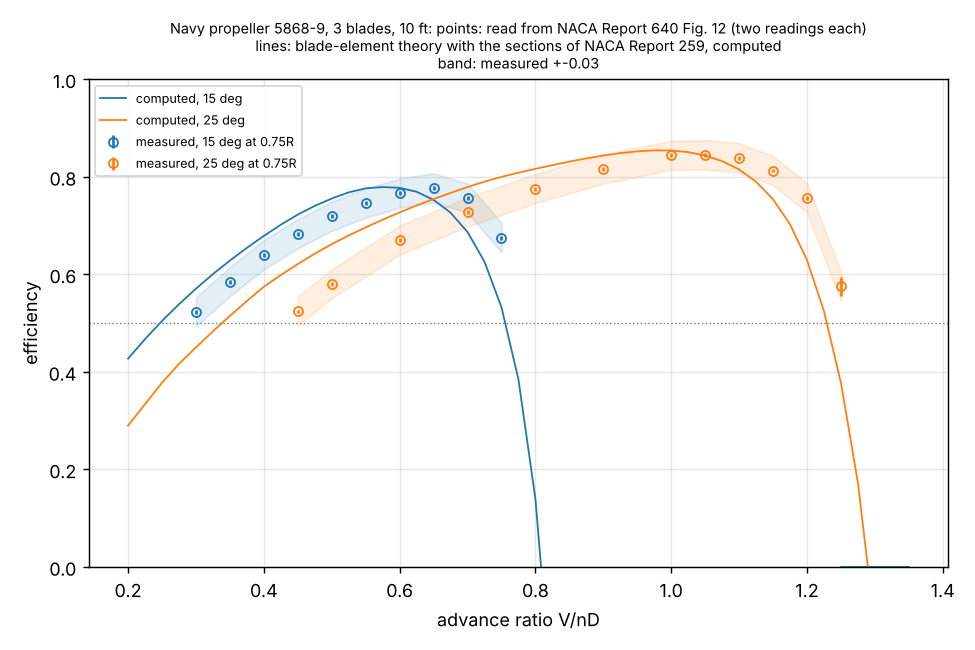
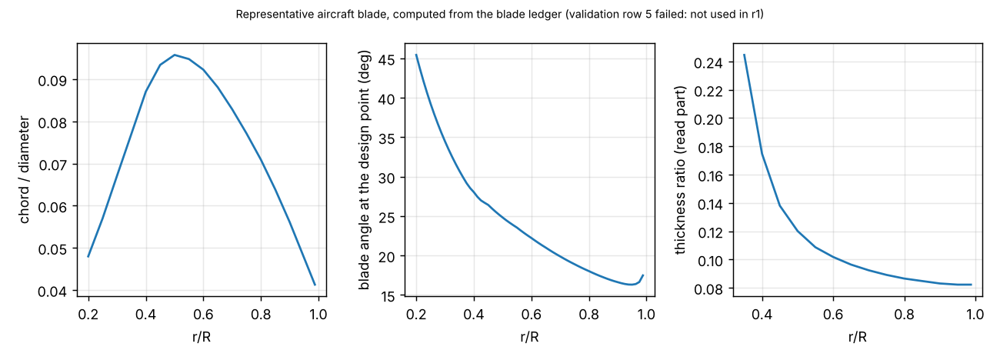
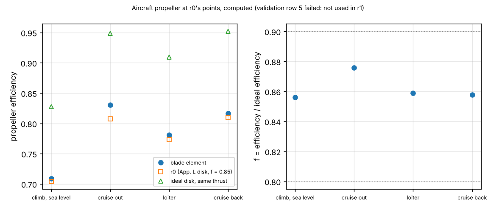

# Task 12 preliminary design P6: blade-element propeller

Generated by `python -m prelim.p6_propeller --report-only` from `runs/task12/pd/2026-11-27/p6/p6.json`. Every number below is read from that file. Spec: `docs/specs/task12_preliminary_design.md`, package P6 (decision PD-10). Tolerances were fixed before the run; nothing was tuned. r0 (`runs/task12/pd/2026-11-27/p0/r0`) was read and not changed.

Evidence class: **independent of App. L's disk in the profile losses; it shares the momentum theory (spec P6). The section data and the validation propeller are measured open data (NACA Reports 259 and 640)**.

**Validation row 5 (the measured propeller) failed. By the spec, every aircraft number in sections 7 to 9 is a failed-validation number and is not used in r1.**

## 1. Run

- Command: `python -m prelim.p6_propeller --out runs/task12/pd/2026-11-27/p6`
- Commit `02791ff12ebd8b294f0e343b4f4a7052ab3d4bac`; working tree at the start: clean (the run's own folder `runs/task12/pd/2026-11-27/p6` is not counted); unchanged during the run: yes.
- Seed: none (no random numbers are drawn in P6). python 3.13.18, numpy 2.5.3, scipy 1.18.1, pyyaml 6.0.3, matplotlib 3.11.2.
- Inputs (sha256, first 12): `runs/task12/pd/2026-11-27/p0/r0/design_pusher.json` 2af85aca9acd; `runs/task12/pd/2026-11-27/p0/r0/ledger.yaml` a3b88c45e6cb; `runs/task12/stage3/2026-11-27/takeoff_f_sweep_ws13a8/sweep.json` 12af5666e237; `data/task12/pd_p6_propeller_source.yaml` 8beb008468a1; `data/task12/pd_p6_tr259_sections.yaml` 5f54228842a4; `data/task12/pd_p6_blade_ledger.yaml` 111f2cbc325e.
- Log: `runs/task12/pd/2026-11-27/p6/run.log`. Run time 439 s.

## 2. Validation and acceptance rows

Validation rows 1 to 5 and aircraft rows 1 to 4 are the spec's. The aircraft rows keep their verdicts as computed; none of them counts while validation row 5 fails.

| # | Row | Result | Tolerance or band | Verdict |
|---|---|---|---|---|
| V1 | element efficiency with zero drag angle, zero rotational interference and the disk's axial interference equals the ideal efficiency ((L.14), (L.5), (L.7)) | largest relative difference 2.2e-16 | 1e-12 | **pass** |
| V2 | maximum of the element efficiency, (L.15), against the plateau of Fig. L.5 for an interference ratio of 0.8 | C_L/C_D 50: 0.769 against 0.768 read; C_L/C_D 10: 0.655 against 0.655 read | 0.01 | **pass** |
| V3 | (L.18) and (L.20) reproduce the J and C_P of Table L.1 from its flight conditions (row D not used) | computed over printed: J 0.960 to 1.058; C_P 0.507 to 0.529 (rows A, B, C, E) | 1 % plus half a unit of the last printed digit | **fail** |
| V4 | static-thrust correlation (L.19) reproduces the two printed diameters of the example | 15.02 ft against 15 ft; 10.62 ft against 10.6 ft | 0.05 ft | **pass** |
| V5 | measured full propeller (NACA Report 640, propeller 5868-9, 3 blades): efficiency against advance ratio at 15 and 25 deg where the measured efficiency is above 0.5 | 6 of 21 judged points inside; largest difference 0.143 | +-0.03 absolute | **fail** |
| A1 | efficiency at climb, cruise and loiter against r0's App. L values | climb, sea level 0.7086 against 0.7041; cruise out 0.8307 against 0.8073; loiter 0.7807 against 0.7733 | +-0.05 absolute | **pass** |
| A2 | implied factor f (blade-element efficiency over the ideal efficiency of the same disk) against the ledger band | climb, sea level 0.856; cruise out 0.876; loiter 0.859; cruise back 0.858; take-off, 0.707 V_TO n/a | 0.8 to 0.9 | **inside the band at every computed point; not computed at takeoff_0707_VTO** |
| A3 | take-off: thrust at 0.707 V_TO at or above the f = 0.60 row of the recorded sweep | no pitch absorbs 450 hp at 60.3 ft/s; most thrust at any pitch 1,251 lb with 354 hp absorbed and 13 stations beyond the section data | at least 1,247 lb | **not computed** |
| A4 | tip relative Mach number at each point and the sensitivity to the blade choices | climb, sea level 0.673; cruise out 0.739; loiter 0.722; cruise back 0.734 | - | **reported, no verdict** |

## 3. Findings

1. **Validation row 5 fails. Every aircraft number of this package is a failed-validation number and is not used in r1 (spec P6).** 6 of 21 judged points are within +-0.03; the largest difference is 0.143. Nothing was tuned. The pattern: at 15 deg the highest measured point is 0.777 at V/nD 0.65 and the highest computed one 0.777 at 0.6; the computed value is 0.047 from the measured one at V/nD 0.3 and -0.143 at 0.75; the computed curve has the measured value of the first of these points at V/nD 0.264 and that of the last at 0.705; at 25 deg the highest measured point is 0.845 at V/nD 1.05 and the highest computed one 0.854 at 1; the computed value is 0.097 from the measured one at V/nD 0.45 and -0.128 at 1.2; the computed curve has the measured value of the first of these points at V/nD 0.357 and that of the last at 1.148. The computed curve is too high on the low-speed side, where the blade is heavily loaded, and falls too early on the high-speed side, near zero thrust. The peaks agree in height; the computed curves lie at a lower advance ratio than the measured ones (figure in section 6).
2. **Likely causes of the row 5 failure, none of them tested here.** (a) The section data are not the blade's: flat-bottomed U.S.N.P.S. sections stand in for Clark Y, measured on a wing of aspect ratio 6 in the variable density tunnel, and their drag is high (section 6); the report itself says the drag at low and negative angles would fall with a Clark Y leading edge, which is where the computed curve falls early. (b) The measured efficiency is of the propeller and engine unit in front of a nacelle 43 in deep with the body drag change charged to the thrust; the model has no body. (c) Inboard of 0.35 of the radius the blade is thicker than the thickest section with data. (d) Beyond the measured angles the end values of the tables are held (the number of such stations is listed per point in section 6).
3. **Validation row 3 fails as the spec words it: (L.18) and (L.20) do not reproduce Table L.1.** From the table's own flight conditions, D = 14 ft and N = 663.4 rpm, the computed J is 0.960 to 1.058 of the printed one and the computed C_P is 0.507 to 0.529 of the printed one: the printed C_P is about twice (L.18). The definitions themselves are not in doubt: (L.18) is P/(rho n^3 D^5) in engineering units and reproduces r0's own J and C_P (tests/task12_pd/test_p6_bem.py). The table belongs to the map of Fig. L.6, which by the library's chapter notes is for a counterrotating tandem propeller; the notes already flag its row D. Why the printed C_P is twice (L.18) was not established. Reported, not tuned; the table is not used anywhere else.
4. **Failed-validation numbers: f is inside the ledger band at every point that could be computed** (climb, sea level 0.856; cruise out 0.876; loiter 0.859; cruise back 0.858; band 0.8 to 0.9, ledger value 0.85). Not computed at: take-off, 0.707 V_TO. The range over the blade choices is in section 9.
5. **Take-off (aircraft row 3) could not be computed, and R7's propeller thrust is not shown by this package.** At 60.3 ft/s and 2,030 rpm no blade pitch makes the representative blade absorb 450 hp: the power levels off at 408 hp once every station is past the last measured angle of attack, where the tables' end values are held and the numbers mean nothing. With every station inside the measured data the most thrust is 870 lb at 202 hp absorbed; at any pitch 1,251 lb at 354 hp with 13 of 64 stations past the data. The row needs 1,247 lb. The section tables stop a few degrees past maximum lift; a stalled blade needs data beyond that. The spec says strip theory near zero speed is weak; here it is the section data that end first.
6. **Failed-validation numbers: the blade choice trades take-off against loiter.** With the activity factor at the top of its band (140) the blade does absorb the take-off power: 1,536 lb at 0.707 V_TO (f 0.793, 6 stations past the data), and the loiter f falls to 0.792 (baseline 0.859). One f for every flight condition (item 16) cannot describe that.
7. **Failed-validation numbers: efficiency against r0's App. L values (aircraft row 1): pass.** climb, sea level 0.7086 against 0.7041 (0.0045); cruise out 0.8307 against 0.8073 (0.0234); loiter 0.7807 against 0.7733 (0.0074). Tolerance +-0.05.
8. **Tip Mach number (item 15), no verdict.** The helical tip Mach number is highest at cruise out, 0.739; it follows from the record's diameter, 2,030 rpm and the speed alone, so it stands whatever row 5 says. The section data are low-speed data; no compressibility loss is in any efficiency here. The Prandtl-Glauert lift factor is a sensitivity only (section 9).
9. **Items of the Gate B report.** Item 3 and NR-5 (propeller): a blade-element check now exists but failed its validation, so the items stay open. Items 13 and 16 (f at low speed; one f everywhere): not closed, see the take-off finding. Item 15: tip Mach numbers reported; blockage and wakes not covered. Item 17 (static C_T/C_P inert under App. L): unchanged; the static comparison of section 8 is a class check only. NR-19 (f for the climb alone): the climb f is in section 8 as a failed-validation number.

## 4. Sources and how they were read

- **NACA Report 640 (NACA-TR-640)**, "The Aerodynamic Characteristics of Full-Scale Propellers Having 2, 3, and 4 Blades of Clark Y and R.A.F. 6 Airfoil Sections", Edwin P. Hartman, David Biermann, 1938. NTRS id 19930091715, https://ntrs.nasa.gov/api/citations/19930091715/downloads/19930091715.pdf ; 20,528,338 bytes, 30 pages, sha256 `8dbac568053c7cde59c32364d4853bb47702c745e630e1ce174d1af5048493e0`. The PDF is not committed. Opened in this session: **yes**. Used for: validation row 5: the measured propeller (blade geometry, Fig. 2; efficiency, Fig. 12)
- **NACA Report 259 (NACA-TR-259)**, "Characteristics of Propeller Sections Tested in the Variable Density Wind Tunnel", Eastman N. Jacobs, 1928. NTRS id 19930091327, https://ntrs.nasa.gov/api/citations/19930091327/downloads/19930091327.pdf ; 867,925 bytes, 16 pages, sha256 `e2bf001c7b4bd07546f021f9f95192b772ceb0afeb5723787ed2178b722f5607`. The PDF is not committed. Opened in this session: **yes**. Used for: section lift and drag of the blade elements (data/task12/pd_p6_tr259_sections.yaml)
- **NACA ACR 4B04 (reissued as a NACA Wartime Report)**, "Comparison of Calculated and Experimental Propeller Characteristics for Four-, Six-, and Eight-Blade Single-Rotating Propellers", John L. Crigler, 1944. NTRS id 19930093324, https://ntrs.nasa.gov/api/citations/19930093324/downloads/19930093324.pdf ; 32,249,852 bytes, 31 pages, sha256 `27c59836777023f4634d7d6415b0268aa77c3e44273bb70482e0129d98cb7e08`. The PDF is not committed. Opened in this session: **yes**. Used for: the open statement of strip theory with a correction for a finite number of blades, recorded before use (spec P6 step 2). Its pages 4 to 6 (printed) state the method "as used by Lock": the element solidity sigma = B b/(2 pi r), the inflow angle from tan(eps) = sigma C_L/(4 F sin(phi)) with F the Goldstein factor read from a chart, and tan(gamma) = C_D/C_L. Only the first 8 PDF pages were read. What it does not give: It takes F from Goldstein's chart, not from Prandtl's closed form, and it writes the light-loading (vortex) form, not the momentum balance per annulus. prelim/bem.py writes the momentum balance itself (it follows from Mattingly (L.3) and (L.5) applied to one annulus) and uses Prandtl's closed form for F. No opened open source prints Prandtl's F; it is written from its textbook definition and that is listed as an assumption in the report.
- Opened and not used: NASA/TM-1998-206637 (NTRS 19980017535): names Glauert's and Adkins and Liebeck's strip theory (PDF pages 53 to 54) but prints no equation of it; AIAA 2019-1219 (slides) (NTRS 20190027611): slides; no equations.
- Why NACA Report 640: Of the three candidates (TR-640, TR-650, TR-642; NTRS metadata of all three was read) TR-640 has a three-blade propeller, prints the blade-form curves and the efficiency curves of that propeller, and was opened first. TR-650 and TR-642 were not downloaded.
- The tested propeller: Navy design, drawing 5868-9, Clark Y sections, 3 blades (printed page 1); diameter 10 ft; geared Curtiss Conqueror engine in a liquid-cooled engine nacelle, 43 in deep, 38 in wide, 126 in long (printed page 2); N.A.C.A. 20-foot wind tunnel, open throat, up to about 115 miles per hour (printed pages 1 and 2). Efficiency as the report defines it: eta = C_T (V/nD)/C_P with the effective thrust T_e = T - delta D, shaft tension less the change of body drag due to the slipstream (printed page 3): a propulsive efficiency of the propeller and engine unit, not of the isolated propeller. Precision: repeat tests usually checked first tests within about 1 percent (printed page 3).
- Blade geometry: Figure 2, printed page 2 (PDF page 6): blade-form curves for propellers 5868-9, 5868-R6 and 37-3647. eye_tile: by eye on 4x and 5x enlarged tiles, the curve where it crosses the station's grid line, against a mark drawn at a trial value. code: prelim/p6_figure_read.py, a straight line through the curve's crossings of up to ten columns 8 to 20 px either side of the grid line; null where the fit landed on a neighbouring curve or a label (seen on the tile) or found fewer than four crossings. eye_crop: the first reading, by eye on 2x enlarged crops, used as the second reading where the code has none. Value: value = mean of eye_tile and the second reading (code, or eye_crop where code is null). Uncertainty: half the difference of the two readings, at least 1.5 px: 0.00015 in b/D, 0.0006 in h/b, 0.003 in p/D.
- Efficiency: Figure 12, printed page 7 (PDF page 11): efficiency curves for propeller 5868-9, Clark Y section, 3 blades. Stations: Chosen before any calculation, where the curve is above 0.5 (it is drawn solid there; dashed below about V/nD 0.25). 15 deg: every 0.05 from 0.30 to 0.75. 25 deg: 0.45 (the lowest 0.05 station above 0.5), every 0.1 from 0.5 to 1.0, and every 0.05 from 1.0 to 1.25, where the curve turns down. code: prelim/p6_figure_read.py, a straight line through the curve's crossings of up to ten columns 8 to 24 px either side of the station. eye_tile: by eye on 4x enlarged tiles against a mark at a trial value. Value: value = mean of the two readings. Uncertainty: half the difference of the two readings, at least 0.004 (the drawn line is about 3 px wide). A station is judged in row 5 if its reading uncertainty is at most 0.015, half the row's tolerance. At V/nD 1.25 the 25 deg curve falls at about 7 in eta per unit of V/nD; the code's straight-line fit is biased high by the curvature and the two readings differ by 0.039. By the judged rule the station is reported and not judged.
- Section tables: `data/task12/pd_p6_tr259_sections.yaml`, Tables IV, VI, VIII, X, XII and XIV of NACA Report 259, typed by hand from the page images. Second reading: the report's own L/D column, recomputed from every row by a test; three rows are inconsistent in the report itself and are kept as printed.
- Library figure: Mattingly, Aircraft Engine Design 2nd ed., Fig. L.5, p. 616: element efficiency against inflow angle, (1 - a')/(1 + a) = 0.8; 2026-11-27, uv run alex page mattingly-aircraft-engine-design 616 (rendered page, 1600 px long side). the frame's 1.0 and 0.0 lines are 500 px apart; the drawn C_L/C_D = infinity line reads 0.800.
- Raymer's Fig. 13.8 (p. 328) was **not opened**: the library's scan is over the download limit of the session. The static class check uses the ledger's `static_ct_over_cp`, which earlier work read from that figure (DR-1 p. 574).

Blade of propeller 5868-9 as used (means of two readings; blade angle with the blade set 25 deg at 0.75R):

| r/R | chord/D | thickness ratio | blade angle (deg) |
|---|---|---|---|
| 0.2 | 0.0381 | above 0.20, not read | 45.90 |
| 0.25 | 0.0453 | above 0.20, not read | 44.04 |
| 0.3 | 0.0533 | above 0.20, not read | 41.87 |
| 0.35 | 0.0612 | 0.2446 | 39.45 |
| 0.4 | 0.0692 | 0.1747 | 36.87 |
| 0.45 | 0.0742 | 0.1380 | 34.18 |
| 0.5 | 0.0761 | 0.1201 | 31.89 |
| 0.55 | 0.0753 | 0.1086 | 30.04 |
| 0.6 | 0.0733 | 0.1018 | 28.45 |
| 0.65 | 0.0700 | 0.0964 | 27.13 |
| 0.7 | 0.0658 | 0.0923 | 26.00 |
| 0.75 | 0.0613 | 0.0891 | 25.02 |
| 0.8 | 0.0563 | 0.0865 | 24.16 |
| 0.85 | 0.0507 | 0.0847 | 23.41 |
| 0.9 | 0.0446 | 0.0830 | 22.79 |
| 0.95 | 0.0378 | 0.0822 | 22.16 |

Activity factor of this blade by Raymer (13.14) over the stations used (0.2 to 0.9875 of the radius): 79.4.

## 5. Validation rows 1 to 4 (library targets)

- Row 1: (L.14) with zero drag angle, zero rotational interference and a = (V_e/V_0 - 1)/2 against (L.7), over V_e/V_0 from 1 to 4 and inflow angles 1 to 89 deg: largest relative difference 2.2e-16. **pass**.
- Row 2: C_L/C_D = 50: (L.15) gives 0.7686 at 44.43 deg; Fig. L.5 reads 0.768 (eye) and 0.768 (pixel); C_L/C_D = 10: (L.15) gives 0.6552 at 42.14 deg; Fig. L.5 reads 0.656 (eye) and 0.655 (pixel). Tolerance 0.01. **pass**.
- Row 4: 15,000 lbf from 4,000 hp, 4 blades: 15.020 ft, printed 15 ft; 7,500 lbf from 2,000 hp, 4 blades: 10.621 ft, printed 10.6 ft. **pass**.
- Row 3, Table L.1 (D = 14 ft, N = 663.4 rpm, ISA): **fail**.

| Row | M_0 | Altitude (ft) | Power (hp) | J printed | J computed | C_P printed | C_P computed | C_P computed/printed |
|---|---|---|---|---|---|---|---|---|
| A | 0.088 | 0 | 2,387 | 0.6 | 0.635 | 1.5 | 0.760 | 0.507 |
| B | 0.529 | 0 | 2,259 | 3.88 | 3.815 | 1.38 | 0.719 | 0.521 |
| C | 0.454 | 0 | 1,411 | 3.3 | 3.274 | 0.85 | 0.449 | 0.529 |
| E | 0.2 | 10,000 | 218 | 1.45 | 1.392 | 0.18 | 0.094 | 0.522 |

## 6. Validation row 5: the measured propeller

The propeller is modelled as tested: 3 blades, 10 ft, the chord, thickness and pitch curves of Fig. 2, the blade turned as a whole to 15 and to 25 deg at 0.75R, the test's rpm, sea-level air. Blade stations every 0.0125 of the radius from 0.2 to 0.9875. "Past data" counts the stations whose angle of attack is outside the measured range of the section tables (end values held).

Blade angle 15 deg at 0.75R:

| V/nD | measured | reading uncertainty | judged | computed | difference | within 0.03 | C_T computed | C_P computed | c_l at 0.75R | stations past data |
|---|---|---|---|---|---|---|---|---|---|---|
| 0.3 | 0.523 | 0.004 | yes | 0.571 | 0.047 | no | 0.1003 | 0.0527 | 0.72 | 0 |
| 0.35 | 0.585 | 0.004 | yes | 0.628 | 0.043 | no | 0.0922 | 0.0513 | 0.66 | 0 |
| 0.4 | 0.640 | 0.004 | yes | 0.679 | 0.039 | no | 0.0835 | 0.0492 | 0.59 | 0 |
| 0.45 | 0.683 | 0.004 | yes | 0.723 | 0.039 | no | 0.0746 | 0.0465 | 0.52 | 0 |
| 0.5 | 0.719 | 0.004 | yes | 0.755 | 0.036 | no | 0.0653 | 0.0432 | 0.45 | 0 |
| 0.55 | 0.746 | 0.004 | yes | 0.776 | 0.030 | no | 0.0556 | 0.0394 | 0.38 | 0 |
| 0.6 | 0.767 | 0.004 | yes | 0.777 | 0.011 | yes | 0.0452 | 0.0349 | 0.31 | 0 |
| 0.65 | 0.777 | 0.004 | yes | 0.753 | -0.025 | yes | 0.0345 | 0.0298 | 0.23 | 0 |
| 0.7 | 0.756 | 0.004 | yes | 0.687 | -0.070 | no | 0.0238 | 0.0242 | 0.15 | 2 |
| 0.75 | 0.675 | 0.004 | yes | 0.532 | -0.143 | no | 0.0130 | 0.0183 | 0.08 | 4 |

Blade angle 25 deg at 0.75R:

| V/nD | measured | reading uncertainty | judged | computed | difference | within 0.03 | C_T computed | C_P computed | c_l at 0.75R | stations past data |
|---|---|---|---|---|---|---|---|---|---|---|
| 0.45 | 0.524 | 0.004 | yes | 0.621 | 0.097 | no | 0.1566 | 0.1134 | 1.20 | 0 |
| 0.5 | 0.581 | 0.004 | yes | 0.662 | 0.081 | no | 0.1501 | 0.1134 | 1.14 | 0 |
| 0.6 | 0.670 | 0.004 | yes | 0.727 | 0.057 | no | 0.1345 | 0.1110 | 1.00 | 0 |
| 0.7 | 0.728 | 0.004 | yes | 0.779 | 0.051 | no | 0.1184 | 0.1064 | 0.87 | 0 |
| 0.8 | 0.776 | 0.004 | yes | 0.816 | 0.041 | no | 0.1003 | 0.0982 | 0.73 | 0 |
| 0.9 | 0.816 | 0.004 | yes | 0.844 | 0.028 | yes | 0.0804 | 0.0858 | 0.58 | 0 |
| 1 | 0.844 | 0.004 | yes | 0.854 | 0.010 | yes | 0.0597 | 0.0699 | 0.43 | 2 |
| 1.05 | 0.845 | 0.004 | yes | 0.844 | -0.001 | yes | 0.0490 | 0.0610 | 0.36 | 3 |
| 1.1 | 0.839 | 0.004 | yes | 0.815 | -0.024 | yes | 0.0382 | 0.0515 | 0.28 | 4 |
| 1.15 | 0.813 | 0.004 | yes | 0.754 | -0.059 | no | 0.0274 | 0.0418 | 0.21 | 6 |
| 1.2 | 0.757 | 0.004 | yes | 0.629 | -0.128 | no | 0.0167 | 0.0319 | 0.14 | 12 |
| 1.25 | 0.575 | 0.019 | no | 0.378 | -0.198 | no | 0.0068 | 0.0224 | 0.07 | 26 |

Sensitivity of row 5 to the modelling choices (reported, no verdict; none of them was adopted after the fact):

| Case | judged points inside 0.03 | largest difference |
|---|---|---|
| baseline | 6 of 21 | 0.143 |
| span factor 0.90 | 5 of 21 | 0.138 |
| span factor 1.00 | 7 of 21 | 0.146 |
| blade starts at 0.3 of the radius | 7 of 21 | 0.133 |
| Prandtl-Glauert factor on the lift | 7 of 21 | 0.132 |

Section data as used (infinite span, span factor 0.95): lowest drag and highest lift of each table.

| Section | thickness ratio | Reynolds (million) | angles (deg) | lowest c_d | highest c_l | c_l/c_d at c_l nearest 0.5 |
|---|---|---|---|---|---|---|
| U.S.N.P.S. 1 | 0.04 | 3.54 | -3.9 to 15.1 | 0.0057 | 0.933 | 73.6 |
| U.S.N.P.S. 2 | 0.08 | 3.67 | -4.3 to 14.5 | 0.0109 | 1.215 | 44.2 |
| U.S.N.P.S. 3 | 0.1 | 3.61 | -5.7 to 17.7 | 0.0123 | 1.438 | 44.0 |
| U.S.N.P.S. 4 | 0.12 | 3.60 | -5.9 to 17.4 | 0.0124 | 1.492 | 39.2 |
| U.S.N.P.S. 5 | 0.16 | 3.65 | -7.5 to 17.5 | 0.0157 | 1.376 | 29.3 |
| U.S.N.P.S. 6 | 0.2 | 3.55 | -10.5 to 14.4 | 0.0210 | 1.181 | 24.2 |

## 7. The representative aircraft propeller (step 1)

**Failed-validation numbers (row 5): not used in r1.**

Blade choices (`data/task12/pd_p6_blade_ledger.yaml`; proposed ledger entries, the Gate B ledger is not edited):

| Entry | Value | Band |
|---|---|---|
| `prop_blades` | 3 | - |
| `prop_activity_factor` | 100.0 | 90 to 140 |
| `prop_design_cl` | 0.5 | 0.4 to 0.6 |
| `prop_planform` | navy_5868_9 | - |
| `prop_thickness_scale` | 1.0 | 0.8 to 1.2 |
| `prop_hub_fraction` | 0.2 | 0.2 to 0.3 |
| `prop_section_family` | usnps_tr259 | - |
| `prop_section_span_factor` | 0.95 | 0.9 to 1 |
| `prop_compressibility` | none | - |

- Diameter 6.909 ft and 2,030 rpm from r0; constant speed: at each point the whole blade is turned until it absorbs the record's shaft power.
- Chord: the 5868-9 planform times 1.259, which gives the activity factor 100.0; chord at 0.75R 0.533 ft.
- Twist: every station at c_l 0.5 at the loiter point; blade angle at 0.75R there 18.90 deg.

## 8. Aircraft rows

**Failed-validation numbers (row 5): not used in r1.**

| Point | Speed (kt) | Altitude (ft) | Shaft power (hp) | J | C_P | Efficiency | r0 (App. L) | Ideal disk, same thrust | f | Thrust (lb) | Blade angle at 0.75R (deg) | c_l along the blade | Helical tip Mach | Relative Mach, last station | Stations past data |
|---|---|---|---|---|---|---|---|---|---|---|---|---|---|---|---|
| climb, sea level | 93.3 | 0 | 450.0 | 0.674 | 0.1708 | 0.7086 | 0.7041 | 0.8276 | 0.856 | 1,113.3 | 28.7 | 0.91 to 1.11 | 0.673 | 0.657 | 0 |
| cruise out | 129.3 | 20,000 | 123.7 | 0.933 | 0.0881 | 0.8307 | 0.8073 | 0.9485 | 0.876 | 259.0 | 24.6 | 0.20 to 0.56 | 0.739 | 0.727 | 0 |
| loiter | 87.3 | 20,000 | 77.8 | 0.630 | 0.0554 | 0.7807 | 0.7733 | 0.9091 | 0.859 | 226.8 | 17.4 | 0.39 to 0.42 | 0.722 | 0.711 | 0 |
| cruise back | 119.1 | 20,000 | 91.3 | 0.860 | 0.0650 | 0.8163 | 0.8094 | 0.9518 | 0.858 | 204.1 | 21.7 | 0.17 to 0.46 | 0.734 | 0.723 | 0 |

- Row 1: pass. Row 2: inside the band at every computed point; not computed at takeoff_0707_VTO. Row 4 is the two Mach columns; the last station is at 0.9875 of the radius and its Mach number includes the interference velocities ((L.16)).

Take-off (row 3), sea level ISA, 450 hp, 2,030 rpm:

- 0.707 V_TO: no blade pitch between -30.0 and 30.0 deg of change absorbs the shaft power 450.0 hp. Power and thrust against pitch:

| Blade angle at 0.75R (deg) | Power absorbed (hp) | Thrust (lb) | c_l at 0.75R | Stations past data | Largest excess (deg) |
|---|---|---|---|---|---|
| 8.9 | 80 | 394 | 0.34 | 0 | 0.0 |
| 10.9 | 104 | 511 | 0.46 | 0 | 0.0 |
| 12.9 | 134 | 630 | 0.58 | 0 | 0.0 |
| 14.9 | 168 | 751 | 0.71 | 0 | 0.0 |
| 16.9 | 202 | 870 | 0.84 | 0 | 0.0 |
| 18.9 | 238 | 980 | 0.96 | 3 | 1.4 |
| 20.9 | 276 | 1,086 | 1.08 | 6 | 3.4 |
| 22.9 | 316 | 1,194 | 1.21 | 9 | 5.4 |
| 24.9 | 354 | 1,251 | 1.27 | 13 | 7.4 |
| 26.9 | 385 | 1,217 | 1.24 | 17 | 9.4 |
| 28.9 | 403 | 1,049 | 1.11 | 44 | 11.4 |
| 30.9 | 407 | 997 | 1.07 | 64 | 13.4 |
| 32.9 | 408 | 995 | 1.07 | 64 | 15.4 |
| 34.9 | 408 | 995 | 1.07 | 64 | 17.4 |
| 36.9 | 408 | 995 | 1.07 | 64 | 19.4 |
| 38.9 | 408 | 995 | 1.07 | 64 | 21.4 |

- static: no blade pitch between -30.0 and 30.0 deg of change absorbs the shaft power 450.0 hp. Power and thrust against pitch:

| Blade angle at 0.75R (deg) | Power absorbed (hp) | Thrust (lb) | c_l at 0.75R | Stations past data | Largest excess (deg) |
|---|---|---|---|---|---|
| 8.9 | 91 | 639 | 0.58 | 5 | 6.8 |
| 10.9 | 115 | 753 | 0.70 | 7 | 8.8 |
| 12.9 | 140 | 866 | 0.83 | 9 | 10.8 |
| 14.9 | 167 | 970 | 0.95 | 11 | 12.8 |
| 16.9 | 195 | 1,072 | 1.07 | 13 | 14.8 |
| 18.9 | 226 | 1,177 | 1.20 | 16 | 16.8 |
| 20.9 | 257 | 1,234 | 1.27 | 18 | 18.8 |
| 22.9 | 288 | 1,157 | 1.25 | 20 | 20.8 |
| 24.9 | 313 | 1,017 | 1.11 | 53 | 22.8 |
| 26.9 | 321 | 984 | 1.07 | 63 | 24.8 |
| 28.9 | 323 | 981 | 1.07 | 64 | 26.8 |
| 30.9 | 323 | 981 | 1.07 | 64 | 28.8 |
| 32.9 | 323 | 981 | 1.07 | 64 | 30.8 |
| 34.9 | 323 | 981 | 1.07 | 64 | 32.8 |
| 36.9 | 323 | 981 | 1.07 | 64 | 34.8 |
| 38.9 | 323 | 981 | 1.07 | 64 | 36.8 |

- Row 3 needs 1,247 lb at 0.707 V_TO (the f = 0.60 row of `runs/task12/stage3/2026-11-27/takeoff_f_sweep_ws13a8/sweep.json`); the record's f = 0.85 row has 1,617 lb. Verdict: **not computed**.
- Static thrust, class comparison only (not a validation): (L.19) gives 2,017 lb; Raymer Fig. 13.8 through the ledger's C_T/C_P of 2.5 gives 2,647 lb; the momentum limit of the disk is 2,218 lb; the recorded sweep has 1,572 lb at f = 0.60 and 1,984 lb at f = 0.85. Blade element: not computed; most thrust in the pitch sweep 1,234 lb with 18 stations past the data.

## 9. Sensitivity to the blade choices, and f per flight condition

**Failed-validation numbers (row 5): not used in r1.**

One entry moved at a time to an end of its band. Efficiency and f at each point; for take-off the thrust at 0.707 V_TO, or "no pitch" with the most thrust of the pitch sweep in brackets.

| Case | Climb eta / f | Cruise out eta / f | Loiter eta / f | Cruise back eta / f | Take-off, 0.707 V_TO |
|---|---|---|---|---|---|
| baseline | 0.709 / 0.856 | 0.831 / 0.876 | 0.781 / 0.859 | 0.816 / 0.858 | no pitch (1,251 lb) |
| prop_activity_factor = 90 | 0.707 / 0.855 | 0.838 / 0.883 | 0.790 / 0.869 | 0.829 / 0.871 | no pitch (1,137 lb) |
| prop_activity_factor = 140 | 0.704 / 0.850 | 0.791 / 0.832 | 0.724 / 0.792 | 0.751 / 0.786 | 1,536 lb, f 0.793, 6 past data |
| prop_design_cl = 0.4 | 0.709 / 0.856 | 0.830 / 0.875 | 0.781 / 0.859 | 0.816 / 0.857 | no pitch (1,254 lb) |
| prop_design_cl = 0.6 | 0.709 / 0.856 | 0.832 / 0.877 | 0.781 / 0.859 | 0.817 / 0.858 | no pitch (1,249 lb) |
| prop_thickness_scale = 0.8 | 0.687 / 0.826 | 0.838 / 0.884 | 0.793 / 0.873 | 0.830 / 0.873 | no pitch (1,142 lb) |
| prop_thickness_scale = 1.2 | 0.707 / 0.854 | 0.826 / 0.870 | 0.769 / 0.844 | 0.805 / 0.845 | no pitch (1,340 lb) |
| prop_hub_fraction = 0.3 | 0.705 / 0.852 | 0.831 / 0.876 | 0.779 / 0.857 | 0.818 / 0.859 | no pitch (1,241 lb) |
| prop_section_span_factor = 0.9 | 0.714 / 0.864 | 0.834 / 0.879 | 0.784 / 0.863 | 0.819 / 0.861 | no pitch (1,256 lb) |
| prop_section_span_factor = 1 | 0.703 / 0.849 | 0.828 / 0.873 | 0.778 / 0.855 | 0.814 / 0.855 | no pitch (1,247 lb) |
| Prandtl-Glauert factor on the lift | 0.709 / 0.856 | 0.823 / 0.867 | 0.770 / 0.846 | 0.802 / 0.842 | 1,410 lb, f 0.707, 18 past data |

f per flight condition, as the range over these cases widened to 0.01 (what item 16 asks for; **not for use in r1 while row 5 fails**):

| Point | f, baseline blade | lowest | highest | cases computed |
|---|---|---|---|---|
| climb, sea level | 0.856 | 0.82 | 0.87 | 11 |
| cruise out | 0.876 | 0.83 | 0.89 | 11 |
| loiter | 0.859 | 0.79 | 0.88 | 11 |
| cruise back | 0.858 | 0.78 | 0.88 | 11 |
| take-off, 0.707 V_TO | n/a | 0.70 | 0.80 | 2 |

## 10. Assumptions made where the spec left a choice

1. Row 5 is judged at 15 and 25 deg, chosen before any run because they bracket the blade angles the aircraft blade runs at, and because Fig. 2 prints the pitch curve for both.
2. A measured point is judged only if its two readings agree within 0.015; one point (25 deg, V/nD 1.25) is not.
3. Row 3's tolerance (1 % plus half a unit of the last printed digit) and row 4's (0.05 ft) were fixed in the tests; the spec gives none.
4. Section data: the flat-bottomed U.S.N.P.S. sections of NACA Report 259 stand in for Clark Y. Angles are taken from the flat lower surface, as blade angles are; the report does not say.
5. The aspect-ratio-6 data are turned into section data by removing C_L/(pi e A) from the angle and C_L^2/(pi e A) from the drag, e = 0.95 (Anderson APD (2.15), p. 81), also past the stall, where that is doubtful.
6. Thicker than 0.20 (inboard of about 0.37 of the radius) the 0.20 section is used. Between two thickness ratios the tables are mixed linearly.
7. Outside a table's angles its end values are held and the station is counted as past the data.
8. The blade runs from 0.2 of the radius; no hub, spinner, shank or body is modelled. Chord and blade angle beyond 0.95 follow the last two readings; the thickness ratio is held.
9. Prandtl's tip factor is written from its textbook form; no opened open source prints it (section 4). No hub-loss factor.
10. No compressibility correction in the baseline; test rpm from the report's schedule (1,000 rpm at both angles), sea-level air.
11. The aircraft blade is the 5868-9 planform and thickness, scaled; its entries are in `data/task12/pd_p6_blade_ledger.yaml` and not in the Gate B ledger. The activity factor is integrated over the stations used, from 0.2 of the radius, not from 0.15.
12. f at a point is the blade-element efficiency over the ideal efficiency (L.8) of the same disk at the blade-element thrust, as r0 defines it.
13. The climb point is at sea level and the other three at the mission altitude; density and speed of sound from `conceptual.units.isa`.

## 11. What this does not show

- It does not validate the blade-element model: row 5 failed.
- Not covered, and carried (spec P6): hub, spinner and pusher-fuselage blockage; the wake of the wing and tail entering the disk (item 15); the pusher's cyclic loads (Mattingly p. 619-620).
- No measured thrust or power coefficient of Report 640 was read (Figs. 9 and 11); only efficiency was compared.
- No section data at the blade's Reynolds and Mach numbers, none past the stall, none for the shank.
- No propeller is selected and none is designed for manufacture (PD-10). r0 is not changed here.
