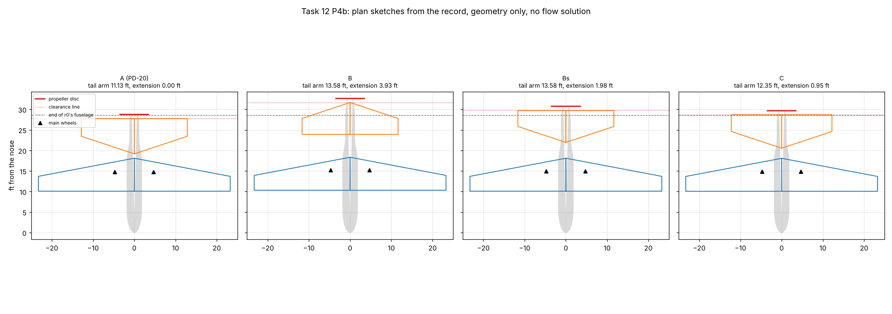
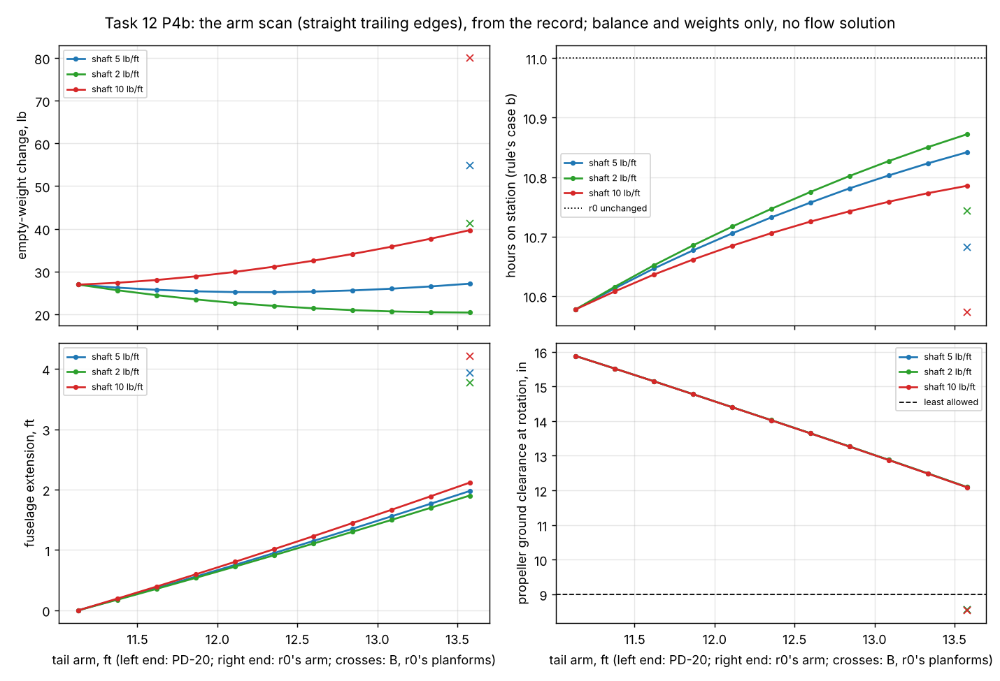

# Task 12 preliminary design P4b: tail and aft-body layout trade

Generated by `python -m prelim.p4b_trade --report-only` from `runs/task12/pd/2026-11-28/p4b/p4b.json`. Every number below is read from that record. This is a follow-up to P4 (`docs/validation/2026-11-27_task12_pd_p4.md`) and its decision PD-20; the result is decision PD-21 (`docs/specs/00_decisions.md` section 9). The choices and the selection rule are in `data/task12/pd_p4b_choices.yaml`, written before any run; nothing was tuned. r0 (`runs/task12/pd/2026-11-27/p0/r0`) and the P4 record were read and not changed: what is found here is a finding for the closing re-record r1 (PD-7).

Evidence class: **layout construction and a comparison by P4's own methods: the stability, balance, trim and rotation numbers have the evidence class of P4 (partly independent of Stage 1); the weights of the added length are Raymer's statistical equations as ratios plus an assumed shaft weight; the drag and hours are Stage 1's build-up and mission with changed wetted areas (a coding check, not a measurement)**.

**In short:** the rule chooses **Bs = arm scan row 10 (tail arm 13.577 ft)** (most hours on station).

Against PD-20 (A) the chosen layout has a fuselage 1.98 ft longer, a tail arm of 13.58 ft against 11.13 ft, a tailplane of 135.5 ft^2 against 165.2 ft^2, an empty-weight change of +27.2 lb against +26.9 lb, -0.16 h on station against -0.42 h, 0.928 of the tail-lift limit at rotation against 0.986, and 12.1 in of propeller ground clearance against 15.9 in. No layout flies with the payload off without ballast; the chosen one needs 474 lb at the payload station.

## 1. Run

- Commit `03b75ee555691e8be05152b2ba3bc1f5e25103a7`, clean tree: True; tree unchanged during the run: True. Command: `python -m prelim.p4b_trade --out runs/task12/pd/2026-11-28/p4b`. Runtime 109 s. No random numbers.
- Python 3.13.18, numpy 2.5.3, scipy 1.18.1, matplotlib 3.11.2. Input files and their sha256 are in the record (`inputs.files`).
- r0: take-off weight 3,517.3 lb, fuel 1,098.7 lb, fuselage 28.583 ft, tail arm 13.577 ft, propeller plane at 28.733 ft, CD0 at the mission altitude 0.022082, 11.000 h on station by this package's route (unchanged areas).
- Shaft: **assumed** 5 lb/ft, band 2 to 10 lb/ft. Support, not a test target: the record's power at 2030 rpm is a torque of 1,164.3 lb ft; a steel tube 3 in across with a 0.058 in wall weighs 1.82 lb/ft and carries 18,060 psi of shear against 36,000 psi allowed.

## 2. The layouts

- **A**: PD-20 as P4 recorded it: no extension, tails forward with straight trailing edges, areas grown to keep the volume coefficients
- **B**: r0's tail planforms (unswept tailplane leading edge), areas and arm; the aft fuselage lengthened by the length rule
- **Bs**: as B with straight trailing edges on both tails (PD-20's item 1), which needs a shorter extension: the smallest extension that clears the disc at r0's tail arm and areas
- **C**: straight trailing edges, the tail arm between PD-20's and r0's that gives the least empty-weight change among the arms whose payload-on rows all pass; volume coefficients kept
- Placement: every candidate: wing by P4's rule (mean static margin 0.10, independent neutral point), main wheels by the 15 deg tipback rule, nose wheel at r0's station.
- Arm scan: 11 tail arms from PD-20's to r0's, straight trailing edges. In this record Bs is row 10 and C is row 05.

## 3. The selection rule (written before the comparison)

Pool: A, B and every row of the arm scan (Bs and C are rows of it).

- 1. A layout stays only if every payload-on row passes: R13 at the full-fuel and empty-fuel centre of gravity (row 1); every payload-on loading inside the envelope (row 3); nose-wheel load of every payload-on loading inside 5 to 20 % (row 4); tail lift at rotation within the limit of 1.0; trim within its limit; overturn angle at most 63 deg; propeller ground clearance at rotation at least 9 in; both tails at least 1.0 ft ahead of the propeller plane inside the disc.
- 2. If any layout left also passes rows 3 and 4 with the payload off and no ballast, only those stay. If none does, payload-off ballast does not rank the layouts: it is reported for each and becomes an operating limit of the chosen one (PD-13).
- 3. Of those left, the one with the most hours on station on r0's fuel, with its wetted areas and with the take-off weight raised by its empty-weight change (case b). Weight and drag both act on R5, so one number carries both.
- 4. Layouts within 0.01 h of the best count as tied; the tie goes to the least empty-weight change.
- 5. If no layout passes step 1, nothing is chosen and the trade goes to the owner.
- Sensitivity: the whole trade is repeated with the shaft at 2 and at 10 lb/ft; the report says whether the choice changes.

## 4. Comparison

| Quantity | A (PD-20) | B | Bs | C |
|---|---|---|---|---|
| tail arm, ft | 11.132 | 13.577 | 13.577 | 12.354 |
| tailplane / fin area, ft^2 | 165.24 / 45.23 | 135.48 / 37.08 | 135.48 / 37.08 | 148.89 / 40.75 |
| trailing edges | straight | as r0 | straight | straight |
| wing leading edge from r0's, ft | +0.915 | +1.146 | +0.918 | +0.894 |
| fuselage extension, ft | 0.000 | 3.928 | 1.976 | 0.948 |
| fuselage length, ft | 28.583 | 32.511 | 30.559 | 29.531 |
| main wheels, ft from the nose | 14.734 | 15.145 | 14.895 | 14.793 |
| **empty-weight change, lb** | **+26.93** | **+54.79** | **+27.15** | **+25.17** |
| of which tailplane / fin, lb | +18.81 / +5.83 | +0.00 / +0.00 | -0.10 / +0.00 | +8.47 / +2.65 |
| of which fuselage with shaft / shaft alone, lb | +2.29 / 0.00 | +40.31 / 19.64 | +20.09 / 9.88 | +10.65 / 4.74 |
| of which flight controls, lb | +0.00 | +14.49 | +7.16 | +3.40 |
| wetted area: tails / fuselage / total, ft^2 | +77.30 / +0.00 / +77.30 | -0.00 / +26.04 / +26.04 | +0.00 / +12.89 / +12.89 | +34.83 / +6.08 / +40.91 |
| CD0 change at the mission altitude | +0.001186 | +0.000294 | +0.000145 | +0.000603 |
| hours on station at r0's weight and fuel (change) | 10.691 (-0.309) | 10.916 (-0.084) | 10.958 (-0.042) | 10.840 (-0.160) |
| **hours with the empty-weight change too (change)** | **10.577** (-0.423) | **10.682** (-0.318) | **10.842** (-0.158) | **10.732** (-0.268) |
| propeller ground clearance at rotation, in (at least 9) | 15.88 | 8.55 | 12.10 | 14.03 |
| same, tilted disc at the true plane, in | 16.20 | 8.87 | 12.41 | 14.34 |
| tail lift at rotation over the limit of 1 | 0.986 | 0.931 | 0.928 | 0.950 |
| largest tail lift coefficient in trim (limit 0.5) | 0.093 | 0.115 | 0.112 | 0.103 |
| static margin, full / empty fuel (R13: 0.05 to 0.15) | 0.0966 / 0.1034 | 0.1016 / 0.0984 | 0.1010 / 0.0990 | 0.0990 / 0.1010 |
| static margin over all payload-on loadings | 0.0699 to 0.1179 | 0.0646 to 0.1147 | 0.0652 to 0.1143 | 0.0673 to 0.1157 |
| payload-on loadings outside the envelope | 0 of 132 | 0 of 132 | 0 of 132 | 0 of 132 |
| nose-wheel load, payload on, % (5 to 20) | 13.9 to 15.1 | 13.3 to 14.8 | 13.6 to 15.1 | 13.7 to 15.1 |
| gear-down payload-on loadings outside the 8 to 15 % optimum | 11 | 0 | 9 | 7 |
| least tipback angle, payload on, all empty-weight factors, deg | 14.49 | 14.37 | 14.38 | 14.38 |
| largest overturn angle, payload on, deg (at most 63) | 62.53 | 62.37 | 62.48 | 62.50 |
| rearmost tail point from the propeller plane, ft (tailplane / fin) | -1.000 / -1.728 | -1.000 / -1.910 | -1.000 / -1.659 | -1.000 / -1.691 |
| row 9 on the loft (P3) | pass | pass | pass | pass |
| payload-off loadings outside the envelope | 132 of 132 | 132 of 132 | 132 of 132 | 132 of 132 |
| nose-wheel load, payload off, % | -1.5 to 4.4 | -2.1 to 4.3 | -1.9 to 4.5 | -1.8 to 4.5 |
| aftmost payload-off centre of gravity from the main wheels, ft (+ behind) | +0.204 | +0.295 | +0.263 | +0.239 |
| **ballast at the payload station for every payload-off loading, lb** | **465** | **475** | **474** | **470** |
| loadings outside the envelope with that ballast | 0 of 132 | 0 of 132 | 0 of 132 | 0 of 132 |
| ballast by P4's figure (aftmost loading only), lb | 420 | 429 | 428 | 424 |
| ballast only to bring the centre of gravity to the wheels, lb | 36 | 51 | 46 | 42 |
| tailplane area over wing area | 0.611 | 0.501 | 0.501 | 0.550 |
| tailplane root leading edge behind the wing root trailing edge, ft | 1.06 | 5.57 | 3.85 | 2.47 |
| tail arm over fuselage length | 0.389 | 0.418 | 0.444 | 0.418 |

### Rows, pass or fail

| Row | A (PD-20) | B | Bs | C | counts in step |
|---|---|---|---|---|---|
| row 1: R13 at the full-fuel and empty-fuel centre of gravity | **pass** | **pass** | **pass** | **pass** | 1 |
| row 3: every payload-on loading inside the envelope | **pass** | **pass** | **pass** | **pass** | 1 |
| row 4: nose-wheel load 5 to 20 %, payload on | **pass** | **pass** | **pass** | **pass** | 1 |
| tail lift at rotation within the limit | **pass** | **pass** | **pass** | **pass** | 1 |
| tail lift in trim within the limit | **pass** | **pass** | **pass** | **pass** | 1 |
| overturn angle | **pass** | **pass** | **pass** | **pass** | 1 |
| propeller ground clearance at rotation | **pass** | **fail** | **pass** | **pass** | 1 |
| tails 1.0 ft clear of the disc | **pass** | **pass** | **pass** | **pass** | 1 |
| row 3 with the payload off, no ballast | **fail** | **fail** | **fail** | **fail** | 2 |
| row 4 with the payload off, no ballast | **fail** | **fail** | **fail** | **fail** | 2 |

A failed row is reported, not tuned: B fails propeller ground clearance at rotation.

## 5. The arm scan

Straight trailing edges, volume coefficients kept, shaft at 5 lb/ft.

| row | tail arm, ft | tailplane, ft^2 | extension, ft | wing shift, ft | empty weight, lb | hours (a) | hours (b) | rotation / limit | propeller clearance, in | ballast, lb | all payload-on rows |
|---|---|---|---|---|---|---|---|---|---|---|---|
| 00 | 11.132 | 165.24 | 0.000 | +0.915 | +26.93 | 10.691 | 10.577 | 0.986 | 15.88 | 465 | pass |
| 01 | 11.376 | 161.69 | 0.183 | +0.907 | +26.23 | 10.724 | 10.613 | 0.976 | 15.52 | 466 | pass |
| 02 | 11.621 | 158.29 | 0.369 | +0.901 | +25.71 | 10.755 | 10.646 | 0.969 | 15.15 | 467 | pass |
| 03 | 11.865 | 155.03 | 0.558 | +0.897 | +25.36 | 10.785 | 10.677 | 0.962 | 14.78 | 468 | pass |
| 04 | 12.110 | 151.90 | 0.751 | +0.894 | +25.18 | 10.813 | 10.705 | 0.955 | 14.40 | 469 | pass |
| 05 | 12.354 | 148.89 | 0.948 | +0.894 | +25.17 | 10.840 | 10.732 | 0.950 | 14.03 | 470 | pass |
| 06 | 12.599 | 146.00 | 1.147 | +0.896 | +25.30 | 10.866 | 10.757 | 0.945 | 13.65 | 471 | pass |
| 07 | 12.843 | 143.22 | 1.350 | +0.899 | +25.57 | 10.891 | 10.781 | 0.941 | 13.27 | 471 | pass |
| 08 | 13.088 | 140.54 | 1.556 | +0.904 | +25.97 | 10.914 | 10.803 | 0.936 | 12.88 | 472 | pass |
| 09 | 13.332 | 137.97 | 1.765 | +0.910 | +26.50 | 10.937 | 10.823 | 0.932 | 12.49 | 473 | pass |
| 10 | 13.577 | 135.48 | 1.976 | +0.918 | +27.15 | 10.958 | 10.842 | 0.928 | 12.10 | 474 | pass |

Hours (a): r0's weight and fuel, the layout's wetted areas. Hours (b): the same with the take-off weight raised by the empty-weight change (the rule's number).

## 6. Selection

- Step 1 leaves 12 of 13 layouts. Step 2: 0 pass with the payload off and no ballast, so ballast does not rank the layouts.
- Steps 3 and 4: **Bs = arm scan row 10 (tail arm 13.577 ft)**, 10.842 h; tied within 0.01 h: 1.
- By empty weight alone (not the rule) the least change in the pool is C = arm scan row 05 (tail arm 12.354 ft).

The shaft band:

| shaft, lb/ft | chosen | its empty-weight change, lb | its hours (b) | A: empty-weight change, lb | A: hours (b) | C at this shaft weight |
|---|---|---|---|---|---|---|
| 2 | Bs = C = arm scan row 10 (tail arm 13.577 ft) | +20.39 | 10.872 | +26.93 | 10.577 | row 10 (arm 13.577 ft, +20.39 lb) |
| 10 | Bs = arm scan row 10 (tail arm 13.577 ft) | +39.68 | 10.785 | +26.93 | 10.577 | row 00 (arm 11.132 ft, +26.93 lb) |

## 7. Payload off and the main wheels

With the payload off the centre of gravity moves aft of the aft limit on every layout (132 of 132 loadings on the chosen one, least static margin -0.2846). It also ends +0.263 ft from the main wheels (positive: behind them). Moving the main wheels cannot cure this: the aft limit of R13 is what is broken, and wheels moved aft to 17.399 ft for payload-off tipback would ask 2.434 of the tail-lift limit at rotation and put up to 26.8 % of the weight on the nose wheel with the payload on. So the main wheels stay where the tipback rule puts them with the payload on, and flight without the payload carries ballast: **474 lb at the payload station**, with which 0 of 132 loadings are outside the envelope, the nose-wheel load is 12.9 to 14.6 % and the least tipback angle is 13.71 deg (the rule's 15 deg is set with the payload on; the rotation angle is 10 deg). This is an operating limit for P8.

## 8. Findings for r1

1. Layout for r1 (PD-21): Bs = arm scan row 10 (tail arm 13.577 ft). Tail arm 13.577 ft, tailplane 135.48 ft^2, fin 37.08 ft^2, trailing edges straight; wing leading edge at the root at 10.082 ft (+0.918 ft from r0); main wheels at 14.895 ft; nose wheel unchanged.
2. Aft fuselage for r1: lengthened by 1.976 ft to 30.559 ft; the propeller plane moves to 30.709 ft; the engine stays at r0's station and a shaft of that added length carries the propeller.
3. Weights for r1, as changes on r0 (not re-sized): horizontal tail -0.10 lb, fuselage +20.09 lb, flight controls +7.16 lb (the fuselage figure includes 9.88 lb of shaft at an assumed 5 lb/ft); empty weight +27.15 lb against +26.93 lb for PD-20.
4. Drag and hours: wetted area +12.89 ft^2, CD0 +0.000145, hours on station -0.042 h at r0's weight and fuel and -0.158 h with the empty-weight change in the take-off weight (PD-20: -0.309 and -0.423 h).
5. Rows on the chosen layout: static margin 0.1010 full and 0.0990 empty; 0 of 132 payload-on loadings outside the envelope; nose-wheel load 13.6 to 15.1 %; tail lift at rotation 0.928 of the limit (PD-20: 0.986); propeller ground clearance at rotation 12.10 in (PD-20: 15.88 in; at least 9 in).
6. Payload off: 132 of 132 loadings are outside the envelope on the chosen layout, and on every other layout of the trade. The aftmost payload-off centre of gravity is +0.263 ft from the main wheels (positive: behind). Flight without the payload needs 474 lb of ballast at the payload station to bring every payload-off loading to the aft limit (428 lb by P4's figure, which takes the aftmost loading only; 46 lb only to bring the centre of gravity to the wheels); with it 0 of 132 loadings are outside the envelope. PD-20 needs 465 lb (420 lb by P4's figure). This is an operating limit for P8 (PD-13).
7. Moving the main wheels does not remove the ballast: it is the aft limit of R13 that the payload-off loadings break. With the wheels moved to 17.399 ft for payload-off tipback, the tail would need 2.434 of its limit at rotation.
8. Tail and wing: the tailplane is 0.501 of the wing area with its root leading edge 3.85 ft behind the wing's root trailing edge (PD-20: 0.611 and 1.06 ft).
9. The shaft weight is an assumption (5 lb/ft, band 2 to 10). At the band ends the rule chooses: 2 lb/ft: Bs = C = arm scan row 10 (tail arm 13.577 ft); 10 lb/ft: Bs = arm scan row 10 (tail arm 13.577 ft).
10. For r1 and P9, not answered here: Stage 1 needs the fuselage extension, the tail arm and the tails' leading-edge sweep as inputs; the shaft, its bearings and its critical speed are not designed; the tail roots sit on a slender tail cone whose structure is not sized; the form factor and the skin-friction length of the longer body are Stage 1's unchanged; the open items of P4 (sponson, tail roots on the engine bay) stand.

## 9. Assumptions

- Everything P4 assumed stands (its report, section 'Assumptions'): stations, tanks, empty-weight band, Multhopp's fuselage term, Stage 1's trim and rotation with P2's section moment, the wing rule and the tipback rule.
- The aft fuselage is lengthened by moving the loft's last control station aft. The engine bay and the engine stay at r0's stations; moving the engine aft with the propeller was not studied (it would take the centre of gravity further aft).
- The extension is the least length that leaves 1.0 ft between the rearmost tail point inside the disc and the propeller plane (P4's clearance; a judgement there).
- The shaft weight per foot is an assumption with a band, not a number from a source. Raymer p. 221 says only that a longer offset needs a drive shaft with its own bearing support. The steel tube of section 1 is support for the band's low end; its formula and material values are taken from the library's chapter notes and the pages could not be opened in this session.
- Fuselage weight by Raymer (15.49) as a ratio: Stage 1's wetted area plus the loft's added skin, the tail arm, the length over diameter. Flight controls by (15.54) as a ratio in fuselage length, charged although the tail does not move aft with the propeller. The added fuselage weight and the shaft sit at the middle of the added length.
- The propeller, its hub and the engine weigh what r0 has; a longer shaft's bearings and frames are inside the per-foot value.
- Drag: only wetted areas change (P3's route). Form factors, interference factors and reference lengths stay Stage 1's; the lower form factor of a longer body is not credited, and no propeller or slipstream effect on the tail cone or the tails is modelled.
- Hours on station are on r0's fuel with r0's engine table; the aircraft is not re-sized. With the empty-weight change in the take-off weight, the geometry stays r0's.
- Propeller ground clearance is Stage 1's expression, as P4 used it (hub at the fuselage end, ledger rotation angle of 10 deg with a tail bumper); the tilted disc at the true propeller plane is reported beside it. The gear length is r0's.
- The arm scan stops at r0's tail arm: a longer arm than r0's was not studied.
- Ballast is at the payload station. The operating-limit figure is the largest need over every payload-off loading, rounded up to a whole pound, and is checked with P4's envelope.
- A trial of the code was run before the record, after the choices file and its selection rule were written. It changed one thing: the ballast figure for the operating limit became the largest need over all payload-off loadings (P4's figure, the aftmost loading only, is kept beside it). The rule, the shaft value and the candidates were not changed.

## 10. What this does not show

- No shaft was designed: no bearings, couplings, critical speed or torsional vibration. The per-foot weight is an assumption; the choice was repeated at its band ends (section 6).
- No flow was solved. The tail behind a longer, slender tail cone, the propeller's inflow behind the tails and the slipstream are not modelled; the drag change is wetted area only.
- The tail cone's structure, the tail roots on it, the engine's inlet and exhaust and the tail bumper are not drawn or sized.
- The aircraft was not re-sized and r0 was not changed. Take-off, climb and the other requirement rows were not re-run at the heavier weight; that is r1's work (P9).
- The methods' limits that P4 lists for PD-20 (lattice downwash at the tail, Multhopp's rule behind the wing, an isolated-surface tail lift slope) apply to every layout here; they bear least on the layouts with the tail far behind the wing.
