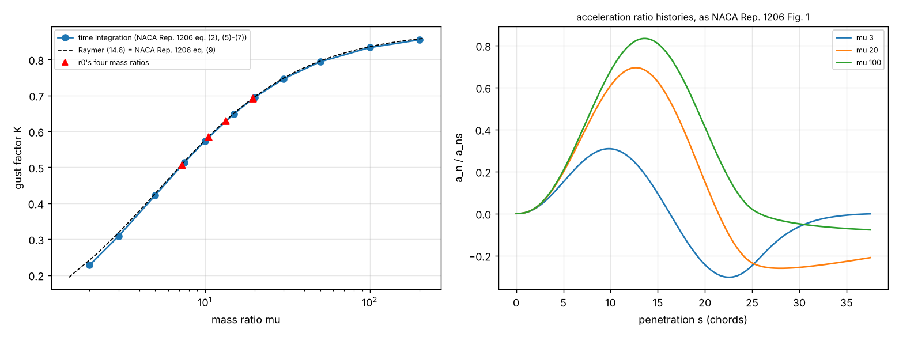
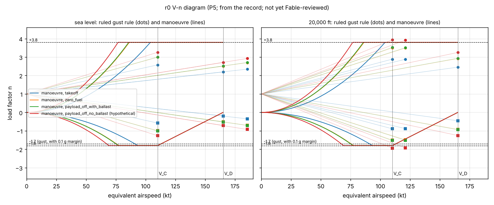
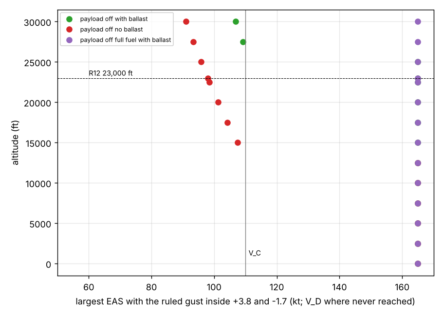

# Task 12 preliminary design P5: loads (gust second source, negative manoeuvre, V-n diagram)

**Not yet Fable-reviewed (ruling PD-22).** Run on Opus 5.5 under owner ruling PD-22 (`docs/specs/00_decisions.md` section 9); Fable reviews this diff before P9.

Generated by `python -m prelim.p5_loads --report-only` from `runs/task12/pd/2026-11-28/p5/p5.json`. Every number below is read from that record. Record made by `python -m prelim.p5_loads --out runs/task12/pd/2026-11-28/p5` at commit 2214d1e from a clean tree (git_dirty False; tree unchanged during the run: True); Python 3.13.18, numpy 2.5.3, scipy 1.18.1, matplotlib 3.11.2; no random numbers. Baseline r0: `runs/task12/pd/2026-11-27/p0/r0` (rebuilt and checked against its record). Spec: `docs/specs/task12_preliminary_design.md`, P5.

## Acceptance

| Row | What | Number | Tolerance | Evidence class | Verdict |
|---|---|---|---|---|---|
| 1 | CS 23.341(c) at Raymer's gust speed against r0's `gusts` (four points) | worst +1.31 % | ±5 % | partly independent (same physics, second text: CS-23 Amendment 4) | **pass** |
| 2 | alleviation factor by time integration against (14.6) at r0's four mass ratios | worst +0.57 % | ±5 % | independent of Raymer's text (a time integration of NACA Report 1206's plunge equation); it re-derives the factor with the model it came from, so it checks (14.6) and its use, not the model | **pass** |
| 3 | ruled rule, take-off and zero-fuel weight: gust inside +3.8 and -1.7, manoeuvre inside +3.8 and -1.8 | largest 3.504, lowest -1.504 | +3.8 / -1.7 | coding check of the ruled rule (Stage 1's own formula) with the negative manoeuvre added from measured data (P2) | **pass** |
| 4 | CS-23 gust speeds; gust held at 30 ft/s above V_C | 5.227 / -3.227; 4.841 / -2.841 | none | partly independent (second text's gust speeds); no verdict | **reported (no verdict, finding for O-2)** |
| 5 | payload off: load factors and operating limit | operating case 3.523 / -1.523 | none | coding check of the ruled rule at a lighter weight; no verdict | **reported (no verdict; operating limit for P8 under PD-13)** |

Every verdict follows from the numbers in the record; reported, not tuned. Rows 4 and 5 have no verdict by the spec.

## 1. Sources

**Step 1, the second text.** The FAA text of 14 CFR 23.333 and 23.341 before amendment 23-64 could not be opened. What was tried (2026-11-28, through the session proxy):

| Host | URL | Result |
|---|---|---|
| rgl.faa.gov | `https://rgl.faa.gov/` | CONNECT tunnel failed, response 502 (also for the FAR frameset URL) |
| drs.faa.gov | `https://drs.faa.gov/api/public/search` | HTTP 403; the site's front page loads (HTTP 200) but is a script application with no document text |
| drs.faa.gov | `https://drs.faa.gov/api/drs/data-pull` | HTTP 403 |
| www.faa.gov | `https://www.faa.gov/aircraft/air_cert/design_approvals/small_airplanes/small_airplanes_regs` | HTTP 200, an index page; no rule text was found on it |
| www.ecfr.gov | `https://www.ecfr.gov/` | CONNECT tunnel failed, response 403 (host not allowed in this environment) |
| www.govinfo.gov | `https://www.govinfo.gov/content/pkg/CFR-2016-title14-vol1/pdf/CFR-2016-title14-vol1-sec23-341.pdf` | no connection (host not allowed in this environment) |

The text used is EASA, Certification Specifications and Acceptable Means of Compliance for Normal, Utility, Aerobatic, and Commuter Category Aeroplanes, CS-23, Amendment 4, 15 July 2015 (Annex to ED Decision 2015/018/R): `https://www.easa.europa.eu/en/downloads/18858/en` (page `https://www.easa.europa.eu/en/document-library/certification-specifications/cs-23-amendment-4`), sha256 `c9bb7f4eb17a6e1c8fb510d8bab50e602596a6cd56b9c63305371cdd2ff1397c`, 409 pages, not committed. The prescriptive CS-23 before EASA's 2017 rewrite into objective rules with consensus standards. It is the EASA text, not the FAA's; that its 23.333 and 23.341 equal 14 CFR 23.333 and 23.341 before amendment 23-64 was not checked, because no FAA text could be opened (see blocked).

- CS 23.333(c)(1)(i) and (ii), printed page 1-C-2 (PDF page 31): Positive (up) and negative (down) gusts of 50 fps at V_C at altitudes between sea level and 20,000 ft, which may be reduced linearly from 50 fps at 20,000 ft to 25 fps at 50,000 ft; positive and negative gusts of 25 fps at V_D at altitudes between sea level and 20,000 ft, which may be reduced linearly from 25 fps at 20,000 ft to 12.5 fps at 50,000 ft. (iii), 66 fps at V_B, is for the commuter category only.
- CS 23.333(c)(2)(i) and (ii), printed page 1-C-2 (PDF page 31): U = (U_de/2)(1 - cos(2 pi s/(25 C))), s the distance penetrated into the gust (ft), C the mean geometric chord of the wing (ft), U_de the derived gust velocity of (c)(1); gust load factors vary linearly with speed between V_C and V_D
- CS 23.333(b)(1)-(3), printed page 1-C-2 (PDF page 31): the positive manoeuvring load factor of CS 23.337 at speeds up to V_D; the negative manoeuvring load factor of CS 23.337 at V_C; factors varying linearly with speed from the specified value at V_C to 0.0 at V_D for the normal and commuter category, and -1.0 at V_D for the aerobatic and utility categories
- CS 23.337(b)(1), printed page 1-C-4 (PDF page 33): the negative limit manoeuvring load factor may not be less than 0.4 times the positive load factor for the normal, utility and commuter categories
- CS 23.335(a)(1)(i) and (a)(3), printed page 1-C-3 (PDF page 32); added 2026-11-28 after a trial run of the code, from the same opened file: design speeds are equivalent airspeeds; V_C (in knots) may not be less than 33 sqrt(W/S) for normal, utility and commuter category aeroplanes, W/S the wing loading at design maximum take-off weight (lb/ft^2); V_C need not be more than 0.9 V_H at sea level
- CS 23.335(b)(2)(i), printed page 1-C-3 (PDF page 32): V_D may not be less than 1.40 V_C min for normal and commuter category aeroplanes
- CS 23.341(c), printed pages 1-C-4 and 1-C-5 (PDF pages 33-34): n = 1 +- k_g rho_0 U_de V a / (2 (W/S)); k_g = 0.88 mu_g/(5.3 + mu_g), the gust alleviation factor; mu_g = 2 (W/S)/(rho C a g), the aeroplane mass ratio; rho_0 sea-level density; rho density at the altitude considered; W/S the wing loading of the load case; C the mean geometric chord; V the equivalent speed; a the slope of the aeroplane normal force coefficient curve per radian (SI units in the text; the relation is dimensionless and is used here in ft, lb, s)
- CS 23.303, printed page 1-C-1 (PDF page 30): unless otherwise provided, a factor of safety of 1.5 must be used

**Step 2, the source of the factor.** NACA Report 1206 (NACA-TR-1206), A Revised Gust-Load Formula and a Re-Evaluation of V-G Data Taken on Civil Transport Airplanes From 1933 to 1950, Kermit G. Pratt and Walter G. Walker, Langley Aeronautical Laboratory, 1954: `https://ntrs.nasa.gov/api/citations/19930090988/downloads/19930090988.pdf` (NTRS 19930090988), sha256 `70f806383e262cb7652528cf212e7d2cc032d5e33f36b4508fb691c85caa3ec9`, 12 pages, not committed; 2026-11-28, curl through the session proxy (host approved by the owner); equations read from the page rendered at 250 dpi, because the text layer is a poor scan.

- Plunge equation (2), printed p. 3 (PDF page 6), left column: a_n(s)/a_ns + (1/mu_g) integral_0^s (1/2pi) C_L_alpha(s - s1) a_n(s1)/a_ns ds1 = integral_0^s (1/2pi) C_L_g(s - s1) d[u(s1)/U]/ds1 ds1 + (u(0)/U)(1/2pi) C_L_g(s); (3): a_ns = m rho S V U/(2W), the acceleration from a steady lift at the gust's largest velocity, g units; m the wing lift-curve slope per radian; (4): mu_g = 2W/(m rho c g S).
- Wagner, eq. (5), printed p. 3 (PDF page 6), right column: phi(s) = 1 - 0.165 exp(-0.09 s) - 0.335 exp(-0.6 s), s in chords.
- Kussner, eq. (6), printed p. 3 (PDF page 6), right column: psi(s) = 1 - 0.236 exp(-0.116 s) - 0.513 exp(-0.728 s) - 0.171 exp(-4.84 s).
- Both are R. T. Jones's infinite-aspect-ratio functions (NACA Rep. 681) as NACA Report 1206 prints them; printed p. 3: results with these infinite-aspect-ratio functions are probably less than 5 percent different from those with finite-aspect-ratio functions (its ref. 11).
- Gust, eq. (7), printed p. 3 (PDF page 6), right column: u(s)/U = (1/2)(1 - cos(pi s/H)) for 0 < s < 2H, 0 outside; H = 12.5 chords (the gust-gradient distance, from zero to the largest gust velocity).
- Gust factor, eq. (8) and (9), printed p. 4 (PDF page 7): K_g = largest a_n/a_ns over the penetration; K_g = 0.88 mu_g/(5.3 + mu_g) approximates the computed curve with an error less than +-0.01; the numerical solution has an error in a_n/a_ns less than +-0.005.

**Library** (cited by number and page; no book text copied): Raymer (14.4)-(14.8), p. 339, as Stage 1 codes them (`conceptual/raymer_loads.py`); Raymer (12.15), p. 270; Raymer Fig. 14.3, p. 337; Anderson APD (6.54), p. 343, with Example 6.3, p. 344 (492.4 ft/s) as the corner-speed test. The book pages were not re-opened in this session: the Anderson PDF is not in the container and the Drive connector refused the download (file over 10 MB). The test of (6.54) recomputes the printed arithmetic.

**The integration.** NACA Report 1206's eq. (2) with its exponential indicial functions turns into ordinary differential equations: the plunge velocity, one lag state per Wagner term and one per Kussner term (`prelim/p5_loads.plunge_history`). scipy's solve_ivp (DOP853, rtol 1e-10) integrates them on [0, 2H] and [2H, 3H]. Tests first (`tests/task12_pd/test_p5_loads.py`): with no lag the history equals its closed form to 1e-8; the gust factor lies within 0.015 of eq. (9) from mass ratio 3 to 200 (the report's fit error 0.01 plus its solution error 0.005), and within 0.02 of the peaks of Fig. 1 read by eye at 3, 20 and 100.

## 2. Row 1: the second text's formula at Raymer's gust speed

CS 23.341(c) has the form of Raymer (14.4)-(14.8). The one difference in what it asks for is the chord: the mean geometric chord, 5.815 ft, against Stage 1's mean aerodynamic chord, 6.094 ft. U_de 30 ft/s at V_C 110.0 kt EAS.

| Altitude | Weight | r0 `gusts` | CS-23, mean geometric chord | deviation | CS-23, mean aerodynamic chord | deviation |
|---|---|---|---|---|---|---|
| sea_level | takeoff | 2.5774 | 2.6019 | +0.95 % | 2.5774 | +0.0000 % |
| sea_level | zero_fuel | 2.9914 | 3.0306 | +1.31 % | 2.9914 | -0.0000 % |
| mission_altitude | takeoff | 2.8884 | 2.9071 | +0.65 % | 2.8884 | +0.0000 % |
| mission_altitude | zero_fuel | 3.5035 | 3.5364 | +0.94 % | 3.5035 | -0.0000 % |

Verdict **pass** (worst +1.31 % against ±5 %). With the same chord the two texts give the same number: this row shows that Stage 1 codes the rule's formula, and that the text's chord raises the load factor slightly. It does not test the physics.

## 3. Row 2: the alleviation factor from the time integration

Mass ratio by (14.8) with Stage 1's chord and lift slope at V_C; gust gradient H = 12.5 chords.

| Altitude | Weight | mu | K (14.6) | K integrated | deviation | peak at (chords) | n with (14.6) | n integrated |
|---|---|---|---|---|---|---|---|---|
| sea_level | takeoff | 10.547 | 0.5857 | 0.5839 | -0.30 % | 11.94 | 2.577 | 2.573 |
| sea_level | zero_fuel | 7.252 | 0.5084 | 0.5055 | -0.57 % | 11.38 | 2.991 | 2.980 |
| mission_altitude | takeoff | 19.527 | 0.6921 | 0.6907 | -0.21 % | 12.67 | 2.888 | 2.884 |
| mission_altitude | zero_fuel | 13.427 | 0.6310 | 0.6295 | -0.23 % | 12.25 | 3.504 | 3.498 |

Verdict **pass** (worst +0.57 % against ±5 %). The integration re-derives the factor with the model it came from (rigid, plunge only, two-dimensional lift functions); agreement checks (14.6) and its use at these mass ratios, not the model. Pitch, wing flexibility, the tail and a finite-span lift build-up are not in it.

## 4. Row 3: the ruled rule with the negative manoeuvre

Negative maximum lift: section -0.880 (P2, set 2, Re 6 million), wing -0.792 by (12.15). Positive wing C_L,max 1.35 (r0).

| Weight | W (lb) | positive corner (kt) | negative corner (kt) | negative stall at V_C | manoeuvre at V_C | manoeuvre at V_D |
|---|---|---|---|---|---|---|
| takeoff | 3,517.3 | 104.0 | 93.4 | -2.495 | 3.80 / -1.80 | 3.80 / -0.00 |
| zero_fuel | 2,418.6 | 86.2 | 77.5 | -3.628 | 3.80 / -1.80 | 3.80 / -0.00 |

The negative stall line reaches -1.8 below V_C at both weights, so the negative manoeuvre limit is reachable and the structure must carry it.

| Altitude | Speed | V EAS (kt) | U_de (ft/s) | Weight | n up | n down |
|---|---|---|---|---|---|---|
| sea_level | V_C | 110.0 | 30.0 | takeoff | 2.577 | -0.577 |
| sea_level | V_D | 165.0 | 15.0 | takeoff | 2.194 | -0.194 |
| sea_level | level_top_speed | 185.2 | 15.0 | takeoff | 2.346 | -0.346 |
| mission_altitude | V_C | 110.0 | 30.0 | takeoff | 2.888 | -0.888 |
| mission_altitude | V_D | 165.0 | 15.0 | takeoff | 2.452 | -0.452 |
| mission_altitude | level_top_speed | 120.9 | 27.0 | takeoff | 2.877 | -0.877 |
| sea_level | V_C | 110.0 | 30.0 | zero_fuel | 2.991 | -0.991 |
| sea_level | V_D | 165.0 | 15.0 | zero_fuel | 2.505 | -0.505 |
| sea_level | level_top_speed | 185.2 | 15.0 | zero_fuel | 2.696 | -0.696 |
| mission_altitude | V_C | 110.0 | 30.0 | zero_fuel | 3.504 | -1.504 |
| mission_altitude | V_D | 165.0 | 15.0 | zero_fuel | 2.920 | -0.920 |
| mission_altitude | level_top_speed | 120.9 | 27.0 | zero_fuel | 3.488 | -1.488 |

Verdict **pass**: largest 3.504 (mission_altitude, V_C, zero_fuel), margin 0.296; lowest -1.504, margin 0.196 to -1.7. This repeats the Gate B check on r0 (the V_C points equal r0's `gusts`); the new part is the negative manoeuvre.

## 5. Row 4: the second text's gust speeds, and the gust held at 30 ft/s (finding for O-2)

Limits: +3.8 / -1.8; ultimate (CS 23.303, factor 1.5) +5.70 / -2.70. No verdict (spec P5 row 4).

**CS 23.333(c) speeds (50 ft/s at V_C, 25 ft/s at V_D), CS 23.341(c) formula.**

| Altitude | Speed | V EAS (kt) | U_de (ft/s) | Weight | n up | n down | beyond limit | beyond ultimate |
|---|---|---|---|---|---|---|---|---|
| sea_level | V_C | 110.0 | 50.0 | takeoff | 3.670 | -1.670 | no | no |
| sea_level | V_D | 165.0 | 25.0 | takeoff | 3.021 | -1.021 | no | no |
| sea_level | level_top_speed | 185.2 | 25.0 | takeoff | 3.279 | -1.279 | no | no |
| mission_altitude | V_C | 110.0 | 50.0 | takeoff | 4.178 | -2.178 | positive, negative | no |
| mission_altitude | V_D | 165.0 | 25.0 | takeoff | 3.444 | -1.444 | no | no |
| mission_altitude | level_top_speed | 120.9 | 45.1 | takeoff | 4.160 | -2.160 | positive, negative | no |
| sea_level | V_C | 110.0 | 50.0 | zero_fuel | 4.384 | -2.384 | positive, negative | no |
| sea_level | V_D | 165.0 | 25.0 | zero_fuel | 3.559 | -1.559 | no | no |
| sea_level | level_top_speed | 185.2 | 25.0 | zero_fuel | 3.884 | -1.884 | positive, negative | no |
| mission_altitude | V_C | 110.0 | 50.0 | zero_fuel | 5.227 | -3.227 | positive, negative | negative |
| mission_altitude | V_D | 165.0 | 25.0 | zero_fuel | 4.244 | -2.244 | positive, negative | no |
| mission_altitude | level_top_speed | 120.9 | 45.1 | zero_fuel | 5.201 | -3.201 | positive, negative | negative |

Weight cost (Stage 1 at L_sized 11.00 h with the positive limit raised to 5.227): W0 3,834.7 lb (+317.4 lb), empty weight +253.8 lb, of which structure +247.7 lb (wing +129.9 lb); power within the engine: True. The negative values carry no weight cost: Stage 1 has no negative-load sizing.

**ruled formula, gust held at 30 ft/s above V_C.**

| Altitude | Speed | V EAS (kt) | U_de (ft/s) | Weight | n up | n down | beyond limit | beyond ultimate |
|---|---|---|---|---|---|---|---|---|
| sea_level | V_C | 110.0 | 30.0 | takeoff | 2.577 | -0.577 | no | no |
| sea_level | V_D | 165.0 | 30.0 | takeoff | 3.388 | -1.388 | no | no |
| sea_level | level_top_speed | 185.2 | 30.0 | takeoff | 3.692 | -1.692 | no | no |
| mission_altitude | V_C | 110.0 | 30.0 | takeoff | 2.888 | -0.888 | no | no |
| mission_altitude | V_D | 165.0 | 30.0 | takeoff | 3.904 | -1.904 | positive, negative | no |
| mission_altitude | level_top_speed | 120.9 | 30.0 | takeoff | 3.084 | -1.084 | no | no |
| sea_level | V_C | 110.0 | 30.0 | zero_fuel | 2.991 | -0.991 | no | no |
| sea_level | V_D | 165.0 | 30.0 | zero_fuel | 4.011 | -2.011 | positive, negative | no |
| sea_level | level_top_speed | 185.2 | 30.0 | zero_fuel | 4.393 | -2.393 | positive, negative | no |
| mission_altitude | V_C | 110.0 | 30.0 | zero_fuel | 3.504 | -1.504 | no | no |
| mission_altitude | V_D | 165.0 | 30.0 | zero_fuel | 4.841 | -2.841 | positive, negative | negative |
| mission_altitude | level_top_speed | 120.9 | 30.0 | zero_fuel | 3.761 | -1.761 | no | no |

Weight cost (Stage 1 at L_sized 11.00 h with the positive limit raised to 4.841): W0 3,747.1 lb (+229.9 lb), empty weight +183.7 lb, of which structure +179.3 lb (wing +93.9 lb); power within the engine: True. The negative values carry no weight cost: Stage 1 has no negative-load sizing.

## 6. Row 5: payload off (NR-18) and the operating limit (PD-13)

P4b found that no layout flies payload-off without ballast; its chosen layout (Bs = arm scan row 10 (tail arm 13.577 ft)) needs 474 lb at the payload station. So the **operating case** is payload off with that ballast; payload off without ballast is **hypothetical** (the aircraft is out of balance and is not flown that way).

| Case | W (lb) | W/S (lb/ft^2) | largest n up (V_C, V_D) | lowest n down (V_C, V_D) | inside +3.8 / -1.7 | lowest listed altitude where the limit is below V_C (ft) |
|---|---|---|---|---|---|---|
| payload_off_no_ballast (hypothetical) | 1,918.6 | 7.09 | 3.939 | -1.939 | False | 15,000 |
| payload_off_with_ballast (operating case) | 2,392.6 | 8.84 | 3.523 | -1.523 | True | 27,500 |
| payload_off_full_fuel_with_ballast | 3,491.3 | 12.90 | 2.899 | -0.899 | True | - |

Operating limit: the largest EAS at which the ruled gust stays inside +3.8 and -1.7 (V_D where no limit is reached).

| Altitude (ft) | payload_off_no_ballast | payload_off_with_ballast | payload_off_full_fuel_with_ballast |
|---|---|---|---|
| 0 | 165.0 | 165.0 | 165.0 |
| 2,500 | 165.0 | 165.0 | 165.0 |
| 5,000 | 165.0 | 165.0 | 165.0 |
| 7,500 | 165.0 | 165.0 | 165.0 |
| 10,000 | 165.0 | 165.0 | 165.0 |
| 12,500 | 165.0 | 165.0 | 165.0 |
| 15,000 | 107.5 (negative) | 165.0 | 165.0 |
| 17,500 | 104.3 (negative) | 165.0 | 165.0 |
| 20,000 | 101.3 (negative) | 165.0 | 165.0 |
| 22,500 | 98.5 (negative) | 165.0 | 165.0 |
| 23,000 | 97.9 (negative) | 165.0 | 165.0 |
| 25,000 | 95.8 (negative) | 165.0 | 165.0 |
| 27,500 | 93.3 (negative) | 109.2 (negative) | 165.0 |
| 30,000 | 91.0 (negative) | 106.8 (negative) | 165.0 |

## 7. Operating limits found

- Payload off is flown only with 474 lb of ballast at the payload station (P4b). With it, at 2,392.6 lb, the ruled gust stays inside the limits at V_C and V_D at sea level and 20,000 ft (3.523 / -1.523); the speed limit first falls below V_C at 27,500 ft among the listed altitudes. For P8 (EP-9).
- Without the ballast (1,918.6 lb, hypothetical) the ruled gust at V_C and V_D at sea level and 20,000 ft is 3.939 / -1.939, outside +3.8 / -1.7; the speed limit falls below V_C from 15,000 ft among the listed altitudes.
- The negative manoeuvre limit -1.8 is reachable below V_C at every weight checked; P8's load-factor command limits (EP-5) must hold it.

## 8. Findings for r1

- r1's empty weight is +27.15 lb (PD-21, P4b). With every weight raised by it and the wing unchanged, row 3's largest gust goes from 3.504 to 3.484 and the lowest from -1.504 to -1.484; row 3 on r1's weights: pass.
- Payload off with ballast: 2,392.6 lb on r0, 2,419.7 lb on r1; largest gust 3.523 to 3.503, lowest -1.523 to -1.503.
- What r1 does not change here: the plunge-only gust formula has no term for the wing's fore-and-aft position or the fuselage length; Stage 1's lift slope uses the fuselage diameter and span only. Tail gust and balancing loads are not computed (NACA Rep. 1206 assumption 5; PD-9).
- If O-2 adopts the second text's gust speeds, row 4's weight cost applies to r1 and is a re-size (PD-8).

## 9. Other findings

- CS 23.335(a)(1)(i) asks for a design cruising speed of at least 119.0 kt EAS at r0's wing loading; r0's V_C is 110.0 kt (R18, ruling B-4); the cap of (a)(3), 0.9 V_H at sea level, is 166.7 kt. By 23.335(b)(2)(i) V_D would be at least 166.6 kt against Stage 1's 165.0 kt. A finding only: R18 and ruling B-4 set V_C; CS-23 is not a requirement of this aircraft.
- CS 23.337(b)(1) asks the normal category for a negative manoeuvre factor of at least 0.4 times the positive, -1.52 here; R9's -1.8 (the utility value of Raymer Table 14.2) covers it.
- Under the second text's speeds the largest gust is 5.227 against the limit +3.8 and ultimate +5.70, and the lowest -3.227 against the limit -1.8 and ultimate -2.70. The ruled rule's 30 ft/s is Raymer's (p. 339); the second text's value at V_C is 50 ft/s. This is the O-2 question; under PD-8 the ruled rule stands.

## 10. Assumptions

- The second text is EASA CS-23 Amendment 4 (2015), not the FAA's 14 CFR Part 23: no FAA text could be opened from this environment (hosts and errors in section 1). That the two texts agree in 23.333 and 23.341 is not checked here.
- CS 23.341(c) takes the mean geometric chord (wing area over span) in the mass ratio; Stage 1 and Raymer (14.8) take the mean aerodynamic chord. Row 1 uses the text's chord as written and shows the other beside it. The lift slope in both is Stage 1's at the Mach number of the speed, as the record's `gusts` entries use it.
- The time integration is NACA Report 1206's model as printed: rigid aircraft, plunge only (no pitch), constant speed, level flight before the gust, wing lift only, gust uniform across the span; Wagner's and Kussner's functions for infinite aspect ratio, eq. (5) and (6), with the lift slope of the finite wing in the mass ratio; the one-minus-cosine gust of eq. (7) with H = 12.5 chords. The report says the infinite-aspect-ratio functions probably change the result by less than 5 %; no finite-aspect-ratio function was used.
- The alleviation factor is the largest acceleration over the gust divided by the quasi-steady sharp-edged value a_ns, as NACA Report 1206 eq. (8) defines it. The response is followed to 3H (37.5 chords) and sampled every 0.001 chord.
- The wing's negative maximum lift is 0.9 times P2's measured section value (set 2, Re 6 million, smooth, the lowest set that shows the negative stall) by Raymer (12.15), p. 270. The book states the rule for the positive stall; its use for the negative stall is an assumption.
- The negative manoeuvre envelope is Raymer Fig. 14.3, p. 337, and CS 23.333(b) for the normal category: the negative stall line down to -1.8 (R9), -1.8 to V_C, then a straight line to 0 at V_D. The positive side is the stall line capped at +3.8 up to V_D. V_D is Stage 1's, 1.5 V_C (Raymer p. 338).
- Weights are r0's nominal values. Zero-fuel weight is take-off weight less r0's fuel (the record's convention). Payload-off weights take off the 500 lb payload; the ballasted ones add P4b's ballast (the largest need over every payload-off loading of its chosen layout) at the payload station. The empty-weight band of the ledger (0.95 to 1.05) is not applied.
- The ruled gust rule (PD-8) holds U_de at 30 ft/s up to V_C at every altitude, falling to 15 ft/s at V_D and 15 ft/s above, in equivalent airspeed, as Stage 1 codes it. The operating limit is computed under that rule at the altitudes of the choices file; between two altitudes of the list it is not computed.
- Row 4 with the second text: U_de is interpolated linearly in speed between V_C and V_D (CS 23.333(c)(2)(i)) and the load factor follows from it; the text also says the load factors vary linearly between V_C and V_D, which differs slightly at the one point between them (the level top speed at 20,000 ft). Above V_D (the sea-level top speed) the V_D value, 25 ft/s, is held; the text does not cover speeds above V_D.
- The weight cost of row 4 is Stage 1 at r0's cell and loiter time with the ledger's positive limit load factor raised to the case's largest positive gust load factor at V_C and V_D. Stage 1 has no negative-load sizing, so the negative load factors carry no weight cost. The re-sized aircraft's other requirement rows were not checked.
- r1 findings: every weight raised by P4b's empty-weight change for its chosen layout, the wing unchanged; r0 is not re-sized. The plunge-only gust has no term for where the wing sits or how long the fuselage is.
- A trial of the code was run on 2026-11-28 before the record, after the sources and choices file was committed. It changed one thing: CS 23.335(a)(1)(i) (least design cruising speed), read from the same opened file, was added to the sources file and is reported as a finding. No tolerance, rule, weight or row was changed.

## 11. What this does not show

- No pitch, flexibility, tail or continuous-turbulence (power-spectral) gust response; the formula and the integration are both plunge-only.
- No tail loads, balancing loads or load distribution (P7 takes the load factors to the spar).
- No negative-load sizing of the structure: Stage 1's weights use the positive ultimate factor only.
- The FAA text was not opened; CS-23 Amendment 4 stands in for it.
- Not yet Fable-reviewed (ruling PD-22).

