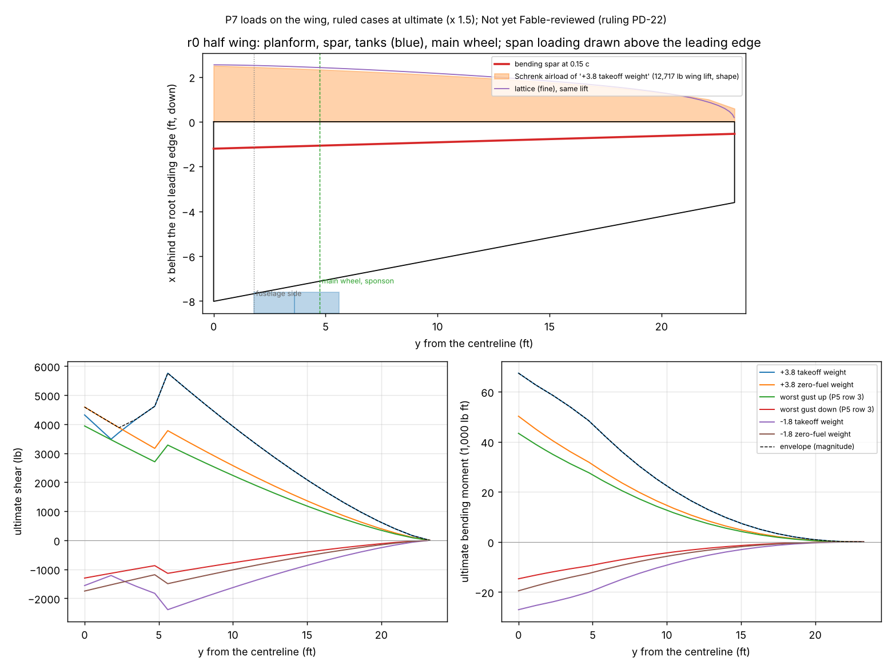
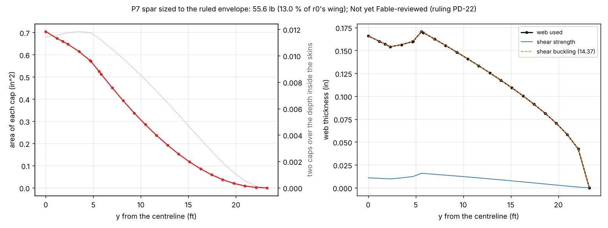

# Task 12 preliminary design P7: wing spar preliminary sizing

**Not yet Fable-reviewed (ruling PD-22).** Run on Opus 5.5 under owner ruling PD-22 (`docs/specs/00_decisions.md` section 9); Fable reviews this diff before P9.

Generated by `python -m prelim.p7_spar --report-only` from `runs/task12/pd/2026-11-28/p7/p7.json`. Every number below is read from that record. Record made by `python -m prelim.p7_spar --out runs/task12/pd/2026-11-28/p7` at commit cd01c23 from a clean tree (git_dirty False; tree unchanged during the run: True); Python 3.13.18, numpy 2.5.3, scipy 1.18.1, matplotlib 3.11.2; no random numbers. Baseline r0: `runs/task12/pd/2026-11-27/p0/r0`. Choices: `data/task12/pd_p7_choices.yaml` (decision PD-23). Spec: `docs/specs/task12_preliminary_design.md`, P7.

## Acceptance

| Row | What | Number | Tolerance | Evidence class | Verdict |
|---|---|---|---|---|---|
| 1 | airload sums to the wing lift; uniform and elliptic cantilevers against their closed forms | lift 4.4e-16; uniform 8.6e-15; elliptic 3.1e-07 (20,000 strips) | 1e-9; 1e-6 | coding check | **pass** |
| 2 | Schrenk's root bending moment against the lattice's (fine), same lift | -1.09 % | ±5 % | partly independent (the study's own vortex lattice against Schrenk's approximation, same planform) | **pass** |
| 3 | positive margin at ultimate load, caps and web, every station, every ruled case | least -2.7e-13 (governing case, zero by construction); every station sized: True | at or above 0 | coding check of the sizing (every station is sized to the envelope of the ruled cases, so the governing case is at zero margin by construction); the content is whether a sizing exists and what margin the other cases keep | **pass** |
| 4 | caps fit inside the section with the assumed skin (0.06 in) | largest share of the depth 1.18 %; least discriminant 32.6 in^2 | real root at every station | layout construction on the loft's section with an assumed skin | **pass** |
| 5 | spar weight as a share of r0's wing weight (429.4 lb) | 55.6 lb, 13.0 % | none | independent of the statistical wing weight (bottom-up spar, typical material values with a judged knock-down); no tolerance | **reported (no tolerance)** |

Every verdict follows from the numbers in the record; reported, not tuned. Row 3 is judged on the spar sized to the envelope of the ruled cases (PD-23), so its real content is that a sizing exists at every station and what margin the non-governing cases keep (section 5).

## 1. Sources

**Library** (Raymer, *Aircraft Design: A Conceptual Approach*, 2nd ed., 1992; cited by number and page, no book text copied):

- (14.9)-(14.11), p. 343: trapezoidal chord, area, elliptical chord of the same span and area; the load shape is the average of the two, scaled to the required lift and carried to the centreline (p. 342-343)
- p. 342: a trim calculation gives the tail lift, which raises or lowers the wing lift the load factor needs
- p. 381-383, Figs. 14.37-14.39: about ten to twenty stations, distributed loads as concentrated loads by the trapezoid rule of Fig. 14.39 (F = S(a + b)/2 at X = S(2a + b)/(3a + 3b) from the end of intensity b), shear summed from the tip inward, moment as the area under the shear curve
- p. 382: wing weight can be spread in proportion to chord; weights are multiplied by the load factor (Fig. 14.38)
- (14.35), p. 383: sigma = M z / I
- p. 384-385, Fig. 14.41: the caps take all the bending, the web, taken as the full spar depth, all the shear at a uniform stress
- (14.37), p. 385, with K from Fig. 14.42, p. 386
- Table 14.4, p. 368-369: typical composite properties at room temperature; p. 368 calls them typical values only

**Page check.** The pages themselves could not be opened in this session: `uv run alex page raymer-aircraft-design-conceptual 368` stops with "sources/raymer-aircraft-design-conceptual.pdf is missing", and the Drive connector refused the book's download (file over its 10 MB limit). The values below are read from the library's chapter notes (unit 13, `verified: true`), whose QA file (library/raymer-aircraft-design-conceptual/qa.md) records Table 14.4's nine rows over both pages as checked against the page image ("Correct"; only the title misprint "properues" is flagged). They were read twice on 2026-11-28 (the notes' table as text, and the same rows parsed cell by cell); both reads agree. Not from memory. A check against the printed page stays open for the Fable review (PD-22).

**Table 14.4, p. 368-369 values used** (High-strength graphite/epoxy, fibre volume 60 %, Table 14.4, p. 368-369):

| Laminate | density (lb/in^3) | F_tu(L) (psi) | F_cu(L) (psi) | F_su(LT) (psi) | E (psi) | G(LT) (psi) |
|---|---|---|---|---|---|---|
| 0 deg (caps) | 0.056 | 180,000 | 180,000 | - | 21,000,000 | - |
| +-45 deg (web) | 0.056 | - | - | 65,500 | 2,340,000 | 5,520,000 |

**[Not lib] knock-down.** 0.5 on the strengths, band 0.35 to 0.65: Judgement [Not lib]: no open source was opened for it. Raymer p. 368 calls Table 14.4 typical values; design values must also cover environment (hot and wet), impact damage, scatter (a statistical basis) and the holes and joints of a built spar. One factor of one half on the typical strengths, with the band run at both ends as a sensitivity. Allowables: caps 90,000 psi, web shear 32,750 psi. Web buckling: K = 5.5 (Fig. 14.42, p. 386, simply supported edges, long panel: 'toward about 5.5, read from the graph' in the library's notes (unit 14). Simply supported is the lower of the two curves; the web panel is taken as long (rib spacing at least the spar depth)).

**Lattice.** drone/vlm.py (the study's own vortex lattice, Task 10 rows V6a-V6c), r0's wing, trapezoidal, unswept leading edge, untwisted (drone/geometry.tapered), at 4 deg; the comparison is of the load's shape, so the angle does not matter. VSPAERO was not needed.

**Inputs.** r0: wing 270.56 ft^2, span 46.524 ft, chords 8.021 / 3.610 ft, wing weight 429.4 lb, sponsons 80.2 lb and main gear 223.0 lb at y = 4.731 ft, fuel 1,098.7 lb; factor of safety 1.5. P4 (`runs/task12/pd/2026-11-27/p4/p4.json`): layout, tanks, centre of gravity 12.174 ft full and 12.316 ft empty, wing moment -0.0729; P4's trim legs reproduce with the same function to 0.0e+00. P5 (`runs/task12/pd/2026-11-28/p5/p5.json`): load factors and speeds. Spar station 0.15 c (P3 arrangement), depth 13.45 % of the chord.

## 2. Load cases (ultimate, root values)

| Case | Kind | n | W (lb) | fuel (lb) | speed | V (kt EAS) | wing lift (lb) | tail lift (lb) | root V_ult (lb) | root M_ult (lb ft) | least cap margin | least web margin |
|---|---|---|---|---|---|---|---|---|---|---|---|---|
| +3.8 takeoff weight | ruled | 3.800 | 3,517.3 | 1,098.7 | V_D | 165.0 | 12,717 | 648 | 4,319 | 67,404 | -0.000 | 0.000 |
| +3.8 zero-fuel weight | ruled | 3.800 | 2,418.6 | 0.0 | V_D | 165.0 | 8,904 | 287 | 4,590 | 50,201 | 0.343 | 0.000 |
| worst gust up (P5 row 3) | ruled | 3.504 | 2,418.6 | 0.0 | V_C | 110.0 | 7,819 | 654 | 3,939 | 43,364 | 0.554 | 0.165 |
| worst gust down (P5 row 3) | ruled | -1.504 | 2,418.6 | 0.0 | V_C | 110.0 | -2,837 | -799 | -1,302 | -14,725 | 3.577 | 2.526 |
| -1.8 takeoff weight | ruled | -1.800 | 3,517.3 | 1,098.7 | negative_corner | 93.4 | -5,376 | -955 | -1,559 | -27,070 | 1.410 | 1.408 |
| -1.8 zero-fuel weight | ruled | -1.800 | 2,418.6 | 0.0 | negative_corner | 77.5 | -3,651 | -702 | -1,749 | -19,534 | 2.451 | 1.624 |
| CS-23 gust speeds, up (P5 row 4) | sensitivity | 5.227 | 2,418.6 | 0.0 | V_C | 110.0 | 11,488 | 1,155 | 5,744 | 63,362 | 0.064 | -0.201 |
| CS-23 gust speeds, down (P5 row 4) | sensitivity | -3.227 | 2,418.6 | 0.0 | V_C | 110.0 | -6,506 | -1,300 | -3,106 | -34,723 | 0.941 | 0.478 |
| gust held at 30 ft/s above V_C, up (P5 row 4) | sensitivity | 4.841 | 2,418.6 | 0.0 | V_D | 165.0 | 11,119 | 589 | 5,679 | 62,277 | 0.082 | -0.192 |
| gust held at 30 ft/s above V_C, down (P5 row 4) | sensitivity | -2.841 | 2,418.6 | 0.0 | V_D | 165.0 | -5,230 | -1,641 | -2,362 | -26,842 | 1.511 | 0.943 |

Every listed speed of the manoeuvre cases (the largest root moment is kept):

| Case | speed | V (kt EAS) | centre of gravity (ft) | C_L wing | C_L tail | wing lift (lb) | tail lift (lb) | root M_ult (lb ft) |
|---|---|---|---|---|---|---|---|---|
| +3.8 takeoff weight | positive_corner | 104.0 | 12.174 | 1.235 | 0.256 | 12,225 | 1,140 | 63,716 |
| +3.8 takeoff weight | V_C | 110.0 | 12.174 | 1.107 | 0.221 | 12,264 | 1,102 | 64,006 |
| +3.8 takeoff weight | V_D | 165.0 | 12.174 | 0.510 | 0.058 | 12,717 | 648 | 67,404 |
| +3.8 zero-fuel weight | positive_corner | 86.2 | 12.316 | 1.221 | 0.287 | 8,310 | 880 | 45,755 |
| +3.8 zero-fuel weight | V_C | 110.0 | 12.316 | 0.762 | 0.148 | 8,450 | 740 | 46,804 |
| +3.8 zero-fuel weight | V_D | 165.0 | 12.316 | 0.357 | 0.026 | 8,904 | 287 | 50,201 |
| -1.8 takeoff weight | negative_corner | 93.4 | 12.174 | -0.672 | -0.265 | -5,376 | -955 | -27,070 |
| -1.8 takeoff weight | V_C | 110.0 | 12.174 | -0.476 | -0.211 | -5,275 | -1,056 | -26,313 |
| -1.8 zero-fuel weight | negative_corner | 77.5 | 12.316 | -0.664 | -0.283 | -3,651 | -702 | -19,534 |
| -1.8 zero-fuel weight | V_C | 110.0 | 12.316 | -0.313 | -0.177 | -3,468 | -885 | -18,165 |

## 3. Row 1: coding checks

- Airload: in every case and speed the strip loads sum to half the wing lift; largest relative error 4.4e-16 (tolerance 1e-09).
- Uniform cantilever, 20 strips: shear 4.3e-15, moment 8.6e-15 of the root values (the trapezoid rule is exact for it).
- Elliptic loading, 20,000 strips: shear 1.3e-07, moment 3.1e-07 (tolerance 1e-06). On the run's own 23 strips: shear 4.2e-03, moment 9.2e-03; the elliptic check on the run's own stations is reported, not judged: the tolerance is for the method, on the check grid.
- Verdict **pass**.

## 4. Row 2: Schrenk against the lattice

Spanwise centre of the half-wing airload, root moment over half-wing lift (ft):

| Source | strips | centre (ft) | against Schrenk on the stations |
|---|---|---|---|
| Schrenk, the run's stations | 23 | 9.9921 | - |
| Schrenk, exact integral | - | 10.0165 | +0.24 % |
| lattice, coarse | 20 | 9.9417 | -0.50 % |
| lattice, medium | 30 | 9.9028 | -0.89 % |
| lattice, fine | 40 | 9.8830 | -1.09 % |

Verdict **pass** (-1.09 % against ±5 %); the airload used is **schrenk**. The lattice has no fuselage and no viscous effects; both are untwisted, so this compares the additional load only.

## 5. Rows 3 and 4: the spar sized to the ruled envelope

Root moment set by '+3.8 takeoff weight', root shear by '+3.8 zero-fuel weight'. Least margin of each ruled case over every station, caps and web (zero for the case that sets a station):

| Case | least margin |
|---|---|
| +3.8 takeoff weight | -0.000 |
| +3.8 zero-fuel weight | 0.000 |
| worst gust up (P5 row 3) | 0.165 |
| worst gust down (P5 row 3) | 2.526 |
| -1.8 takeoff weight | 1.408 |
| -1.8 zero-fuel weight | 1.624 |

| y (ft) | chord (ft) | depth (in) | inside skins (in) | M_ult env (lb ft) | set by | V_ult env (lb) | set by | cap area (in^2) | cap t (in) | web (in) | web set by |
|---|---|---|---|---|---|---|---|---|---|---|---|
| 0.000 | 8.021 | 12.95 | 12.83 | 67,404 | +3.8 takeoff weight | 4,590 | +3.8 zero-fuel weight | 0.7045 | 0.0732 | 0.1660 | buckling |
| 1.163 | 7.801 | 12.59 | 12.47 | 62,699 | +3.8 takeoff weight | 4,232 | +3.8 zero-fuel weight | 0.6741 | 0.0720 | 0.1601 | buckling |
| 1.786 | 7.683 | 12.40 | 12.28 | 60,437 | +3.8 takeoff weight | 4,043 | +3.8 zero-fuel weight | 0.6599 | 0.0716 | 0.1568 | buckling |
| 2.326 | 7.580 | 12.24 | 12.12 | 58,494 | +3.8 takeoff weight | 3,880 | +3.8 zero-fuel weight | 0.6474 | 0.0712 | 0.1540 | buckling |
| 3.489 | 7.360 | 11.88 | 11.76 | 53,900 | +3.8 takeoff weight | 4,177 | +3.8 takeoff weight | 0.6146 | 0.0696 | 0.1563 | buckling |
| 4.652 | 7.139 | 11.53 | 11.41 | 48,798 | +3.8 takeoff weight | 4,590 | +3.8 takeoff weight | 0.5738 | 0.0670 | 0.1596 | buckling |
| 4.731 | 7.124 | 11.50 | 11.38 | 48,437 | +3.8 takeoff weight | 4,616 | +3.8 takeoff weight | 0.5708 | 0.0668 | 0.1598 | buckling |
| 5.607 | 6.958 | 11.23 | 11.11 | 43,512 | +3.8 takeoff weight | 5,759 | +3.8 takeoff weight | 0.5250 | 0.0629 | 0.1707 | buckling |
| 5.815 | 6.918 | 11.17 | 11.05 | 42,320 | +3.8 takeoff weight | 5,668 | +3.8 takeoff weight | 0.5135 | 0.0619 | 0.1695 | buckling |
| 6.979 | 6.698 | 10.81 | 10.69 | 36,020 | +3.8 takeoff weight | 5,167 | +3.8 takeoff weight | 0.4515 | 0.0562 | 0.1625 | buckling |
| 8.142 | 6.477 | 10.46 | 10.34 | 30,296 | +3.8 takeoff weight | 4,678 | +3.8 takeoff weight | 0.3927 | 0.0505 | 0.1555 | buckling |
| 9.305 | 6.257 | 10.10 | 9.98 | 25,133 | +3.8 takeoff weight | 4,202 | +3.8 takeoff weight | 0.3373 | 0.0449 | 0.1483 | buckling |
| 10.468 | 6.036 | 9.75 | 9.63 | 20,517 | +3.8 takeoff weight | 3,738 | +3.8 takeoff weight | 0.2854 | 0.0394 | 0.1409 | buckling |
| 11.631 | 5.815 | 9.39 | 9.27 | 16,431 | +3.8 takeoff weight | 3,290 | +3.8 takeoff weight | 0.2372 | 0.0340 | 0.1333 | buckling |
| 12.794 | 5.595 | 9.03 | 8.91 | 12,858 | +3.8 takeoff weight | 2,857 | +3.8 takeoff weight | 0.1930 | 0.0287 | 0.1255 | buckling |
| 13.957 | 5.374 | 8.68 | 8.56 | 9,779 | +3.8 takeoff weight | 2,440 | +3.8 takeoff weight | 0.1528 | 0.0237 | 0.1175 | buckling |
| 15.120 | 5.154 | 8.32 | 8.20 | 7,175 | +3.8 takeoff weight | 2,042 | +3.8 takeoff weight | 0.1169 | 0.0189 | 0.1092 | buckling |
| 16.283 | 4.933 | 7.96 | 7.84 | 5,022 | +3.8 takeoff weight | 1,664 | +3.8 takeoff weight | 0.0855 | 0.0144 | 0.1005 | buckling |
| 17.446 | 4.713 | 7.61 | 7.49 | 3,296 | +3.8 takeoff weight | 1,307 | +3.8 takeoff weight | 0.0588 | 0.0104 | 0.0913 | buckling |
| 18.610 | 4.492 | 7.25 | 7.13 | 1,972 | +3.8 takeoff weight | 974 | +3.8 takeoff weight | 0.0369 | 0.0068 | 0.0814 | buckling |
| 19.773 | 4.271 | 6.90 | 6.78 | 1,019 | +3.8 takeoff weight | 669 | +3.8 takeoff weight | 0.0201 | 0.0039 | 0.0706 | buckling |
| 20.936 | 4.051 | 6.54 | 6.42 | 403 | +3.8 takeoff weight | 395 | +3.8 takeoff weight | 0.0084 | 0.0017 | 0.0582 | buckling |
| 22.099 | 3.830 | 6.18 | 6.06 | 84 | +3.8 takeoff weight | 161 | +3.8 takeoff weight | 0.0018 | 0.0004 | 0.0423 | buckling |
| 23.262 | 3.610 | 5.83 | 5.71 | 0 | +3.8 takeoff weight | 0 | +3.8 takeoff weight | 0.0000 | 0.0000 | 0.0000 | buckling |

Row 3 verdict **pass**; row 4 verdict **pass** (two caps take at most 1.18 % of the depth inside the skins).

## 6. Row 5: spar weight against the statistical wing (item 8)

Spar 55.62 lb (caps 17.99 lb, web 37.63 lb) against r0's wing 429.4 lb: 13.0 %. Heavier than the whole statistical wing: False. No tolerance (the library gives no spar share). Verdict **reported (no tolerance)**.

Each banded judgement at its band ends, one at a time (ruled envelope):

| Judgement | value | spar (lb) | caps (lb) | web (lb) | share of the wing | caps fit |
|---|---|---|---|---|---|---|
| knock_down | 0.35 | 63.39 | 25.76 | 37.63 | 14.8 % | True |
| knock_down | 0.65 | 51.45 | 13.82 | 37.63 | 12.0 % | True |
| skin_thickness_in | 0.04 | 55.75 | 17.92 | 37.83 | 13.0 % | True |
| skin_thickness_in | 0.1 | 55.35 | 18.13 | 37.22 | 12.9 % | True |
| cap_width_over_chord | 0.06 | 55.68 | 18.05 | 37.63 | 13.0 % | True |
| cap_width_over_chord | 0.15 | 55.59 | 17.96 | 37.63 | 12.9 % | True |
| spar_chord_fraction | 0.12 | 53.63 | 19.28 | 34.35 | 12.5 % | True |
| spar_chord_fraction | 0.25 | 59.37 | 16.22 | 43.15 | 13.8 % | True |

## 7. Sensitivity: the P5 row 4 cases on the ruled spar (no verdict)

| Case | least cap margin | least web margin |
|---|---|---|
| CS-23 gust speeds, up (P5 row 4) | 0.064 | -0.201 |
| CS-23 gust speeds, down (P5 row 4) | 0.941 | 0.478 |
| gust held at 30 ft/s above V_C, up (P5 row 4) | 0.082 | -0.192 |
| gust held at 30 ft/s above V_C, down (P5 row 4) | 1.511 | 0.943 |

A spar sized to carry them as well: 56.26 lb (caps 17.99 lb, web 38.27 lb), caps fit: True. A finding for O-2 (PD-8): under the ruled rule these cases are not design cases.

## 8. Findings for r1

- With P4b's layout (Bs = arm scan row 10 (tail arm 13.577 ft); PD-21), its centre of gravity (12.807 ft full, 12.819 ft empty), weights raised by 27.15 lb and P2's clean maximum lift 1.276: root ultimate moment 67,404 to 70,216 lb ft (+4.17 %), set by '+3.8 takeoff weight'; spar 55.62 to 56.79 lb (+1.17 lb); caps fit: True.
- Of that, r1's weights and maximum lift alone on r0's layout and centre of gravity give 68,092 lb ft (+1.02 %) and 55.91 lb; the rest is the layout. In '+3.8 takeoff weight' the tail lift is 648 lb on r0 and 376 lb on r1, the wing lift 12,717 and 13,093 lb (positive up).
- The lower maximum lift moves only the positive corner speed. The +3.8 cases keep their largest root moment at: +3.8 takeoff weight V_D; +3.8 zero-fuel weight V_D (r0), +3.8 takeoff weight V_D; +3.8 zero-fuel weight V_D (r1).
- P9 re-runs P7 on r1 with the same code if r1 changes the wing, its weight, the tanks or the gear station.

## 9. Other findings

- The web is set by shear buckling at 23 of the 23 stations that carry shear and makes 68 % of the spar weight: an unstiffened +-45 deg web that may not buckle is heavy. Stiffeners or a sandwich web would cut it; not sized here.
- Largest cap thickness 0.073 in; two caps take at most 1.18 % of the depth inside the skins.
- Stations set by a negative case: none. The caps are equal above and below (equal tension and compression values), so a negative case sets a station only where its moment or shear is the larger in magnitude.
- Tail trim load in '+3.8 takeoff weight': 648 lb (positive up), so the wing carries 12,717 lb of n W = 13,366 lb. A tail upload lowers the wing's share; a download would raise it.

## 10. Assumptions

- One bending spar at the P3 arrangement's front-spar station carries all the bending in its caps and all the shear in its web (Raymer p. 384-385, Fig. 14.41); the rear spar, ribs, skins and joints are not sized, and no torsion box is modelled (PD-9, PD-23).
- The spar depth is the loft's NACA 4415 depth straight up at the spar station less two skins of the assumed thickness; each cap's area is concentrated at its centroid, half a cap thickness inside the skin, and the cap is as wide as the assumed share of the local chord.
- Material values are Raymer's Table 14.4 typical values for high-strength graphite/epoxy (0 deg caps, +-45 deg web), read from the library's checked chapter notes because the printed page could not be opened in this session; the strengths are multiplied by one judged knock-down factor; the moduli are not.
- The web may not buckle at ultimate load: (14.37) with K for simply supported edges on a long panel (Fig. 14.42), the panel width the spar depth inside the skins, the modulus that of the +-45 deg laminate. The isotropic plate formula on an orthotropic laminate is an approximation. A stiffened or post-buckled web is not considered.
- Every case is balanced in pitch with P4's tail trim equation at the centre of gravity of its weight (payload on, gear up, nominal empty weight; P4 row 1), gusts included; a gust's own tail load and the pitching response are not computed (as in P5).
- The airload is Schrenk's shape over the whole span, carried to the centreline (Raymer p. 342-343), untwisted, no aileron, no basic load; the lattice row checks the shape. The fuselage's own lift and its carry-over are not modelled.
- Inertia relief: the wing weight by chord over the whole span (p. 382), the fuel in P4's two tanks a side by chord squared, full at take-off weight and none at zero-fuel weight, and the sponsons and main gear as one point load a side at r0's main-wheel half track. The fuel system and every other item give no relief.
- A manoeuvre case is evaluated at each listed speed (corner, V_C, V_D for +3.8; negative corner and V_C for -1.8) and the speed of the largest ultimate root bending moment is kept; speeds are equivalent airspeeds and the dynamic pressure is 0.5 rho_0 V^2.
- Ultimate load is limit load times r0's factor of safety (Nz_ultimate over its limit load factor). Each station is sized to the envelope of the ruled cases; caps are equal above and below because the tension and compression values are equal.
- The spar weight is the caps and web alone, integrated over the span by the trapezoid rule on the stations, across the fuselage to the centreline, with no minimum gauge, fittings, fasteners or splices: a lower bound on a built spar.
- r1 findings use P4b's chosen layout (PD-21) with its centre of gravity and weights at full and empty fuel, P5's r1 gust factors and P2's measured clean maximum lift for the positive corner speed; the wing, its weight and the tanks are r0's.
- A trial of the code was run on 2026-11-28 before the record, after the choices file was committed. It changed one thing in that file: three moduli were written 21.0e6, 2.34e6 and 5.52e6, which YAML 1.1 reads as text; they are now 21.0e+6, 2.34e+6 and 5.52e+6, the same values. No choice, tolerance, band or case was changed.

## 11. What this does not show

- Not a stress report: no rear spar, torsion box, ribs, skins, joints, fittings, fatigue, flutter or divergence (PD-9); no finite elements; no laminate design.
- No design allowables from tests: typical values times a judged knock-down. The printed Table 14.4 page was not re-opened in this session.
- No aileron, flap, roll or asymmetric case; no landing or ground loads on the wing.
- The spar weight is not a wing weight: skins, ribs, the rear spar, control surfaces and fittings make the rest of the 429.4 lb.
- Not yet Fable-reviewed (ruling PD-22).

